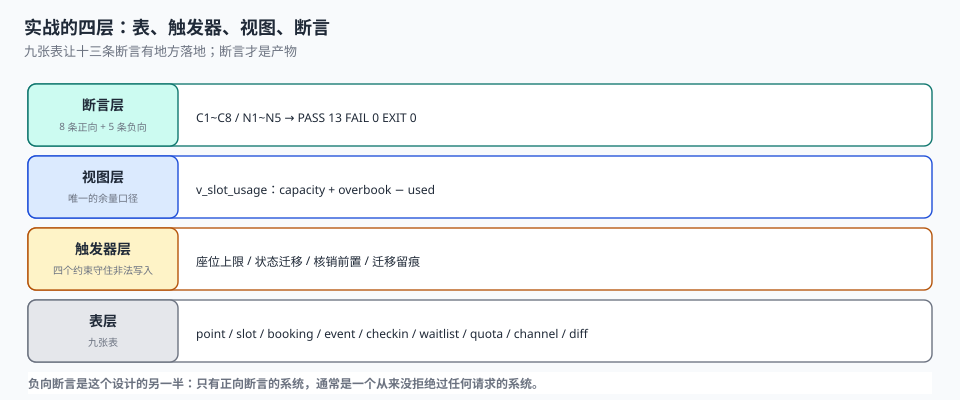

# 实战：九张表、四个触发器、十三条断言

前面九页讲的都是「应该怎样」。这一页把它们压成一份能跑的东西：九张表、四个触发器、一个视图、十三条断言，全部在一个 `:memory:` 库里建起来，跑完退出码 0。

**能被脚本判定的，才叫设计。** 一句话写在文档里，三个月后没人执行；写成一条 `SELECT` 且期望 0 行，它会一直替你检查。

::: tip 一句话理解
这一页的产物不是「代码」，是**一套判据**。九张表是为了让十三条断言有地方落地，不是为了做一个能上线的系统。
:::

## 一、为什么用 SQLite 做实战

| 理由 | 说明 |
| --- | --- |
| 零依赖 | `python3` 自带，不需要起服务、不需要装驱动 |
| 约束能力完整 | 唯一键、部分索引、`CHECK`、触发器、外键，一条不少 |
| 事务语义真实 | `BEGIN` / `SAVEPOINT` / 回滚都是真的，不是模拟 |
| 可复现 | 每天重跑，输出必须逐字一致 |



**它不是为了让读者拿去上线**，是为了让「唯一键带状态谓词」「清理要幂等」「改期要守恒」这些结论有一个可执行的验证入口。换成 PostgreSQL 或 MySQL，SQL 形态会变，判据不变。

## 二、九张表

| 表 | 承担什么 | 关键约束 |
| --- | --- | --- |
| `service_point` | 服务点（门店 / 诊室 / 场地） | 营业时间区间合法 |
| `slot` | 档期（一个资源的一段时间） | `UNIQUE(point_id, start_at)`、`end_at > start_at` |
| `booking` | 预约（含占位） | `UNIQUE(idem_key)`、部分唯一索引 `(slot_id, seat_no)` |
| `booking_event` | 状态迁移留痕（只增） | 无更新路径 |
| `checkin` | 核销事实 | 主键 = `booking_id`（幂等） |
| `waitlist` | 候补队列 | `UNIQUE(slot_id, user_id)` |
| `channel_quota` | 渠道配额 | `CHECK(used <= quota)` |
| `channel_booking` | 渠道侧镜像 | 主键 `(channel, ext_id)` |
| `recon_diff` | 对账差异台账 | `kind` 四值枚举、`handled` 状态 |

## 三、完整 DDL

```sql
CREATE TABLE service_point (
  point_id   TEXT PRIMARY KEY,
  name       TEXT NOT NULL,
  tz         TEXT NOT NULL DEFAULT 'Asia/Shanghai',
  group_id   TEXT NOT NULL,
  open_hour  INTEGER NOT NULL CHECK (open_hour BETWEEN 0 AND 23),
  close_hour INTEGER NOT NULL CHECK (close_hour BETWEEN 1 AND 24),
  CHECK (close_hour > open_hour)
);

CREATE TABLE slot (
  slot_id   TEXT PRIMARY KEY,
  point_id  TEXT NOT NULL REFERENCES service_point(point_id),
  biz_date  TEXT NOT NULL,
  start_at  TEXT NOT NULL,
  end_at    TEXT NOT NULL,
  capacity  INTEGER NOT NULL CHECK (capacity > 0),
  overbook  INTEGER NOT NULL DEFAULT 0 CHECK (overbook >= 0),
  state     TEXT NOT NULL DEFAULT 'OPEN' CHECK (state IN ('OPEN','CLOSED')),
  UNIQUE (point_id, start_at),
  CHECK (end_at > start_at)
);

CREATE TABLE booking (
  booking_id   TEXT PRIMARY KEY,
  idem_key     TEXT NOT NULL UNIQUE,
  slot_id      TEXT NOT NULL REFERENCES slot(slot_id),
  seat_no      INTEGER NOT NULL,
  user_id      TEXT NOT NULL,
  channel      TEXT NOT NULL CHECK (channel IN ('SELF','CHA','CHB')),
  state        TEXT NOT NULL DEFAULT 'HOLD'
               CHECK (state IN ('HOLD','CONFIRMED','CHECKED_IN','NO_SHOW','CANCELLED','EXPIRED')),
  created_at   TEXT NOT NULL,
  pay_deadline TEXT NOT NULL,
  moved_from   TEXT REFERENCES booking(booking_id),
  version      INTEGER NOT NULL DEFAULT 0
);
CREATE INDEX ix_booking_slot ON booking(slot_id, state);
CREATE UNIQUE INDEX ux_booking_seat ON booking(slot_id, seat_no)
  WHERE state IN ('HOLD','CONFIRMED','CHECKED_IN','NO_SHOW');

CREATE TABLE booking_event (
  event_id   INTEGER PRIMARY KEY AUTOINCREMENT,
  booking_id TEXT NOT NULL,
  from_state TEXT,
  to_state   TEXT NOT NULL,
  at         TEXT NOT NULL,
  reason     TEXT
);

CREATE TABLE checkin (
  booking_id TEXT PRIMARY KEY REFERENCES booking(booking_id),
  at         TEXT NOT NULL,
  operator   TEXT NOT NULL
);

CREATE TABLE waitlist (
  waitlist_id INTEGER PRIMARY KEY AUTOINCREMENT,
  slot_id     TEXT NOT NULL REFERENCES slot(slot_id),
  user_id     TEXT NOT NULL,
  priority    INTEGER NOT NULL DEFAULT 100,
  enqueued_at TEXT NOT NULL,
  state       TEXT NOT NULL DEFAULT 'WAITING'
              CHECK (state IN ('WAITING','NOTIFIED','PROMOTED','EXPIRED','CANCELLED')),
  notified_at TEXT,
  expire_at   TEXT,
  UNIQUE (slot_id, user_id)
);

CREATE TABLE channel_quota (
  point_id TEXT NOT NULL,
  biz_date TEXT NOT NULL,
  channel  TEXT NOT NULL,
  quota    INTEGER NOT NULL CHECK (quota >= 0),
  used     INTEGER NOT NULL DEFAULT 0 CHECK (used >= 0 AND used <= quota),
  PRIMARY KEY (point_id, biz_date, channel)
);

CREATE TABLE channel_booking (
  channel  TEXT NOT NULL,
  ext_id   TEXT NOT NULL,
  slot_key TEXT NOT NULL,
  seat_no  INTEGER NOT NULL,
  status   TEXT NOT NULL,
  PRIMARY KEY (channel, ext_id)
);

CREATE TABLE recon_diff (
  diff_id  INTEGER PRIMARY KEY AUTOINCREMENT,
  biz_date TEXT NOT NULL,
  kind     TEXT NOT NULL CHECK (kind IN ('MISSING','EXTRA','DUP','TZ')),
  channel  TEXT NOT NULL,
  ext_id   TEXT,
  note     TEXT,
  handled  TEXT NOT NULL DEFAULT 'OPEN' CHECK (handled IN ('OPEN','FIXED','IGNORED')),
  handled_at TEXT
);
```

`ux_booking_seat` 那条**部分唯一索引**是全篇最值钱的一行：它同时满足两个互相矛盾的需求——「一个座位只能有一个有效预约」和「退掉的座位要能再卖」。

## 四、四个触发器

```sql
-- T1：座位号不得超过 capacity + overbook
CREATE TRIGGER trg_booking_seat_cap BEFORE INSERT ON booking
BEGIN
  SELECT CASE
    WHEN NEW.seat_no < 1
      OR NEW.seat_no > (SELECT capacity + overbook FROM slot WHERE slot_id = NEW.slot_id)
    THEN RAISE(ABORT, 'seat_no out of capacity')
  END;
END;

-- T2：状态迁移白名单（六态五边，其余一律拒绝）
CREATE TRIGGER trg_booking_state BEFORE UPDATE OF state ON booking
WHEN NOT (
     (OLD.state = 'HOLD'       AND NEW.state IN ('CONFIRMED','CANCELLED','EXPIRED'))
  OR (OLD.state = 'CONFIRMED'  AND NEW.state IN ('CHECKED_IN','NO_SHOW','CANCELLED'))
  OR (OLD.state = 'CHECKED_IN' AND NEW.state IN ('CANCELLED'))
)
BEGIN
  SELECT RAISE(ABORT, 'illegal state transition');
END;

-- T3：只有「已确认」的预约能核销
CREATE TRIGGER trg_checkin_require_confirmed BEFORE INSERT ON checkin
BEGIN
  SELECT CASE
    WHEN (SELECT state FROM booking WHERE booking_id = NEW.booking_id) <> 'CONFIRMED'
    THEN RAISE(ABORT, 'booking not confirmed')
  END;
END;

-- T4：每次迁移留痕（追加式，不改历史）
CREATE TRIGGER trg_booking_event AFTER UPDATE OF state ON booking
BEGIN
  INSERT INTO booking_event(booking_id, from_state, to_state, at)
  VALUES (NEW.booking_id, OLD.state, NEW.state, datetime('now'));
END;
```

T2 的写法值得多看两眼：**用 `WHEN NOT (...)` 列出「所有合法的迁移」，而不是用 `WHEN (...)` 列出「所有非法的迁移」**。前者的默认值是拒绝，后者的默认值是放行——状态机这种东西，默认必须是否定。

## 五、一个视图：唯一的余量口径

```sql
CREATE VIEW v_slot_usage AS
SELECT s.slot_id, s.capacity, s.overbook,
       COALESCE(SUM(CASE WHEN b.state IN ('HOLD','CONFIRMED','CHECKED_IN','NO_SHOW')
                         THEN 1 ELSE 0 END), 0) AS used,
       s.capacity + s.overbook
       - COALESCE(SUM(CASE WHEN b.state IN ('HOLD','CONFIRMED','CHECKED_IN','NO_SHOW')
                           THEN 1 ELSE 0 END), 0) AS remaining
FROM slot s LEFT JOIN booking b ON b.slot_id = s.slot_id
GROUP BY s.slot_id;
```

**全系统只有这一个地方算余量。** 前端展示、下单校验、运营看板、对账报表，全部读这个视图。四处各写一遍的系统，出问题时你连「哪个数是对的」都判断不了。

## 六、十三条断言

| 编号 | 类型 | 断言 | 期望 |
| --- | --- | --- | --- |
| `C1` | 正向 | 余量 = 容量 + 超售 − 占用 | 违例 0 |
| `C2` | 正向 | 同档期同座位二次占座被拒 | `UNIQUE` 冲突 |
| `C3` | 正向 | 售罄档期余量为 0 | `remaining = 0` |
| `C4` | 正向 | 改期前后总占位次相等 | 9 → 9 |
| `C5` | 正向 | 重复核销被拒 | `UNIQUE` 冲突 |
| `C6` | 正向 | 递补人数不超过释放位 | 1 ≤ 1 |
| `C7` | 正向 | 差异台账四类齐全 | 行 4 类 4 |
| `C8` | 正向 | 相邻档期首尾相接，无缝不重叠 | 断点 0 |
| `N1` | 负向 | 超容量座位号被拒 | `seat_no out of capacity` |
| `N2` | 负向 | 重复幂等键被拒 | `booking.idem_key` 冲突 |
| `N3` | 负向 | 未支付的 HOLD 单不能核销 | `booking not confirmed` |
| `N4` | 负向 | 已取消的预约不能核销 | `booking not confirmed` |
| `N5` | 负向 | 非法状态迁移被拒 | `illegal state transition` |

八条正向 + 五条负向。**负向断言不是「顺手加的保护」，它们是这个设计的另一半**：正向断言证明「该发生的发生了」，负向断言证明「不该发生的被挡住了」。只有正向断言的系统，通常是一个从来没拒绝过任何请求的系统。

### 实测输出

```text
DDL 建表完成：9 张表 / 4 个触发器 / 1 个视图
档期 24 个，单档容量 3，总容量 72
种子：9 条预约 / 3 条配额 / 2 条候补
[PASS] C1 余量恒等式 违例 0
[PASS] C2 同档期同座位二次占座 被拒：UNIQUE constraint failed: booking.slot_id, booking.seat_no
[PASS] C3 售罄档期余量 remaining=0
[PASS] C4 改期守恒 改期前 9 → 改期后 9
[PASS] C5 重复核销 被拒：UNIQUE constraint failed: checkin.booking_id
[PASS] C6 递补不超释放位 释放 1 位、递补 1 人
[PASS] C7 差异四类齐全且合计一致 行 4 类 4
[PASS] C8 档期接缝无缝且不重叠 断点 0
[PASS] N1 超容量座位号 被拒：seat_no out of capacity
[PASS] N2 重复幂等键 被拒：UNIQUE constraint failed: booking.idem_key
[PASS] N3 未支付的 HOLD 单不能核销 被拒：booking not confirmed
[PASS] N4 已取消预约核销 被拒：booking not confirmed
[PASS] N5 非法状态迁移（取消后直接核销） 被拒：illegal state transition

断言：PASS 13 / FAIL 0
占用总位次 7 ｜ 事件留痕 3 条
EXIT 0
```

## 七、怎么跑

把上面四段（DDL、触发器、视图、断言）按顺序放进一个 `bk_practice.py`，直接执行：

```shell
# 1. 建库并跑断言（内存库，不落盘）
python3 bk_practice.py
# 期望：末行 EXIT 0，且「PASS 13 / FAIL 0」

# 2. 换成文件库，便于用 sqlite3 手工验证
sed -i.bak 's|sqlite3.connect(":memory:")|sqlite3.connect("ab.db")|' bk_practice.py
rm -f ab.db && python3 bk_practice.py

# 3. 看一眼留痕：三次迁移应该有三行
sqlite3 ab.db "select booking_id, from_state, to_state from booking_event;"
```

第 2 步的 `sed` 是为了让断言跑完之后库还在，可以接着用 `sqlite3` 手工查。**能跑一次的脚本只是脚本，能停下来查的库才是工具。**

::: warning 三条使用边界
1. **不要把这些表直接搬到生产**：没有分区、没有归档、没有软删除。它验证的是约束，不是容量。
2. **触发器不等于业务校验**：触发器保证「不会写出非法数据」，但不能替代「告诉用户为什么」。错误信息要由应用层翻译。
3. **断言要随业务改**：新增一种取消来源，就要新增一条 `CHECK` 取值；否则新值会被老约束静默拒绝，而报错信息与业务无关。
:::

## 八、判据

本页判据族 `BKP-A` ~ `BKP-H`，共 8 条。

| 判据 | 断言 | 验证方式 |
| --- | --- | --- |
| `BKP-A` | 九张表可一次建成 | 建库无报错，表数 = 9 |
| `BKP-B` | 四个触发器都存在且生效 | 非法插入被拒，`sqlite_master` 有 4 行 |
| `BKP-C` | 余量只有一个口径 | 全库只有一个视图算 `remaining` |
| `BKP-D` | 正向断言 8 条全 PASS | 输出 `PASS 13` |
| `BKP-E` | 负向断言 5 条全 PASS | 每条都有具体的拒绝原因 |
| `BKP-F` | 脚本退出码为 0 | `echo $?` 输出 0 |
| `BKP-G` | 重复执行结果一致 | 连跑两次输出逐字相同 |
| `BKP-H` | 断言可单独执行 | 注释掉其余断言，单条仍能判 |

## 九、下一步可以扩什么

这份实战刻意停在了「约束层」。如果要继续往前推，四个方向：

| 方向 | 加什么 | 会暴露什么问题 |
| --- | --- | --- |
| 并发 | 多线程占座 + 文件库 WAL | 唯一键冲突的错误处理路径 |
| 时间 | 假时钟 + 夏令时切换日 | 档期生成、清理任务的边界 |
| 规模 | 10 万档期 + 100 万预约 | 余量视图的性能（`GROUP BY` 会退化） |
| 对账 | 造 1% 的四类差异 | 分类算法的召回与误判 |

第三个方向最重要：`v_slot_usage` 在 4,800 个档期上毫秒级返回，到 10 万档期时会因为全表 `GROUP BY` 变成秒级。到那时必须改成「`used` 落库 + 原子更新」，而这恰恰会回到[占量与并发](../Concurrency/index.md)讲的那个取舍——**视图简单但慢，计数快但要防漏更新**。

## 参考资料

- SQLite 官方文档《CREATE TRIGGER》《Partial Indexes》《UPSERT》：本页四个触发器与部分唯一索引的语法依据。
- ISO 8601-1:2019《日期和时间 信息交换表示法 第 1 部分：基本规则》：档期时间区间的表示。
- 与本页相邻：[占量与并发](../Concurrency/index.md)、[改期与取消](../Reschedule/index.md)、[渠道同步与对账](../Reconcile/index.md)。
