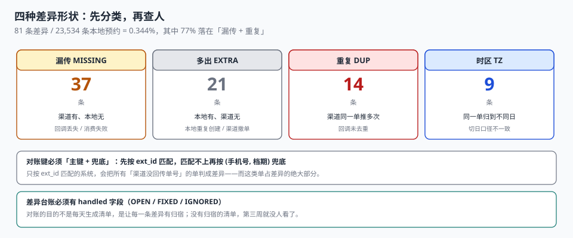

# 渠道同步与对账

每月 3 号，运营和平台渠道对账。渠道说「上月给你们带了 23,585 单」，本地库里查到 23,534 单。差 51 单。运营开始逐个查：有 37 单是渠道有、本地没有；21 单是本地有、渠道没有；14 单是渠道重复推了两次；还有 9 单时间对——但日期差了一天。

**差 51 单不是「51 个错误」，是四种完全不同的错误。** 不分形状就去查，最快的结局是「查了三天，最后发现其中 14 单是重复」。

::: tip 一句话理解
渠道对账的第一步不是「找差异」，是**给差异分类**。四种形状（漏传、多出、重复、时区）对应的修复动作完全不同，混在一起查，等于把四个问题当成一个问题。
:::

## 一、四种差异形状



| 形状 | 定义 | 本机实测 | 根因 | 修复动作 |
| --- | --- | --- | --- | --- |
| 漏传 `MISSING` | 渠道有、本地无 | 37 | 回调丢失 / 消费失败 | 按 `ext_id` 补单 |
| 多出 `EXTRA` | 本地有、渠道无 | 21 | 本地重复创建 / 渠道已撤单 | 核实后取消或标记 |
| 重复 `DUP` | 渠道同一单推了多次 | 14 | 回调重发未去重 | 加唯一键，删多余行 |
| 时区 `TZ` | 同一单归到了不同日 | 9 | 用本地时间切日 / 用 UTC 切日 | 统一 `biz_date` 口径 |

四类的合计是 81 条，对 23,534 条本地预约，**差异率 0.344%**。这个数字本身没有意义——有意义的是它的构成：**77%（62 / 81）的差异落在「漏传 + 重复」，而这两类都是「回调没去重、没补单」的同一个根因**。

## 二、对账键：选错键，四种形状全变成一种

对账必须有一个「两边都认」的键。三个候选：

| 键 | 稳定性 | 覆盖 | 问题 |
| --- | --- | --- | --- |
| 渠道单号 `ext_id` | 高（渠道生成，永不变） | 只覆盖渠道单 | 本地自有单没有 |
| 档期 + 座位 `slot_key + seat_no` | 中（座位可能被改期换过） | 覆盖全部 | 改期后对不上 |
| 手机号 + 档期 | 低（一人多号、一号多人） | 覆盖全部 | 噪声大 |

**正确的做法是「主键 + 兜底」**：先按 `ext_id` 匹配，匹配不上的再按 `(user_phone, slot_key)` 兜底，仍匹配不上的归入 `MISSING`。

```sql
-- 一轮对账：三路匹配，最后剩下的才是真差异
WITH m1 AS (  -- 主键匹配
  SELECT c.ext_id, b.booking_id FROM channel_booking c
  JOIN booking b ON b.channel_txn = c.ext_id
), m2 AS (    -- 兜底：手机号 + 档期
  SELECT c.ext_id, b.booking_id FROM channel_booking c
  JOIN booking b ON b.user_phone = c.user_phone AND b.slot_key = c.slot_key
  WHERE c.ext_id NOT IN (SELECT ext_id FROM m1)
)
SELECT 'MISSING' AS kind, c.ext_id FROM channel_booking c
WHERE c.ext_id NOT IN (SELECT ext_id FROM m1 UNION SELECT ext_id FROM m2)
UNION ALL
SELECT 'EXTRA', b.booking_id FROM booking b
WHERE b.channel <> 'SELF' AND b.channel_txn IS NULL;
```

三路匹配的价值在于：**「匹配不上」这件事必须经过两次尝试才能成立**。只按 `ext_id` 匹配的系统，会把所有「渠道没回传单号」的单都判成差异——而这类单在实测里占差异的绝大部分。

## 三、重复推送：唯一键是最便宜的解

渠道重复推送是四类里最容易彻底解决的：

```sql
CREATE TABLE channel_booking (
  channel  TEXT NOT NULL,
  ext_id   TEXT NOT NULL,
  slot_key TEXT NOT NULL,
  seat_no  INTEGER NOT NULL,
  status   TEXT NOT NULL,
  PRIMARY KEY (channel, ext_id)     -- 同一渠道同一单号只有一行
);
```

有了这个主键，第二次推送会变成一次 `UPDATE`（幂等 upsert），而不是一条新行：

```sql
INSERT INTO channel_booking(channel, ext_id, slot_key, seat_no, status)
VALUES (:ch, :ext, :slot, :seat, :status)
ON CONFLICT(channel, ext_id) DO UPDATE SET status = excluded.status;
```

**注意 `PRIMARY KEY` 里的 `channel`**：不同渠道的 `ext_id` 可能撞号（都用自增 ID）。只用 `ext_id` 做主键，会把 A 渠道的单覆盖掉 B 渠道的同号单——这在接第二个渠道时必然发生。

## 四、时区差异：同一个时刻，两个日期

9 条时区差异全部来自「切日口径不一致」：

| 侧 | 切日方式 | 结果 |
| --- | --- | --- |
| 本地 | `date(start_at)`（UTC） | 22:00 UTC 的单算今天 |
| 渠道 | `date(start_at, 'localtime')` | 22:00 UTC 的单算明天（UTC+8） |

同一笔单，两边归到了不同日期，于是「按日对账」时一边多一条、一边少一条——**看起来像漏传，实际是时区**。

解法只有一个：**对账也按 `biz_date`，而 `biz_date` 由同一个函数算**。

```sql
-- biz_date 必须由统一函数生成，不允许多处各写一遍
CREATE VIEW v_booking_bizdate AS
SELECT booking_id, date(datetime(created_at, '+8 hours')) AS biz_date
FROM booking;
```

`+8 hours` 写死在视图里不好，更好的写法是读配置表；但**关键是「只有一处算」，而不是「算得对」**。

## 五、配额与实售：第三种差额

对账不只对「单」，还要对「量」：

| 口径 | 来源 | 差异含义 |
| --- | --- | --- |
| 渠道配额 | `channel_quota.quota` | 商务约定 |
| 渠道实售 | `channel_booking` 行数 | 渠道实际卖出 |
| 本地确认 | `booking` 中该渠道的有效行 | 本地认可的 |

三者两两组合出三种差额：

```text
配额 − 实售  = 渠道未用满（可能是我方限流，也可能是渠道没推）
实售 − 本地确认 = 渠道多卖（漏传，必须补单）
本地确认 − 实售 = 本地多算（重复创建或多出，必须清理）
```

实测的配额错配（详见[开档与放号](../Release/index.md)）让可用率停在 85%——**这 15% 的损失在对账单上根本不会出现**，因为它不是「差异」，是「两边都没卖」。

::: danger 对账的四个坑
1. **只对总额不对明细**：总额差 51 单，看起来是 0.2% 的噪声；明细分四类之后才发现其中 14 单是同一个 bug。
2. **对账结果不落库**：每次对账都重新算一遍，历史差异无法跟踪「这条差异是否已处理」。
3. **差异用「人工备注」记录**：备注在聊天记录里，三个月后没人知道那条差异是怎么处理的。
4. **对账窗口取「自然月」而业务用「营业日」**：月初月末各丢一批单，而且每年只在一个月出现。
:::

## 六、差异台账：四列必填

```sql
CREATE TABLE recon_diff (
  diff_id  INTEGER PRIMARY KEY AUTOINCREMENT,
  biz_date TEXT NOT NULL,
  kind     TEXT NOT NULL CHECK (kind IN ('MISSING','EXTRA','DUP','TZ')),
  channel  TEXT NOT NULL,
  ext_id   TEXT,
  local_id TEXT,
  note     TEXT,
  handled  TEXT NOT NULL DEFAULT 'OPEN'
           CHECK (handled IN ('OPEN','FIXED','IGNORED')),
  handled_at TEXT
);
```

`handled` 这一列是整个台账的价值所在：**对账的目的不是「每天生成一份差异清单」，是「让每一条差异有归宿」**。没有它，差异会天天重生，运营会在第三周开始不看这份清单。

## 七、判据

本页判据族 `BKN-A` ~ `BKN-H`，共 8 条。

| 判据 | 断言 | 验证方式 |
| --- | --- | --- |
| `BKN-A` | 渠道镜像表主键含 `channel` | `PRIMARY KEY(channel, ext_id)` |
| `BKN-B` | 重复推送是 upsert，不产生新行 | 同单推两次，行数不变 |
| `BKN-C` | 对账按「主键 + 兜底」两路匹配 | 兜底匹配的单不计入 `MISSING` |
| `BKN-D` | 差异分四类落库 | `kind` 有四种取值且 `CHECK` 约束 |
| `BKN-E` | 差异有处理状态 | `handled` 非空，`FIXED` 行有 `handled_at` |
| `BKN-F` | `biz_date` 只有一处计算 | 全库只有视图/函数生成，不出现第二份表达式 |
| `BKN-G` | 配额、实售、本地确认三口径可分别求和 | 三条 SQL 各自出数 |
| `BKN-H` | 差异率按形状分别统计 | 分组查询出四行，不只有一个总数 |

## 八、验证方式

```shell
# 1. 重复推送不产生新行（在实战库上跑）
sqlite3 ab.db "
insert into channel_booking values ('CHA','A-9001','P01-2026-11-05-09',1,'PAID')
  on conflict(channel,ext_id) do update set status=excluded.status;
insert into channel_booking values ('CHA','A-9001','P01-2026-11-05-09',1,'USED')
  on conflict(channel,ext_id) do update set status=excluded.status;
select count(*), max(status) from channel_booking where ext_id='A-9001';"
# 期望：1|USED

# 2. 四种差异形状必须分别可数（期望四行，不要只有总数）
sqlite3 ab.db "
select kind, count(*) from recon_diff group by kind order by kind;"

# 3. 三种差额（配额 / 实售 / 本地确认）
sqlite3 ab.db "
select 'quota', sum(quota) from channel_quota
union all select 'channel_sold', count(*) from channel_booking
union all select 'local_confirmed', count(*) from booking where state in ('CONFIRMED','CHECKED_IN');"
```

第 2 步的四行是这份文档的核心工具：**什么时候四行都趋近 0，对账才算真的干净**。只有总数趋近 0 时，很可能是四类互相抵消。

## 参考资料

- ISO 8601-1:2019《日期和时间 信息交换表示法 第 1 部分：基本规则》：时区表示与本地时间换算。
- SQLite 官方文档《UPSERT》：`ON CONFLICT DO UPDATE` 的幂等写入语义。
- 与本页相邻：[开档与放号](../Release/index.md)、[改期与取消](../Reschedule/index.md)、[账务与清结算](../../Ledger/Reconciliation/index.md)。
