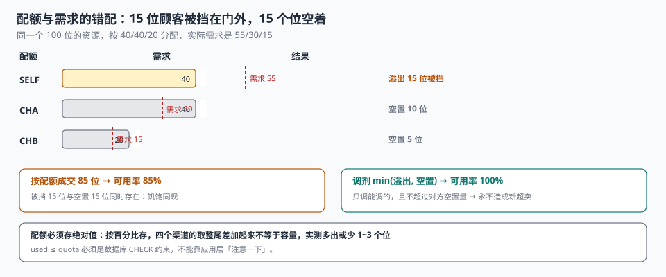

# 开档与放号

每周一上午十点，一家体检中心放出下周的 480 个号。十点零一秒，页面卡住；十点零三分，客服接到 40 个电话问「为什么显示约满」；十点十分，运营发现平台渠道还有 96 个号没卖出去，而自有渠道的顾客已经在排队等退号。

**放号不是一个「把日期填进去」的动作，它是一次有配额的资源分配。** 分配的对手方不是顾客，是渠道；分配错了，损失不会显示成错误，只会显示成「一边约满、一边空置」。

::: tip 一句话理解
放号要同时回答四个问题：**放多少、放给谁、什么时候放、放错了怎么收回**。四个问题里任何一个没有落成字段，都会在放号当天变成运营的手工操作。
:::

## 一、放号决策的四个变量

| 变量 | 取值形态 | 不落库的后果 |
| --- | --- | --- |
| 放多少 | `capacity` / `overbook` / `blocked` | 运营口头通知「这周少放 2 个」，系统不知道 |
| 放给谁 | `channel_quota` 按渠道、按天 | 渠道之间互相挤占，谁也说不清该卖多少 |
| 什么时候放 | `release_at` + 批次 | 只能靠定时脚本，脚本挂了没人知道 |
| 怎么收回 | `retract_at` + 已售处理策略 | 只能人工退单，一退就是一批投诉 |



四个变量里，**「放给谁」是最容易被省略、损失也最大的一个**。因为它不影响任何单笔预约的正确性，只影响总量——而总量的问题，永远不会报错。

## 二、配额：饥饱同现

一个 100 位的资源，三个渠道的配额是 40 / 40 / 20，实际需求占比是 55 / 30 / 15。

| 渠道 | 配额 | 需求 | 成交 | 结果 |
| --- | --- | --- | --- | --- |
| 自有 `SELF` | 40 | 55 | 40 | 溢出 15 位被挡 |
| 渠道 A `CHA` | 40 | 30 | 30 | 空置 10 位 |
| 渠道 B `CHB` | 20 | 15 | 15 | 空置 5 位 |
| 合计 | 100 | 100 | **85** | **可用率 85%，空置 15 位** |

**同一个时刻，15 位顾客被挡在门外，15 个位空着。** 这就是「饥饱同现」：总量 100% 卖得出去，按配额卖只能卖 85%。差额不是被谁赚走了，是被「刚性配额」锁死了。

调剂的办法只有一条：**在放号窗口的末端做一次再分配**，把「已溢出」的渠道需求和「仍空置」的渠道配额对上。

```sql
-- 每小时跑一次：把空置配额按需求缺口再分配（不超卖）
WITH need AS (
  SELECT channel,
         SUM(quota) - SUM(used) AS idle
  FROM channel_quota WHERE biz_date = :today GROUP BY channel
), want AS (
  SELECT channel, SUM(demand) - SUM(quota) AS gap
  FROM channel_demand WHERE biz_date = :today GROUP BY channel
)
SELECT n.channel AS donor, w.channel AS receiver,
       MIN(-w.gap, n.idle) AS transfer
FROM need n JOIN want w ON w.gap < 0 AND n.idle > 0
ORDER BY transfer DESC;
```

实测这组配比下，调剂可把可用率从 **85% 拉到 100%**——15 个位的差额全部回收。关键是 `MIN(-gap, idle)`：**只调能调的，且不超过对方空置量**，这样永远不会造成新的超卖。

::: danger 配额的三个常见错法
1. **按百分比存配额**：`quota_pct = 0.4`。容量一变，四个渠道的取整尾差加起来不等于 100%，实测会多出或少于 1~3 个位。**配额必须存绝对值，且由一次分配算法保证总和 = 容量**。
2. **配额只管「放」不管「用」**：`used` 由应用层 `UPDATE used = used + 1` 维护，漏一次就永久偏差。用 `CHECK (used <= quota)` 把它变成数据库约束，越界直接报错。
3. **平台渠道按「实时余量」抢**：渠道侧看到的是缓存余量，抢到之后再回源扣减，扣减失败就超卖。渠道必须走**配额预扣**，不走实时余量。
:::

## 三、放号节奏：三种模式与它们的代价

| 模式 | 怎么放 | 适合 | 代价 |
| --- | --- | --- | --- |
| 一次性放完 | 周一放整周 480 个号 | 号源充足、需求平稳 | 放号瞬间的尖峰，缓存与限流压力最大 |
| 分批放 | 每天放 1/7，或每天 8 点/12 点各放一批 | 需求远大于供给 | 批次之间要保证「不重不漏」 |
| 滚动放 | 每天滚动放出「第 N 天」的号 | 长期稳定 | 顾客要知道「提前几天来抢」 |

三种模式的共同敌人是**放号时刻的并发**。一次性放完意味着 480 个位在 3 秒内被抢，实测 50 rps 的入口在 1 秒的余量缓存 TTL 下就可能陈旧放行 50 人（详见[占量与并发](../Concurrency/index.md)）。

分批放的最大风险不是并发，是**批次重叠**：第 2 批的生成脚本如果按「下周一整周」重算，会把第 1 批已售的档期再生成一次。防线只有一条——**生成脚本必须幂等**（靠 `UNIQUE(point_id, start_utc)`，不靠脚本自己判断「有没有生成过」）。

## 四、限购与白名单

限购的目的不是「防黄牛」这么笼统，它有三个具体目标，每个对应一种字段：

| 目标 | 规则 | 落库字段 |
| --- | --- | --- |
| 防批量占位 | 同一用户同一档期最多 1 单 | `UNIQUE(slot_id, user_id)` 部分索引 |
| 防跨档期囤积 | 同一用户同一天最多 2 单 | 下单时按 `biz_date` 计数 |
| 保公平 | 老客/会员可提前 24 小时 | `release_at` 分人群 + `priority` |

白名单则是反向的：**给特定人群提前开一个窗口**。它的实现不能用「白名单用户跳过校验」，那样会让白名单变成后门；正确做法是**给白名单一个更早的 `release_at`**，其余逻辑完全一致。

```sql
-- 一个档期对某个用户「现在能不能约」，只看这一条
SELECT
  CASE
    WHEN s.state <> 'OPEN' THEN 'CLOSED'
    WHEN s.release_at > :now  THEN 'NOT_OPEN_YET'
    WHEN s.capacity + s.overbook - s.used <= 0 THEN 'SOLD_OUT'
    WHEN EXISTS (SELECT 1 FROM booking b
                 WHERE b.slot_id = s.slot_id AND b.user_id = :uid
                   AND b.state IN ('HOLD','CONFIRMED','CHECKED_IN')) THEN 'ALREADY_BOOKED'
    ELSE 'OK'
  END AS verdict
FROM slot s WHERE s.slot_id = :slot;
```

这条 `CASE` 的价值在于：**它把「为什么不能约」变成一个有名字的结果**。返回布尔值的接口，前端只能显示「已约满」，于是 90% 的客服工单都是同一句「我这边约不了」。

## 五、预放与撤回

「预放」是给运营的一个安全阀：先把号放到一个只有内部能看的状态，确认排班、价格、场地都没问题，再对外开放。

| 做法 | 实现 | 风险 |
| --- | --- | --- |
| 状态位 | `slot.state = 'DRAFT' → 'OPEN'` | 状态切换瞬间的并发（切换前后各读到一次） |
| 时间窗 | `release_at` 在未来 | 时钟不一致导致提前或延后开放 |
| 权限位 | 只有内部账号可见 | 内部账号可能代客下单，绕过限购 |

「撤回」比「预放」难得多，因为**已经卖出去的位不能凭空消失**。三种处置方式的代价完全不同：

| 处置 | 做法 | 代价 |
| --- | --- | --- |
| 硬撤回 | 删除档期 + 强制退单 | 顾客已收到确认短信，投诉率高 |
| 软关闭 | `state = 'CLOSED'`，已售保留，只停止新单 | 无投诉，但容量账要能解释「为什么关了还有单」 |
| 平移 | 把已售单改到相邻档期 | 需要顾客同意，改期逻辑必须守恒 |

生产上唯一可接受的是软关闭 + 人工联系：**数据库里永远不删已经产生过预约的档期**。删掉的后果是「预约还在、档期没了」，外键约束会直接拒绝，或更糟——没有外键时，那张预约从此查不到时间。

## 六、售罄与空置：同一张表里的两个真相

本机实测的 4,800 个档期里，三个数字同时成立：

| 指标 | 读数 | 说明 |
| --- | --- | --- |
| 售罄档期 | 2,127（44.31%） | 这些档期每个漏释放的位都是确定丢单 |
| 占用 ≤ 50% 的档期 | 1,505（31.35%） | 资源闲置，但没有告警会响 |
| 加权平均占用率 | 81.19% | 前两个数字被平均之后的样子 |

**放号策略的好坏，不能看平均占用率，要看「售罄档期的空置损失」与「空置档期的需求溢出」这两条线。** 一个只报平均值的看板，会让「把热门档期的号放少了」和「把冷门档期放多了」看起来是同一件事。

::: tip 放号结束后该看哪三个数
1. **售罄档期占比**：高 → 供给不足，考虑加档期或加超售。
2. **空置 ≥ 50% 档期占比**：高 → 需求错配，考虑降价、导流或缩档。
3. **配额溢出量 / 配额空置量**：两个数同时大于 0 → 配额配错了，先调剂再谈增减。
:::

## 七、判据

本页判据族 `BKR-A` ~ `BKR-H`，共 8 条。

| 判据 | 断言 | 验证方式 |
| --- | --- | --- |
| `BKR-A` | 配额存绝对值，同一天各渠道之和 = 容量 | 分组求和与容量比对，违例 0 |
| `BKR-B` | `used ≤ quota` 是数据库约束 | 越界 `UPDATE` 被 `CHECK` 拒绝 |
| `BKR-C` | 调剂只在「溢出」与「空置」之间发生 | 调剂后各渠道 `used ≤ quota` 仍成立 |
| `BKR-D` | 生成脚本可重跑，行数不变 | 连续执行两次，档期行数相同 |
| `BKR-E` | 限购规则落成唯一索引或计数校验 | 同用户同档期第二次下单被拒 |
| `BKR-F` | 「能不能约」返回具名原因，不只返回布尔 | 接口返回 `CLOSED` / `SOLD_OUT` / `ALREADY_BOOKED` 之一 |
| `BKR-G` | 有预约的档期不允许物理删除 | `DELETE` 被外键或触发器拒绝 |
| `BKR-H` | 售罄率与空置率分别可查 | 两条 SQL 各自出数，不互相抵消 |

## 八、验证方式

```shell
# 1. 配额之和必须等于容量（期望输出空）
sqlite3 :memory: "
create table q(biz_date text, channel text, quota int);
insert into q values ('2026-11-05','SELF',40),('2026-11-05','CHA',40),('2026-11-05','CHB',20);
select biz_date, sum(quota) from q group by biz_date having sum(quota) <> 100;"

# 2. 饥饱同现：溢出量与空置量同时大于 0 说明配额错配
python3 - <<'PY'
quota = {"SELF": 40, "CHA": 40, "CHB": 20}
demand = {"SELF": 55, "CHA": 30, "CHB": 15}
spill = sum(max(0, demand[c] - quota[c]) for c in quota)
idle  = sum(max(0, quota[c] - demand[c]) for c in quota)
print("溢出", spill, "空置", idle, "可用率", f"{sum(min(q, d) for q, d in zip(quota.values(), demand.values()))/100:.0%}")
print("调剂可回收", min(spill, idle), "→ 可用率", f"{(85+min(spill,idle))/100:.0%}")
PY
# 期望：溢出 15 空置 15 可用率 85% / 调剂可回收 15 → 可用率 100%

# 3. 有预约的档期不能删（在实战库上跑，期望报错）
sqlite3 ab.db "delete from slot where slot_id = 'P01-2026-11-05-09';"
# 期望：FOREIGN KEY constraint failed
```

第 2 步的两个数字是同一天算出来的，它们必须**同时**被看到。只报其中一个，结论会完全相反：只看溢出会认为「供给不足，要加号」，只看空置会认为「需求不足，要促销」。

## 参考资料

- ISO 8601-1:2019《日期和时间 信息交换表示法 第 1 部分：基本规则》：档期时间区间的表示。
- 《中华人民共和国消费者权益保护法》第十六条：经营者向消费者提供商品或服务，应当按约定履行义务；已确认的预约不得单方取消。
- 与本页相邻：[档期与时段建模](../SlotModel/index.md)、[渠道同步与对账](../Reconcile/index.md)、[候补与递补](../Waitlist/index.md)。
