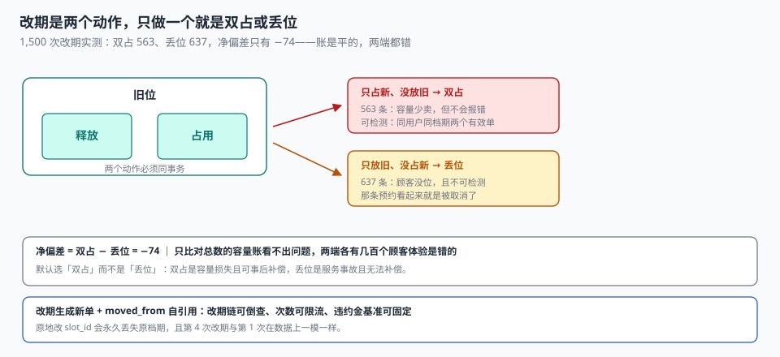

# 改期与取消

一位顾客把周四 10:00 的预约改到周五 15:00。操作成功了，短信也发了。但周四那个位从此显示「已占」——因为改期的代码只写了「占新位」，没有写「放旧位」。三天后店长看容量账，发现周四整天满档，实际到店只有六成。

**改期是预约系统里唯一一个「一次操作要动两个位」的动作。** 它天然跨两个资源实例、天然需要事务、天然在失败时留下两种半成品：双占（旧位没放）和丢位（新位没占但旧位放了）。

::: tip 一句话理解
改期不是「修改一个字段」，是**释放旧位 + 占用新位这一对动作**。凡是把它写成一条 `UPDATE slot_id` 的实现，都会在失败时留下一个双占或一个丢位——而两者都不会报错。
:::

## 一、改期的三种写法

| 写法 | 顺序 | 失败时留下什么 | 可接受度 |
| --- | --- | --- | --- |
| 先占新、后放旧 | `INSERT` 新 → `UPDATE` 旧为取消 | 新位占了、旧位没放 → **双占** | 中（少卖但不多卖） |
| 先放旧、后占新 | `UPDATE` 旧为取消 → `INSERT` 新 | 旧位放了、新位没占 → **丢位** | 差（顾客没位） |
| 同一事务，先占后放 | 一个事务里两次写 | 全部回滚，无半成品 | 好 |



三种写法的差别不在正确路径（都能改成功），而在**失败路径**。本机实测 1,500 次改期，两种错误路径的发生量几乎一样：

| 错误 | 含义 | 实测条数 |
| --- | --- | --- |
| 双占 | 只占新、没放旧 | 563 |
| 丢位 | 只放旧、没占新 | 637 |
| 净偏差 | 563 − 637 | **−74** |

**净偏差只有 −74，看起来「几乎没有偏差」。** 这正是最危险的地方：如果容量账只比对总数，563 个双占和 637 个丢位会互相抵消，账是平的，而两端各有几百个顾客体验是错的。

## 二、为什么「先占新后放旧」是更好的默认

如果事务无法覆盖两步（例如跨库、跨服务），必须选一种半成品，选「双占」而不是「丢位」，理由有三条：

1. **双占是容量损失，丢位是服务事故。** 双占让一个位卖不出去，丢位让一个已确认的顾客没有位。
2. **双占可以事后补偿**（跑一次「已取消但未释放」的对账），丢位无法补偿（顾客已经在路上了）。
3. **双占在数据上可检测**（同一用户同一时刻两个有效单），丢位不可检测（那条预约看起来就是被取消了）。

```sql
-- 可检测：同一用户在同一时刻有两个有效预约
SELECT user_id, slot_id, COUNT(*) FROM booking
WHERE state IN ('HOLD','CONFIRMED','CHECKED_IN')
GROUP BY user_id, slot_id HAVING COUNT(*) > 1;
```

这条 SQL 是改期功能的「体检项」：**有行 = 有双占**。

## 三、moved_from：改期链要能倒着走

改期最常见的实现是「原地改 `slot_id`」，它有三个问题：

| 问题 | 后果 |
| --- | --- |
| 原档期信息丢失 | 无法回答「这一单原本约的是几点」 |
| 改期次数无法统计 | 黄牛反复改期囤位，系统看不见 |
| 违约金无法计算 | 按「原始预约时间」还是「本次改期时间」算，没有依据 |

正确做法是**新开一单 + 自引用 `moved_from`**：

```sql
CREATE TABLE booking (
  booking_id TEXT PRIMARY KEY,
  moved_from TEXT REFERENCES booking(booking_id),  -- 由哪一单改来
  move_seq   INTEGER NOT NULL DEFAULT 0,           -- 第几次改期
  ...
);
```

这样「改期链」就是一条可回溯的链表：

```sql
-- 从当前单倒查原始预约
WITH RECURSIVE chain(booking_id, moved_from, lvl) AS (
  SELECT booking_id, moved_from, 0 FROM booking WHERE booking_id = :current
  UNION ALL
  SELECT b.booking_id, b.moved_from, chain.lvl + 1
  FROM booking b JOIN chain ON b.booking_id = chain.moved_from
)
SELECT * FROM chain ORDER BY lvl DESC;
```

`move_seq` 则是限流的抓手：**同一用户 30 天内改期超过 3 次，进入人工审核**。没有这个字段，「反复改期囤热门位」这件事在数据上完全隐形。

::: danger 改期的四个坑
1. **原地改 `slot_id`**：旧位不会自动释放（除非代码显式写），而且原档期信息永久丢失。实测双占 563 条，全部来自这种写法。
2. **改期不校验新位余量**：只在同一天内改，觉得「反正总量没变」。跨档期改期时，新档期可能是满的。
3. **取消不退配额**：改期释放的位没有把 `channel_quota.used` 减回去，渠道侧从此少一个额度可用。
4. **违约金按「当前时间」算**：顾客把预约改到明天再取消，违约金从「距离开场 5 分钟」算成「距离明天 30 小时」，白退一笔钱。
:::

## 四、违约金阶梯：按「距离开始的时间」分档

阶梯的本质是**用价格把「临时取消的外部性」内部化**：商家越晚知道，损失越大。

| 距离开始 | 取消政策 | 依据 |
| --- | --- | --- |
| > 24 小时 | 全额退 | 商家有充分时间再卖 |
| 2~24 小时 | 退 50% 或改期一次 | 再卖概率显著下降 |
| < 2 小时 | 不退 | 位基本无法再卖 |
| 已开始 / 未到店 | 不退，且记爽约 | 已产生服务成本 |

实现上还有几处最容易漏：

```sql
-- 违约金按「该预约所属档期的开始时刻」算，不按当前时间
SELECT
  CASE
    WHEN julianday(s.start_at) - julianday(:cancel_at) > 1.0  THEN 0.00
    WHEN julianday(s.start_at) - julianday(:cancel_at) > 2.0/24 THEN 0.50
    ELSE 1.00
  END AS penalty_rate
FROM slot s JOIN booking b ON b.slot_id = s.slot_id
WHERE b.booking_id = :booking;
```

1. **基准是档期开始时刻**，不是「预约创建时刻」，也不是「本次改期时刻」。
2. **比例与金额分列存**：`penalty_rate` 与 `penalty_amount` 都要落库，否则退款金额改了规则之后无法复算。
3. **阶梯必须可配置且带版本号**：政策一年改两次，历史订单必须按当时的政策算。

## 五、取消的三个来源

| 来源 | 触发 | 是否计违约金 | 是否释放配额 |
| --- | --- | --- | --- |
| 顾客取消 | 用户操作 | 按阶梯 | 是 |
| 商家取消 | 停诊、设备故障、人员不足 | 否，且应补偿 | 是，且应主动通知 |
| 系统取消 | 超时未付、支付失败、风控拦截 | 否 | 是 |

三者必须在数据上分开（`cancel_source`），因为它们**对运营指标的意义完全不同**：商家取消率高说明供给不稳定，系统取消率高说明支付链路有问题，顾客取消率高说明需求不稳或提醒不到位。合成一个「取消率」，三个问题变成一个数。

## 六、跨资源组改期

「从城西店改到城东店」比「同店改时间」多两个约束：

| 约束 | 说明 | 校验方式 |
| --- | --- | --- |
| 服务项目一致 | 城东店可能没有这个项目 | 项目-门店关联表存在性 |
| 价格可能不同 | 不同门店定价不同 | 改期时重算应收，差额补退 |
| 服务人员资质 | 新门店的技师可能不会这个项目 | 资质-项目关联 |

第二条最容易漏：改期时只改了 `slot_id`，金额没重算，顾客按旧价在新门店消费，月底结算时门店之间对不上账。

```sql
-- 改期时重算应收，差额单独记一笔（不退到原支付渠道，走余额）
SELECT :new_price - b.paid_amount AS diff FROM booking b WHERE b.booking_id = :old;
```

**差额走余额而不是原路退**，是因为原路退会产生一笔新交易（手续费、对账、发票红冲），而余额只动一张表。这个选择不是技术偏好，是成本选择。

## 七、判据

本页判据族 `BKG-A` ~ `BKG-H`，共 8 条。

| 判据 | 断言 | 验证方式 |
| --- | --- | --- |
| `BKG-A` | 释放旧位与占用新位在同一事务 | 人为让第二步失败，第一步回滚 |
| `BKG-B` | 改期后总占位次不变（守恒） | 改期前后 `SUM(used)` 相等 |
| `BKG-C` | 改期生成新单，`moved_from` 指向旧单 | 旧单状态为 `CANCELLED`，新单有 `moved_from` |
| `BKG-D` | 同一用户同一档期无双有效单 | 双占检测 SQL 返回 0 行 |
| `BKG-E` | 改期次数 `move_seq` 可统计并可限流 | 第 4 次改期被拒或进审核 |
| `BKG-F` | 违约金以档期开始时刻为基准 | 构造「改到明天再取消」用例，仍按原档期算 |
| `BKG-G` | 取消来源分三类存 | `cancel_source` 有 `USER` / `MERCHANT` / `SYSTEM` |
| `BKG-H` | 跨门店改期重算金额并留差额记录 | 差额写入 `balance_txn`，金额可复算 |

## 八、验证方式

```shell
# 1. 改期守恒：改期前后总占位次必须相等（在实战库上跑）
sqlite3 ab.db "
select sum(capacity+overbook) - count(*) from booking
 where state in ('HOLD','CONFIRMED','CHECKED_IN','NO_SHOW') and slot_id in
       (select slot_id from booking);
begin;
update booking set state='CANCELLED' where booking_id='B007';
insert into booking(booking_id,idem_key,slot_id,seat_no,user_id,channel,state,created_at,pay_deadline,moved_from)
values ('B012','k-B012','P01-2026-11-06-10',1,'U7','SELF','HOLD','2026-11-04 12:00:00','2026-11-04 12:15:00','B007');
commit;
select sum(capacity+overbook) - count(*) from booking
 where state in ('HOLD','CONFIRMED','CHECKED_IN','NO_SHOW') and slot_id in
       (select slot_id from booking);"
# 期望：两次相同

# 2. 双占检测（期望 0 行）
sqlite3 ab.db "
select user_id, slot_id, count(*) from booking
where state in ('HOLD','CONFIRMED','CHECKED_IN')
group by user_id, slot_id having count(*) > 1;"

# 3. 改期链可回溯（期望列出 2 行：B007 与 B012）
sqlite3 ab.db "
with recursive chain(booking_id, moved_from, lvl) as (
  select booking_id, moved_from, 0 from booking where booking_id='B012'
  union all
  select b.booking_id, b.moved_from, chain.lvl+1
  from booking b join chain on b.booking_id = chain.moved_from)
select booking_id, lvl from chain order by lvl desc;"
```

第 1 步两个相等的数字就是「守恒」的全部意思。**如果第二次比第一次大，说明出现了双占；小，说明丢了位。** 只跑一次是看不出方向的。

## 参考资料

- 《中华人民共和国民法典》第五百六十三条、第五百八十五条：合同解除与违约金约定。
- ISO 8601-1:2019《日期和时间 信息交换表示法 第 1 部分：基本规则》：时间差计算与时间区间表示。
- 与本页相邻：[占位与支付](../Hold/index.md)、[履约与核销](../Checkin/index.md)、[订单状态机](../../Ecommerce/OrderStateMachine/index.md)。
