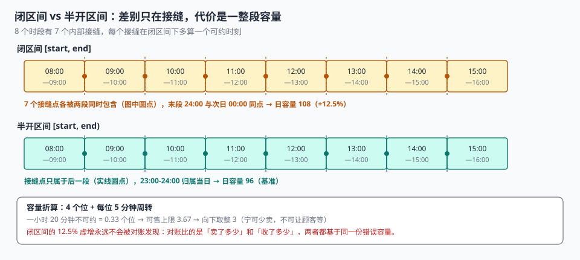

# 档期与时段建模

一家推拿店有三种项目：15 分钟肩颈、60 分钟全身、90 分钟理疗。老板说「就按小时排，一小时一个位」，于是 90 分钟的项目永远卡在两个档期之间，技师要么提前结束，要么让下一位顾客等半小时。老板又改成「按项目排」，结果同一间房在两个项目之间需要 10 分钟换床单，这 10 分钟不在任何档期里——它既不占位，也不能卖。

**档期建模的难点从来不是「画出时间格子」，而是「把一段物理时间里所有会占用它的东西都减掉」。** 少减一项，格子看起来还是那个格子，只是永远卖不出该卖的数量。

::: tip 一句话理解
容量不是「我一小时能接几个人」这个整数，而是**从名义容量里减掉五个东西之后剩下的那个数**——减错的项不会报错，它只会让「可约」和「实际能接」慢慢分叉。
:::

## 一、容量的五个减项

| 项 | 含义 | 谁产生 | 不减的后果 |
| --- | --- | --- | --- |
| `capacity` | 名义容量：物理上最多同时服务几个 | 建档期 | —— |
| `blocked` | 内部占用：员工用餐、培训、设备检修 | 排班 / 工单 | 卖出去了没人服务 |
| `turnaround` | 周转时间：换床单、消杀、清洁折算的位 | 服务类型 | 上一单拖到下一单 |
| `reserved` | 渠道预留：留给平台、会员、线下的额度 | 商务 | 平台单来了卖不出 |
| `overbook` | 超售额度（负项，加回来） | 运营策略 | 爽约造成的空置无法弥补 |

写成一条式子：

```text
可售上限 = capacity − blocked − turnaround + overbook
可售余量 = 可售上限 − reserved(该渠道之外) − used
```

注意 `reserved` 的位置：它**不是**从可售上限里减掉的，而是按渠道分别扣。全局减掉会让「预留了但没用完」的额度凭空消失——实测里这正是可用率掉到 85% 的原因（详见[渠道同步与对账](../Reconcile/index.md)）。

### 周转时间为什么必须折算成「位」

一家店一小时 4 个位，每个位之间要 5 分钟清洁。直觉上「4 个位还是 4 个位」，但只要有一单超时，清洁就被挤掉，然后下一单延迟，然后整条队列顺延。

正确的算法是把周转时间折算成「占用比例」：4 个位、每位 5 分钟周转，一小时里就有 20 分钟是「不可约时间」——相当于 **0.33 个位**。所以可售上限不是 4，而是 3.67，取整后仍是 3（**向下取整，不四舍五入**：宁可少卖，不可让顾客等）。

::: danger 三个建模错误，任何一个都会让容量永久偏大
1. **`end_at` 写成闭区间**：`BETWEEN start AND end` 会让 09:00 同时属于 08:00-09:00 和 09:00-10:00 两个档期。实测 8 个时段有 7 个内部接缝，每个接缝多算一个可约时刻；末段 `end = 24:00` 与次日 `00:00` 同点，**日容量虚增 12.5%**。
2. **用「默认时长」代替 `end_at`**：15 / 60 / 90 分钟三种项目共用一个档期表时，「默认一小时」会让 90 分钟的项目永远溢出，而溢出不会报错。
3. **把 `blocked` 做成一个布尔字段**：内部占用有开始有结束（培训 14:00-16:00），布尔值只能表达「这一天不能用」，粒度差了两个数量级。
:::

## 二、三种时段切分方式

| 方式 | 怎么切 | 适合 | 代价 |
| --- | --- | --- | --- |
| 固定网格 | 每 30 / 60 分钟一段，容量相同 | 快剪、洗车、核酸式流水 | 长短项目无法混排 |
| 可变时长 | 按项目时长反向切，档期长度不一 | 推拿、维修、家政 | 接缝多，排程难 |
| 滚动窗口 | 只有开始时间，结束 = 开始 + 服务时长 | 餐厅订座、会议室 | 冲突判定要算区间重叠 |

三种方式的分水岭是**同一资源上，服务时长是否统一**。统一就选固定网格（最简单、最容易做余量缓存）；不统一就必须选后两种，而选后两种的第一件事是把冲突判定从「相等」改成「重叠」：

```sql
-- 区间重叠判定：新单 [s2, e2) 与旧单 [s1, e1) 冲突
-- 条件：s2 < e1 AND s1 < e2
SELECT COUNT(*) FROM booking b JOIN slot s ON s.slot_id = b.slot_id
WHERE b.state IN ('HOLD','CONFIRMED','CHECKED_IN','NO_SHOW')
  AND :new_start < s.end_at AND s.start_at < :new_end;
```

`<` 而不是 `<=` 是关键：`s2 = e1`（新单正好从旧单结束时刻开始）不算冲突，这正是半开区间的全部意义。

## 三、接缝：一天多算了多少容量



以「08:00 到 24:00，每小时一段，容量 12」为例，两种写法的差别只在接缝，但结果差一整段：

| 写法 | 09:00 属于几段 | 接缝可重复售出 | 末段处理 | 日容量（8 段 × 12 位） |
| --- | --- | --- | --- | --- |
| 半开区间 `[08:00, 09:00)` | 1 段（后段首） | 0 处 | 23:00-24:00 归属当日 | 96（基准） |
| 闭区间 `[08:00, 09:00]` | 2 段（前段末 + 后段首） | 7 处（每处可多卖 1 位） | 次日 00:00 也算一次 | 108（**+12.5%**） |

两行差一整段：**末段跨日让每天多出一个可约段，日容量虚增 12.5%**；而 7 处接缝重叠是「同一个时刻能被两个档期同时判定为可用」，它不一定立刻变成多卖的位，但会让冲突判定失效。

这个 12.5% 永远不会被对账发现——因为对账比的是「卖了多少」和「收了多少」，两者都基于同一份错误的容量。

还有一个更隐蔽的接缝问题：**跨零点**。夜宵店 23:00-01:00 的档期，`biz_date` 算哪一天？如果按 `start_at` 的日期，这一单算前一天；如果按 `end_at`，算后一天。两个口径都能自圆其说，但**同一个月的报表只能用其中一个**，否则月初月末各丢一批单。

```sql
-- 营业日：先减切点小时，再取日期
-- 切点 04:00 的门店：2026-11-05 00:30 的单归 2026-11-04
SELECT date(datetime(start_at, '-4 hours')) AS biz_date FROM slot;
```

## 四、时区与夏令时

预约系统最容易忽略的一类错误，是「本地时间不是单调的」。在有夏令时的时区里，一年有两天，一天不是 24 小时：

| 日期（America/New_York） | 现象 | 对档期的影响 |
| --- | --- | --- |
| 2026-03-08 | 02:00-03:00 不存在 | 按本地时间枚举出的 02:30 档期**永远约不到** |
| 2026-11-01 | 01:00-02:00 出现两次 | 同一档期被卖出两次 |

本机实测：按本地时间构造 `2026-03-08 02:30` 会得到 `03:30` 的同一时刻，两者时间戳完全相同（相差 0 秒）。也就是说，生成器以为自己在建 02:30 的档期，实际建的是 03:30 的——**那 02:30 这个时段从此不存在，03:30 的容量翻倍**。

正确做法只有一条：**档期表存 UTC 时间戳 + 一个 `tz` 字段，本地时间只在展示层生成**。

```sql
-- 存 UTC，展示时换算；不要存 '2026-03-08 02:30' 这种本地时间字符串
CREATE TABLE slot (
  slot_id   TEXT PRIMARY KEY,
  point_id  TEXT NOT NULL,
  start_utc TEXT NOT NULL,   -- ISO 8601 带 Z
  end_utc   TEXT NOT NULL,
  tz        TEXT NOT NULL,   -- 'America/New_York'
  UNIQUE (point_id, start_utc)
);
```

::: warning 只做「一个时区」也要写 `tz`
「我们只在国内，没有夏令时」这句话在三种情况下会失效：跨境门店、出海第一站、以及**服务器时区与业务时区不一致**（容器默认 UTC，业务在 UTC+8，`datetime('now')` 写进去的就是 UTC）。前两种是业务扩张，第三种从第一天就在。
:::

## 五、复合资源：一个位其实是几个资源的交集

「一位理发师 + 一间房 + 一台设备」才是完整资源。建模有两种写法：

| 写法 | 结构 | 优点 | 缺点 |
| --- | --- | --- | --- |
| 资源组 | `resource_group` 把三者绑成一个虚拟资源 | 简单，一位就是一格 | 任一项被占用就整组不可用，粒度粗 |
| 多维档期 | 每个资源各有一张档期表，下单时取交集 | 精确，可单独占用 | 冲突判定要跨表，事务更长 |

选资源组的判据是：**这三样东西是不是总是一起被占用**。理发师 + 椅子 → 是（永远一起），所以绑成组；诊室 + 医生 + 检验设备 → 否（医生可以不带设备出诊），所以必须多维。

多维档期的最小实现是「三张表 + 一次交集查询」：

```sql
-- 三个资源在同一时段都还有余量，才允许下单
SELECT s.slot_id FROM slot s
WHERE s.point_id IN ('DOC-07','ROOM-3','DEV-2')
  AND s.start_utc = :start
GROUP BY s.start_utc
HAVING COUNT(*) = 3
   AND MIN(s.capacity - s.used) > 0;
```

`HAVING COUNT(*) = 3` 是这条 SQL 的全部价值：**只有三个资源都有位时，这个时间点才是可约的**。少一个都是「看起来能约，实际服务不了」。

## 六、档期生成的四个约束

批量生成档期（一次生成一个月）时，有四条约束必须在生成阶段校验，而不是等到下单：

1. **不重叠**：同一资源同一时刻只有一个档期（`UNIQUE(point_id, start_utc)`）。
2. **不留缝**：相邻档期首尾相接，`a.end_utc = b.start_utc`；有缝的地方是「卖不出去的时间」，必须显式记为 `CLOSED`。
3. **不越界**：档期必须落在营业时间内（`open_hour ≤ start < close_hour`）。
4. **不重复生成**：同一天重复跑生成脚本，不能产生第二批（靠唯一键，不靠脚本自己判断）。

第 4 条最容易被忽略：生成脚本通常是「补数据」用的，运维会在出问题时手动重跑一次。没有唯一键的版本会静默地把容量翻倍。

## 七、判据

本页判据族 `BKS-A` ~ `BKS-H`，共 8 条。

| 判据 | 断言 | 验证方式 |
| --- | --- | --- |
| `BKS-A` | 档期是半开区间，相邻档期首尾相接 | 接缝违例 SQL 返回 0 |
| `BKS-B` | 档期存 UTC，本地时间只在展示层换算 | 表结构无本地时间字符串列，且有 `tz` |
| `BKS-C` | 容量五减项可分别取值，不在代码里写死 | 可售上限由 SQL 算出，与文档式子一致 |
| `BKS-D` | 周转时间向下取整折算成位 | 4 位 × 5 分钟 → 可售 3，不是 4 |
| `BKS-E` | 同一资源同一时刻只有一个档期 | 重复 `INSERT` 被唯一键拒绝 |
| `BKS-F` | 生成脚本可重跑，不产生第二批 | 连续跑两次，行数不变 |
| `BKS-G` | 营业日由切点算出，跨零点单归属确定 | 00:30 的单归属前一日 |
| `BKS-H` | 夏令时切换日的档期数与本地小时数一致 | 3/8 该时区只有 23 个本地小时，档期数对应减少 |

## 八、验证方式

```shell
# 1. 接缝检查（期望 0）
sqlite3 :memory: "
create table slot(point_id text, start_at text, end_at text);
insert into slot values ('P01','2026-11-05 09:00','2026-11-05 10:00'),
                        ('P01','2026-11-05 10:00','2026-11-05 11:00');
select count(*) from slot a join slot b
  on a.point_id=b.point_id and b.start_at>a.start_at
where a.end_at<>b.start_at;"

# 2. 半开区间的重叠判定：新单正好接在旧单结束时刻，不算冲突（期望 0）
sqlite3 :memory: "
select count(*) from (
  select '2026-11-05 10:00' as s2, '2026-11-05 11:00' as e2) n,
  (select '2026-11-05 09:00' as s1, '2026-11-05 10:00' as e1) o
where n.s2 < o.e1 and o.s1 < n.e2;"

# 3. 夏令时：3/8 该时区只有 23 个本地小时
python3 - <<'PY'
from datetime import datetime, timedelta
from zoneinfo import ZoneInfo
tz = ZoneInfo("America/New_York")
a = datetime(2026, 3, 8, 0, 0, tzinfo=tz)
hours = set()
for i in range(26):
    t = a + timedelta(hours=i)
    if t.date() == a.date():
        hours.add(t.strftime("%H:%M"))
print("本地小时数", len(hours))     # 期望 23
x = datetime(2026, 3, 8, 2, 30, tzinfo=tz)
print("02:30 实际落在", x.strftime("%H:%M"))   # 期望 03:30
PY
```

第 3 步的两个输出就是夏令时的全部真相：**23 个小时，以及一个「不存在却能被构造出来」的时刻**。生成器如果不处理，会静默地少一个档期、多一个重复档期。

## 与「全球化与时区本地化工程」专题的分工（第 269 天补充）

| 维度 | 本页回答 | 专题回答 |
| --- | --- | --- |
| 对象 | 容量、半开区间、占座与释放 | [半开区间两端按同一 `ZoneId` 计算](../../Globalization/CalendarAndCutoff/index.md) |
| 边界 | 预约模型与并发控制 | 时区规则、DST 日区间长度与日切配置 |
| 不重复 | 不再讲夏令时算法 | 不重复库存与档期容量 |

**本页特有的一处坑**：把日区间写成 `[start, start + 24h)`。折叠日实际有 25 小时本地时间、间隙日只有 23 小时，按 24 小时切会**多放一个时段或漏掉一个时段**，在预约场景里直接表现为超卖或空档，且不会报错。正确写法：`calendar_day` 里落 `hours`（23.0 / 25.0），区间两端都从维表读 `starts_utc / ends_utc`；第 269 天[实战门禁](../../Globalization/Practice/index.md)的 `CK6` 用主键重复插入验证了这张维表的守卫。

## 参考资料

- ISO 8601-1:2019《日期和时间 信息交换表示法 第 1 部分：基本规则》：时间区间的表示与两个端点。
- RFC 5545《iCalendar》第 3.8.2.2 节：`DTEND` 为 non-inclusive；同节规定夏令时切换日本地时间的解释规则。
- IANA 时区数据库（tzdata）：`America/New_York` 在 2026-03-08 与 2026-11-01 的偏移变更。
- 与本页相邻：[总览](../Overview/index.md)、[开档与放号](../Release/index.md)、[占量与并发](../Concurrency/index.md)。
