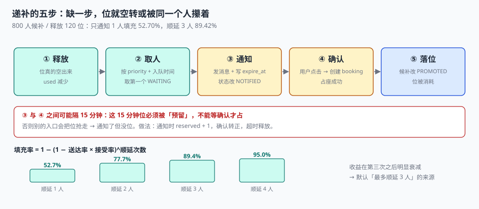

# 候补与递补

一个热门档期满了，页面给了一个「加入候补」的按钮。800 个人点了。三天里有 120 个位被释放出来——退单、改期、超时未付。理论上这 120 个位应该被候补队列填满，实际只填了 109 个。

**候补不是「排队等」，是「一个位要连着通知几个人才能填满」。** 每通知一个人，就有一次被拒绝、超时、电话打不通的概率；这些概率乘起来，决定了候补队列的真实填充率。

::: tip 一句话理解
候补的核心参数不是「队列长度」，是**每个位通知几个人、给多长时间**。窗口太短，位空转；窗口太长，位被一个人攥着，后面的人全等着。
:::

## 一、候补的三个参数

| 参数 | 含义 | 太小 | 太大 |
| --- | --- | --- | --- |
| `notify_batch` | 一个位同时通知几个人 | 填充率低（没人接就空转） | 多人同时抢，先到先得变成拼手速 |
| `window_min` | 通知后多少分钟内必须确认 | 接不到电话的人被判超时 | 位被占着，队列停滞 |
| `max_cascade` | 一个位最多顺延几次 | 填充率低 | 通知风暴，骚扰用户 |

本机实测（800 人候补、120 个位释放、通知送达率 85%、接受率 62%）：

| 策略 | 填充率 | 空转通知次数 |
| --- | --- | --- |
| 只通知 1 人，不接受就放弃 | **52.70%** | —— |
| 顺延最多 3 人 | **89.42%** | 86 |
| 先到先得（顺延 3 人） | 90.83%（109 / 120） | 86 |
| 会员优先（顺延 3 人） | 91.67%（110 / 120） | 87 |

第一行和第二行的差距是本章最重要的数字：**同样一个位，只通知一个人只能填满一半，允许顺延三次能填满九成。** 差的不是队列长度，是「一个位被通知了几个人」。

```text
填充率 = 1 − (1 − 送达率 × 接受率)^顺延次数
       = 1 − (1 − 0.85 × 0.62)^3
       = 1 − 0.473^3
       = 89.42%
```

这个式子说明：**顺延次数是唯一一个能显著改善填充率的杠杆**。提高送达率（换短信通道）很难，提高接受率（降价）要花钱，而多顺延一次几乎免费——代价是骚扰风险。

::: danger 候补的四个坑
1. **一个位只通知一个人**：填充率 52.70%，一半的位空转。这是最常见的实现，因为它「最公平」——但它把公平建立在了浪费上。
2. **通知窗口用「固定时刻」而不是「相对时刻」**：写 `expire_at = '2026-11-05 20:00'`，会让 19:59 收到通知的人只有 1 分钟。
3. **递补时不校验位是否还在**：通知发出后位被别人抢走（超时释放被另一个入口用了），候补用户点进来发现「已满」。
4. **候补与占位共用同一张表**：候补用户没有 `seat_no`，硬塞进 `booking` 会破坏「有效状态唯一」的索引。
:::

## 二、候补表的正确形状

```sql
CREATE TABLE waitlist (
  waitlist_id INTEGER PRIMARY KEY AUTOINCREMENT,
  slot_id     TEXT NOT NULL REFERENCES slot(slot_id),
  user_id     TEXT NOT NULL,
  priority    INTEGER NOT NULL DEFAULT 100,   -- 数值小优先
  enqueued_at TEXT NOT NULL,
  state       TEXT NOT NULL DEFAULT 'WAITING'
              CHECK (state IN ('WAITING','NOTIFIED','PROMOTED','EXPIRED','CANCELLED')),
  notified_at TEXT,
  expire_at   TEXT,                            -- 相对通知时刻计算，不是固定时刻
  UNIQUE (slot_id, user_id)                    -- 同一档期同一人只能排一次
);
```

三个字段承担三件事：

| 字段 | 承担什么 | 少了会怎样 |
| --- | --- | --- |
| `priority` | 排序依据（会员、紧急程度、加入时间） | 只能先到先得，无法做差异化 |
| `notified_at` + `expire_at` | 窗口的起止，且是相对计算 | 无法判定「超时」与「还没通知」 |
| `UNIQUE(slot_id, user_id)` | 防重复排队 | 同一人排 5 次，队列被灌水 |

`UNIQUE(slot_id, user_id)` 是防「候补灌水」的唯一可靠手段。没有它，一个人反复点「加入候补」就能在队列里占 5 个位置——而这不是恶意，是很多人下意识的动作。

## 三、递补流程：五步，缺一不可



| 步 | 动作 | 失败会怎样 |
| --- | --- | --- |
| ① 释放 | 位真的空出来（`used` 减少） | 通知了但位没空 → 用户点进来已满 |
| ② 取人 | 按 `priority, enqueued_at` 取第一个 `WAITING` | 取错人 → 公平性投诉 |
| ③ 通知 | 发消息，写 `notified_at` / `expire_at`，状态改 `NOTIFIED` | 通知失败但状态改了 → 位空转 |
| ④ 确认 | 用户点击，创建 `booking`（占座） | 占座失败 → 位需要重新递补 |
| ⑤ 落位 | 候补状态改 `PROMOTED`，位被消耗 | 漏改 → 下一轮又通知同一个人 |

第 ① 步和第 ④ 步之间可能隔了 15 分钟。这 15 分钟里，位**必须被预留**，否则会被别的入口抢走。做法是：通知时就把位锁进一个「预留池」，而不是等用户确认才占。

```sql
-- 通知时预留（占位但不产生 booking），确认时转正，超时则释放
UPDATE slot SET reserved = reserved + 1
WHERE slot_id = :slot AND capacity + overbook - used - reserved > 0;
-- rowcount = 0 说明位已被抢走，跳过此人，继续下一位
```

`reserved` 是第三个计数（在 `used` 之外）。它让「已售」「已预留」「可售」三态分开——**没有这个字段，递补必然出现「通知了但没位」**。

## 四、公平性：三个可选口径

| 口径 | 排序 | 优点 | 代价 |
| --- | --- | --- | --- |
| 先到先得 | `enqueued_at` | 规则最简单，没人质疑 | 手速快的人永远赢 |
| 会员优先 | `priority, enqueued_at` | 商业价值导向 | 非会员体验差 |
| 机会均等 | 随机抽签 | 最公平 | 用户无法预期，投诉「为什么不是我」 |

本机实测两种口径的填充率几乎一样（90.83% vs 91.67%，差 0.84 个点），**但等待时长的分布完全不同**：先到先得下，排在 605 位之后的人要等约 121 小时（按每天释放 120 位计）——也就是**排在后面的人其实永远等不到**。

这就是「公平性」在候补系统里的真实含义：**不是「谁先来」，而是「等多久是合理的」**。一个诚实的产品应该告诉用户「当前排队 605 人，按最近释放速度预计 5 天」，而不是给一个「排队中」的模糊状态。

## 五、批量释放的原子性

一天结束时会批量释放（超时未付、爽约判定），可能一次释放几十个位。这一步有两个坑：

| 坑 | 后果 | 处理 |
| --- | --- | --- |
| 边释放边递补 | 递补看到的是释放到一半的状态 | 先全部释放完，再统一触发递补 |
| 递补无上限 | 一次通知几百人，短信通道被打爆 | 每批最多 50 个位，分批触发 |

```sql
-- 先释放，再统一取需要递补的档期（两步分开）
UPDATE booking SET state='EXPIRED' WHERE state='HOLD' AND pay_deadline < :now;

SELECT s.slot_id, s.capacity + s.overbook - s.used AS free
FROM slot s
WHERE s.capacity + s.overbook - s.used > 0
  AND EXISTS (SELECT 1 FROM waitlist w WHERE w.slot_id = s.slot_id AND w.state='WAITING')
ORDER BY s.start_at LIMIT 50;
```

「先释放完再递补」不是为了性能，是为了**让每一次递补决策都基于一个稳定的快照**。边释放边递补的系统，会出现「通知了 3 个人，位只有 1 个」的情况。

## 六、候补的退出路径

候补不是无限期的。三条退出：

| 退出 | 触发 | 用户感受 |
| --- | --- | --- |
| 递补成功 | 拿到位 | 满意 |
| 过期 | 档期已开始，候补作废 | 需要提前告知，不能静默作废 |
| 主动取消 | 用户不等了 | 必须能自助取消，否则占着队列 |

第二条最容易被做成静默：档期开始了，候补行还在 `WAITING`。这会让「排队人数」永远虚高，运营看到的队列长度是假的。清理任务必须处理：**档期开始后，该档期的所有 `WAITING` 改为 `EXPIRED`**。

## 七、判据

本页判据族 `BKW-A` ~ `BKW-H`，共 8 条。

| 判据 | 断言 | 验证方式 |
| --- | --- | --- |
| `BKW-A` | 候补与预约分表，候补行没有 `seat_no` | `waitlist` 表结构无 `seat_no` |
| `BKW-B` | 同档期同用户唯一 | `UNIQUE(slot_id, user_id)`，重复加入被拒 |
| `BKW-C` | 窗口相对通知时刻计算 | `expire_at = notified_at + window`，非固定时刻 |
| `BKW-D` | 通知时预留位，不等到确认 | 有 `reserved` 计数且递补前 +1 |
| `BKW-E` | 一个位最多顺延 N 次 | 计数可查，超过 N 停止通知 |
| `BKW-F` | 递补成功后才消耗位 | `PROMOTED` 与 `booking` 行一一对应 |
| `BKW-G` | 批量释放先完成再递补 | 两段 SQL 分离，中间无通知 |
| `BKW-H` | 档期开始后候补自动过期 | 定时任务把 `WAITING` 改 `EXPIRED` |

## 八、验证方式

```shell
# 1. 填充率与顺延次数的关系（期望 52.70% → 89.42%）
python3 - <<'PY'
p = 0.85 * 0.62
for n in (1, 2, 3, 4):
    print(f"顺延 {n} 人 → 填充率 {1-(1-p)**n:.2%}")
PY

# 2. 重复加入候补必须被拒（在实战库上跑）
sqlite3 ab.db "
insert into waitlist(slot_id,user_id,priority,enqueued_at,state)
values ('P01-2026-11-05-09','U10',200,'2026-11-04 10:00:00','WAITING');"
# 期望：UNIQUE constraint failed: waitlist.slot_id, waitlist.user_id

# 3. 递补不超过释放位（期望 promoted <= free）
sqlite3 ab.db "
select (select count(*) from waitlist where state='PROMOTED') as promoted,
       (select capacity+overbook-used from slot where slot_id='P01-2026-11-05-09') as free;"
```

第 1 步的四个数字应该连起来看：**顺延 1 人 52.70%、2 人 77.65%、3 人 89.42%、4 人 95.00%**。收益在第三次之后开始明显衰减，这就是「最多顺延 3 人」这个默认值的来源。

## 参考资料

- ISO 8601-1:2019《日期和时间 信息交换表示法 第 1 部分：基本规则》：时间窗与相对时长计算。
- 《中华人民共和国消费者权益保护法》第八条：消费者享有知悉其接受服务真实情况的权利（候补进度应可查）。
- 与本页相邻：[开档与放号](../Release/index.md)、[占位与支付](../Hold/index.md)、[履约与核销](../Checkin/index.md)。
