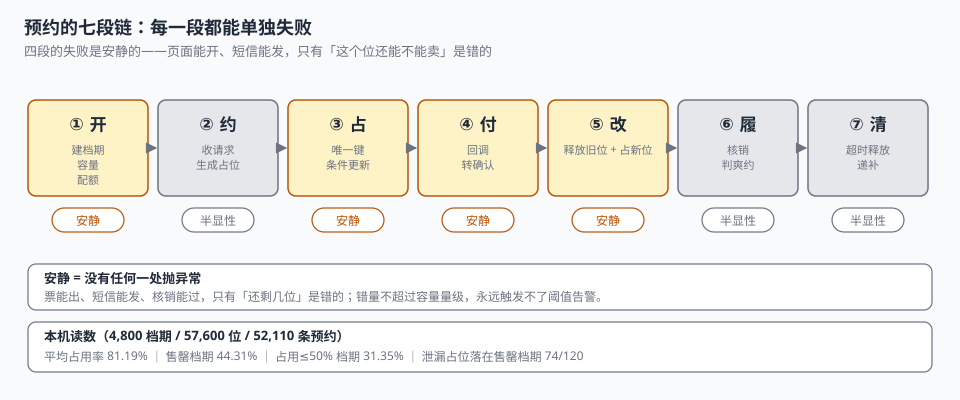
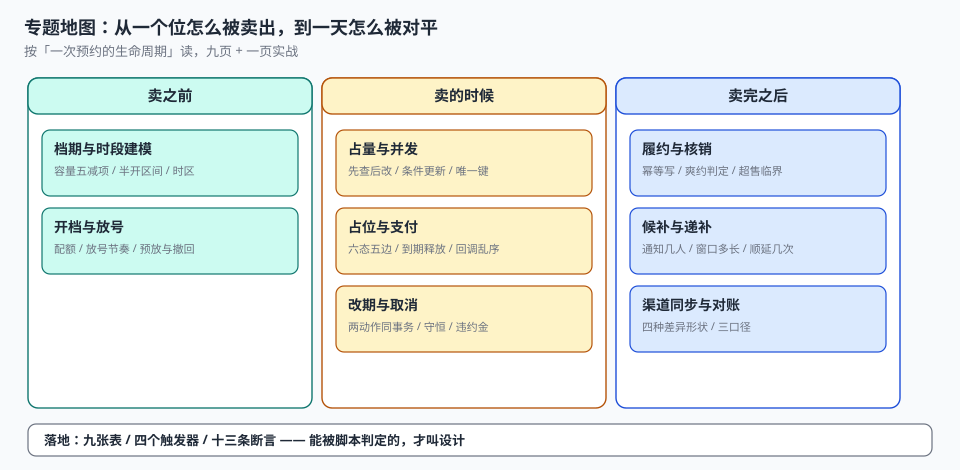

# 预约与资源档期工程

早上九点，一家牙科诊所的第一个号被三个人同时点中：一个在小程序里，一个在点评页面，一个打客服电话由前台代约。三秒钟后，系统里的「剩余 1 位」变成了 3 条确认记录——两个患者在同一天同一时刻坐到了同一张牙椅上。前台只能给其中一位道歉，另一位改到十点半。

**这不是「手速太快」，而是「余量」这个数在三个地方各算了一遍，而且都没有落地成一个能拒绝第二次写入的约束。** 在电商里，超卖会被一次下单请求的返回值暴露；在预约系统里，超卖不报错、不告警，只在顾客到店的那一刻变成一句「您稍等」。

::: tip 一句话理解
预约系统卖的不是「一个时间」，而是**某个资源在某段时间上的一个位**——所以它必须先是一门库存学（一位只能卖一次），再是一门排队学（没抢到的人怎么排），最后才是一门日历。
:::

## 一、这个专题讲什么

从「放出下周的号」到「没人来的位被回收」，一次预约要走七段：

| 段 | 这一段在做什么 | 产物 | 失败是否安静 |
| --- | --- | --- | --- |
| ① 开 | 建档期、定容量、按渠道分配额 | `slot` + `channel_quota` | **安静**（开错了照常可约，只是可约量是错的） |
| ② 约 | 收下这次请求，生成一条占位 | `booking`（`HOLD`） | 半显性（重复提交会多一条） |
| ③ 占 | 把「一个位」真正锁住 | 唯一键 / 条件更新 | **安静**（先查后改照样返回成功） |
| ④ 付 | 收到钱，把占位转成确认 | `booking`（`CONFIRMED`） | **安静**（回调乱序会把它改回未支付） |
| ⑤ 改 | 改期、取消、按阶梯算违约金 | `booking.moved_from` | **安静**（旧位没释放 = 双占） |
| ⑥ 履 | 到店核销、判爽约 | `checkin` | **安静**（重复核销多消耗一个位） |
| ⑦ 清 | 超时释放、候补递补、渠道对账 | `waitlist` + `recon_diff` | **安静**（漏释放的位再也不会回来） |

七段里**四段的失败是安静的**。它们的共同形态是：页面上的「可约」看得见、确认短信发得出、到店也能核销，只有「这个位到底还能不能卖」没人能回答。

本机实测最能说明问题的一组读数：4,800 个档期、57,600 个名义位、52,110 条预约，**加权平均占用率 81.19%**——听起来是个「基本卖满」的健康数字。但把档期按占用率摊开看：**44.31% 的档期已经售罄，同时 31.35% 的档期占用不到一半**。

| 视角 | 读数 | 它掩盖了什么 |
| --- | --- | --- |
| 加权平均占用率 | 81.19% | 售罄与空置同时存在，平均值把两端都吃掉了 |
| 售罄档期占比 | 44.31%（2,127 / 4,800） | 这些档期里每漏释放一个位，就是一次确定的丢单 |
| 占用 ≤ 50% 的档期 | 31.35%（1,505 / 4,800） | 资源闲置，但没人会为「没卖出去的位」发告警 |

这就是预约系统最典型的缺陷形态：**总量看起来健康，结构全是错的**。一个只盯「总体出租率」的看板，永远发现不了「热门档期被僵尸占位堵死」这件事——实测里 120 条泄漏占位有 **74 条（61.67%）落在已售罄的档期上**，那 74 个位是被已放弃的订单挡死的成交机会。

## 二、三个「还有没有位置」

| 口径 | 定义 | 谁在关心 | 常见错法 |
| --- | --- | --- | --- |
| 名义容量 `capacity` | 档期定义时写死的可约量 | 运营 / 排班 | 把「人」和「位」混为一谈（一单两人只算一位） |
| 已占用量 `used` | `HOLD + CONFIRMED + CHECKED_IN + NO_SHOW` | 前端余量、客服 | 只算 `CONFIRMED`，把未支付的占位当成不存在 |
| 可售余量 `remaining` | `capacity + overbook − used` | 下单校验 | 每次现算、算法还不一样，三个入口三个结果 |

三者必须由**同一个视图**算出来。本机实测：只看已确认时占用率 77.66%，把占位算进来是 81.19%——差 2,036 个位，占名义容量的 3.53%。这 3.53% 恰好就是「前端显示有、点进去没有了」的工单来源。

### 一个必须自己算一遍的例子

某个容量 12 的档期，已确认 11 单、占位 2 单、开放超售 1 位。

| 算法 | 表达式 | 余量 | 后果 |
| --- | --- | --- | --- |
| 只算已确认 | 12 − 11 | 1 | 再卖 1 位就真超卖（占位那 2 单付了钱就爆） |
| 算上占位、忘了超售 | 12 − 13 | −1 | 显示已满，但今天其实还能卖 1 位 |
| 名义 + 超售 − 已占 | 12 + 1 − 13 | **0** | 正确：还能卖 0 位，且已有 1 位在超售池里 |

**三种算法都能在代码里写出来，只有第三种同时回答了两个问题**：现在能不能卖，以及已经卖超了多少。

::: danger 三件事必须写进数据模型，不能留给「下单前查一下」
1. **占座必须是唯一键，不是一次 `SELECT`**：先查后改在 12 线程 72 次抢 50 个位的实测里，**报成功 53~55 次、实际占 53~55 个位，超卖 3~5 位**；改成 `UPDATE ... WHERE used < cap` 后稳定 50/0。
2. **唯一键必须带状态谓词**：`UNIQUE(slot_id, seat_no)` 不加 `WHERE state IN (...)`，退掉的座位就永远不能再卖——这不是「小心一点」，是索引定义写错。
3. **占位到期时刻要落库**（`pay_deadline`），不能靠「创建时间 + 15 分钟」在查询时现算：现算的写法在时钟漂移、批量补数据、时区切换三种情况下都会失效，而且清理任务与查询用的不是同一个时间基准。
:::

## 三、专题地图

按「一次预约的生命周期」读：

| 阶段 | 页面 | 一句话 |
| --- | --- | --- |
| 卖之前 | [档期与时段建模](SlotModel/index.md) | 容量不是一个数，是五个减项算出来的结果 |
| 卖之前 | [开档与放号](Release/index.md) | 放号不是「把日期填进去」，是把风险按渠道切开 |
| 卖的时候 | [占量与并发](Concurrency/index.md) | 唯一键管「同一个位」，条件更新管「同一批位」 |
| 卖的时候 | [占位与支付](Hold/index.md) | 占位是一个有到期时间的承诺，不是一个状态字段 |
| 卖掉之后 | [改期与取消](Reschedule/index.md) | 改期是两个动作，只做一个就是双占或丢位 |
| 到店 | [履约与核销](Checkin/index.md) | 核销是幂等写，爽约是一个需要被定义的判定 |
| 没抢到 | [候补与递补](Waitlist/index.md) | 递补的本质是「一个位要通知几个人才能填满」 |
| 收口 | [渠道同步与对账](Reconcile/index.md) | 差异只有四种形状，先分形状再查人 |
| 落地 | [实战：九张表、四个触发器、十三条断言](Practice/index.md) | 能被脚本判定的，才叫设计 |

## 四、和相邻专题的分工

本册只讲「一个位怎么被卖出去、卖对、卖完还能对平」。相邻主题各自已经讲透的部分，这里不重复：

| 相邻专题 | 它讲什么 | 本专题不重复讲 |
| --- | --- | --- |
| [电商库存](../Ecommerce/Inventory/index.md) | 可售、预占、超卖的中心库存模型 | 时段库存的**容量五减项**与档期切分 |
| [分布式调度](../DistributedScheduling/Overview/index.md) | 定时任务、分片、漏跑补偿 | 超时释放只是一个**待清理队列**，不讲调度框架 |
| [考勤排班](../TimeAttendance/ShiftModel/index.md) | 班次、打卡、工时核算 | 员工排班与「谁来服务」，不讲工时 |
| [幂等状态机](../IdempotencyStateMachine/IdempotencyKey/index.md) | 请求级幂等的通用设计 | 预约的**双幂等键**（点击 + 渠道回调） |
| [订单状态机](../Ecommerce/OrderStateMachine/index.md) | 线上订单的通用生命周期 | 预约的六个状态与「占位到期」这条边 |
| [消息通知](../NotificationDelivery/Delivery/index.md) | 触达通道、重试、送达回执 | 递补通知的**窗口与顺延策略** |
| [支付回调](../Ecommerce/Payment/index.md) | 渠道下单、回调验签、退款 | 回调乱序对占位状态的影响，只讲边界 |
| [账务对账](../Ledger/Reconciliation/index.md) | 分录横平与未达账项 | 号源侧的四类差异形状与归因 |
| [定价与优惠](../PricingPromotion/Overview/index.md) | 规则引擎与优惠分摊 | 违约金阶梯只讲「按时间分档」，不讲券 |
| [多租户隔离](../MultiTenantSaaS/TenantContext/index.md) | 租户上下文与行级隔离 | 连锁品牌的门店组只讲配额切分 |

## 五、版本组织：为什么不建版本目录

预约侧最常见的疑问是「从电话预约到小程序，文档是不是要分一代」。本册**不建 `AppointmentBooking/V1` 这类目录**，三条理由：

1. **换代的是入口，判据一字没变。** 电话、网页、小程序、点评渠道，变的只是 `booking.channel` 的枚举值；「一个位只能卖一次、占位必须到期释放、核销必须幂等」这三条从纸质登记本时代就成立。
2. **并存差异是渠道形态，不是代际。** 直营、加盟、平台代售的差别在**配额与结算**（谁能卖多少、钱进谁的账），不在链路本身。用版本目录去装「平台代售」，会把配额问题伪装成代码分支问题。
3. **真正需要版本目录的是「同一份代码两套写法」。** 本库已有先例：[Spring5](../Java/Frame/Spring/Spring5/index.md) / [Spring6](../Java/Frame/Spring/Spring6/index.md)、[Vue2](../../Frontend/Frame/Vue/Vue2/index.md) / [Vue3](../../Frontend/Frame/Vue/Vue3/index.md)——同一框架两代 API 并存，旧版必须原样保留并标注维护状态。预约侧不是这种情形：一套写法接不同渠道，渠道差异落在配额表里。

::: info 旧渠道与旧终端的处置口径
遇到只支持老接口的渠道（例如只支持 HTTP 明文回调的门店自建渠道），**不新建章节**，在[渠道同步与对账](Reconcile/index.md)的兼容性表里加一行，标注「仅存量渠道使用，新签合同不再接入」。这条口径和本库对 Spring5 / Vue2 的处理一致：旧内容保留、标注状态、不覆盖。
:::

## 六、建议阅读顺序

1. 先读[总览：七段链与三个「还有没有位置」](Overview/index.md)——把「一个位」这个概念立起来。
2. 再读[档期与时段建模](SlotModel/index.md)与[开档与放号](Release/index.md)——这两页决定后面所有数字的分母。
3. 然后是三段「卖」的：[占量与并发](Concurrency/index.md)、[占位与支付](Hold/index.md)、[改期与取消](Reschedule/index.md)。
4. 接着是两段「卖完之后」的：[履约与核销](Checkin/index.md)、[候补与递补](Waitlist/index.md)。
5. 最后读[渠道同步与对账](Reconcile/index.md)，按[实战](Practice/index.md)把九张表建出来，跑一遍十三条断言。

## 七、本册的读数从哪来

所有数字来自一台 16 GB 笔记本上的 SQLite 3.50.4 / Python 3.13，种子 `20261104`，规模是 20 个服务点 × 30 天 × 8 个时段 = 4,800 个档期、57,600 个名义位、52,110 条预约，**不是生产数据，也不是压测结论**。写进正文的每一个数都可以用附录里的脚本重跑：

| 读数 | 值 | 出现在 |
| --- | --- | --- |
| 加权平均占用率 | 81.19% | 本页、[总览](Overview/index.md) |
| 售罄 / 空置≥50% 档期 | 44.31% / 31.35% | 本页、[开档与放号](Release/index.md) |
| 先查后改超卖 | 3~5 位（12 线程抢 50 位） | [占量与并发](Concurrency/index.md) |
| 泄漏占位落在售罄档期 | 74 / 120（61.67%） | [占位与支付](Hold/index.md) |
| 改期双占 / 丢位 | 563 / 637（净 −74） | [改期与取消](Reschedule/index.md) |
| 爽约率 | 6.79%（3,036 / 44,730） | [履约与核销](Checkin/index.md) |
| 候补填充率 | 90.83%（FIFO）/ 91.67%（会员优先） | [候补与递补](Waitlist/index.md) |
| 渠道对账差异率 | 0.344%（81 / 23,534） | [渠道同步与对账](Reconcile/index.md) |
| 断言通过 | 13 / 13，退出码 0 | [实战](Practice/index.md) |

::: warning 这些数字不能直接当 SLA
单机 SQLite 的毫秒级和真实档期系统的高并发不是一回事。本文用它们判断**方向和量级**（例如「净额会掩盖双向差异」「平均占用率会掩盖两端」），不用它们承诺性能。凡涉及性能的结论，文中都注明了「按本机读数」。
:::

## 参考资料

- ISO 8601-1:2019《日期和时间 信息交换表示法 第 1 部分：基本规则》：时间区间（time interval）由两个时刻限定，本册所有档期按该标准表示时间点。
- RFC 5545《iCalendar》第 3.8.2.2 节：`DTEND` 是「不含」（non-inclusive）的——本册 `[start_at, end_at)` 的半开约定来自这里，不是自创。
- RFC 5545《Internet Calendaring and Extensible Scheduling Core Object Specification (iCalendar)》第 3.3.10 节：`DURATION` 与 `DTEND` 语义、时区与夏令时处理约定。
- GB/T 7408—2005《数据元和交换格式 信息交换 日期和时间表示法》：日期时间的本地时间与 UTC 表示。
- 与本册相邻：[电商库存](../Ecommerce/Inventory/index.md)、[幂等状态机](../IdempotencyStateMachine/Overview/index.md)、[账务与清结算](../Ledger/Overview/index.md)。
