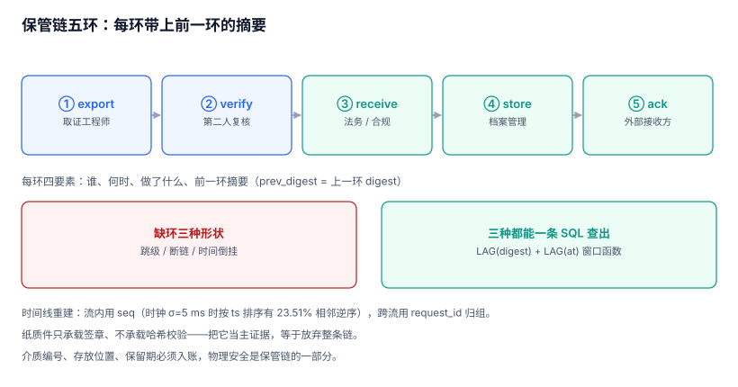

# 保管链与时间线重建

前面几章解决的是「记录没被改」。这一章解决的是「**包在传递过程中没被换**」，以及「拿到一堆记录后，怎么排出一条能讲给人听的顺序」。

两件事都发生在系统之外——保管链在人与系统之间，时间线在记录与事实之间。也正因为发生在系统之外，它们最容易被当成流程问题，最后变成「谁记得谁签过」。

本页判据族 `ADN-A` ~ `ADN-H`，共 8 条。



## 一、保管链五环

一份证据包从生成到被接收，最少经过五环。每环记录四要素：**谁、何时、做了什么、前一环的摘要**。

| 环 | 动作 | 执行者 | 关键约束 |
| --- | --- | --- | --- |
| 1 | `export` 生成 | 取证工程师 | 包生成即封存，此后只读 |
| 2 | `verify` 校验 | 第二人（复核人） | 必须独立重算，不复用导出者的结论 |
| 3 | `receive` 接收 | 法务 / 合规 | 签收单要写明介质与分卷数 |
| 4 | `store` 存放 | 档案管理 | 存放位置、锁柜编号、保留期 |
| 5 | `ack` 确认 | 外部接收方 | 回执回到第 1 环的执行者手上 |

四要素缺一不可，尤其「前一环的摘要」：它是把五个环节串成链的唯一手段。没有它，五条记录只是五条独立的时间戳，谁都可以事后补一条。

```sql
CREATE TABLE evidence_custody (
  custody_id  TEXT PRIMARY KEY,
  package_id  TEXT NOT NULL REFERENCES evidence_package(package_id),
  step        INTEGER NOT NULL,
  actor       TEXT NOT NULL,
  action      TEXT NOT NULL CHECK (action IN ('export','verify','receive','store','ack')),
  at          TEXT NOT NULL,
  prev_digest TEXT NOT NULL,
  digest      TEXT NOT NULL,
  UNIQUE (package_id, step)
);

-- 环节必须从 1 开始逐级递增：跳级、重号、倒序一律拒绝
CREATE TRIGGER trg_custody_step_guard BEFORE INSERT ON evidence_custody
WHEN NEW.step <> (SELECT COALESCE(MAX(step), 0) + 1 FROM evidence_custody WHERE package_id = NEW.package_id)
BEGIN SELECT RAISE(ABORT, 'CUSTODY_STEP_GAP'); END;
```

::: danger 本页特有的坑：保管链不能只记「签收」
很多团队的交接单只有一行「2026-11-08 法务已签收」。它证明了「有人签过」，证明不了「签的就是这一份」——因为单据上没有包摘要。

正确做法：每环的 `digest` 至少包含「包摘要 + 上一环摘要 + 动作 + 时间」，并且 `prev_digest` 必须等于上一环的 `digest`。这样即使有人补一条「看起来合理」的接收记录，也会因为 `prev_digest` 对不上而暴露。
:::

## 二、缺环的三种形状

| 形状 | 现象 | 检测 | 后果 |
| --- | --- | --- | --- |
| 跳级 | step 1、2、4 | `CUSTODY_STEP_GAP` | 第 3 环无人认领，包可能被替换过 |
| 断链 | `prev_digest` ≠ 上一环 `digest` | 逐环比对 | 有人重建了一条并行的保管记录 |
| 时间倒挂 | 第 4 环时间早于第 3 环 | 排序检查 | 记录是事后补写的 |

三种都能用一条 SQL 查出来，不需要额外系统：

```sql
-- 缺环 + 断链 + 时间倒挂，一次查完
WITH c AS (
  SELECT package_id, step, actor, action, at, prev_digest, digest,
         LAG(digest) OVER (PARTITION BY package_id ORDER BY step) AS prev_actual,
         LAG(at)     OVER (PARTITION BY package_id ORDER BY step) AS prev_at
  FROM evidence_custody
)
SELECT package_id, step, action,
       CASE WHEN prev_actual IS NULL AND step <> 1 THEN 'MISSING_HEAD'
            WHEN prev_actual IS NOT NULL AND prev_digest <> prev_actual THEN 'BROKEN_CUSTODY'
            WHEN prev_at IS NOT NULL AND at < prev_at THEN 'TIME_INVERSION'
            ELSE 'OK' END AS verdict
FROM c
WHERE verdict <> 'OK';
```

## 三、时间线重建：先定序，再讲故事

取证时最常被要求的是「把这个订单从下单到退款的全过程按顺序列出来」。这件事看起来只是 `ORDER BY ts`，实际有三个坑。

### 坑一：用时间戳排序会颠倒因果

多节点写入时，各机器的时钟有微小偏差。本机实测（5 ms 一条的高密度流，20,000 条，按时间戳排序后统计相邻逆序）：

| 时钟标准差 σ | 相邻逆序比例 |
| --- | --- |
| 1 ms | **0.01%** |
| 2 ms | **3.57%** |
| 5 ms | **23.51%** |

5 ms 抖动在容器化环境里非常常见。23.51% 的逆序意味着**每四条相邻记录里就有一条顺序是错的**，而错的那条恰好可能是「先退款还是先发货」——这是定性问题，不是精度问题。

结论：**同一流内用 `seq` 排序**。`seq` 是单点分配的（数据库序列、单写入者），天然反映写入顺序。

### 坑二：跨流没有全局顺序

一个业务操作会跨多个流（订单流、支付流、库存流）。三条流各自的 `seq` 独立，无法直接比较。两种解法：

1. **用 `request_id` 聚合**：同一次请求的多条事件靠 `request_id` 归组，组内用 `seq`，组间用 `occurred_at` 并接受误差。
2. **引入全局逻辑时钟**（如混合逻辑时钟 HLC）：写入时携带 `(物理时间, 逻辑计数)`，排序时先比物理再比逻辑。代价是要改写入链路。

大多数团队用第一种就够了，前提是**在同一次请求里传同一个 `request_id`**——这一点在异步链路（消息队列、定时任务）里经常断掉。

### 坑三：同一毫秒内的事件无法定序

高并发下同一毫秒内会有多条事件。若时间戳只到秒，同秒记录的顺序完全无法确定；到毫秒，仍有 1 ms 内的并列。

处置方式不是提高精度（永远不够），而是**承认并列并显式标注**：同一时间戳的组内按 `seq` 排，并在报告里注明「以下 N 条时间相同，顺序依据写入序号，不代表业务先后」。

## 四、重建脚本：一条 SQL 讲完一个案件

```sql
-- 按对象拉时间线：先按 request_id 归组，再按 seq 定序
SELECT e.request_id,
       MIN(e.seq)  AS first_seq,
       MIN(e.occurred_at) AS first_ts,
       GROUP_CONCAT(e.action, ' → ') AS chain,
       SUM(CASE WHEN e.result <> 'allow' THEN 1 ELSE 0 END) AS denied
FROM audit_event e
WHERE e.stream_id = 'S-1'
  AND e.object_type = 'order'
  AND e.object_id = 'O-50001'
GROUP BY e.request_id
ORDER BY first_seq;
-- 预期：每个 request_id 一行，chain 字段直接可读；
--       denied > 0 的行说明这次请求里有被拒绝的动作，举证时必须解释
```

这条 SQL 的输出就是一份「时间线草稿」。它的价值在于**可复跑**：对方质疑某一条时，你能当场再跑一次，得到同样的结果。

## 五、五环之外：介质与存放

保管链记录的是「谁经手」，介质与存放决定「物理上安不安全」：

| 介质 | 风险 | 约束 |
| --- | --- | --- |
| 加密 U 盘 | 丢失、密码同渠道传递 | 密码另一通道、U 盘编号入账 |
| 光盘（一次性写） | 容量小、读取设备少 | 适合长期封存，需双份异地 |
| 加密文件 + 监管门户上传 | 上传失败无回执 | 必须拿到平台受理号 |
| 纸质打印件 | 无法校验哈希 | 只作辅助，不作主证据 |

最后一行值得强调：纸质件不能承载哈希校验，只能承载「签章」。**把纸质件当主证据，等于放弃了整套链的价值。**

## 六、本页判据

| 编号 | 判据 | 为什么要它 | 怎么验证 |
| --- | --- | --- | --- |
| `ADN-A` | 保管链恰有五环，每环记录四要素 | 缺环等于包可被替换 | `evidence_custody` 按 `package_id` 计数 = 5 |
| `ADN-B` | 每环 `prev_digest` 等于上一环 `digest` | 串链的唯一手段 | 逐环比对无不一致 |
| `ADN-C` | 环节号从 1 连续递增，跳级被拒 | 跳级是替换包的典型痕迹 | 插入 `step=7` 必须 `CUSTODY_STEP_GAP` |
| `ADN-D` | 环节时间单调不减 | 时间倒挂说明事后补写 | 相邻环节 `at` 不倒序 |
| `ADN-E` | 流内定序用 `seq` 而非时间戳 | 时钟抖动会颠倒因果（σ=5 ms 时 23.51%） | 两种排序结果差异可测 |
| `ADN-F` | 跨流用 `request_id` 归组，且异步链路也传递它 | 没有它跨流时间线无法归组 | 抽一次异步操作，三流记录同 `request_id` |
| `ADN-G` | 同时间戳并列显式标注，不假装有序 | 精度永远不够，诚实标注才可辩护 | 报告中出现并列说明段 |
| `ADN-H` | 介质编号、存放位置、保留期入账 | 物理安全是链的一部分 | 交接单上有介质编号与锁柜号 |

## 七、验证方式

```sql
-- 1) 五环是否齐全（应为 5 行、step 1..5）
SELECT package_id, COUNT(*) AS steps, MIN(step) AS lo, MAX(step) AS hi
FROM evidence_custody GROUP BY package_id;
-- 预期：steps=5, lo=1, hi=5
```

```sql
-- 2) 断链检测（应为 0 行）
WITH c AS (
  SELECT package_id, step, prev_digest,
         LAG(digest) OVER (PARTITION BY package_id ORDER BY step) AS prev_actual
  FROM evidence_custody
)
SELECT * FROM c
WHERE prev_actual IS NOT NULL AND prev_digest <> prev_actual;
-- 预期：0 行
```

```shell
# 3) 时间线重建可复跑：同一对象跑两次，输出必须逐字节一致
sqlite3 af.db "SELECT request_id, GROUP_CONCAT(action,' → ') FROM audit_event
               WHERE object_id='O-50001' GROUP BY request_id ORDER BY MIN(seq);" > /tmp/tl1.txt
sqlite3 af.db "SELECT request_id, GROUP_CONCAT(action,' → ') FROM audit_event
               WHERE object_id='O-50001' GROUP BY request_id ORDER BY MIN(seq);" > /tmp/tl2.txt
diff /tmp/tl1.txt /tmp/tl2.txt && echo REPRODUCIBLE
# 预期：REPRODUCIBLE
```

## 八、参考资料

- [ISO/IEC 27037:2012](https://www.iso.org/standard/44381.html)：电子证据的保全与移交，本页五环划分的框架来源（2026-11 核对）
- [NIST SP 800-86](https://csrc.nist.gov/pubs/sp/800/86/final)：取证流程与证据完整性，本页「每环四要素」的对照
- [PostgreSQL: Window Functions](https://www.postgresql.org/docs/current/tutorial-window.html)：`LAG` 查缺环与断链的语法来源
- [Time, Clocks, and the Ordering of Events in a Distributed System](https://lamport.azurewebsites.net/pubs/time-clocks.pdf)：Lamport 1978，本页「跨流没有全局顺序」的理论依据
- [Hybrid Logical Clock 论文](https://cse.buffalo.edu/tech-reports/2014-04.pdf)：跨节点定序的工程方案，本页坑二的备选解法
