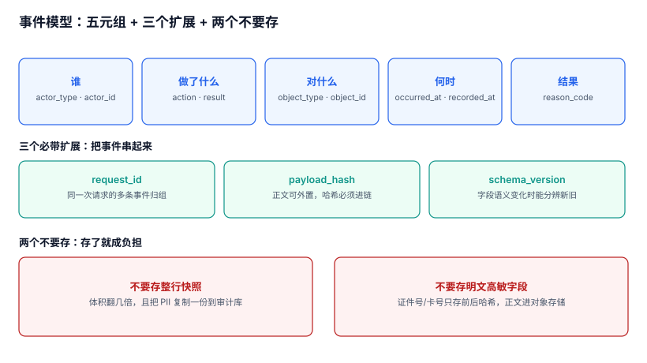

# 事件模型：留什么、留多细、留多久

审计事件与业务日志长得几乎一样，都是「一行带时间戳的文本」。区别在**用途**：日志是给系统自己看的（排障、统计），审计是给**别人**看的（监管、审计、法庭）。用途不同，字段的要求就完全不同——日志可以丢、可以采样、可以只写一句「refund ok」，审计不行。

本页解决三个问题：一条事件必须有哪些字段、`actor` 到底该记谁、载荷（before/after）记到什么颗粒度。

本页判据族 `ADE-A` ~ `ADE-H`，共 8 条。



## 一、事件不是日志：四条硬区别

| 维度 | 业务日志 | 审计事件 |
| --- | --- | --- |
| 读者 | 开发与运维 | 监管、法务、内审、法官 |
| 可丢性 | 可采样、可降级、可丢弃 | **一条都不能少**（缺一条就是断链） |
| 可改性 | 可清理旧数据、可改格式 | 只能追加，格式一旦发布即冻结 |
| 失败后果 | 排障慢一点 | 举证时无法自证，可能被推定不利 |

第四条最容易被低估。诉讼里对「一方自己保管、自己控制的电子记录」的采信度本来就低，如果这份记录还能被自己改写，对方只需要问一句「你们凭什么保证这行没被改过」，举证责任就回到了你身上。

::: danger 审计表不能当「更详细的日志表」用
同一个表既服务排障又服务举证，最后会两头不讨好：排障要的是「全、快、能搜」，举证要的是「不可改、可校验、可导出」。混在一起的典型结局是——为了让日志能滚动清理，给表加了 `DELETE` 权限，于是审计也能被删。**物理分表、物理分账号**，是最省事的边界。
:::

## 二、五元组：少了任何一个，记录就不能独立成立

一条能被独立复核的事件，最少需要五个要素：

| 要素 | 字段 | 反例 | 后果 |
| --- | --- | --- | --- |
| 谁 | `actor_type` + `actor_id` | 只记 `user_id`，服务账号为空 | 批处理操作查不到人 |
| 做了什么 | `action` + `result` | 只记 `action`，失败也被记成同一行 | 无法区分「尝试」与「成功」 |
| 对什么 | `object_type` + `object_id` | 只记 `order_id` 不记类型 | 跨表 ID 撞号后指向错对象 |
| 何时 | `occurred_at` + `recorded_at` | 只记一个时间 | 事后补录时无法区分「当时」与「现在」 |
| 结果如何 | `reason_code` | 只记 `deny` | 拒绝原因不可归类，风控复盘无据 |

五元组之外，**三个必带扩展**解决「怎么串起来」：

1. `request_id`：同一次请求产生的多条事件（下单 + 扣库存 + 记积分）靠它聚合。没有它，你只能按时间猜。
2. `payload_hash`：载荷正文的摘要。正文可以外置（对象存储），哈希必须进链——**链上跑的是哈希，不是正文**。
3. `schema_version`：字段含义变化时能分辨新旧。没有它，半年后没人知道 `result='ok'` 当时是不是包含「部分成功」。

## 三、`actor` 要记三层，不是一层

这是审计里最贵的单点错误：**记录格式完全正确，只是「谁」不对**。

| 层 | 字段 | 含义 | 缺失时的后果 |
| --- | --- | --- | --- |
| 认证主体 | `auth_subject` | 令牌/证书代表谁（可能是服务账号） | 分不清人与程序 |
| 授权主体 | `grant_subject` | 谁被授予了这个权限 | 越权追责时找不到授权链 |
| 实际操作人 | `on_behalf_of` | 代操作时的真实自然人 | 客服代客、运维代维全部归责不到人 |

代操作是常态而不是例外：客服后台、运维跳板机、批处理任务、第三方回调，四类场景都会让「令牌主体」与「真实操作人」分离。判据很简单：**任取一条代操作记录，三个字段都要有值，或者有显式的 `null` + 原因码**。`null` 不可怕，`null` 且没有原因码才可怕。

```sql
-- 找出「代操作但没记 on_behalf_of」的记录：这是归责黑洞
SELECT actor_type, COUNT(*) AS n
FROM audit_event
WHERE request_id LIKE 'svc-%'          -- 服务端发起的请求
  AND on_behalf_of IS NULL
  AND reason_code IS NULL
GROUP BY actor_type;
-- 预期：0 行。有行 = 服务端代操作没有传递真实操作人
```

## 四、两个时间：`occurred_at` 与 `recorded_at`

只记一个时间，会把两类完全不同的情况混成一种：

- 正常写入：两者相差毫秒级。
- 异步补录（消息重投、离线设备回传、批处理回填）：两者相差分钟到天。

举证时这个差值非常重要：对方问「为什么这条 10 月 1 日的退款记录是 10 月 8 日才写的」，你必须能答「这是 10 月 8 日补偿批处理的补录，`occurred_at` 是原始业务时间」。

时钟本身也会漂。本机实测（5 ms 一条的高密度流，20,000 条，按 `occurred_at` 排序后统计相邻逆序）：

| 时钟标准差 σ | 相邻逆序比例 | 结论 |
| --- | --- | --- |
| 1 ms | **0.01%** | 基本可忽略 |
| 2 ms | **3.57%** | 已经影响「谁先谁后」的判断 |
| 5 ms | **23.51%** | 排序结果接近随机 |

所以规则是：**链内定序用 `seq`，对外展示用 `occurred_at` + 偏移声明**。两者不可互换——用 `ts` 排序会在 5 ms 抖动下把因果顺序颠倒，用 `seq` 排序会让「补录的历史事件」排在末尾（那是对的，因为它确实后写）。

## 五、载荷：存 diff，不存整行

`payload` 记什么，是「能不能举证」与「会不会泄密」之间的取舍：

| 方案 | 能回答 | 风险 | 适用 |
| --- | --- | --- | --- |
| 不存 | 只知「改了」 | 举证时被问「改成了什么」答不上 | 不建议 |
| 存整行快照 | 全部 | 体积大，且把 PII 复制了一份到审计库 | 低频关键表 |
| 存字段级 diff | 改了哪几个字段、从什么改成什么 | 需要稳定的 diff 算法 | **推荐** |
| 只存 hash | 内容是否被改 | 无法举证内容本身 | 高敏字段（证件号、卡号） |

推荐组合：**字段级 diff 进 `payload`，高敏字段只存 `字段名 + 前后哈希`，正文放对象存储并用 `payload_hash` 锚住**。这样既回答了「改成了什么」，又没有在审计库里多存一份身份证号。

```json
{
  "seq": 100231,
  "action": "customer.update",
  "object_type": "customer",
  "object_id": "C-88213",
  "diff": [
    {"field": "phone", "from_hash": "9f2c…", "to_hash": "41ab…"},
    {"field": "level", "from": "normal", "to": "vip"}
  ],
  "schema_version": 3
}
```

注意 `diff` 里 `phone` 只有哈希、`level` 有明文。这个不对称是**刻意的**：分级依据是「该字段泄露的代价是否高于举证的价值」。

## 六、体积：246.6 字节一条，一年 90 GB

体积决定三件事：链的复算成本、留存成本、导出分卷数。本机实测（20 万条真实字段结构的事件，canonical JSON 序列化）：

| 指标 | 读数 |
| --- | --- |
| 单条平均字节 | **246.6 B** |
| P95 字节 | **294 B** |
| 日增 100 万条时年增 | **90.0 GB** |
| 20 万条建链耗时 | **1,490.0 ms**（7.45 µs/条） |

90 GB/年不算大，但它是**只增不减**的。真正的成本不在存储，在「五年后还要能复算」——按 3.65 亿条/年推算，全链复算一次需要 **46.8 分钟**，这个数字决定了你必须做分段校验，见[完整性校验](../IntegrityCheck/index.md)。

## 七、审计不能采样

监控可以采样，链路追踪可以采样，审计不行。原因很直接：**采样的前提是「没采到的和采到的一样」**，而审计要回答的恰恰是「那一条特定的记录在哪」。

本机模拟（10 万条事件、随机 100 次篡改，按比例抽样后能命中的次数）：

| 采样率 | 100 次篡改中命中 | 结论 |
| --- | --- | --- |
| 10% | **11 次** | 89% 的篡改永久不可见 |
| 1% | **2 次** | 等于没有审计 |

同一逻辑适用于「只记关键操作」：判断「什么算关键」发生在写入时，而举证需求发生在事后——**用写入时的判断去满足事后的需求，必然漏**。可行的降本手段只有两个：字段裁剪（少存正文、多存哈希）与分层存储（见[留存与销毁](../RetentionDisposal/index.md)），不是采样。

## 八、本页判据

| 编号 | 判据 | 为什么要它 | 怎么验证 |
| --- | --- | --- | --- |
| `ADE-A` | 审计事件与业务日志物理分表、分账号，审计表对应用账号只开 `INSERT` | 同一个可写身份是证据被抹掉的最短路径 | 用应用账号执行 `UPDATE`/`DELETE` 必须报权限错误 |
| `ADE-B` | 五元组齐全，`result` 区分 `allow`/`deny`/`error` | 只记成功等于只记好消息 | 表上有 `CHECK` 约束限制 `result` 取值 |
| `ADE-C` | `actor` 三层（认证/授权/实际）齐全，代操作必须有 `on_behalf_of` 或原因码 | 服务账号代操作是归责失败第一源 | 代操作记录里 `on_behalf_of IS NULL AND reason_code IS NULL` 为 0 行 |
| `ADE-D` | `occurred_at` 与 `recorded_at` 都存在，差值可查 | 补录与实时写入必须能区分 | 补录批次的时间差显著大于实时写入 |
| `ADE-E` | 链内定序用 `seq`，不用时间戳 | 时钟抖动会颠倒因果 | 按 `ts` 与按 `seq` 排序的结果差异率可测（σ=5 ms 时 23.51%） |
| `ADE-F` | 载荷存字段级 diff，高敏字段只存前后哈希 | 既要能举证，又不能扩大 PII 面 | 审计表中不存在明文证件号/卡号 |
| `ADE-G` | 每条事件带 `schema_version` | 字段语义会变，旧记录必须能按旧版解释 | 取一年前的记录，能查到当时的 `schema_version` |
| `ADE-H` | 审计不做采样、不做「只记关键操作」的过滤 | 采样的前提在审计场景不成立 | 同一业务表变更数与审计事件数一一对应 |

## 九、验证方式

```shell
# 1) 应用账号对审计表只有 INSERT：两条都必须被拒
psql "$DSN" -c "UPDATE audit_event SET object_id='x' WHERE seq=1;"
psql "$DSN" -c "DELETE FROM audit_event WHERE seq=1;"
# 预期：ERROR: permission denied for table audit_event（两条都是）
```

```sql
-- 2) 五元组完备性：任一字段为空就是「不能独立成立」的记录
SELECT COUNT(*) AS total,
       SUM(CASE WHEN actor_id IS NULL OR action IS NULL OR object_id IS NULL
                  OR occurred_at IS NULL OR result IS NULL THEN 1 ELSE 0 END) AS incomplete
FROM audit_event;
-- 预期：incomplete = 0
```

```sql
-- 3) 载荷里有没有明文高敏字段（以证件号为例）
SELECT COUNT(*) FROM audit_event
WHERE payload::text ~ '[0-9]{17}[0-9Xx]';
-- 预期：0。有值 = diff 把高敏字段的明文写进了审计库
```

## 十、参考资料

- [OWASP Logging Cheat Sheet](https://cheatsheetseries.owasp.org/cheatsheets/Logging_Cheat_Sheet.html)：事件字段清单与「不该记录什么」，本页七条字段纪律的直接依据（2026-11 核对）
- [NIST SP 800-92](https://csrc.nist.gov/pubs/sp/800/92/final)：日志内容与来源分类，本页「五元组」与「三个扩展」的对照
- [RFC 3339: Date and Time on the Internet](https://datatracker.ietf.org/doc/html/rfc3339)：时间格式与时区偏移的写法，本页双时间字段的格式依据
- [PostgreSQL: CREATE POLICY](https://www.postgresql.org/docs/current/sql-createpolicy.html)：行级策略只开 `INSERT` 的实现方式，本页 `ADE-A` 的落地手段
- [JSON Canonicalization Scheme (RFC 8785)](https://datatracker.ietf.org/doc/html/rfc8785)：序列化稳定性，本页未展开但[完整性校验](../IntegrityCheck/index.md)依赖它
