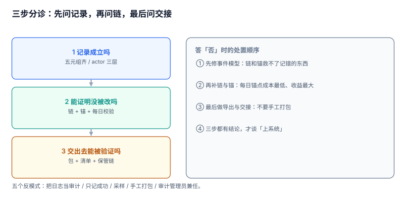

# 常见问题与分诊

这一页收的是做审计留痕时被反复问到的判断题。它们大多不是「某个 API 怎么用」，而是「这个做法算不算数」——而这类问题恰恰没有标准答案，只有口径。

十二问按出现频率排序，前三问覆盖一半的现场争议。

本页判据族 `ADZ-A` ~ `ADZ-H`，共 8 条。



## 一、三步分诊

遇到「我们的审计能不能用」这类问题，按顺序问三个，不要跳：

| 步 | 问什么 | 答「否」时的处置 |
| --- | --- | --- |
| 1 | 记录本身能独立成立吗（五元组齐、`actor` 三层） | 先修事件模型，链和锚都救不了记错的东西 |
| 2 | 记录能证明没被改吗（链 + 锚点 + 每日校验） | 补链与锚，先做每日锚点（成本最低、收益最大） |
| 3 | 交出去的东西能被验证吗（包 + 清单 + 保管链） | 做导出程序与交接单，不要手工打包 |

顺序反了会浪费很多时间：先做证据包模板的团队，最后发现包里的事件缺 `before/after`，只能推倒重来。

## 二、十二问

### 1. 我们有 ELK，还需要单独做审计吗

需要。ELK 解决「日志在哪、怎么搜」，不解决「这条记录能不能被改、能不能证明没被改」。日志系统通常允许管理员删除索引、调整保留期、重新索引——**这三个动作在审计语境里都等于销毁证据**。

判据：日志系统的管理员能不能在你不察觉的情况下删掉某一天的记录？能，就需要独立的审计链。

### 2. 哈希链能不能防止内部人改数据

不能「防止」，能「发现」，且只能发现「中间被改」。本机实测：改中间一行与删中间一行都能定位到 `seq`；但截掉末尾 1 / 100 / 5,000 条，**三种情况全部判 OK**。

所以「防内部人」需要三件套：库层追加写（挡住误操作）、哈希链（发现中间改动）、外部锚点（发现末尾截断）。少任何一件，攻击面都留着。

### 3. 我们把审计表放在业务库里，有问题吗

表同库不是问题，**同一个可写身份**才是问题。判据只有一条：应用使用的数据库账号对审计表有没有 `UPDATE`/`DELETE` 权限？有，就必须拆。

如果拆库成本太高，最低成本的替代是：同库、不同 schema、应用账号只被授予 `INSERT`，并用触发器拒绝改删。这挡不住 DBA，但挡住了 90% 的现实风险（应用 bug、注入、误操作脚本）。

### 4. `actor` 记谁：登录用户还是服务账号

都记。三层字段：`auth_subject`（令牌代表谁）、`grant_subject`（谁授的权）、`on_behalf_of`（真实操作人）。

只记登录用户会漏掉「服务账号批处理」，只记服务账号会漏掉「谁让他跑的」。代操作场景（客服代客、运维代维）必须有 `on_behalf_of`，否则归责链条在第一环就断了。

### 5. 事件里要不要存 before/after 明文

存 diff，不存整行；高敏字段只存前后哈希。理由有两个：体积（本机 246.6 B/条，存整行会翻几倍）与 PII 面（审计库不该成为第二份用户资料库）。

判据：审计表里能不能 `grep` 出身份证号？能，就说明 diff 太粗。

### 6. 校验跑一次要 46 分钟，能不能只跑最近三个月

不能只跑最近三个月——那正好给「改三个月前的记录」留了门。正确做法是**分段校验 + 每日锚点对齐**：每日对齐是常数成本（比较两个数字），分段校验按需触发（怀疑哪段验哪段，本机 1,000 条 7.42 ms）。

全链校验保留给三个时刻：取证前、恢复后、迁移后。

### 7. 证据包对方拒收，最常见的原因是什么

按现场经验排序：① 没有清单（直接 zip 发过去）；② 清单与文件对不上（导出后又手工改了一个）；③ 校验报告是截图（无法复跑）；④ 时间范围与请求不符（筛选条件没进包）；⑤ 缺锚点回执。

第 ③ 条最容易被忽略：报告必须由脚本生成，并附上生成命令。**截图证明不了任何事**。

### 8. 同一个案件导出两次哈希不一样，怎么办

先查包内有没有易变字段（导出时刻、耗时、随机 ID）。本机实测：含这些字段时两次哈希不同（`291a6f8f…` vs `2570d9ed…`），固定字段后两次相同（`23001c76…`）。

改法：易变元数据放 `manifest.meta` 且不参与总哈希；事件按 `seq` 排序；字段顺序固定；`exporter_version` 进包。

### 9. 用户要求删除，但我们要留 5 年，怎么答

分三种回答，对应三种状态：

1. 无保留义务：立即删除，回「已删除」。
2. 有保留义务但现在不能删：状态 `blocked`，回「依据 X，将于 Y 日后删除」。
3. 诉讼冻结中：状态 `blocked`，回「因案件冻结，暂不能删除」，并给冻结依据编号。

本机模拟 5,000 个删除请求，**83.26% 落在法定保留期内**——所以第 2 种是常态，系统必须能给出「依据 + 到期日」，否则在监管看来就是「不配合」。

### 10. 能不能把历史记录改掉来做脱敏

不能。改历史行会同时造成两个后果：链断（哈希对不上）与举证失效（历史被改写）。正确做法是**新增一条脱敏事件**（`action='pii.mask'`），原记录保留但字段指向脱敏值，链继续往下走。

如果法规要求原值必须消失，走「归档冻结 + 到期整段销毁」，而不是就地改写。

### 11. 谁能读审计：给 CTO 开一个只读账号行不行

不建议。审计读权限应该由「案件 + 角色 + 目的」三者共同决定，而不是「职级」。给高管开全量只读，等于让最有能力规避的人拥有最完整的视野。

可行折中：高管看**聚合视图**（谁在什么时候查了审计、查了多少行），不看明细。要看明细，走案件流程。

### 12. 上审计系统要多少人月

不按人月算，按「三件事有没有人负责」算：① 事件模型（谁定字段、谁改）；② 链与锚（谁运维锚定任务、回执存哪）；③ 取证流程（谁接案件、谁做交接）。三件事各有一个人，两个人月能起步；三件事都没人，二十人月也做不出能举证的系统。

## 三、五个反模式

| 反模式 | 表现 | 后果 | 正解 |
| --- | --- | --- | --- |
| 把日志当审计 | 「我们 ELK 里有」 | 管理员可删索引 | 独立链 + 锚点 |
| 只记成功 | 审计里全是 `ok` | 无法解释「为什么没做」 | `result` 三态 |
| 采样 | 「量大，抽 10%」 | 100 次篡改只命中 11 次 | 字段裁剪 + 分层，不采样 |
| 手工打包 | 用 zip 压缩后发邮件 | 无清单、无回执、不可复现 | 导出程序 + 交接单 |
| 审计管理员兼任 | 一个人既能读又能改 | 四眼失效 | 读改分离 |

## 四、术语表

| 术语 | 含义 | 易混点 |
| --- | --- | --- |
| 留痕（logging） | 把操作记下来 | 不等于可举证 |
| 链（hash chain） | 每条记录带前驱哈希 | 挡不住末尾截断 |
| 锚定（anchoring） | 把链头交给外部 | 回执必须存库外 |
| 保管链（chain of custody） | 证据包的交接记录 | 不等于哈希链 |
| WORM | 一次写入多次读取 | 锁的是对象版本，不是桶 |
| 法定保留（legal hold） | 依法不得删除的期间 | `hold_to` 为空视为永久 |
| 四眼原则 | 申请 + 批准 + 留痕 | 不防两人合谋 |

## 五、本页判据

| 编号 | 判据 | 为什么要它 | 怎么验证 |
| --- | --- | --- | --- |
| `ADZ-A` | 分诊按「记录 → 链 → 交接」三步走，不跳步 | 跳步会做无用功 | 分诊记录里三步都有结论 |
| `ADZ-B` | 「有日志系统」不被当作「有审计」 | 两者解决的问题不同 | 能指出日志管理员的删除权限 |
| `ADZ-C` | 哈希链的能力边界被明确写进方案（含截断盲区） | 夸大能力会在取证时被击穿 | 方案里有「不能发现什么」一节 |
| `ADZ-D` | 审计表与应用账号的权限边界可验证 | 同库同账号是最短攻击路径 | 应用账号 `UPDATE` 必须失败 |
| `ADZ-E` | 证据包拒收的五类原因有对应检查 | 拒收往往源于可预防的疏漏 | 交付前逐项自检 |
| `ADZ-F` | 删除请求的回答模板含「依据 + 到期日」 | 只回 403 等于不配合 | 抽 10 条 `blocked` 记录检查 |
| `ADZ-G` | 脱敏以新增事件实现，不改历史 | 改历史会断链 | 脱敏后链校验通过 |
| `ADZ-H` | 审计读权限不按职级授予，按案件授予 | 视野最全的人最会规避 | 权限矩阵里无「全量只读」角色 |

## 六、验证方式

```sql
-- 1) 反模式自查：审计里是不是只有成功记录
SELECT result, COUNT(*) FROM audit_event GROUP BY result;
-- 预期：allow / deny / error 三态都有（比例可悬殊，但不能只有 allow）
```

```sql
-- 2) 采样自查：审计事件数与业务变更数是否一一对应
SELECT (SELECT COUNT(*) FROM audit_event WHERE action LIKE 'order.%') AS audit_rows,
       (SELECT COUNT(*) FROM order_history) AS biz_rows;
-- 预期：两个数相等。审计少于业务 = 有采样或过滤
```

```shell
# 3) 交付前五项自检（对应第 7 问）
test -f manifest.json && jq -e '.files | length > 0' manifest.json >/dev/null && echo "清单 OK"
jq -r '.files[] | "\(.sha256)  \(.name)"' manifest.json | shasum -a 256 -c - | grep -v OK || echo "文件一致 OK"
test -f verify_report.txt && echo "校验报告 OK"
test -f anchor_receipt.tsr && echo "锚点回执 OK"
test -f custody.json && echo "保管链 OK"
# 预期：五项全部输出 OK
```

## 七、参考资料

- [NIST SP 800-92](https://csrc.nist.gov/pubs/sp/800/92/final)：日志管理与审计的区别，本页第 1 问的依据（2026-11 核对）
- [ISO/IEC 27037:2012](https://www.iso.org/standard/44381.html)：证据保全与移交，本页第 7 问的检查项来源
- [RFC 3161](https://datatracker.ietf.org/doc/html/rfc3161)：锚点回执格式，第 7 问第 5 项的依据
- [OWASP Logging Cheat Sheet](https://cheatsheetseries.owasp.org/cheatsheets/Logging_Cheat_Sheet.html)：字段与访问控制，第 4、11 问的对照
- [GDPR Art. 17](https://gdpr-info.eu/art-17-gdpr/)：删除权与例外，第 9 问的法律框架
