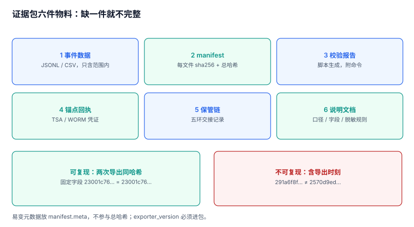

# 取证导出：证据包、清单与可复现

「导出一份数据给对方」和「交付一个证据包」的差别，不在文件格式，而在**对方能不能自己验证**。CSV 加一封邮件，对方只能选择信或不信；证据包里有清单、有校验报告、有锚点回执、有交接记录，对方可以自己算一遍。

本页给出证据包的六件物料、可复现的三条纪律，以及一份「对方会拒收什么」的清单。

本页判据族 `ADG-A` ~ `ADG-H`，共 8 条。



## 一、六件物料，缺一件就不完整

| # | 物料 | 作用 | 缺失时对方的反应 |
| --- | --- | --- | --- |
| 1 | 事件数据（JSONL/CSV，只含范围内记录） | 内容本体 | 无法核对事实 |
| 2 | `manifest.json`（文件清单 + 每文件 sha256 + 总哈希） | 证明包内文件未被替换 | 「你怎么证明这份 CSV 没被编辑过」 |
| 3 | 链校验报告（全链或区间校验的结论） | 证明记录来自真实的链 | 「这份数据是你们现编的吧」 |
| 4 | 锚点回执（TSA/透明日志/WORM 凭证） | 证明链头在某个时刻已存在 | 「截断过的链也能自校验通过」 |
| 5 | 保管链记录（五环交接） | 证明包在传递中没被替换 | 「中间经过谁的手」 |
| 6 | 说明文档（口径、字段、筛选条件、脱敏规则） | 让对方能读懂并复算 | 「这个字段是什么意思」 |

第 2 件是分水岭。没有 `manifest`，包内任何一个文件都可以被单独替换而不留痕；有了它，替换一个字节都能被发现——**这也是本册「证据」与「数据」的分界线**。

## 二、可复现：同一个案件导出两次，哈希必须一样

这是最容易被忽略、也最容易被对方一句话击穿的一条。本机实测（同一案件、500 条事件）：

| 包内是否含「导出时刻 / 耗时」等易变字段 | 第一次 `manifest_sha256` | 第二次 | 结论 |
| --- | --- | --- | --- |
| 不含（固定字段） | `23001c769ba83d9c` | `23001c769ba83d9c` | **可复现** |
| 含 | `291a6f8fb920bb4c` | `2570d9eda1b44861` | **不可复现** |

不可复现的后果很具体：你无法证明「今天这份包」与「三个月前交给监管的那份包」是同一批数据。对方只要拿两份包一比对哈希，就会得到「你们两次导出的东西不一样」——而你可能只是重跑了一次。

三条纪律：

1. **进入哈希的内容必须确定**：事件按 `seq` 排序、字段按固定顺序、时间统一 UTC + 毫秒。
2. **易变元数据放哈希之外**：导出时刻、操作人、耗时写在 `manifest` 的 `meta` 段里，`meta` 不参与总哈希计算（或单独计算并标注）。
3. **导出程序版本进包**：同一份数据用不同版本的导出程序可能产生不同字段序。`exporter_version` 必须出现，否则「复现」依赖于你恰好还在用同一个版本。

```json
{
  "meta": {"case_id": "C-2026-0917", "exported_at": "2026-11-07T10:00:00Z",
           "exported_by": "auditor-a", "exporter_version": "1.4.2"},
  "scope": {"from": "2026-08-01T00:00:00Z", "to": "2026-09-30T23:59:59Z",
            "object_types": ["order", "refund"], "stream": "S-1"},
  "files": [
    {"name": "events.jsonl", "rows": 500, "sha256": "…", "bytes": 4194304}
  ],
  "chain": {"verified": true, "from_seq": 1, "to_seq": 500, "anchor_id": "AN-1"},
  "manifest_sha256": "23001c769ba83d9c"
}
```

注意 `scope` 必须显式写出**筛选条件**而不只是「案件号」。同一个案件在不同时间导出，若筛选条件没进包，对方无法判断两份包的差异来自数据变化还是条件变化。

## 三、范围裁剪：宁可多给，不要少给

取证的范围通常由对方指定（某段时间、某个对象、某个租户）。三个常见错误：

| 错误 | 后果 | 正确做法 |
| --- | --- | --- |
| 只导「相关表」的记录 | 缺上下文，事件无法自解释 | 按对象 ID 拉全链路（含上下游动作） |
| 按 `occurred_at` 过滤但记录是补录的 | 漏掉补录段 | 用 `occurred_at` 与 `recorded_at` 双条件，并说明 |
| 只导成功的操作 | 无法解释「为什么没做」 | 失败与拒绝的记录同样在范围内 |

第三条尤其重要。举证时「他尝试了但被拒绝」与「他没尝试」是两个完全不同的事实，而只导成功记录的包，恰好把这两者混成了一种。

## 四、脱敏与完整性的冲突

证据里常有 PII（手机号、证件号、地址）。脱敏之后，哈希必然变化，于是出现一个死结：**脱敏后的文件无法与原始链对上**。

三种解法，各有代价：

| 解法 | 做法 | 代价 |
| --- | --- | --- |
| 双份交付 | 原文封存（法官/监管可见）+ 脱敏版（业务方可见） | 需要两套保管链 |
| 保留哈希 | 脱敏值 + 原文值的哈希同时给出 | 对方无法验证脱敏是否正确，只能验证原文未被改 |
| 规则版本化 | 给出脱敏规则（`mask_v3`）与规则哈希 | 需要规则本身可复现 |

推荐组合是「双份交付 + 规则版本化」：脱敏版给业务方看，原文版封存，两份包各自的 `manifest` 独立，并在说明文档里写清「哪份对应哪条保管链」。**不要试图让一份包同时满足两种读者**，那会让两种读者都不满意。

## 五、交付：加密、分卷、校验和

导出之后还有一段路，这段路的失败率比导出本身高：

1. **加密**：包内有 PII，传输与静态都必须加密。密码/密钥**不能放在同一封邮件里**——这是最常见的形式合规问题。
2. **分卷**：单文件超过 2 GB 时，很多渠道（邮件、IM、部分监管系统）会直接拒收。按 500 MB 分卷，并在 `manifest` 里列出每个分卷的哈希。
3. **校验和单独给**：`manifest_sha256` 通过另一条通道（电话/短信/纸质）告知，否则「包和被改过的清单一起发过去」是无法被发现的。
4. **回执**：对方签收后必须回传签收单（谁、何时、以什么介质），这一环进保管链（见[保管链](../CustodyChain/index.md)）。

## 六、对方会拒收什么

站在接收方视角列一份清单，比站在自己视角写「我们做了什么」有用得多：

| 拒收理由 | 根因 | 事前可避免 |
| --- | --- | --- |
| 包内没有清单 | 用 `zip` 打包直接发 | 强制走导出程序 |
| 清单与文件对不上 | 导出后又手工改了一个文件 | 导出后不允许再打开编辑 |
| 校验报告是截图 | 报告没有可执行来源 | 报告必须由脚本生成并附命令 |
| 时间范围与请求不符 | 筛选条件没进包 | `scope` 落进 `manifest` |
| 缺锚点回执 | 「我们每天锚定」但回执没归档 | 回执与包同目录存放 |
| 出现明文身份证号 | 脱敏规则漏字段 | 导出前跑一遍正则自检 |

最后一条是硬伤：一旦包里出现不该出现的 PII，整包可能被要求重做，而重做意味着新的保管链、新的回执、新的签收——**工期通常不够**。

```shell
# 导出前自检：包内是否出现疑似证件号/手机号（示例，按自身规则调整）
grep -nE '([0-9]{17}[0-9Xx])|(1[3-9][0-9]{9})' events.jsonl | head
# 预期：无输出。有输出 = 脱敏漏字段，禁止交付
```

## 七、本页判据

| 编号 | 判据 | 为什么要它 | 怎么验证 |
| --- | --- | --- | --- |
| `ADG-A` | 证据包六件物料齐全，缺任一件视为未交付 | 缺清单的包无法自证 | 按清单逐项检查，六项全在 |
| `ADG-B` | `manifest` 含每文件 sha256 与总哈希，且总哈希不含易变字段 | 可复现是自证的前提 | 连导两次，总哈希相等 |
| `ADG-C` | `scope` 落进包内（时间、对象类型、租户、流） | 否则无法解释两次导出的差异 | 打开 `manifest` 能看到完整筛选条件 |
| `ADG-D` | 范围内包含失败/拒绝的记录 | 「尝试过」与「没尝试」是不同事实 | 包内存在 `result != 'allow'` 的行 |
| `ADG-E` | 脱敏有规则版本，且原文版与脱敏版各自独立成包 | 一份包无法服务两类读者 | 两个包各有 `manifest` 与保管链 |
| `ADG-F` | 传输加密，密钥与包分通道传递 | 同通道等于没加密 | 密钥通过电话/纸质/另一系统传递 |
| `ADG-G` | 超过 2 GB 时分卷，分卷哈希列入清单 | 大文件会被渠道拒收 | 分卷数与清单条数一致 |
| `ADG-H` | 导出前跑 PII 自检，命中即阻断交付 | 一包 PII 可以让整包作废 | 自检命令输出为空才允许打包 |

## 八、验证方式

```shell
# 1) 可复现性：连导两次，比对总哈希（必须相等）
python3 export_case.py --case C-2026-0917 --out /tmp/pack-a
python3 export_case.py --case C-2026-0917 --out /tmp/pack-b
jq -r .manifest_sha256 /tmp/pack-a/manifest.json /tmp/pack-b/manifest.json
# 预期：两行相同。不同 = 包内混入了导出时刻/耗时等易变字段
```

```shell
# 2) 清单与实物一致：逐文件重算 sha256
cd /tmp/pack-a && jq -r '.files[] | "\(.sha256)  \(.name)"' manifest.json | shasum -a 256 -c -
# 预期：每个文件一行 OK。任一 FAILED = 包被改过或清单过期
```

```sql
-- 3) 包内条数与库内条数是否一致（防止导出时静默截断）
SELECT (SELECT COUNT(*) FROM audit_event
        WHERE stream_id = 'S-1'
          AND object_type IN ('order','refund')
          AND occurred_at BETWEEN '2026-08-01T00:00:00Z' AND '2026-09-30T23:59:59Z') AS db_rows;
-- 与 manifest.files[0].rows 比对，必须相等
```

第三条是「静默截断」的唯一防线：导出程序为了内存安全常加 `LIMIT`，而 `LIMIT` 命中时**不会报错**，只会少给几行。

## 九、参考资料

- [RFC 3161: Time-Stamp Protocol](https://datatracker.ietf.org/doc/html/rfc3161)：锚点回执的格式，本页第 4 件物料的依据（2026-11 核对）
- [RFC 4180: Common Format and MIME Type for CSV Files](https://datatracker.ietf.org/doc/html/rfc4180)：CSV 交付的转义与编码约定，避免「对方打开乱码」
- [RFC 8785: JSON Canonicalization Scheme](https://datatracker.ietf.org/doc/html/rfc8785)：可复现哈希的序列化前提
- [ISO/IEC 27037:2012](https://www.iso.org/standard/44381.html)：电子证据的识别、收集、获取与保全，本页「六件物料」的框架来源
- [NIST SP 800-86: Guide to Integrating Forensic Techniques](https://csrc.nist.gov/pubs/sp/800/86/final)：取证流程与工具验证，本页「校验报告必须可执行」的依据
