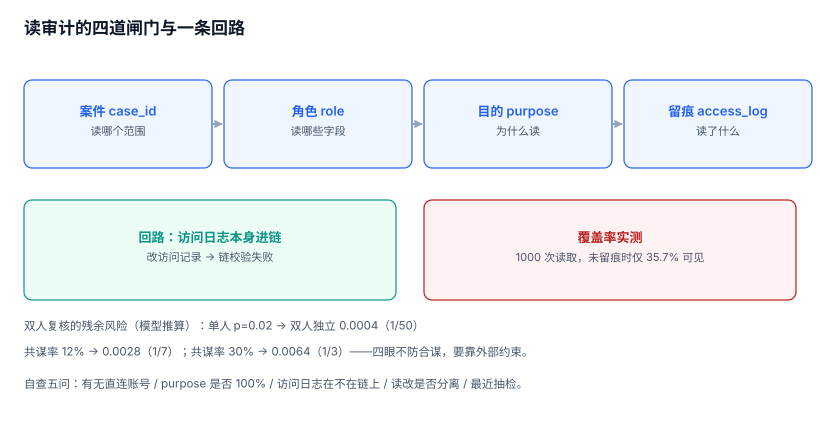

# 四眼原则与审计访问

审计库是整个系统里信息密度最高的地方：谁在什么时候做了什么、金额多少、改前改后是什么。它同时具备两个属性——**必须有人能读**（否则失去意义）与**读的人本身就是风险**（一次批量导出等于把全公司的操作史带走）。

本页解决三个问题：谁可以读、读的时候要留下什么、以及「四眼」到底防住了什么、防不住什么。

本页判据族 `ADK-A` ~ `ADK-H`，共 8 条。



## 一、读权限不是「管理员」

最常见的错误是把审计读权限授予「超级管理员」。它有两个后果：

1. **超级管理员能看到「谁查过他的操作」**，于是可以针对性规避。
2. **超级管理员能改审计表**（如果同库同账号），于是「查」与「改」是同一个人。

正确模型是三条正交的授权，缺一不可：

| 维度 | 控制什么 | 典型实现 |
| --- | --- | --- |
| 案件（case） | 能读哪个范围 | 每次查询必须关联 `case_id`，范围由案件定义 |
| 角色（role） | 能读哪些字段 | 分析师看 `action/result`，不看 `payload` 明文 |
| 目的（purpose） | 为什么读 | 必填，且有最小长度与词表约束 |

三条正交的意思是：**有角色无案件 = 不能读**（防止「随手查一下」），**有案件无目的 = 不能读**（防止无法解释的查询）。

```sql
CREATE TABLE audit_access_log (
  access_id   TEXT PRIMARY KEY,
  viewer      TEXT NOT NULL,
  purpose     TEXT NOT NULL CHECK (length(trim(purpose)) >= 8),
  case_id     TEXT,
  filter_expr TEXT NOT NULL,
  row_count   INTEGER NOT NULL,
  approved_by TEXT,
  at          TEXT NOT NULL
);
```

`purpose` 的 `CHECK` 约束是刻意粗糙的：它拦不住「随便写八个字」，但能拦住空值与「看」这种一个字的敷衍。真正的质量控制靠**事后抽检**——每个月抽 20 条访问记录，看 `purpose` 与 `filter_expr` 是否匹配。

## 二、四眼：申请、批准、读取、留痕

| 环 | 动作 | 谁 | 留下什么 |
| --- | --- | --- | --- |
| 1 | 提出申请（案件 + 范围 + 目的） | 申请人 | 申请单：`case_id`、时间范围、对象范围、目的 |
| 2 | 批准 | 第二人（合规/法务） | 批准人、批准时间、批准的范围 |
| 3 | 执行读取 | 申请人 | `filter_expr`、`row_count`、结果哈希 |
| 4 | 读取留痕进链 | 系统 | 一条 `audit.access` 事件，进同一条链 |

第 4 环是分水岭。**如果访问日志不在链上，改访问日志就能隐身**：查了三个小时，把访问记录删掉，系统里看不出任何痕迹。而访问日志一旦进链，删除就会断链——这就是「读审计的人被审计」的落地方式。

::: tip 一句话理解
四眼的本质不是「两个人一起看」，而是**任何一次读取都留下两条无法互相抵消的记录**：一条在访问日志里（谁读了什么），一条在链上（这条访问日志本身没被改）。
:::

## 三、双人复核防住了什么

用最简单的模型算一遍（模型推算，非实测；`p` = 单人越权或误操作的概率，`c` = 两人共谋的比例）：

| 场景 | 残余风险 | 相对单人 |
| --- | --- | --- |
| 单人 | `p = 0.02` | 1× |
| 双人独立（`p²`） | `0.0004` | **1/50** |
| 双人 + 共谋率 12%（`p² + c·p`） | `0.0028` | 1/7 |
| 双人 + 共谋率 30% | `0.0064` | 1/3 |

两个结论都很重要：

1. **四眼对「单人误操作/单人越权」非常有效**（50 倍降幅）。
2. **四眼对「两人合谋」几乎无效**——共谋率一升到 30%，降幅只剩 3 倍。

所以四眼必须配合**第三方约束**才有意义：访问日志进链（改不了）、定期抽检（不看也知道会被看）、外部审计（不归你管）。**只靠「两个人签字」的流程，在利益足够大时会退化成一个人签两次。**

## 四、读取留痕的覆盖率：35.7%

这是本页最刺眼的一个数字。本机模拟 1,000 次审计读取，只有部分通道做了读取留痕：

| 指标 | 读数 |
| --- | --- |
| 读取次数 | 1,000 |
| 可见（有留痕） | **357（35.7%）** |
| 不可见 | 643（64.3%） |

不可见的通道通常有四个：直连数据库的客户端、BI 工具的临时查询、导出文件的二次分发、备份恢复出来的副本。前两个能靠「只开 API 不开库权限」收口，后两个只能靠制度 + 水印。

一条实用判据：**审计库不应有「人可以直接连」的账号**。所有读取走同一个服务，服务负责鉴权、留痕、限流。这条做起来比看起来难，但它是 35.7% 与 100% 的分界线。

## 五、最小化：能不看就不看

四眼管「谁能看」，最小化管「能看多少」。三个具体手段：

| 手段 | 做法 | 效果 |
| --- | --- | --- |
| 列裁剪 | 默认视图不含 `payload` 明文，只有哈希 | 泄露面从「内容」降到「行为」 |
| 行限制 | 单次查询上限 5,000 行，超出必须分批并留痕 | 阻断「一次性拖库」 |
| 聚合优先 | 先给统计结果，需要明细再申请 | 大多数问题不需要明细 |

第二条要与「取证需要全量」协调：取证场景可以突破 5,000 行，但必须**升级为案件级授权**（有案件号、有批准人），而不是把上限调大。

```sql
-- 默认视图：不含 payload 明文
CREATE VIEW v_audit_safe AS
SELECT stream_id, seq, occurred_at, actor_type, actor_id, action,
       object_type, object_id, result, reason_code, request_id, payload_hash
FROM audit_event;
-- 只有案件级角色能读基表；其他角色只能读这个视图
GRANT SELECT ON v_audit_safe TO role_analyst;
```

## 六、自查：五个问题

上线前用这五个问题自查，比看一堆制度文档有用：

1. 审计库有没有「人可以直接连」的账号？（应为 0）
2. 每一次读取是否都能说出「为什么读」？（`purpose` 非空率 100%）
3. 访问日志本身在不在链上？（在 = 改不了）
4. 有没有人既能读审计又能改审计？（应为 0）
5. 最近一次抽检是什么时候、抽了几条、发现了什么？（应有记录）

第 4 条最容易被忽略：在很多系统里，「审计管理员」这个角色同时拥有读与改的权限——这在设计上就是自相矛盾的。**读与改必须由两个不同的角色持有，且两个角色不能由同一个人同时拥有。**

## 七、本页判据

| 编号 | 判据 | 为什么要它 | 怎么验证 |
| --- | --- | --- | --- |
| `ADK-A` | 读权限由「案件 + 角色 + 目的」三者共同决定 | 单一维度授权必然过宽 | 无案件或无目的的请求必须被拒 |
| `ADK-B` | 每次读取落 `audit_access_log`，含 `filter_expr` 与 `row_count` | 没有记录就无法复查 | 任取一次读取，能查到完整条件 |
| `ADK-C` | `purpose` 有最小长度约束，且事后抽检 | 空目的等于没有目的 | 插入 `'看'` 必须失败 |
| `ADK-D` | 访问日志本身进链 | 否则改访问记录即可隐身 | 删除访问日志会触发链校验失败 |
| `ADK-E` | 读与改由不同角色持有，且不可由同一人兼任 | 同人读写等于没有四眼 | 权限矩阵里两列无交集 |
| `ADK-F` | 默认视图不含载荷明文，明细需升级授权 | 最小化是低成本的泄露防线 | 分析师角色查不到 `payload` 列 |
| `ADK-G` | 单次查询有行数上限，突破需案件级授权 | 阻断一次性拖库 | 超限请求返回明确错误而非静默截断 |
| `ADK-H` | 审计库无「人可直连」账号，读取统一走服务 | 直连账号是留痕黑洞 | 数据库账号清单里只有服务账号 |

## 八、验证方式

```sql
-- 1) 有没有「无目的」的读取记录
SELECT COUNT(*) AS total,
       SUM(CASE WHEN length(trim(COALESCE(purpose,''))) < 8 THEN 1 ELSE 0 END) AS bad
FROM audit_access_log;
-- 预期：bad = 0
```

```sql
-- 2) 有没有人既能读又能改（权限矩阵自检，PG 示例）
SELECT r.rolname,
       has_table_privilege(r.rolname, 'audit_event', 'SELECT') AS can_read,
       has_table_privilege(r.rolname, 'audit_event', 'UPDATE') AS can_write
FROM pg_roles r
WHERE has_table_privilege(r.rolname, 'audit_event', 'SELECT')
  AND has_table_privilege(r.rolname, 'audit_event', 'UPDATE');
-- 预期：0 行
```

```shell
# 3) 访问日志进链：删除一条访问日志，链校验必须失败
sqlite3 af.db "DELETE FROM audit_event WHERE action='audit.access' AND seq=42;"
# 预期：Runtime error: AUDIT_APPEND_ONLY —— 第一道门；
#       即使绕过触发器，链校验会给出 HASH_MISMATCH @42（第二道门）
```

## 九、参考资料

- [ISO/IEC 27001:2022 A.8.15 / A.5.3](https://www.iso.org/standard/27001)：日志访问的职责分离要求，本页「读改分离」的依据（2026-11 核对）
- [NIST SP 800-53 Rev.5 AU-9 / AU-11](https://csrc.nist.gov/pubs/sp/800/53/r5/upd1/final)：审计信息的保护与留存，本页访问日志进链的框架来源
- [OWASP Logging Cheat Sheet](https://cheatsheetseries.owasp.org/cheatsheets/Logging_Cheat_Sheet.html)：谁可以读日志、读到什么粒度
- [GDPR Art. 5(1)(c) 数据最小化](https://gdpr-info.eu/art-5-gdpr/)：本页「列裁剪 + 行限制」的合规依据
- [PostgreSQL: GRANT](https://www.postgresql.org/docs/current/sql-grant.html)：列级授权与视图授权的实现方式
