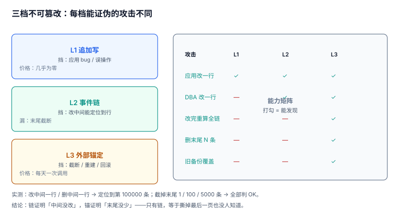

# 不可篡改：三档强度与「能证伪什么」

「不可篡改」是一个被用滥的词。数据库里加个 `created_at`、表上撤掉 `UPDATE` 权限、日志投到对象存储开个版本控制，三种做法都会在方案文档里写成「审计不可篡改」，但它们能证伪的攻击完全不同。

本页把这件事拆成三档，逐档说清**它能挡住谁、挡不住谁**，再给一条现实可落地的组合：表上追加写 + 事件链 + 每日外部锚定。

本页判据族 `ADM-A` ~ `ADM-H`，共 8 条。



## 一、三档强度

| 档 | 做法 | 挡得住 | 挡不住 | 成本 |
| --- | --- | --- | --- | --- |
| L1 追加写 | 撤 `UPDATE`/`DELETE` 权限、触发器拒绝改删 | 应用 bug、误操作、SQL 注入改数据 | 有 DBA 权限的人、直接改数据文件、恢复旧备份 | 几乎为零 |
| L2 事件链 | 每条记录带前驱哈希，改一条则后继全断 | L1 挡不住的全部，**且能定位到第几条** | 从末尾截断（链自校验仍通过） | 7.45 µs/条 |
| L3 外部锚定 | 定期把链头交给第三方（TSA/透明日志/WORM 桶） | 截断、整段替换、用旧备份回滚 | 第三方本身作恶（概率低但要写进风险表） | 每天一次调用 |

三档是叠加关系，不是替代关系。只做 L3 不做 L2 没有意义（没有链头可锚），只做 L2 不做 L3 会留下最大的一个洞。

::: tip 一句话理解
链证明「中间没被改」，锚证明「末尾没被少」。**只有链，等于把最后一页撕掉也没人知道。**
:::

## 二、L1：追加写要在库层守住

权限撤掉只是第一层，真正可靠的是**库层的写入约束**。用触发器把「序号连续」与「前驱哈希对得上」写进数据库，任何绕过应用的写入都会当场失败：

```sql
-- 禁改禁删
CREATE TRIGGER trg_event_no_update BEFORE UPDATE ON audit_event
BEGIN SELECT RAISE(ABORT, 'AUDIT_APPEND_ONLY'); END;

CREATE TRIGGER trg_event_no_delete BEFORE DELETE ON audit_event
BEGIN SELECT RAISE(ABORT, 'AUDIT_APPEND_ONLY'); END;

-- 序号连续 + 前驱哈希必须等于「上一行」的哈希
CREATE TRIGGER trg_event_seq_guard BEFORE INSERT ON audit_event
WHEN NEW.seq <> (SELECT COALESCE(MAX(seq), 0) + 1 FROM audit_event WHERE stream_id = NEW.stream_id)
  OR NEW.prev_hash <> (SELECT COALESCE(
       (SELECT hash FROM audit_event WHERE stream_id = NEW.stream_id ORDER BY seq DESC LIMIT 1),
       'GENESIS'))
BEGIN SELECT RAISE(ABORT, 'AUDIT_CHAIN_BREAK'); END;
```

::: danger 本页特有的坑：`MAX(hash)` 不是「最后一条的哈希」
上面第二个条件的第一版写的是 `(SELECT COALESCE(MAX(hash), 'GENESIS') FROM audit_event WHERE …)`。看起来是「取上一行的哈希」，实际是**取所有哈希里字典序最大的那个字符串**。二十万条里只要有一条哈希以 `ff…` 开头，之后每一条插入都会报 `AUDIT_CHAIN_BREAK`——而错误信息指向的是「链断了」，不是「查询写错了」，排查方向会被带偏很久。

正确写法只有两种：按 `seq` 倒序取一行（如上面所示），或者把链头单独存进 `audit_stream.head_hash` 并在同一事务里更新。**聚合函数不能用来表达「上一行」**，这是 SQL 里最容易犯的一类语义错误。
:::

## 三、L2：链能证伪什么、不能证伪什么

链的结构是 `hash_n = H(hash_{n-1} ‖ canonical(event_n))`。本机实测（20 万条，sha256）：

| 攻击 | 结果 | 定位 |
| --- | --- | --- |
| 改中间一行（`payload.after + 1`） | `HASH_MISMATCH` | **第 100,000 条** |
| 删中间一行 | `HASH_MISMATCH` | **第 100,000 条** |
| 截掉最后 1 条 | `OK` | 无 |
| 截掉最后 100 条 | `OK` | 无 |
| 截掉最后 5,000 条 | `OK` | 无 |

三种截断**全部漏检（100%）**。这不是实现 bug，是链式结构的数学性质：从第 1 条重算到最后一条现存记录，每一步都对得上——因为「被删掉的那些」根本不参与计算。

这条读数值得单独记住，因为它是「我们做了哈希链」这句承诺里唯一的漏洞，也是最容易被利用的漏洞：**删掉对自己不利的最后几条，比改中间一条容易得多，而且不需要任何技术手段**（只需恢复一份旧备份、或让写入端少写几条）。

::: warning 链的价值在「定位」，不在「阻止」
L2 不能阻止有权限的人改数据（他改完可以重算整条链）。它能做的是：**在没有密钥的情况下，改一条就必须重算之后所有条**；而一旦锚点在外部，「重算之后的链头」就对不上锚点。所以 L2 + L3 才构成完整的「防篡改」，单靠 L2 只是「防误改」。
:::

## 四、L3：锚定的三种载体

锚点的本质是「把某个时刻的链头，交给一个你改不动的地方」。

| 载体 | 证明什么 | 代价 | 适用 |
| --- | --- | --- | --- |
| TSA 时间戳（RFC 3161） | 该链头在某个时刻之前已存在 | 每次调用毫秒级、按次计费 | 需要法律效力的场景 |
| 透明日志（Merkle 树） | 链头被纳入一个公开可验证的日志 | 需要接入方，回执是包含证明 | 需要第三方见证的场景 |
| 对象存储锁定桶（WORM） | 该对象在保留期内不可删改 | 存储费 + 保留期不可缩短 | 自建、成本最低 |

落地时最容易错的两件事：

1. **锚点存在同一个地方**。链头写进 `audit_anchor` 表，而这张表和 `audit_event` 在同一个库、同一块磁盘——删库的人顺手就删了锚点。锚点必须落到**另一个信任域**（另一个云账号、另一个库、纸质回执）。
2. **锚定频率与事件量不匹配**。每天锚一次意味着最多丢一天；每小时锚一次成本可控，但会暴露「最后一次锚定之后」的那段窗口。这个窗口必须写进风险说明，而不是假装不存在。

```shell
# 用 OpenSSL 向 TSA 取一次时间戳回执（RFC 3161）
openssl ts -query -data chain_head.bin -sha256 -cert -out req.tsq
curl -s -H "Content-Type: application/timestamp-query" \
     --data-binary @req.tsq https://tsa.example.com/ -o resp.tsr
openssl ts -reply -in resp.tsr -text
# 预期：输出里能看到 Status: Granted 与 genTime，回执与 chain_head.bin 一起归档
```

## 五、成本：哈希不是瓶颈

本机实测（20 万条、单条 246.6 B）：

| 操作 | 耗时 | 单条 |
| --- | --- | --- |
| 建链（sha256） | **1,490.0 ms** | 7.45 µs |
| 写入 SQLite（含索引） | **588.1 ms** | 2.94 µs |
| 全链复算校验 | **1,538.6 ms** | 7.69 µs |

哈希的耗时是写入的 **2.5 倍**，但绝对值仍是微秒级：日增 100 万条时，链计算每天消耗 **7.45 秒** CPU。真正贵的不是哈希，是**校验**（见[完整性校验](../IntegrityCheck/index.md)）与**留存**（见[留存与销毁](../RetentionDisposal/index.md)）。

::: danger 密钥版本必须进链
如果链用 HMAC 而不是裸 sha256（很多实现这么做，为了防止「改完重算」），那 `key_version` 必须写进每条记录。否则密钥轮换后，旧记录的校验需要旧密钥，而你不知道哪条用的是哪一版——**校验会从「失败」退化成「无法判断」**，后者在举证时更糟。裸 sha256 没有这个问题（谁都能重算），代价是「改完重算」也谁都能做——这正是需要 L3 的原因。
:::

## 六、L1/L2/L3 的组合判据

一张表把三档的能力边界说清（打勾 = 能发现）：

| 攻击场景 | L1 追加写 | L2 事件链 | L3 外部锚定 |
| --- | --- | --- | --- |
| 应用 bug 改了一行 | ✅ 直接被拒 | ✅ | ✅ |
| DBA 用超级权限改一行 | ❌ | ✅ 定位到行 | ✅ |
| DBA 改一行并重算之后全部 | ❌ | ❌ | ✅ 链头对不上锚点 |
| 删掉最后 N 条 | ❌ | ❌ | ✅ 条数/链头对不上 |
| 用三天前的备份整库覆盖 | ❌ | ❌ | ✅ 锚点停在三天前之后 |
| 换掉整条链（从零重建） | ❌ | ❌ | ✅ 锚点回执里的链头不同 |

最后一行是重点：**没有 L3 时，「重建一条一模一样的链」与「原链」在系统内无法区分**。这不是理论问题——灾备切换、库迁移、分库合并都会产生「重建」的需求，也正是审计最容易被「顺手重算」的时刻。

## 七、本页判据

| 编号 | 判据 | 为什么要它 | 怎么验证 |
| --- | --- | --- | --- |
| `ADM-A` | 审计表对应用账号只开 `INSERT`，且库层有触发器拒绝 `UPDATE`/`DELETE` | 权限是配置，触发器是约束 | 两种语句都必须报错 |
| `ADM-B` | 前驱哈希取「上一行」而非聚合值（`MAX`/`MIN`） | 聚合无法表达「上一行」，会导致链路假断裂 | 插入 3 条后第 4 条必须成功 |
| `ADM-C` | 链能对「改中间一行」定位到 `seq` | 定位能力是链的主要价值 | 改第 N 条后校验返回 `HASH_MISMATCH, N` |
| `ADM-D` | 明确承认尾部截断不可被链发现，并由锚点兜底 | 不写清楚就会被当成「已解决」 | 截断后链校验 OK、锚点比对 `TAIL_TRUNCATED` |
| `ADM-E` | 锚点存放在审计库之外，且保留回执原文 | 同库锚点等于没锚 | 删除审计库后仍能从外部取回回执 |
| `ADM-F` | 锚定频率写明，且「最后锚点到现在」的窗口写进风险说明 | 窗口是真实暴露面 | 文档里有明确的窗口时长与补偿措施 |
| `ADM-G` | 使用 HMAC 时 `key_version` 进链；使用裸 sha256 时明确「可重算」风险 | 轮换后旧记录必须仍可校验 | 轮换密钥后旧记录校验通过 |
| `ADM-H` | 灾备切换/库迁移后强制全链 + 锚点比对，不重算链 | 重建是审计最容易被「顺手改」的时刻 | 迁移后校验报告里有锚点比对结论 |

## 八、验证方式

```sql
-- 1) 链是否真的在链：任意相邻两行，后一行的 prev_hash 必须等于前一行的 hash
SELECT COUNT(*) AS broken
FROM audit_event a
JOIN audit_event b
  ON b.stream_id = a.stream_id AND b.seq = a.seq + 1
WHERE b.prev_hash <> a.hash;
-- 预期：0。有值 = 链早已断，只是没人查
```

```sql
-- 2) 链头与锚点是否对齐（截断检测的唯一手段）
SELECT s.stream_id,
       (SELECT MAX(seq) FROM audit_event e WHERE e.stream_id = s.stream_id) AS head_seq,
       (SELECT MAX(upto_seq) FROM audit_anchor a WHERE a.stream_id = s.stream_id) AS anchor_seq,
       CASE WHEN (SELECT MAX(seq) FROM audit_event e WHERE e.stream_id = s.stream_id)
               = (SELECT MAX(upto_seq) FROM audit_anchor a WHERE a.stream_id = s.stream_id)
            THEN 'ALIGNED' ELSE 'GAP' END AS verdict
FROM audit_stream s;
-- 预期：ALIGNED（刚锚完）或 GAP 且差值 ≤ 一天量。差值持续扩大 = 锚定任务已停
```

```shell
# 3) 三档能力自查：先改一行，再删末尾，看两道门各报什么
python3 - <<'PY'
import hashlib, json
def h(prev, e): return hashlib.sha256(prev + json.dumps(e, sort_keys=True).encode()).hexdigest()
evs = [{"seq": i, "v": i} for i in range(1, 6)]
chain, prev = [], "GENESIS"
for e in evs:
    prev = h(prev.encode(), e); chain.append(prev)
def verify(evs, chain):
    prev = "GENESIS"
    for e, c in zip(evs, chain):
        if h(prev.encode(), e) != c: return ("MISMATCH", e["seq"])
        prev = c
    return ("OK", None)
print("改第3条:", verify(evs[:2] + [{"seq": 3, "v": 99}] + evs[3:], chain))
print("删第3条:", verify(evs[:2] + evs[3:], chain[:2] + chain[3:]))
print("截末尾2条:", verify(evs[:3], chain[:3]))
PY
# 预期：('MISMATCH', 3) / ('MISMATCH', 4) / ('OK', None)
# 第三行就是「链挡不住截断」的证明：必须靠锚点
```

## 九、参考资料

- [RFC 3161: Time-Stamp Protocol](https://datatracker.ietf.org/doc/html/rfc3161)：锚点的标准协议，本页 L3 的格式依据（2026-11 核对）
- [RFC 6962: Certificate Transparency](https://datatracker.ietf.org/doc/html/rfc6962)：Merkle 树与包含证明，透明日志型锚点的实现参考
- [SQLite: CREATE TRIGGER](https://www.sqlite.org/lang_createtrigger.html)：本页触发器示例的语法来源，`RAISE(ABORT)` 的行为说明
- [PostgreSQL: Trigger Functions](https://www.postgresql.org/docs/current/plpgsql-trigger.html)：PG 下用 `RAISE EXCEPTION` 实现同等约束
- [AWS S3 Object Lock](https://docs.aws.amazon.com/AmazonS3/latest/userguide/object-lock.html)：WORM 桶的保留模式（治理模式 vs 合规模式），选错模式等于没锁
