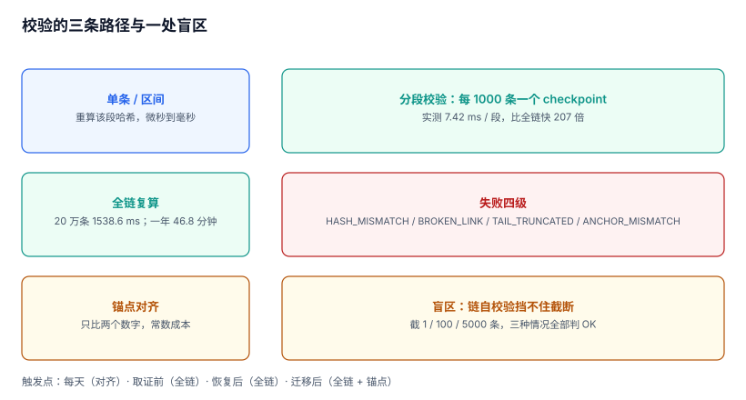

# 完整性校验：全链、分段与截断盲区

链建起来之后，最常见的状态是「建完就没再跑过」。等到真取证时，第一次校验往往就是最后一次——因为结果通常不好看：要么链早就断了，要么中断在三个月前的某次迁移里，要么压根没留下校验记录，无法说清「什么时候还是好的」。

本页解决三件事：什么时候校验、怎么在可接受的时间内校验、校验失败时怎么分级定位。

本页判据族 `ADI-A` ~ `ADI-H`，共 8 条。



## 一、校验的四种对象

不同问题需要校验不同范围，混用会导致「跑得慢」或「查不出」：

| 对象 | 校验什么 | 成本 | 触发时机 |
| --- | --- | --- | --- |
| 单条 | 该条内容的哈希是否等于 `hash` 字段 | 微秒 | 举证某一条时 |
| 区间 | `[a, b]` 内每条的前驱关系 | 与区间长度成正比 | 怀疑某段时间被动过 |
| 全链 | 从创世重算到链头 | 与总长度成正比 | 取证前、迁移后 |
| 锚点对齐 | 链头/条数是否等于外部锚点记录 | 常数 | **每天**（这是唯一能发现截断的） |

第四种最便宜也最容易被忽略。它不需要重算任何哈希，只需要比较两个数字：库里的 `MAX(seq)` 与最近一次锚点里的 `upto_seq`。

## 二、全链太慢：分段校验快 207 倍

全链复算的耗时随事件量线性增长。本机实测：

| 范围 | 条数 | 耗时 |
| --- | --- | --- |
| 全链 | 200,000 | **1,538.6 ms** |
| 单段（每 1,000 条一个 checkpoint） | 1,000 | **7.42 ms** |
| 加速比 | — | **207×** |

按日增 100 万条推算，一年后（3.65 亿条）全链复算一次约 **46.8 分钟**。这个数字的现实含义是：**你不会跑它**。而「不会跑的校验」等于没有校验。

分段的做法是每隔 N 条记一个 checkpoint（该处的 `hash`），校验时只重算目标段：

```sql
-- checkpoint 表：每 1000 条记一次链头
CREATE TABLE chain_checkpoint (
  stream_id  TEXT NOT NULL,
  upto_seq   INTEGER NOT NULL,
  chain_hash TEXT NOT NULL,
  created_at TEXT NOT NULL,
  PRIMARY KEY (stream_id, upto_seq)
);

-- 每 1000 条落一个点（应用在写入事务内顺带插入，不要事后补算）
INSERT INTO chain_checkpoint
SELECT stream_id, seq, hash, datetime('now')
FROM audit_event
WHERE stream_id = 'S-1' AND seq % 1000 = 0
  AND NOT EXISTS (SELECT 1 FROM chain_checkpoint c
                  WHERE c.stream_id = audit_event.stream_id AND c.upto_seq = audit_event.seq);
```

有了 checkpoint，「怀疑 8 月这批记录」就变成一个 7 ms 的操作，而不是 46 分钟的批处理。

::: warning checkpoint 自己也要被保护
如果 checkpoint 可以被随便重写，那「改数据 + 改 checkpoint」就成了一条完整的伪造路径。checkpoint 必须与事件表同级别保护（追加写），并且**每天锚定的对象是链头而不是 checkpoint**——锚点是 checkpoint 的上位约束。
:::

## 三、序列化不稳定会制造假故障

链的校验依赖「同一份内容算出同一个哈希」。这件事在 JSON 上并不自动成立：键序、浮点格式、时间时区、Unicode 归一化，任何一处不稳定都会让**原始记录无法复算出原始哈希**。

本机在写这一页时踩到的不是序列化，而是更朴素的一种：

```python
# 错误示范：浅拷贝后改字典，改的是原对象
ev = list(events)
ev[100_000]["payload"]["after"] += 1      # list() 是浅拷贝，这里动了 events[100_000]
verify(events[:limit], chain[:limit])     # 之后所有校验都从第 100,000 条起报 MISMATCH
```

结果看起来像「链在 10 万条处断了」，实际是**校验脚本自己改了数据**。这类假故障的代价比真故障更高：它会让你去追一条不存在的篡改，而真问题（比如某段序列化不稳定）被掩盖。

三条纪律：

1. 校验只读：校验进程用只读连接，且不构造可变的中间对象。
2. 序列化固定：用 canonical JSON（键排序、无空格、数字不带多余小数、时间统一 UTC + 毫秒）。
3. 哈希输入包含 `schema_version`：字段含义变了，序列化规则也会变，版本号必须参与计算。

## 四、失败分级：四种失败，四种处置

| 级别 | 现象 | 含义 | 处置 |
| --- | --- | --- | --- |
| `HASH_MISMATCH @seq` | 第 N 条内容算不出原哈希 | 该条被改过 | 冻结该段、比对备份、出差异报告 |
| `BROKEN_LINK @seq` | 第 N 条的 `prev_hash` ≠ 第 N-1 条的 `hash` | 中间被删或被插 | 同上，且优先怀疑「少了一条」 |
| `TAIL_TRUNCATED` | 链头 < 锚点 `upto_seq` | 末尾被删 | 立即升级为安全事件：这是最难发生也最难解释的 |
| `ANCHOR_MISMATCH` | 链头哈希 ≠ 锚点记录哈希 | 整段被重建或替换 | 按「证据失效」处理，不要试图修复链 |

分级的价值在**处置动作不同**：前两种是「数据问题」，第三种是「安全事件」，第四种是「证据作废」。合成一个「校验失败」的告警，等于让值班的人自己分诊——而他多半会选最省事的那个解释。

```sql
-- 一次查询给出四种判定（不重算哈希，只看结构与锚点）
WITH head AS (
  SELECT s.stream_id,
         (SELECT MAX(seq) FROM audit_event e WHERE e.stream_id = s.stream_id) AS h_seq,
         (SELECT hash FROM audit_event e WHERE e.stream_id = s.stream_id ORDER BY seq DESC LIMIT 1) AS h_hash
  FROM audit_stream s
), anchor AS (
  SELECT a.stream_id, a.upto_seq, a.chain_hash
  FROM audit_anchor a
  JOIN (SELECT stream_id, MAX(upto_seq) AS m FROM audit_anchor GROUP BY stream_id) t
    ON t.stream_id = a.stream_id AND t.m = a.upto_seq
)
SELECT h.stream_id, h.h_seq, a.upto_seq, h.h_hash, a.chain_hash,
       CASE WHEN h.h_seq < a.upto_seq THEN 'TAIL_TRUNCATED'
            WHEN h.h_seq > a.upto_seq THEN 'UNAUDITED_TAIL'
            WHEN h.h_hash <> a.chain_hash THEN 'ANCHOR_MISMATCH'
            ELSE 'ALIGNED' END AS verdict
FROM head h LEFT JOIN anchor a ON a.stream_id = h.stream_id;
```

`UNAUDITED_TAIL` 是正常的：锚定每天一次，白天新增的记录本来就还没锚。判断依据是「差值是否超过一天的事件量」，而不是「是否相等」。

## 五、什么时候必须校验

| 时机 | 为什么必须 | 不做的后果 |
| --- | --- | --- |
| 每天定时 | 让「最后一次好的状态」有记录 | 出事时说不清「什么时候开始坏的」 |
| 取证前 | 交付的证据包必须附校验报告 | 对方会问「你导出前验过吗」 |
| 恢复/迁移后 | 恢复可能恢复到旧快照 | 静默丢一段，链自校验还通过 |
| 升级改表后 | 迁移脚本可能重写行 | 哈希全变，且没人知道是哪次升级导致的 |
| 怀疑泄露后 | 攻击者可能删了对自己不利的记录 | 无法界定影响范围 |

第二、四两条最容易被跳过，因为它们发生在「忙的时候」。一条实用的纪律：**把校验做成导出与迁移流程里的强制步骤**，不给「跳过」这个选项。

## 六、性能：把查询建在正确的位置

校验之外，取证时最常做的是「按对象拉一条时间线」。本机实测（20 万条，SQLite 3.50.4）：

| 查询 | 索引 | 耗时 | 返回行 |
| --- | --- | --- | --- |
| 单对象全量 | `(stream, object_type, object_id, occurred_at)` | **0.06 ms** | 1 |
| 单对象 + 时间窗 | 同上 | **0.07 ms** | 1 |
| 按 `action` 过滤 | 无索引 | **91.59 ms** | 39,918 |

差三个数量级。这条读数说明的不是「要建索引」这种常识，而是**索引要建在取证会用到的维度上**：`(对象, 时间)` 是主路径，`action` 只在统计分析时才用，不该为它单独建索引（写放大不值得）。

## 七、本页判据

| 编号 | 判据 | 为什么要它 | 怎么验证 |
| --- | --- | --- | --- |
| `ADI-A` | 每天至少一次「链头 ⇄ 锚点」对齐检查，结果落库 | 这是唯一能发现截断的检查 | `audit_verify_run` 表里每天一行 |
| `ADI-B` | 全链校验有分段方案，单次耗时与链长解耦 | 46.8 分钟的校验不会被跑 | 单段校验 ≤ 全链的 1/100（本机 207×） |
| `ADI-C` | 校验输入使用 canonical 序列化，且 `schema_version` 参与哈希 | 序列化漂移会制造假故障 | 同一批记录复算两次哈希一致 |
| `ADI-D` | 校验进程只读，且不在内存里修改待校验对象 | 校验脚本改数据会造成「假断链」 | 校验前后 `COUNT(*)` 与 `MAX(seq)` 不变 |
| `ADI-E` | 失败分四级（内容/链接/截断/锚点），处置动作各不相同 | 合成一个告警等于没分诊 | 四种构造场景各触发对应级别 |
| `ADI-F` | 取证前、恢复后、迁移后强制校验，且报告进证据包 | 这三个时刻最容易静默丢数据 | 证据包里能看到校验报告文件 |
| `ADI-G` | 取证主路径 `(对象, 时间)` 有索引，查询 < 10 ms | 取证常在现场做，慢等于做不完 | `EXPLAIN` 显示走索引 |
| `ADI-H` | 校验结果本身留痕（谁跑的、什么范围、结论） | 「验过了」也需要证据 | 校验运行表可按时间倒查 |

## 八、验证方式

```sql
-- 1) 链结构自洽（不重算哈希，只看前后指针）
SELECT COUNT(*) AS broken_links
FROM audit_event a
JOIN audit_event b ON b.stream_id = a.stream_id AND b.seq = a.seq + 1
WHERE b.prev_hash <> a.hash;
-- 预期：0
```

```shell
# 2) 分段校验 vs 全链校验的耗时对比（本机 20 万条）
python3 - <<'PY'
import hashlib, json, time, random
random.seed(20261107)
evs = [{"seq": i, "v": random.randint(0, 10**6)} for i in range(200_000)]
def canon(e): return json.dumps(e, sort_keys=True, separators=(",", ":")).encode()
chain, prev = [], b"\0" * 32
for e in evs:
    prev = hashlib.sha256(prev + canon(e)).digest(); chain.append(prev)

t = time.perf_counter()
prev = b"\0" * 32
for e, c in zip(evs, chain):
    assert hashlib.sha256(prev + canon(e)).digest() == c; prev = c
full = (time.perf_counter() - t) * 1000

t = time.perf_counter()
i0 = 137_000
prev = chain[i0 - 1]
for i in range(i0, i0 + 1000):
    assert hashlib.sha256(prev + canon(evs[i])).digest() == chain[i]; prev = chain[i]
seg = (time.perf_counter() - t) * 1000
print(f"full={full:.1f}ms segment={seg:.2f}ms speedup={full/seg:.0f}x")
PY
# 预期：full≈1500ms segment≈7ms speedup≈200x
```

```sql
-- 3) 四种判定各构造一次，确认分级生效（以截断为例）
-- 在副本上执行（真实库有 append-only 触发器）：
-- CREATE TEMP TABLE ev_copy AS SELECT * FROM audit_event WHERE stream_id='S-1';
-- DELETE FROM ev_copy WHERE seq > 490;
SELECT (SELECT MAX(seq) FROM audit_event WHERE stream_id='S-1') AS head_seq,
       (SELECT upto_seq FROM audit_anchor WHERE stream_id='S-1') AS anchor_seq;
-- 预期：head_seq=500、anchor_seq=500、判定 ALIGNED；
--       把 head 换成截断后的 490 即得 TAIL_TRUNCATED
```

## 九、参考资料

- [RFC 8785: JSON Canonicalization Scheme](https://datatracker.ietf.org/doc/html/rfc8785)：序列化稳定性的标准做法，本页 `ADI-C` 的依据（2026-11 核对）
- [RFC 6962: Certificate Transparency](https://datatracker.ietf.org/doc/html/rfc6962)：checkpoint 与包含证明，本页分段校验的工业原型
- [NIST SP 800-92](https://csrc.nist.gov/pubs/sp/800/92/final)：日志完整性检查的频率建议，本页「何时校验」对照
- [SQLite: Query Planning](https://www.sqlite.org/optoverview.html)：本页索引读数的 `EXPLAIN QUERY PLAN` 依据
- [PostgreSQL: Routine Vacuuming](https://www.postgresql.org/docs/current/routine-vacuuming.html)：大表上的批量校验会与清理互相影响，安排校验窗口时需要考虑
