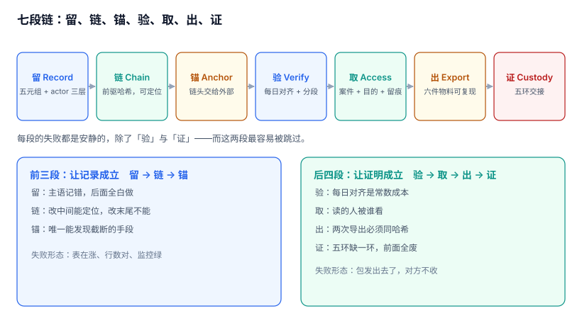

# 总览：三个「这条记录」与五个安静的失败

审计系统上线一年后，团队通常会发现两种说法同时存在：**「我们每一笔操作都记了」与「真出事的时候一条都拿不出来」**。这两句话不矛盾，它们是同一件事的两面——系统把「写了一条日志」当成了「留下了一份证据」，又把「记录存在」当成了「记录可信」。

本页先把对象拆开，再把失败形态摆出来，最后给一条不加新组件也能走的三步起点。

本页判据族 `ADU-A` ~ `ADU-H`，共 8 条。



## 一、三个「这条记录」不是同一个东西

同一句话在三个地方指三个不同的对象，混用是大部分审计设计错误的源头：

| 视角 | 对象 | 身份由什么决定 | 谁能改 | 举证时它回答什么 |
| --- | --- | --- | --- | --- |
| 业务 | 事实（event） | 一次真实发生的操作 | 谁都改不了 | 「到底发生了什么」 |
| 系统 | 记录（record） | `stream_id` + `seq` + 前驱哈希 | 只能追加 | 「系统当时记了什么」 |
| 第三方 | 证据（evidence） | 证据包哈希 + 锚点回执 + 保管链 | 谁都改不动 | 「凭什么信这份记录」 |

三者混用的后果，一条比一条贵：

1. **用记录当事实**：审计里写着「用户 A 删除了订单」，但实际是运维用一个具有全局权限的服务账号代删的。记录没错，事实错了——因为 `actor` 记的是令牌主体，不是实际操作人。
2. **用事实当记录**：业务库里有 `updated_at`，于是认为「改了以后能查」。可 `updated_at` 只保留最后一次，中间被谁改过、改成了什么，全都丢了。
3. **用记录当证据**：把 `SELECT * FROM audit_event` 导成 CSV 发过去。对方问「你怎么证明这份 CSV 与你们库里的记录一致」，你答不上来——CSV 没有链、没有锚、没有保管链。

::: tip 一句话理解
事实是「发生过什么」，记录是「系统怎么写下来的」，证据是「别人凭什么信」。前两个归你管，第三个归哈希、锚点和交接单管。
:::

## 二、七段链：每段的输入、输出与失败方式

| 段 | 输入 | 输出 | 失败时表现为什么 | 本册页面 |
| --- | --- | --- | --- | --- |
| 留 Record | 业务操作 | 一条带五元组的事件 | 主语记错，事后无法归责 | [事件模型](../EventModel/index.md) |
| 链 Chain | 事件 + 前驱哈希 | 一条可定位的链 | 链断了但没人校验 | [不可篡改](../Immutability/index.md) |
| 锚 Anchor | 链的当前头 | 外部时间戳回执 | 末尾被截断，链自校验仍全绿 | [不可篡改](../Immutability/index.md) |
| 验 Verify | 链 + 锚点 | 一份校验报告 | 只跑一次，出事时才发现早就断了 | [完整性校验](../IntegrityCheck/index.md) |
| 取 Access | 案件 + 权限 | 一份带 purpose 的访问记录 | 查的人比被查的人多，且没人知道 | [四眼原则](../FourEyes/index.md) |
| 出 Export | 范围 + 版本 | 一个可复现的证据包 | 两次导出两个哈希，无法自证 | [取证导出](../ForensicExport/index.md) |
| 证 Custody | 证据包 + 交接 | 一条五环保管链 | 缺一环，前面六段全部作废 | [保管链](../CustodyChain/index.md) |

七段里，**第 1、2、3、5、6 段的失败是安静的**：系统照常运行、审计表照常有新行、导出照常成功，监控上看不出任何异常。只有第 4 段（校验失败）与第 7 段（交接记录缺失）有机会被人发现，而这两段恰恰是最容易被跳过的。

## 三、五个安静的失败

这五条是本册各章的主线，每条后面挂着一个本机实测读数（Python 3.13.12 + SQLite 3.50.4，固定种子 `20261107`，20 万条事件，脚本不入库）：

| 失败 | 为什么安静 | 本册读数（本机可复跑） |
| --- | --- | --- |
| 主语记错 | 记录格式完全正确，只是「谁」不对 | 服务账号代操作时，`actor` 与真实操作人两个字段，缺一个就归责不到人 |
| 末尾被截断 | 链从第 1 条重算全部通过 | 截掉最后 1 / 100 / 5,000 条，**3 种情况全部判 OK（漏检 100%）** |
| 全链复算太慢，于是不跑 | 跑一次要几十秒，就没人跑 | 20 万条全链 **1,538.6 ms**；按年 3.65 亿条推算 **46.8 分钟** |
| 留存策略删掉了要证的那段 | 删除任务执行成功，报表也变干净了 | 5,000 个删除请求里 **83.26%** 落在法定保留期内，必须拒绝执行 |
| 读审计的人不被审计 | 读取不影响任何业务指标 | 1,000 次审计读取，未做读取留痕时只有 **35.7%** 可见 |

五条分别对应：[事件模型](../EventModel/index.md)、[不可篡改](../Immutability/index.md)、[完整性校验](../IntegrityCheck/index.md)、[留存与销毁](../RetentionDisposal/index.md)、[四眼原则](../FourEyes/index.md)。两条扎堆在「链」与「存」不是巧合——**审计的绝大部分失效发生在写完之后，而不是写入时**。

::: danger 不要把「表里有数据」当成「留痕成立」
审计的失效几乎都不抛异常：`INSERT` 成功、行数在涨、查询能出结果。末尾截断、`actor` 记成服务账号、留存任务删早了、读取没留痕——**没有一件会让监控变红**。唯一能拦住它们的是一组能自己算的校验：链头与锚点对不对得上、删除请求有没有撞上冻结、访问日志有没有 `purpose`。本册每一页的「验证方式」都是这种可执行校验，不是「看一眼对不对」。
:::

## 四、三个反模式

这三个写法在评审时都很合理，上线一年后都会变成「不敢动」：

1. **把审计表放在业务库里，用同一个可写账号**：应用能 `UPDATE` 审计表，意味着一次 SQL 注入、一个误操作的运维脚本、一个跑错环境的迁移，都能把证据抹掉。表同库不是原罪，**同一个可写身份**才是。
2. **只记 `action` 不记 `before/after`**：`order.refund` 这条记录能证明「有人点了退款」，但证明不了「退了多少、退之前是多少」。等到对账争议时，这份记录的价值接近于零。
3. **把导出当取证**：页面上点「导出 CSV」，文件落在下载目录，谁下载的、下载后有没有改过、交给了谁，一概没有。真正的证据包必须自带清单、校验报告与交接记录——**证据的可信度不来自内容，来自围绕内容的那些单据**。

## 五、什么时候不需要做证据链

证据链是有成本的：哈希计算、锚定服务、校验任务、冻结流程、交接单。下面四条同时成立时，**先别建**：

- 记录只用于「事后查一下」，没有对外承诺（监管报送、司法举证、外部审计）。
- 记录的保留期短于 6 个月，且没有法定下限。
- 有权改库的人不超过 2 个，且都在同一个信任域内。
- 出错时的处置方式是「补偿客户」而不是「证明自己没错」。

四条里只要有一条不成立，就至少需要最小形态：**一张只允许追加的表 + 每天一次的链头锚定**。这两件事不需要新组件，一张表加一个定时任务就能起步。

## 六、最小起步三步

1. **先把主语记对**：区分「认证主体」「授权主体」「实际操作人」。代操作（客服代客、运维代维、服务账号批处理）必须带 `on_behalf_of`，否则第一段就废了。
2. **再做链与锚**：事件表加 `prev_hash` / `hash`，用触发器守住「序号连续 + 前驱对得上」；每天把链头写进一条 `audit_anchor`，并把回执存到**另一个系统**（对象存储的锁定桶、TSA、另一个库）。链只能证明「中间没改」，锚才能证明「末尾没少」。
3. **最后做校验与交接**：定时分段校验 + 取证前全链校验 + 导出带清单。没有第 3 步，前两步的投入在第一次真取证时才会知道有没有用。

顺序不能反。先做「证据包模板」的团队，通常会在第一次真取证时发现：包里的事件缺 `before/after`，锚点只有一条且存在同一块磁盘上——**模板做得再漂亮，也补不回没有记下来的东西**。

## 七、本页判据

| 编号 | 判据 | 为什么要它 | 怎么验证 |
| --- | --- | --- | --- |
| `ADU-A` | 「事实 / 记录 / 证据」三者分别有独立载体，不共用一个 ID 语义 | 三者生命周期不同，混用会让举证链条断在第一环 | 库里能分别查到业务事件、`audit_event`、`evidence_package` 三类对象 |
| `ADU-B` | 每条记录都能追到「谁发起、谁授权、谁执行」三者，缺一即标注 | 服务账号代操作是归责失败的第一大来源 | 任取一条代操作记录，三个字段都有值或显式 `null` + 原因码 |
| `ADU-C` | 链头每天至少锚定一次，且回执存放在审计库之外 | 链自校验挡不住末尾截断 | 截掉最后 N 条后，链校验 OK 但锚点比对必须 `TAIL_TRUNCATED` |
| `ADU-D` | 全链校验有分段方案，单次校验时间与链长解耦 | 全链按年增长到 46.8 分钟时，没人会跑 | 分段校验耗时 ≤ 全链的 1/100（本机 207×） |
| `ADU-E` | 删除请求必须先过冻结检查，冻结期内只能 `blocked` | 法定保留与删除权的冲突是必然事件，不是异常 | 对冻结主体的删除请求执行 `executed` 必须被拒 |
| `ADU-F` | 审计读取本身留痕，且 `purpose` 有最小长度约束 | 不被审计的读取等于可隐身的情报收集 | 无 `purpose` 或过短的访问记录插入必须失败 |
| `ADU-G` | 证据包导出可复现：同范围同版本两次导出哈希相同 | 不可复现的包无法自证未被篡改 | 连导两次比对 `manifest_sha256`，必须相等 |
| `ADU-H` | 每条对外举证至少演练过一次「从请求到交付」全流程 | 没演练过的流程在压力下必然缺环 | 演练记录里能看到五环交接与校验报告 |

## 八、验证方式

三步都能在读完本册后对着自己的库跑，不需要改代码：

```sql
-- 1) 是否存在「链头没人锚」的流：链在长，锚不动
SELECT s.stream_id, s.name,
       (SELECT MAX(seq) FROM audit_event e WHERE e.stream_id = s.stream_id) AS head_seq,
       (SELECT MAX(upto_seq) FROM audit_anchor a WHERE a.stream_id = s.stream_id) AS anchor_seq
FROM audit_stream s;
-- 预期：head_seq 与 anchor_seq 的差不超过「一天的事件量」。差距持续变大 = 锚定任务停了
```

```sql
-- 2) 冻结期内是否被执行过删除
SELECT d.request_id, d.subject_id, d.status, h.hold_from, h.hold_to
FROM deletion_request d
JOIN legal_hold h ON h.subject_id = d.subject_id AND h.released_at IS NULL
WHERE d.status = 'executed' AND d.executed_at >= h.hold_from;
-- 预期：0 行。有行 = 冻结判断只在应用层做过，库层没守住
```

```sql
-- 3) 审计读取有没有留下 purpose
SELECT COUNT(*) AS total,
       SUM(CASE WHEN length(trim(COALESCE(purpose, ''))) < 8 THEN 1 ELSE 0 END) AS bad_purpose,
       SUM(CASE WHEN approved_by IS NULL THEN 1 ELSE 0 END) AS no_approver
FROM audit_access_log;
-- 预期：bad_purpose = 0；no_approver 的比例等于「单人可读」的比例，应当接近 0
```

第三条最容易被忽略：它不需要你知道「谁该被允许读」，只要看**读取记录里有没有能解释「为什么读」的字段**。没有这个字段，四眼原则就只剩两只眼。

## 九、参考资料

- [NIST SP 800-92: Guide to Computer Security Log Management](https://csrc.nist.gov/pubs/sp/800/92/final)：日志管理的职责分工与保留策略，本册「留 / 存」两段的边界依据（2026-11 核对）
- [OWASP Logging Cheat Sheet](https://cheatsheetseries.owasp.org/cheatsheets/Logging_Cheat_Sheet.html)：事件应包含哪些字段、哪些字段绝不能记，本册[事件模型](../EventModel/index.md)的五元组据此裁剪
- [RFC 3161: Time-Stamp Protocol (TSP)](https://datatracker.ietf.org/doc/html/rfc3161)：外部锚定的标准做法，本册[不可篡改](../Immutability/index.md)的锚点格式依据
- [RFC 6962: Certificate Transparency](https://datatracker.ietf.org/doc/html/rfc6962)：Merkle 树透明日志，本册[完整性校验](../IntegrityCheck/index.md)分段校验的思想来源
- [ISO/IEC 27001:2022 控制项 A.8.15 Logging](https://www.iso.org/standard/27001)：日志留存与保护的合规要求，本册[留存与销毁](../RetentionDisposal/index.md)引用
- [《中华人民共和国网络安全法》第二十一条](https://www.gov.cn/xinwen/2016-11/07/content_5129723.htm)：网络日志留存不少于六个月，本册法定下限的依据之一
