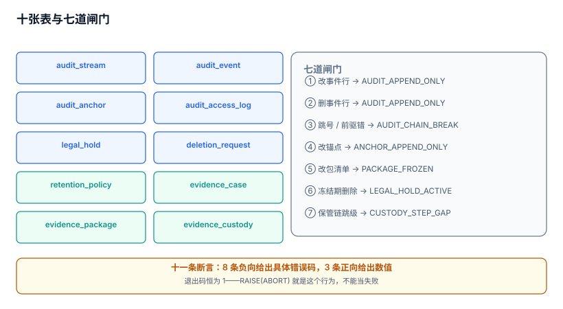

# 实战：十张表、七个触发器与十一条断言

前面八页讲的都是「应该怎样」。这一页把它落成能跑的 DDL：十张表装下一条审计链从事件到证据包的全部对象，七个触发器把「只能追加」「必须链接」「冻结不可删」写在库层，十一条断言把每条纪律变成一个能失败的用例。

全部内容在 SQLite 3.50.4 上跑过，断言结果附在第四节。

本页判据族 `ADJ-A` ~ `ADJ-H`，共 8 条。



## 一、为什么是这十张表

| # | 表 | 装什么 | 不装什么 |
| --- | --- | --- | --- |
| 1 | `audit_stream` | 一条链的身份（租户、算法） | 链上的记录 |
| 2 | `audit_event` | 事件本体（五元组 + 链指针） | 载荷明文（只存 `payload_hash`） |
| 3 | `audit_anchor` | 外部锚定回执 | 事件内容 |
| 4 | `audit_access_log` | 谁读了审计、为什么读 | 读到的内容 |
| 5 | `legal_hold` | 冻结（依据、起止） | 具体哪些行被冻结（用主体维度表达） |
| 6 | `deletion_request` | 删除请求与三态 | 删除的执行细节 |
| 7 | `retention_policy` | 每类数据留多久、从何时算、到期怎么处置 | 具体批次的执行状态 |
| 8 | `evidence_case` | 案件（范围、授权机关） | 证据包 |
| 9 | `evidence_package` | 证据包（清单哈希、条数、锚点） | 包内文件（在对象存储） |
| 10 | `evidence_custody` | 五环交接 | 交接附件的正文 |

十条边界里最容易被合并掉的是第 4 与第 5 张：「访问日志」看着像普通日志，可以和业务日志同表；「冻结」看着像删除请求的一个状态字段，可以并进去。**一旦合并，四眼与法定保留就都退化成了应用层约定**——而这两件事恰恰是「应用层说了不算」的典型。

## 二、完整 DDL

```sql
PRAGMA foreign_keys = ON;

CREATE TABLE audit_stream (
  stream_id   TEXT PRIMARY KEY,
  tenant_id   INTEGER NOT NULL,
  name        TEXT NOT NULL,
  algo        TEXT NOT NULL DEFAULT 'sha256',
  created_at  TEXT NOT NULL
);

CREATE TABLE audit_event (
  stream_id    TEXT NOT NULL REFERENCES audit_stream(stream_id),
  seq          INTEGER NOT NULL,
  occurred_at  TEXT NOT NULL,
  recorded_at  TEXT NOT NULL,
  actor_type   TEXT NOT NULL CHECK (actor_type IN ('user','service','admin')),
  actor_id     TEXT NOT NULL,
  action       TEXT NOT NULL,
  object_type  TEXT NOT NULL,
  object_id    TEXT NOT NULL,
  result       TEXT NOT NULL CHECK (result IN ('allow','deny','error')),
  reason_code  TEXT,
  request_id   TEXT,
  payload_hash TEXT NOT NULL,
  prev_hash    TEXT NOT NULL,
  hash         TEXT NOT NULL,
  PRIMARY KEY (stream_id, seq)
);
CREATE INDEX ix_event_object ON audit_event(stream_id, object_type, object_id, occurred_at);
CREATE INDEX ix_event_actor  ON audit_event(stream_id, actor_id, occurred_at);

CREATE TABLE audit_anchor (
  anchor_id   TEXT PRIMARY KEY,
  stream_id   TEXT NOT NULL REFERENCES audit_stream(stream_id),
  upto_seq    INTEGER NOT NULL,
  chain_hash  TEXT NOT NULL,
  anchor_type TEXT NOT NULL,
  receipt     TEXT NOT NULL,
  anchored_at TEXT NOT NULL,
  UNIQUE (stream_id, upto_seq)
);

CREATE TABLE audit_access_log (
  access_id   TEXT PRIMARY KEY,
  viewer      TEXT NOT NULL,
  purpose     TEXT NOT NULL CHECK (length(trim(purpose)) >= 8),
  case_id     TEXT,
  filter_expr TEXT NOT NULL,
  row_count   INTEGER NOT NULL,
  approved_by TEXT,
  at          TEXT NOT NULL
);

CREATE TABLE legal_hold (
  hold_id      TEXT PRIMARY KEY,
  subject_type TEXT NOT NULL,
  subject_id   TEXT NOT NULL,
  basis        TEXT NOT NULL,
  hold_from    TEXT NOT NULL,
  hold_to      TEXT,
  released_at  TEXT
);

CREATE TABLE deletion_request (
  request_id   TEXT PRIMARY KEY,
  subject_id   TEXT NOT NULL,
  requested_at TEXT NOT NULL,
  status       TEXT NOT NULL CHECK (status IN ('pending','blocked','executed')),
  executed_at  TEXT
);

CREATE TABLE retention_policy (
  policy_id   TEXT PRIMARY KEY,
  data_class  TEXT NOT NULL,
  retain_days INTEGER NOT NULL CHECK (retain_days > 0),
  start_from  TEXT NOT NULL CHECK (start_from IN ('event','period_end','relation_end')),
  legal_basis TEXT NOT NULL,
  disposition TEXT NOT NULL CHECK (disposition IN ('delete','anonymize','archive'))
);

CREATE TABLE evidence_case (
  case_id    TEXT PRIMARY KEY,
  title      TEXT NOT NULL,
  authority  TEXT NOT NULL,
  scope_from TEXT NOT NULL,
  scope_to   TEXT NOT NULL,
  status     TEXT NOT NULL CHECK (status IN ('open','sealed','closed')),
  opened_at  TEXT NOT NULL
);

CREATE TABLE evidence_package (
  package_id      TEXT PRIMARY KEY,
  case_id         TEXT NOT NULL REFERENCES evidence_case(case_id),
  built_at        TEXT NOT NULL,
  built_by        TEXT NOT NULL,
  event_count     INTEGER NOT NULL,
  manifest_sha256 TEXT NOT NULL,
  bytes           INTEGER NOT NULL,
  anchor_id       TEXT REFERENCES audit_anchor(anchor_id)
);

CREATE TABLE evidence_custody (
  custody_id  TEXT PRIMARY KEY,
  package_id  TEXT NOT NULL REFERENCES evidence_package(package_id),
  step        INTEGER NOT NULL,
  actor       TEXT NOT NULL,
  action      TEXT NOT NULL,
  at          TEXT NOT NULL,
  prev_digest TEXT NOT NULL,
  digest      TEXT NOT NULL,
  UNIQUE (package_id, step)
);
```

::: tip 为什么没有 `tenant_id` 在每张表上
租户维度放在 `audit_stream` 上，事件通过 `stream_id` 间接归属。这样做的代价是「按租户扫全表」需要 join，收益是**一条链只属于一个租户**——链是全局单调的，多租户混在一个链里会让「某租户的链头」这个概念失去意义。若确实需要按租户隔离查询，用视图把 join 封起来。
:::

## 三、七个触发器

| # | 触发器 | 拒绝什么 | 错误码 |
| --- | --- | --- | --- |
| 1 | `trg_event_no_update` | 改事件行 | `AUDIT_APPEND_ONLY` |
| 2 | `trg_event_no_delete` | 删事件行 | `AUDIT_APPEND_ONLY` |
| 3 | `trg_event_seq_guard` | 跳号 / 前驱哈希不符 | `AUDIT_CHAIN_BREAK` |
| 4 | `trg_anchor_no_update` | 改锚点 | `ANCHOR_APPEND_ONLY` |
| 5 | `trg_package_manifest_frozen` | 改证据包清单摘要或条数 | `PACKAGE_FROZEN` |
| 6 | `trg_deletion_hold_guard` | 冻结期内执行删除 | `LEGAL_HOLD_ACTIVE` |
| 7 | `trg_custody_step_guard` | 保管链跳级 | `CUSTODY_STEP_GAP` |

```sql
CREATE TRIGGER trg_event_no_update BEFORE UPDATE ON audit_event
BEGIN SELECT RAISE(ABORT, 'AUDIT_APPEND_ONLY'); END;

CREATE TRIGGER trg_event_no_delete BEFORE DELETE ON audit_event
BEGIN SELECT RAISE(ABORT, 'AUDIT_APPEND_ONLY'); END;

CREATE TRIGGER trg_event_seq_guard BEFORE INSERT ON audit_event
WHEN NEW.seq <> (SELECT COALESCE(MAX(seq), 0) + 1 FROM audit_event WHERE stream_id = NEW.stream_id)
  OR NEW.prev_hash <> (SELECT COALESCE(
       (SELECT hash FROM audit_event WHERE stream_id = NEW.stream_id ORDER BY seq DESC LIMIT 1),
       'GENESIS'))
BEGIN SELECT RAISE(ABORT, 'AUDIT_CHAIN_BREAK'); END;

CREATE TRIGGER trg_anchor_no_update BEFORE UPDATE ON audit_anchor
BEGIN SELECT RAISE(ABORT, 'ANCHOR_APPEND_ONLY'); END;

CREATE TRIGGER trg_package_manifest_frozen BEFORE UPDATE OF manifest_sha256, event_count ON evidence_package
BEGIN SELECT RAISE(ABORT, 'PACKAGE_FROZEN'); END;

CREATE TRIGGER trg_deletion_hold_guard BEFORE UPDATE OF status ON deletion_request
WHEN NEW.status = 'executed'
 AND EXISTS (SELECT 1 FROM legal_hold h
             WHERE h.subject_id = NEW.subject_id
               AND h.released_at IS NULL
               AND (h.hold_to IS NULL OR h.hold_to >= NEW.requested_at))
BEGIN SELECT RAISE(ABORT, 'LEGAL_HOLD_ACTIVE'); END;

CREATE TRIGGER trg_custody_step_guard BEFORE INSERT ON evidence_custody
WHEN NEW.step <> (SELECT COALESCE(MAX(step), 0) + 1 FROM evidence_custody WHERE package_id = NEW.package_id)
BEGIN SELECT RAISE(ABORT, 'CUSTODY_STEP_GAP'); END;
```

七道门里，第 3 与第 6 是**语义型**的（要比较别的行），其余五道是**形状型**的（只拒绝某种动作）。语义型的门一定要配负向用例，否则「写了个触发器」和「触发器真的在拦」无法区分。

## 四、十一条断言与实测结果

造数：1 条流、500 条事件、1 个锚点、1 个案件、1 个证据包、5 环保管链、1 条冻结、2 条删除请求。

| 编号 | 断言 | 期望 | 实测 |
| --- | --- | --- | --- |
| A1 | 改第 250 条 | 拒绝 | `AUDIT_APPEND_ONLY` |
| A2 | 删第 250 条 | 拒绝 | `AUDIT_APPEND_ONLY` |
| A3 | 插 `seq=502` | 拒绝 | `AUDIT_CHAIN_BREAK` |
| A4 | 插 `seq=501` 但前驱哈希错 | 拒绝 | `AUDIT_CHAIN_BREAK` |
| A5 | 副本截到 490 条后比对锚点 | 检出 | `490 / 490 / 500 / TAIL_TRUNCATED` |
| A6 | 冻结主体执行删除 | 拒绝 | `LEGAL_HOLD_ACTIVE` |
| A7 | 无冻结主体执行删除 | 成功 | `D-2 \| executed` |
| A8 | 改证据包清单摘要 | 拒绝 | `PACKAGE_FROZEN` |
| A9 | 保管链插 `step=7` | 拒绝 | `CUSTODY_STEP_GAP` |
| A10 | 访问日志 `purpose='看'` | 拒绝 | `CHECK constraint failed` |
| A11 | 正常追加第 501 条 | 成功 | `501` |

```text
--- A1 篡改一行（应 ABORT: AUDIT_APPEND_ONLY） ---
Runtime error near line 173: AUDIT_APPEND_ONLY (19)
--- A5 尾部截断（绕过触发器的副本）：链仍自洽，只有锚点能发现 ---
490|490|500|TAIL_TRUNCATED
--- A6 冻结期内执行删除（应 ABORT: LEGAL_HOLD_ACTIVE） ---
Runtime error near line 189: LEGAL_HOLD_ACTIVE (19)
--- A7 无冻结的请求可以执行（应成功） ---
D-1|pending
D-2|executed
--- A11 正向：正常追加一条（应成功，count=501） ---
501
--- 汇总 ---
501|501|5|1|1
```

八条负向（A1/A2/A3/A4/A6/A8/A9/A10）全部给出预期错误码，三条正向（A5/A7/A11）给出预期值。**脚本的整体退出码是 1**，因为 `sqlite3` 在遇到 `RAISE(ABORT)` 时返回非零——这是预期行为，不是失败。判「通过」看的是每段的错误码与数值，不是 `EXIT=0`。

::: danger 本页特有的坑：`sqlite3` 的退出码不能当断言结果
用 `sqlite3 af.db < practice.sql; echo $?` 判「全绿」是错的：只要有一条 `RAISE(ABORT)`，退出码就是 1，而这恰恰是**负向用例成功**的标志。反过来，如果所有负向用例都「通过」（即没有报错），退出码是 0——说明七道门一道都没生效。

正确做法是把断言写成「期望错误码 vs 实际错误码」的逐条比对（本节表格就是），或者用脚本按段捕获 stderr。**只看退出码的断言，在这个场景里方向是反的。**
:::

## 五、三个真实踩到的坑

### 坑一：`MAX(hash)` 不是「上一行的哈希」

第 3 个触发器第一版写的是 `NEW.prev_hash <> (SELECT COALESCE(MAX(hash),'GENESIS') FROM audit_event WHERE …)`。它是**取所有哈希里字典序最大的字符串**，不是最后一条。造数一开始就报 `AUDIT_CHAIN_BREAK`，错误信息指向「链断了」，而真实原因是查询语义错了。

改法：`(SELECT hash FROM audit_event WHERE stream_id = NEW.stream_id ORDER BY seq DESC LIMIT 1)`，或把链头存进 `audit_stream.head_hash`。**聚合函数表达不了「上一行」**。

### 坑二：批量插入时子查询的求值时机

`INSERT ... SELECT` 插 500 行时，触发器的 `WHEN` 子句里 `MAX(seq)` 会随行推进而更新（SQLite 逐行触发），所以批量插入是可行的：

```sql
WITH RECURSIVE n(i) AS (SELECT 1 UNION ALL SELECT i + 1 FROM n WHERE i < 8)
INSERT INTO audit_event SELECT 'S-1', i, … FROM n;   -- 通过，seq 连续
```

但这条结论**只对「逐行触发」成立**。若换成先在应用里一次性算出所有 `prev_hash` 再批量写（常见的性能优化），一次写入 500 行时链校验只会检查第一行的前驱——**后面 499 行的前驱关系没人管**。所以批量写必须配一条事后校验：

```sql
SELECT COUNT(*) FROM audit_event a
JOIN audit_event b ON b.stream_id = a.stream_id AND b.seq = a.seq + 1
WHERE b.prev_hash <> a.hash;   -- 预期 0
```

### 坑三：浅拷贝改到了原对象

本机做链校验时的真实事故：`ev = list(events)` 之后改 `ev[100_000]["payload"]["after"]`，改的是**原字典**（`list()` 是浅拷贝）。结果校验从第 100,000 条起全部报 `HASH_MISMATCH`，看起来像「链在十万条处被篡改」。

教训：**校验进程必须只读**，且不构造可变的中间对象（用 `copy.deepcopy` 或干脆不复制）。

## 六、复跑方式

```shell
# 1) 建库并执行全部 DDL + 断言（本页脚本）
sqlite3 af.db < af_practice.sql 2>&1 | tee /tmp/af_practice.out
# 预期：8 条 Runtime error 对应 A1~A4、A6、A8~A10；
#       A5 输出 490|490|500|TAIL_TRUNCATED；A7 输出 D-2|executed；A11 输出 501

# 2) 结构自检：10 张表、7 个触发器
sqlite3 af.db "SELECT (SELECT COUNT(*) FROM sqlite_master WHERE type='table'),
                      (SELECT COUNT(*) FROM sqlite_master WHERE type='trigger');"
# 预期：10|7

# 3) 链结构自洽
sqlite3 af.db "SELECT COUNT(*) FROM audit_event a JOIN audit_event b
               ON b.stream_id=a.stream_id AND b.seq=a.seq+1 WHERE b.prev_hash<>a.hash;"
# 预期：0
```

## 七、这套模型覆盖不到的四个缺口

如实列出，避免读者以为照抄 DDL 就完事：

1. **哈希由应用算**：DDL 只校验「指针对不对」，不校验「哈希算得对不对」。真正的链计算在写入方，库层只能守住关系。
2. **锚点在库外**：`audit_anchor` 存的是回执编号与链头，回执正文在 TSA/对象存储。库被整体替换时，只有库外回执能作证。
3. **访问日志的完整性**：本节只保证「写入时 `purpose` 不空」，不保证「所有读取都留痕」——直连数据库的读取绕过了这张表，见[四眼原则](../FourEyes/index.md)。
4. **删除的下游传播**：`deletion_request` 只管本库，数仓、搜索索引、备份副本不在范围内，见[留存与销毁](../RetentionDisposal/index.md)。

## 八、本页判据

| 编号 | 判据 | 为什么要它 | 怎么验证 |
| --- | --- | --- | --- |
| `ADJ-A` | 十张表各自承载一个对象，访问日志与冻结不并入业务表 | 合并即退化为应用层约定 | `sqlite_master` 里能数出 10 张表 |
| `ADJ-B` | 事件表有 `(stream, seq)` 主键与 `(对象, 时间)`、`(主体, 时间)` 两个索引 | 主键保序、索引保取证速度 | `EXPLAIN` 显示走索引 |
| `ADJ-C` | 七个触发器覆盖改、删、跳号、锚点、清单、冻结、保管链 | 库层约束不依赖应用 | 7 个负向/正向用例各触发一次 |
| `ADJ-D` | 负向断言必须给出**具体错误码**，不只看退出码 | `sqlite3` 遇 `RAISE` 返回 1，退出码方向是反的 | 每段输出里能看到错误码 |
| `ADJ-E` | 批量写入后补一条前驱关系校验 | 逐行触发只在单行插入时可靠 | 批量插入后 `broken_links = 0` |
| `ADJ-F` | 删除请求的三态由库层守卫，`hold_to IS NULL` 视为永久 | 应用层判定有竞态 | 冻结主体执行删除必须失败 |
| `ADJ-G` | 证据包清单摘要与条数不可改 | 改清单等于改证据 | `PACKAGE_FROZEN` |
| `ADJ-H` | 明确列出模型覆盖不到的缺口 | 读者不该以为 DDL 等于合规 | 本节四条缺口与实际一致 |

## 九、验证方式

见第六节三条命令，全部可在本机复跑：建库、结构计数（`10|7`）、链自洽（`0`）。若要把断言做成 CI 门禁，用逐段捕获 stderr 的脚本比对错误码，**不要**依赖 `EXIT`。

## 十、参考资料

- [SQLite: CREATE TRIGGER](https://www.sqlite.org/lang_createtrigger.html)：`WHEN` 子句与 `RAISE(ABORT)` 的语义，本页七道门的语法依据（2026-11 核对）
- [SQLite: Foreign Keys](https://www.sqlite.org/foreignkeys.html)：`PRAGMA foreign_keys` 是连接级开关，容易漏开
- [PostgreSQL: CREATE TRIGGER](https://www.postgresql.org/docs/current/sql-createtrigger.html)：迁移到 PG 时 `RAISE EXCEPTION` 的等价写法
- [PostgreSQL: Row Security Policies](https://www.postgresql.org/docs/current/ddl-rowsecurity.html)：用 RLS 实现「应用只写不改」的替代方案
- [NIST SP 800-92](https://csrc.nist.gov/pubs/sp/800/92/final)：审计表结构与保留要求的上位依据
