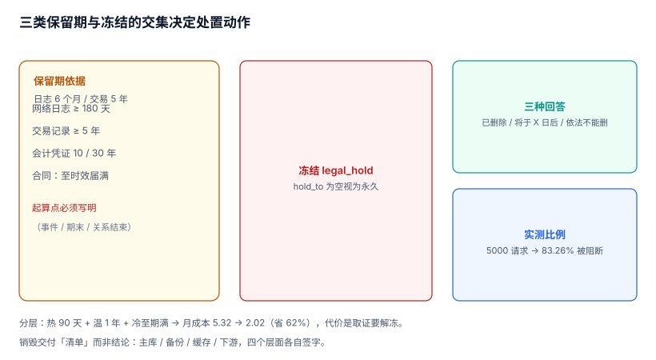

# 留存与销毁：法定保留撞上删除权

审计库里最拧巴的一对需求是：**一边要求「删掉我的个人信息」，一边要求「把这条记录留五年」**。两边都不是可选项，两边都有罚则。

本页给出一套能同时成立的处置模型：按数据类别定保留期、按冻结状态定能否删、按存储层定成本，最后说清「销毁」到底能证明什么。

本页判据族 `ADL-A` ~ `ADL-H`，共 8 条。



## 一、保留期不是一个数字，是三类依据的叠加

| 类别 | 典型保留期 | 依据 | 起算点 |
| --- | --- | --- | --- |
| 网络/安全日志 | **≥ 6 个月** | 《网络安全法》第二十一条 | 日志生成时 |
| 客户身份与交易记录 | **≥ 5 年** | 反洗钱相关规定 | 业务关系结束 / 交易发生时 |
| 会计凭证与账簿 | **10 年 / 30 年** | 《会计档案管理办法》 | 会计年度终了后 |
| 合同与诉讼相关 | 至时效届满（3 年，最长 20 年） | 《民法典》诉讼时效 | 权利受侵害时 |
| 普通操作日志 | 90 天 ~ 1 年 | 内部策略 | 生成时 |

::: warning 保留期必须写清「起算点」
「保留 5 年」在没有起算点时是无法执行的：从事件发生算、从业务关系结束算、从会计年度终了算，三者能差出一年以上。**起算点写不清，删除任务就会在错误的日期执行**，而这属于「删早了」，事后无法补救。
:::

合规要求是**下限**不是上限。内部策略可以更长（比如审计日志留 6 年），但不能更短；而「更长」会与删除权直接冲突——这就是下一页要解决的矛盾。

## 二、冲突是必然的，不是异常

本机模拟（5,000 个删除请求，事件年龄在 6 年内均匀分布，处于法定保留期的不能删）：

| 指标 | 读数 |
| --- | --- |
| 删除请求数 | **5,000** |
| 因法定保留被阻断 | **4,163（83.26%）** |
| 可立即执行 | 837（16.74%） |

83.26% 这个比例的现实含义：**删除权在审计领域大部分时候是「不能删」，而不是「删」**。系统必须能明确回答「为什么不能删、什么时候可以删」，而不是简单地返回一个 403。

三种处置动作，对应三种回答：

| 动作 | 何时用 | 对用户的回答 |
| --- | --- | --- |
| 立即删除 | 无保留义务、无冻结 | 「已删除」 |
| 延迟删除 | 保留期满后可删 | 「将于 X 年 X 月 X 日后删除」 |
| 拒绝删除 | 处于法定保留或诉讼冻结 | 「因法定义务暂不能删除，依据是 …」 |

第三种必须有**依据字段**（`legal_basis`）和**到期日**（`hold_to`）。没有这两个字段的「拒绝」在监管看来就是「不配合」。

## 三、冻结（legal hold）必须与删除任务在同一处判定

最常见的实现错误：删除任务在应用层查一次「有没有冻结」，然后执行 `DELETE`。问题在于**冻结是可能在查询与删除之间发生的**——诉讼通知到达的那一刻，删除任务正好跑到一半。

正确做法是把判定写进库层，让删除在冻结生效后**必然失败**：

```sql
CREATE TABLE legal_hold (
  hold_id      TEXT PRIMARY KEY,
  subject_type TEXT NOT NULL,
  subject_id   TEXT NOT NULL,
  basis        TEXT NOT NULL,          -- 依据：函件编号、案件号、条款
  hold_from    TEXT NOT NULL,
  hold_to      TEXT,                   -- NULL = 未定期限
  released_at  TEXT
);

-- 冻结期内不允许把删除请求置为 executed
CREATE TRIGGER trg_deletion_hold_guard BEFORE UPDATE OF status ON deletion_request
WHEN NEW.status = 'executed'
 AND EXISTS (SELECT 1 FROM legal_hold h
             WHERE h.subject_id = NEW.subject_id
               AND h.released_at IS NULL
               AND (h.hold_to IS NULL OR h.hold_to >= NEW.requested_at))
BEGIN SELECT RAISE(ABORT, 'LEGAL_HOLD_ACTIVE'); END;
```

注意条件里的 `h.hold_to IS NULL OR h.hold_to >= NEW.requested_at`：**未定期限的冻结必须视为永久**，否则一个漏填 `hold_to` 的记录会让冻结形同虚设。

## 四、分层：留存 5 年不等于热存 5 年

保留期的成本问题不在总量，在「全都在最贵的那一层」。按访问频率分三层是标准做法：

| 层 | 覆盖 | 访问频率 | 单价（相对） |
| --- | --- | --- | --- |
| 热（在线库） | 最近 90 天 | 每天 | 1.0 |
| 温（归档库） | 90 天 ~ 1 年 | 每月 | 0.34 |
| 冷（对象存储 / 锁定桶） | 1 年 ~ 保留期满 | 每年或仅取证 | 0.09 |

本机按示例体量（热 3.2 GB、温 6.0 GB、冷 6.0 GB）估算月成本：

| 方案 | 月成本 | 相对 |
| --- | --- | --- |
| 全部热存 | **5.32** | 100% |
| 三层分层 | **2.02** | **38%** |

省 62%，代价是「取证时要先解冻」。这个代价必须写进 SLA：冷层取数可能需要分钟级到小时级，**现场取证时等不起**。可行的折中是「最近 12 个月保持温层」，因为绝大多数取证请求指向近期。

## 五、销毁能证明什么

这是最容易被夸大的一环。「数据已彻底销毁」这句话在技术上只能证明到某个程度：

| 层面 | 能证明 | 证明不了 |
| --- | --- | --- |
| 主库 | 行已不存在（`COUNT(*) = 0`） | 备份里是否还有 |
| 备份 | 该备份已过期并被覆盖 | 离线磁带 / 异地副本 |
| 缓存 | 键已失效 | 下游系统（数仓、报表、搜索索引） |
| 日志 | 该段日志已清理 | 已被转发到第三方的副本 |

所以销毁的交付物不是一句「已删除」，而是**一张清单**：列出所有持有该数据的系统、各自的删除状态、验证方式、责任人。这份清单通常叫「数据地图」或「处理活动记录」，见[数据删除](../../../Others/PrivacyEngineering/Deletion/index.md)。

```sql
-- 销毁验证：三个层面各查一次（示例）
-- 1) 主库
SELECT COUNT(*) FROM audit_event WHERE actor_id = 'U-1001';
-- 2) 归档（对象存储侧用清单文件核对）
-- aws s3 ls s3://audit-cold/2026/09/ | grep U-1001
-- 3) 下游（数仓/搜索）各自一条查询
```

第二、三层面无法用 SQL 回答，这恰恰是要写进清单的原因：**能自动验证的部分自动验证，不能的必须有人签字**。

## 六、删除与匿名化的取舍

能删的时候，也未必该删。三种粒度：

| 粒度 | 做法 | 保留的分析价值 | 可逆性 |
| --- | --- | --- | --- |
| 行删除 | `DELETE` 整条事件 | 0 | 不可逆（但断链！） |
| 字段脱敏 | 把 `actor_id` 换成 `anon-7f3a`，同时保留原值哈希 | 行为模式仍可分析 | 不可逆，可校验 |
| 令牌化 | 存映射表，删除时删映射 | 完整 | 删映射即不可逆 |

**审计场景强烈建议第二种**：整条删除会在链上留一个洞（见[不可篡改](../Immutability/index.md)），而字段脱敏既满足「不再识别到个人」，又不破坏链——因为脱敏动作本身可以记成一条新事件（`action='pii.mask'`），链继续往下走。

::: danger 不要为了「删干净」去改历史记录
「把这个人相关的记录都删掉」如果落到 `UPDATE audit_event` 上，会同时造成两个后果：链断（改过的行哈希对不上）与举证失效（历史被改写）。

正确路径是：**新增一条脱敏事件，原记录保留但字段指向脱敏值**；如果法规要求原值必须消失，则走「归档冻结 + 到期整段销毁」，而不是就地改写。
:::

## 七、本页判据

| 编号 | 判据 | 为什么要它 | 怎么验证 |
| --- | --- | --- | --- |
| `ADL-A` | 每类数据有明确保留期与**起算点** | 没有起算点的保留期无法执行 | 策略表里 `retain_days` 与 `start_from` 都非空 |
| `ADL-B` | 保留期满足法定下限（日志 6 个月、交易 5 年等） | 短于下限即违规 | 策略值与依据条款逐条对照 |
| `ADL-C` | 删除请求三态（pending/blocked/executed），拒绝必须带依据与到期日 | 「不配合」与「依法不能删」必须可区分 | `blocked` 行都有 `legal_basis` 与 `hold_to` |
| `ADL-D` | 冻结判定在库层生效，且 `hold_to IS NULL` 视为永久 | 应用层判定存在竞态 | 冻结后执行删除必须被拒 |
| `ADL-E` | 保留期满自动触发处置任务，且任务可审计 | 靠人记的销毁一定会漏 | 处置任务表可按批次查 |
| `ADL-F` | 分层策略与取证 SLA 一致（近期可即时取） | 冷层解冻会让现场取证超时 | 12 个月内数据在温层或热层 |
| `ADL-G` | 销毁交付「清单」而非结论，覆盖主库/备份/缓存/下游 | 单一系统的删除不等于数据消失 | 清单列出所有持有方与状态 |
| `ADL-H` | 脱敏以新增事件实现，不改历史行 | 改历史会断链并毁掉举证能力 | 脱敏后链校验仍通过 |

## 八、验证方式

```sql
-- 1) 有没有「短于法定下限」的策略（以 180 天为例）
SELECT policy_id, data_class, retain_days, legal_basis
FROM retention_policy
WHERE data_class IN ('security_log','access_log') AND retain_days < 180;
-- 预期：0 行
```

```sql
-- 2) 被拒绝的删除请求是否都给了依据与到期日
SELECT COUNT(*) AS blocked,
       SUM(CASE WHEN legal_basis IS NULL OR hold_to IS NULL THEN 1 ELSE 0 END) AS unexplained
FROM deletion_request WHERE status = 'blocked';
-- 预期：unexplained = 0
```

```shell
# 3) 冻结竞态：先置 pending，再插入冻结，最后尝试执行（必须失败）
sqlite3 af.db "UPDATE deletion_request SET status='executed', executed_at=datetime('now') WHERE request_id='D-1';"
# 预期：Runtime error: LEGAL_HOLD_ACTIVE —— 说明库层守住了，不依赖应用判断
```

## 九、参考资料

- [《中华人民共和国网络安全法》第二十一条](https://www.gov.cn/xinwen/2016-11/07/content_5129723.htm)：网络日志留存不少于六个月（2026-11 核对）
- [《会计档案管理办法》（财政部、国家档案局令第 79 号）](http://www.gov.cn/gongbao/content/2016/content_5053560.htm)：会计凭证 30 年、年度报告永久等期限规定
- [GDPR Art. 5(1)(e) 与 Art. 17(3)(b)](https://gdpr-info.eu/art-17-gdpr/)：存储限制原则与「法定义务」对删除权的例外
- [ISO/IEC 27001:2022 A.8.10](https://www.iso.org/standard/27001)：信息删除要求，本页「销毁清单」的框架来源
- [NIST SP 800-88 Rev.1](https://csrc.nist.gov/pubs/sp/800/88/r1/final)：介质净化（clear/purge/destroy）三档，本页「销毁能证明什么」的依据
