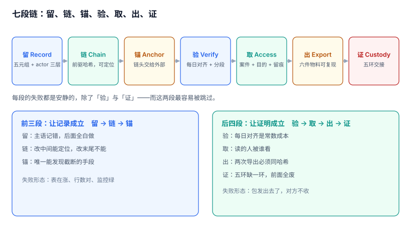
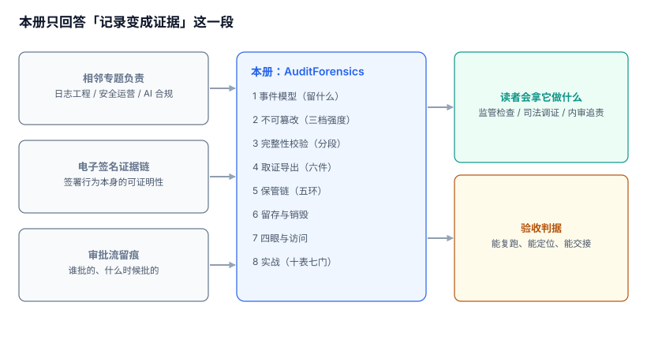

# 审计留痕与合规取证工程

审计这件事最常见的误解是「我们记了日志」。日志能回答「系统当时在干什么」，但不能回答**「这条记录有没有被人改过、改在哪一行、谁能证明」**。等到监管现场检查、司法调证或者内审追责时，一份能被自己系统改写的记录，等于没有记录。

本专题只回答一个问题：**一次业务操作，怎么变成一份第三方可以独立复核、并且能证明「事后没被改过」的证据**。

::: tip 一句话理解
留痕是「写下来」，取证是「让写下来的东西在别人手里也成立」。两者之间隔着三样东西：**链、锚、保管链**。
:::

## 本专题回答什么、不回答什么

「审计」「日志」「监控」「留痕」在同一个团队里常常指同一堆文件。下表把库内相邻专题的分工写死，避免同一个问题被两册各答一遍。

| 问题的主语 | 由谁回答 | 具体页面 |
| --- | --- | --- |
| 日志怎么采、怎么存、怎么查、怎么删 | 日志工程视角 | [日志系统](../../Ops/LogSystem/index.md) |
| 主机与 K8s 的审计事件、规则、告警 | 安全运营视角 | [审计与检测](../../Ops/SecurityHardening/AuditDetection/index.md) |
| AI 调用链的审计字段与拒答留痕 | 模型合规视角 | [AI 合规审计](../../AI/AISecurityCompliance/Audit/index.md) |
| 电子签名的证据链与时间戳 | 签署行为视角 | [证据链](../../Backend/ESignature/EvidenceChain/index.md) |
| 审批流里「谁批的、什么时候批的」 | 流程语义视角 | [审批流设计](../WorkflowEngine/ApprovalFlow/index.md) |
| 变更的高风险判定与审批门禁 | 变更管理视角 | [变更管理](../../Ops/ChangeManagement/index.md) |
| **一次业务操作怎么被记成一条可举证的记录，篡改怎么被发现，证据包怎么交出去** | **本册** | 就是你现在看的这一册 |

分界线一句话：**主语是「日志跑在哪、怎么查得快」，看别的册子；主语是「这条记录能不能拿到法庭上、怎么证明它没被改」，看本册。**

## 目录

| 章节 | 它管的那一段 | 一句话 |
| --- | --- | --- |
| [总览：三个「这条记录」与五个安静的失败](Overview/index.md) | 全景 | 先把「事实 / 记录 / 证据」拆开 |
| [事件模型：留什么、留多细、留多久](EventModel/index.md) | 留 | 记错主语，后面全白做 |
| [不可篡改：三档强度与能证伪什么](Immutability/index.md) | 链 | 链能定位改在哪，挡不住改末尾 |
| [完整性校验：全链、分段与截断盲区](IntegrityCheck/index.md) | 验 | 分段校验快 207 倍，盲区换人补 |
| [取证导出：证据包与可复现](ForensicExport/index.md) | 出 | 同一个案件导出两次，哈希必须一样 |
| [保管链与时间线重建](CustodyChain/index.md) | 证 | 五环缺一环，前面全废 |
| [留存与销毁：法定保留撞上删除权](RetentionDisposal/index.md) | 存 | 删得掉不等于删得对 |
| [四眼原则与审计访问](FourEyes/index.md) | 取 | 看审计的人，被谁看 |
| [实战：十张表、七个触发器与十一条断言](Practice/index.md) | 全链 | 约束落在表上才算数 |
| [常见问题与分诊](FAQ/index.md) | — | 十二个被反复问到的判断题 |

## 本专题的判据族

本专题共 **10 族 80 条判据**，每页 8 条，逐条可判定。

| 族 | 覆盖 | 页 |
| --- | --- | --- |
| `ADU-A ~ ADU-H` | 三个「这条记录」、七段链、五个安静的失败、三个反模式、起步顺序、边界、版本组织、验收入口 | [总览](Overview/index.md) |
| `ADE-A ~ ADE-H` | 事件与日志之别、五元组、三个扩展、actor 三层、双时间、载荷边界、体积、不可采样 | [事件模型](EventModel/index.md) |
| `ADM-A ~ ADM-H` | 三档强度、链能证伪什么、尾部截断、锚定、append-only、WORM、成本、密钥版本 | [不可篡改](Immutability/index.md) |
| `ADI-A ~ ADI-H` | 校验对象、分段、序列化稳定性、失败分级、触发点、索引、复算成本、恢复后必校验 | [完整性校验](IntegrityCheck/index.md) |
| `ADG-A ~ ADG-H` | 证据包六件、范围、可复现、脱敏、加密交付、分卷、版本、拒收条件 | [取证导出](ForensicExport/index.md) |
| `ADN-A ~ ADN-H` | 五环、四要素、缺环、时间线、时钟偏移、seq 与 ts、同秒、重建脚本 | [保管链](CustodyChain/index.md) |
| `ADL-A ~ ADL-H` | 三类保留期、法定依据、冻结、删除权冲突、匿名化、分层、销毁证明、副本延迟 | [留存与销毁](RetentionDisposal/index.md) |
| `ADK-A ~ ADK-H` | 读权限模型、四眼、purpose、审批、访问留痕、双人数学、最小化、自查 | [四眼原则](FourEyes/index.md) |
| `ADJ-A ~ ADJ-H` | 十表、六触发器、十一断言、三坑、复跑、负向探针、覆盖缺口、交付 | [实战](Practice/index.md) |
| `ADZ-A ~ ADZ-H` | 十二问、三步分诊、反例、取证问、留存问、性能问、法务问、升级路径 | [FAQ](FAQ/index.md) |

## 版本组织：本专题不建版本目录

本册面向的「换代」发生在**产品与法规条文**上（WORM 存储、透明日志服务、各家 TSA、等保条款版本），而不在判据上：**「追加写」「前驱哈希必须对得上」「导出必须可复现」这三条，在 2010 年的手写流水表和 2026 年的透明日志上都是同一句话**。

所以本册按「链上的一段」分族（`ADU` `ADE` `ADM` `ADI` `ADG` `ADN` `ADL` `ADK` `ADJ` `ADZ`），不按产品版本分目录。需要按大版本建目录的是「同一份代码两套写法」那类主题，库内已有范式可对照：

- [Spring 5](../Java/Frame/Spring/Spring5/index.md) 与 [Spring 6](../Java/Frame/Spring/Spring6/index.md)：两代 API 不兼容，旧版保留并标注状态。
- [Vue 2](../../Frontend/Frame/Vue/Vue2/index.md) 与 [Vue 3](../../Frontend/Frame/Vue/Vue3/index.md)：同一框架两套响应式写法。

审计没有这种分裂：TSA 换成另一家、存储从块设备换成对象锁，判据一个字都不用改。

## 阅读顺序

- **只要结论**：读[总览](Overview/index.md)的「五个安静的失败」一节，五分钟能对上自己的系统。
- **正在被「这条日志算不算数」折磨**：按 [事件模型](EventModel/index.md) → [不可篡改](Immutability/index.md) → [留存与销毁](RetentionDisposal/index.md) 读，三页覆盖 80% 的「记录了但举不了证」。
- **要交一份证据出去**：直接看[取证导出](ForensicExport/index.md) 与 [保管链](CustodyChain/index.md)，再回头补[实战](Practice/index.md)的表结构。
