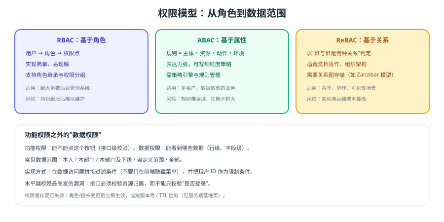

# 权限模型

认证通过之后，"这个用户能做哪些事、能看哪些数据"才是真正决定安全边界的部分。权限设计做不好，最常见的后果是**水平越权**——用户改一个 ID 就能看到别人的数据。



## 三种主流模型

| 模型 | 判定依据 | 优点 | 代价 | 适用 |
| --- | --- | --- | --- | --- |
| RBAC | 用户 → 角色 → 权限点 | 简单直观、易维护 | 角色膨胀后难管理 | 绝大多数后台系统 |
| ABAC | 主体/资源/动作/环境属性 | 表达力强、细粒度 | 规则复杂、性能开销 | 多租户、数据敏感业务 |
| ReBAC | 实体之间的关系 | 适合共享/协作场景 | 实现与运维成本最高 | 文档协作、组织架构 |

::: tip 权限设计的起点
从一张表开始：**角色 → 权限点（接口级）→ 数据范围**。把它写清楚之后，再决定用 RBAC 还是 ABAC，比一上来就纠结"用哪套模型"高效得多。
:::

实践建议：**从 RBAC 起步，遇到"规则无法用角色表达"时再局部引入 ABAC**，不要一开始就上策略引擎。

## 权限的两个层次

| 层次 | 回答 | 实现位置 | 典型错误 |
| --- | --- | --- | --- |
| 功能权限 | 能不能调用这个接口/按钮 | 接口注解、网关路由 | 只隐藏前端菜单 |
| 数据权限 | 能看到哪些数据行/字段 | 数据访问层过滤 | 只校验"已登录" |

数据权限的常见范围：

```text
仅本人 → 本部门 → 本部门及下级 → 自定义范围 → 全部
```

::: danger 越权是最容易被忽略的高危问题
**水平越权**：A 用户通过修改 `orderId` 访问 B 用户的订单。
**垂直越权**：普通用户直接调用管理端接口。

两者都不是"认证"问题，而是"授权"问题。**接口必须同时校验"权限点"与"资源归属"**，缺一不可。
:::

## 数据权限怎么落到 SQL

```sql
-- 反例：只按业务条件查询，没有数据范围约束
SELECT * FROM orders WHERE status = 'PAID';

-- 正例：强制拼接数据范围（此处示例为"本部门及下级"）
SELECT o.* FROM orders o
JOIN sys_dept d ON d.id = o.dept_id
WHERE o.status = 'PAID'
  AND d.path LIKE CONCAT((SELECT path FROM sys_dept WHERE id = :currentDeptId), '%');
```

实现要点：

1. **租户 ID 作为强制条件**：由框架统一追加，禁止业务代码"选择性"拼接。
2. **权限过滤在服务端**：前端传来的过滤条件只能收窄范围，不能放宽范围。
3. **敏感字段单独控制**：如手机号、金额，按字段授权或脱敏输出。
4. **越权尝试要留痕**：查询条件被改写（例如越权 ID）时记录审计日志。

## 数据范围的第一档：「仅本人」到底怎么判

上面那句 `仅本人 → 本部门 → 本部门及下级 → 自定义 → 全部` 里，**最难的不是最长的那一档，而是最短的那一档**。因为它的判据只有一条，却极容易被写成另一种东西。

| 判据 | 正确写法 | 错误写法 | 错在哪 |
| --- | --- | --- | --- |
| 「这是谁的东西」 | 用**令牌里的主体**去比对资源行的 owner 列（`row.owner_id == token.sub`） | 用**请求体/查询参数里的 id**（`req.body.userId == row.owner_id`） | 请求体是调用方可控的：一次 `403` 之后他只需把那个 id 换成自己的 |
| 「我能不能改」 | 服务端判 owner，前端隐藏按钮只是体验 | 只隐藏按钮 | 绕过前端就是真攻击，而攻击者从不走前端 |
| 「我能看到哪些」 | **列表在服务端过滤**（SQL 的 `WHERE owner_id = ?`） | 拉全量再在前端按 `userId` 过滤 | 不属于他的数据已经发到了他的浏览器里，打开 DevTools 就能看 |

::: danger 归属失败该返回 `403` 还是 `404`
两者都对，取决于**资源的存在性是否已经是公开信息**：

- **公开**（文章、公开评论、商品）：返回 `403`。对方本来就能看到这条资源，`404` 反而会让人以为「删掉了」，属于误导。
- **不公开**（私信、他人订单、内部工单）：返回 `404`。`403` 等于承认「这条记录存在，只是你看不到」，这本身就是一个存在性泄漏——与「未发布文章返回 404 而不是 403」是同一条原则。

判据先问一句：**这个资源的存在性，对未授权的一方而言是秘密吗？** 是秘密就 `404`，不是就 `403`。
:::

::: tip 「我的 X」是过滤，不是权限
`GET /me/comments`、`GET /my-orders` 这类接口听起来像权限，其实是**过滤**：它对所有人返回同一个状态码，区别只在返回哪些行。

这个区分有实际后果：它**不能被写成 `403` 判据**，只能写成内容判据——「返回的每一行 `owner_id` 都等于 `token.sub`」。把它错当成权限，就会出现「测了状态码就以为测了越权」的假绿。

真正的权限判据落在**对单条资源的写操作**上（改、删），因为那时才存在「你无权动它」这个状态。

一个真实项目的完整落地（6 类动作 × 3 种身份的越权矩阵、以及「读是过滤、写是权限」这条区分）见 [全栈博客平台 · 读者账号与权限](../../../../project/Complete/BlogPlatform/ReaderAccount/index.md)。
:::

## 权限缓存与一致性

| 方案 | 说明 | 风险 |
| --- | --- | --- |
| 不缓存 | 每次查库/查接口 | 性能压力大 |
| 本地缓存 + TTL | 简单，秒级生效 | 权限变更生效有延迟 |
| 分布式缓存 + 主动失效 | 变更时删缓存 | 需要可靠的消息/事件机制 |
| 版本号 | 用户/角色变更自增版本，缓存随之失效 | 实现稍复杂，但一致性最好 |

建议：**关键写操作（授权、封禁）即时校验数据库，普通读取走缓存**。

## 前后端权限分工

| 端 | 职责 | 不能做的事 |
| --- | --- | --- |
| 前端 | 控制菜单/按钮可见性，提升体验 | 不能作为安全边界 |
| 后端 | 接口级 + 数据级校验 | 不能只依赖前端传参 |

前端权限数据（菜单、按钮编码）应与后端权限点**同源**，避免两边各自维护一套导致不一致。

## 验证方式

1. 用低权限账号直接调用高权限接口（Postman/curl），确认返回 403。
2. 用 A 账号的令牌访问 B 账号的资源 ID，确认返回 403/404 而不是数据。
3. 修改角色权限后立即用同一会话发起请求，确认权限变化按预期生效（验证缓存失效）。
4. 检查最终执行的 SQL，确认数据范围条件确实被拼进查询。

## 相关专题

- [服务端落地](../Implementation/index.md)：权限校验在网关与服务中的分工
- [安全最佳实践](../Security/index.md)：越权与审计
- [OAuth 2.1 与 OIDC](../Oauth2/index.md)：scope 与权限的关系
- [Spring Security 6 · 授权](../../Java/Frame/SpringSecurity/v6/SpringBoot/Authorization/index.md)：Java 侧实现

## 与「权限矩阵验证」章节的分工（第 148 天补充）

[权限矩阵验证](/project/Complete/TeamBoard/PermissionMatrix/index.md)（属[在线协作任务看板](/project/Complete/TeamBoard/index.md)）把本页的授权口径**变成了一张会失败的用例矩阵**，两者分工：

| 边界问题 | 归本页 | 归该章节 |
| --- | --- | --- |
| 授权模型怎么建模（RBAC / ABAC / 数据范围） | 给模型、判据层次与「仅本人」这类数据范围的判法 | 不重新定义规则——它**原样引用**架构页定下的 18 格 |
| 「跨工作区一律 `404`」还是 `403` | 给两条状态码的语义与取舍 | 把该口径作为**边界用例**逐格固定，并指出它是**防枚举**约定 |
| `401` 与 `403` 的先后 | 给判定顺序与原因 | 给一条**顺序敏感**的联调口径（`401` 先于 `403`），并用用例固定 |
| 权限判定的三个层次怎么落 | 给「入口 / 服务 / 数据」三层各自判什么 | 给出**只在一层做的三个漏洞**与对应用例 |

一句话：**本页讲「授权怎么建模」；该章节讲「建好的模型怎么被逐格证明——每一格都要有一个『错的样子』」。**

## 与「租户边界」章节集的分工（第 155 天补充）

| 维度 | 本页 | 「租户边界」章节集（第 155 天） |
| --- | --- | --- |
| 回答的问题 | 一个主体对一份资源「有没有权限」怎么建模与判定 | 这个主体与那份资源「是不是同一个租户的」，以及不是同一租户时该返回什么 |
| 失败语义 | `401` 未认证、`403` 已认证但无权 | 跨租户一律 `404`（不泄漏存在性），`403` 只留给同租户角色不足 |
| 资源范围 | 以「资源」为单位 | 四类读路径（检索 / 游标 / 导出 / 附件签名）+ 三个写路径（表、缓存、推送） |
| 兜底层 | 应用层判定 | 数据库 RLS、缓存 key、主题命名空间、对象 key 前缀，四层各自兜底 |

一句话结论：**本页决定「谁能做什么」，章节集决定「谁不能碰到谁的数据」**——后者错了，前者的判定结果会喂给一个不该拿到数据的人。

::: danger 这一页特有的坑
最常见的混用是把「跨租户」也判成 `403`。`403` 的语义是「资源存在，但你不能动」，它把存在性告诉了越权者；跨租户必须 `404`，并且 body 为空。
:::

## 与「数据库访问控制与审计」专题的分工（第 190 天补充）

| 问题 | 看哪里 |
| --- | --- |
| 角色模型、接口级鉴权、权限点怎么设计 | 本页 |
| 应用判错时库层还能不能兜住、行级策略怎么写 | [数据库访问控制与审计](../../../DB/AccessControl/index.md) |
| 越权用例该怎么组织成矩阵 | [实战：一套可验收的权限基线](../../../DB/AccessControl/Practice/index.md) |

**这一页特有的坑：应用层「先查后改」在并发下会双成功，而应用层鉴权通过并不代表这个结果是对的。** 两个请求都通过了「是否有权取消订单」的检查，然后各自更新——本机用两个会话实测，只按 `id` 更新的版本两笔都成功、后到者覆盖了前者的终态；把状态放进 `WHERE` 的版本第二笔影响 0 行。库层的条件更新不是「性能优化」，它是应用层鉴权之外唯一能保证「这一次迁移合法」的东西。

## 与「多租户 SaaS 架构」的分工（第 195 天补充）

| 那边（专题）回答 | 本页回答 |
| --- | --- |
| 租户身份的三道校验：Token 租户 == Header 租户、路径租户 ∈ 可访问集合、库层策略兜底 | 应用层 RBAC / ABAC 的模型、接口级鉴权、Token 声明设计 |
| 为什么「只信请求头」会被伪造、「只信 Token」无法支持多租户切换 | 角色与权限的建模与判定 |
| 隔离失效时库层还能不能兜住（`FORCE` 策略 + 非所有者身份） | 鉴权失败的错误码与响应 |

**本页独有的一个坑**：一个用户属于多个租户时，Token 里的 `tenant` 声明不能写成「当前租户」，而要写成「可访问租户集合」，当前租户由请求头给出并做交集校验。写成单个 `tenant` 声明后，用户切换租户只能重新登录，而产品经理一定会要求「不重新登录就能切」——那时再改 Token 结构，等于全量用户重新登录一次。

专题详见 [多租户 SaaS 架构](../../MultiTenantSaaS/index.md) 的 [租户上下文](../../MultiTenantSaaS/TenantContext/index.md)。


## 与「薪酬核算与个税社保工程」的分工（第 230 天补充）

| 你关心的问题 | 该读哪一册 | 为什么不是本册 |
| --- | --- | --- |
| 工资条的字段级权限怎么建模 | [银行代发与工资条](../../Payroll/Payout/index.md) | 那册给可见范围矩阵与权限 SQL，本册讲通用授权模型 |
| 为什么「工号前缀」不能当部门判据 | [薪酬常见问题](../../Payroll/FAQ/index.md) | 那册给分诊与术语，本册讲角色与资源 |
| 财务能看全员明细吗 | [成本归集与总账勾稽](../../Payroll/Ledger/index.md) | 那册讲成本口径，本册讲权限边界 |

::: danger 本页特有的一个坑：用工号或姓名推断组织归属
把「工号前缀相同」当成「同部门」，在 120 人的样例里放行了 120 人，**越权 119 人**。字符串推断看起来省了一张关系表，实际上任何一次工号规则调整都会让权限整体失效，而且失效时没有任何报错。正确做法是权限只引用关系表（`org_relation`、`role_scope`），并在 SQL 层就限定可见行，而不是在应用层过滤结果集。
:::

## 与「客户身份归并与主数据」的分工（第 235 天补充）

同一批请求里既有「你是谁」，也有「你是哪个客户」，两件事由不同册子管：

| 你关心的问题 | 该读哪一册 | 为什么不是本册 |
| --- | --- | --- |
| 令牌有效吗、能不能调这个接口 | 本页 | 判**凭证与权限**，不管背后是一个人还是三个人 |
| 同一个人的三个账号要不要并成一个 | [客户身份归并与主数据](../../CustomerIdentity/Overview/index.md) | 判**多个档案是不是同一个人** |
| 合并之后旧 `sub` 还能不能用 | [合并与别名](../../CustomerIdentity/MergeAlias/index.md) | 判**主键迁移与别名转发** |

::: danger 一页一坑：令牌里的 `sub` 指向了已合并的客户
合并把客户 2 并进 1，但会话里存的还是 `sub=2`。鉴权全通过（令牌有效、角色正确），接口却返回空数据——因为 `customer_id=2` 已经 `status='merged'`，业务查询按主键取不到行。

正确写法是在**解析令牌的那一层**就把别名解开：`sub = resolve(customer_alias, sub)`，且解析只允许 1 跳（别名必须指簇根）。把这件事推给每个业务接口，等于让 40 个接口各写一遍同样的 bug。
:::

## 与电子签署专题的分工（第 217 天补）

两册都会出现「他能不能做这件事」，但判断依据完全不同：

| 问题 | 该读哪册 | 判据 |
| --- | --- | --- |
| 这个令牌有没有 `contract:sign` 权限 | 本页 | `scope` / RBAC，服务端可随时回收 |
| 这个签名是不是他本人做的 | [电子签署](../../ESignature/index.md) | 私钥是否只由本人控制 |
| 后台运维能不能替他签 | 本页 | **能力上能，合规上不能** |
| 离职员工的令牌怎么处理 | 本页 | 吊销即可 |

关键结论：**授权不等于不可否认**。一个拥有 `contract:sign` 的运维账号可以「合法地」调用签署接口，但那份签名在举证时不成立——因为《电子签名法》要求「签署时签名制作数据仅由签名人控制」。所以签署服务里不该有「代签」接口，需要代签时必须走**授权链**（授权书快照 + 经办人核身 + 企业证书），细节在[实名与意愿](../../ESignature/IdentityIntent/index.md)。

## 与「组织与任职」专题的分工（第 238 天补充）

本页判**「这个请求能不能做」**（功能权限 + 数据范围），组织与任职册判**「这个人在哪个组织、什么时候在」**。两者的接缝是数据权限里的「按组织树看数据」。

| 你关心的问题 | 该读哪一册 | 为什么不是本页 |
| --- | --- | --- |
| 这个角色能进哪些菜单、调哪些接口 | 本页 | 判**功能权限** |
| 他只能看自己部门的数据吗 | 本页给判定方式 | 判**范围表达式**，不判组织树怎么长 |
| 昨天的组织调整会不会影响今天的数据可见性 | [组织单元：三种存法与搬迁代价](../../OrgPeople/OrgModel/index.md) | 那册判**树怎么变**，本页判**权限怎么算** |
| 历史审批单上「当时的审批人」是谁 | [汇报线：实线、虚线与环](../../OrgPeople/ReportingLine/index.md) | 那册判**当时向谁汇报** |

::: danger 本页特有的一处坑：按「当前组织路径」授权，组织一改权限就漂移
数据权限最常见的写法是把 `org.path` 存进授权表，然后 `WHERE data.org_path LIKE auth.path || '%'`。组织树一旦调整（本机 600 个单元里搬一个中层要重写 179 行路径），昨天能看的数据今天就看不到，而权限表一个字没改。

正确做法是授权时存**授权那一刻的组织范围快照 + 生效区间**（授权表带 `valid_from/valid_to`，路径也带版本），判定时按「数据发生日 + 授权有效期」双条件取交集。这一步不做，每次组织调整都会变成一次权限事故，而事故的表象是「系统坏了」。
:::

## 与「培训与资质认证」专题的分工（第 240 天补充）

「能访问什么」与「能上岗干什么」是两套独立判定，最危险的错法是用前者代替后者：

| 问题 | 本册（授权） | 培训与资质册 |
| --- | --- | --- |
| 能不能调这个接口 | **判**：RBAC/ABAC + 令牌 | 不判 |
| 能不能上这个岗 | 不判 | **判**：矩阵 + 证书 + 判定点 |
| 权限回收够不够 | **判**：最小权限与即时回收 | 提供「资质失效」这一路输入 |
| 离职当天怎么处理 | **判**：账号停用 | 资质记录保留（审计要） |

延伸阅读：[岗位资质矩阵](../../TrainingQualification/Matrix/index.md)、[上岗准入：判定点在哪里](../../TrainingQualification/AccessGate/index.md)、[证书与有效期](../../TrainingQualification/Certificate/index.md)。

::: danger 一个只在本页成立的坑
**给「无证但需要作业」的人临时提权**。临时提权解决的是「系统不让点」，不是「他没有资质」。一旦用权限绕过准入，后续所有报表都会显示「已准入」——因为拦截根本没发生。资质侧应当提供的是**带责任人的宽限**，不是权限。
:::

## 与「临床试验数据管理」专题的分工（第 244 天补充）

本页讲 RBAC / ABAC 与最小权限，临床专题讲的是一个特殊约束：**组别（arm）本身就是需要保护的字段**。这在本页的通用模型里只是一个普通属性：

| 本页讲什么 | 临床专题讲什么 | 边界 |
| --- | --- | --- |
| 角色、权限、资源、策略 | 六个角色对 `arm` 字段的可见性矩阵 | 本页不判字段级可见性 |
| 最小权限与职责分离 | 疗效评估者与给药者必须分离 | 本页不判业务角色划分 |
| 数据行级/列级过滤 | 接口响应不得含组别字段（技术性破盲） | 本页不判响应裁剪 |
| 审计与越权检测 | 揭盲操作的审批与知晓范围 | 本页不判揭盲流程 |

**一个最常见的越权形态**：前端隐藏了 `arm` 列，后端接口照常返回。这不是「权限配置错了」，而是**权限作用在了渲染层而不是数据层**。判据很简单：打开浏览器开发者工具看一次响应体——如果里面有组别字段，盲态在技术上已经破了。

→ 临床侧的完整链路见[盲态与揭盲：四道闸与破盲处置](../../ClinicalTrial/BlindMaintenance/index.md)。

## 与「招投标与电子采购交易工程」专题的分工（第 252 天补充）

| 关注点 | 本册（权限模型） | 招投标专题 |
| --- | --- | --- |
| 回答的问题 | 「这个人能不能做这类事」 | 「这个人能不能评**这一标**」 |
| 载体 | 角色 → 权限点 → 数据范围 | 回避关系（人 × 投标人 × 项目） |
| 变更频率 | 季度级 | 每标一次 |
| 失效后果 | 越权访问 | 评标结果可被推翻 |

本册的 RBAC 能回答「有没有 `bid.evaluate` 权限」，但回答不了「他和这家投标人有没有关系」。回避是**关系数据**，不是角色。

::: warning 回避关系不能塞进角色
把「需回避」做成一个角色，就得为每一标新建角色（组合爆炸），而且关系一变更历史角色不会自动失效。本机模拟：500 名专家中 15% 与投标人有关联（同单位、近亲属、项目前期参与），**随机抽 5 人时抽到至少 1 名该回避者的概率是 55.79%**——超过一半的评审组会带人，而系统里毫无痕迹，因为「随机抽 5 人」这个动作本身是合规的。口径是 `expert_relation(expert_id, supplier_id, rel_type, valid_from, valid_to)` 一张关系表 + 抽取时 `NOT EXISTS` 过滤，并把过滤结果落 `expert_assign.avoid_checked=1`；只写日志不过滤，等于没做。
:::

## 与「招聘与人才获取工程」专题的分工（第 253 天补充）

招聘系统是权限事故的高发区，因为它同时满足三个条件：**存敏感个人信息、用户角色极杂（HR、用人经理、面试官、猎头、内推人）、且大量用户只是临时参与**。本册提供鉴权与授权的机制，招聘册负责把「谁能看哪一份简历」翻译成本册能判的表达式。

| 问题 | 本册（认证与授权） | 招聘与人才获取册 |
| --- | --- | --- |
| 你是谁 | **判**：`sub` + 会话 + 令牌 | 不判 |
| 你能调哪个接口 | **判**：功能权限（RBAC/ABAC） | 声明所需权限点 |
| 你能看哪一条数据 | **判**：数据权限表达式（如 `owner = ${sub}`） | **判**：面试官只看「被指派的那几场」 |
| 手机号能不能明文看 | 不判（本册只判「能不能读该字段」） | **判**：敏感字段三层隔离，数据层最有效 |
| 候选人要不要账号 | 不判 | **判**：不要——候选人不是系统用户 |

三层隔离（接口层掩码 / 查询层裁列 / 数据层脱敏）里，只有**数据层**是可靠的：前两层都依赖「每个新接口都记得用同一个包装」，而数据层是视图或列级权限，写错一次就在库里错着。这也是为什么招聘册把手机号、身份证、薪资三列的判断下沉到库，而不是放在服务里。

::: danger 一个只在本页成立的坑
**给面试官开「招聘模块可见」的功能权限。** 「可见」是最省事的授权方式，但它等于把整个候选人池交出去——面试官需要的是**被指派的那几场面试 + 该场候选人的脱敏简历**，不是全库 2,400 份简历。这类事故的隐蔽之处在于：授权动作本身是合规的（面试官确实该看简历），只有**范围**超了；而功能权限这一层根本没有范围概念。

本册能表达范围，但前提是调用方给得出条件。招聘册给的条件是「`interview.interviewer_id = ${sub}` 且 `interview.status = 'scheduled'`」——若业务侧传不出这个条件，本册只能退化成「有权限 = 全可见」。

反过来也有一个坑：**用数据权限去拦字段**。数据权限管「行」，字段可见性管「列」，拿行权限拦列会出现「他有这一行的权限，于是看到了不该看的手机号」。
:::

延伸阅读：[筛选：敏感字段三层隔离](../../Recruiting/Screening/index.md)、[面试：六状态与是否占位](../../Recruiting/Interview/index.md)。

## 与「图数据与关系计算工程」专题的分工

| 问题 | 本页 | 专题 |
| --- | --- | --- |
| 权限模型（RBAC/ABAC）、判定点、最小权限 | 回答 | 不重复 |
| 权限继承树的遍历实现与上限 | 给语义 | 给成本与终止性 |
| 循环授权、深度爆炸、缓存失效 | 不回答 | 回答 |

::: danger 本页特有的一个坑
权限继承写成图之后，「A 继承 B、B 继承 A」这种循环配置在业务上并不罕见（两个部门互设管理员）。用 `WITH RECURSIVE` 且没有 `UNION` 与深度上限时，判定请求会一直转到连接超时——而它表现为「登录很慢」，不是「配置错误」。**权限判定必须有深度上限（建议 8~10）与环检测**，超限时按「拒绝」而不是「放行」处理。
:::

## 参考资料

- OWASP · Authorization Cheat Sheet：https://cheatsheetseries.owasp.org/cheatsheets/Authorization_Cheat_Sheet.html
- NIST RBAC 模型说明：https://csrc.nist.gov/projects/role-based-access-control
