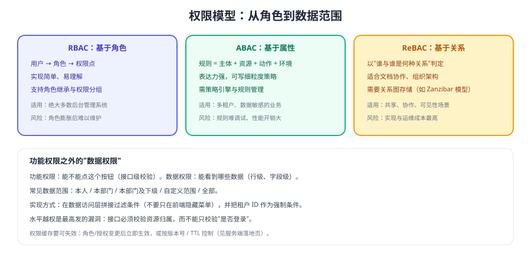

# 权限模型

认证通过之后，"这个用户能做哪些事、能看哪些数据"才是真正决定安全边界的部分。权限设计做不好，最常见的后果是**水平越权**——用户改一个 ID 就能看到别人的数据。



## 三种主流模型

| 模型 | 判定依据 | 优点 | 代价 | 适用 |
| --- | --- | --- | --- | --- |
| RBAC | 用户 → 角色 → 权限点 | 简单直观、易维护 | 角色膨胀后难管理 | 绝大多数后台系统 |
| ABAC | 主体/资源/动作/环境属性 | 表达力强、细粒度 | 规则复杂、性能开销 | 多租户、数据敏感业务 |
| ReBAC | 实体之间的关系 | 适合共享/协作场景 | 实现与运维成本最高 | 文档协作、组织架构 |

::: tip 权限设计的起点
从一张表开始：**角色 → 权限点（接口级）→ 数据范围**。把它写清楚之后，再决定用 RBAC 还是 ABAC，比一上来就纠结"用哪套模型"高效得多。
:::

实践建议：**从 RBAC 起步，遇到"规则无法用角色表达"时再局部引入 ABAC**，不要一开始就上策略引擎。

## 权限的两个层次

| 层次 | 回答 | 实现位置 | 典型错误 |
| --- | --- | --- | --- |
| 功能权限 | 能不能调用这个接口/按钮 | 接口注解、网关路由 | 只隐藏前端菜单 |
| 数据权限 | 能看到哪些数据行/字段 | 数据访问层过滤 | 只校验"已登录" |

数据权限的常见范围：

```text
仅本人 → 本部门 → 本部门及下级 → 自定义范围 → 全部
```

::: danger 越权是最容易被忽略的高危问题
**水平越权**：A 用户通过修改 `orderId` 访问 B 用户的订单。
**垂直越权**：普通用户直接调用管理端接口。

两者都不是"认证"问题，而是"授权"问题。**接口必须同时校验"权限点"与"资源归属"**，缺一不可。
:::

## 数据权限怎么落到 SQL

```sql
-- 反例：只按业务条件查询，没有数据范围约束
SELECT * FROM orders WHERE status = 'PAID';

-- 正例：强制拼接数据范围（此处示例为"本部门及下级"）
SELECT o.* FROM orders o
JOIN sys_dept d ON d.id = o.dept_id
WHERE o.status = 'PAID'
  AND d.path LIKE CONCAT((SELECT path FROM sys_dept WHERE id = :currentDeptId), '%');
```

实现要点：

1. **租户 ID 作为强制条件**：由框架统一追加，禁止业务代码"选择性"拼接。
2. **权限过滤在服务端**：前端传来的过滤条件只能收窄范围，不能放宽范围。
3. **敏感字段单独控制**：如手机号、金额，按字段授权或脱敏输出。
4. **越权尝试要留痕**：查询条件被改写（例如越权 ID）时记录审计日志。

## 数据范围的第一档：「仅本人」到底怎么判

上面那句 `仅本人 → 本部门 → 本部门及下级 → 自定义 → 全部` 里，**最难的不是最长的那一档，而是最短的那一档**。因为它的判据只有一条，却极容易被写成另一种东西。

| 判据 | 正确写法 | 错误写法 | 错在哪 |
| --- | --- | --- | --- |
| 「这是谁的东西」 | 用**令牌里的主体**去比对资源行的 owner 列（`row.owner_id == token.sub`） | 用**请求体/查询参数里的 id**（`req.body.userId == row.owner_id`） | 请求体是调用方可控的：一次 `403` 之后他只需把那个 id 换成自己的 |
| 「我能不能改」 | 服务端判 owner，前端隐藏按钮只是体验 | 只隐藏按钮 | 绕过前端就是真攻击，而攻击者从不走前端 |
| 「我能看到哪些」 | **列表在服务端过滤**（SQL 的 `WHERE owner_id = ?`） | 拉全量再在前端按 `userId` 过滤 | 不属于他的数据已经发到了他的浏览器里，打开 DevTools 就能看 |

::: danger 归属失败该返回 `403` 还是 `404`
两者都对，取决于**资源的存在性是否已经是公开信息**：

- **公开**（文章、公开评论、商品）：返回 `403`。对方本来就能看到这条资源，`404` 反而会让人以为「删掉了」，属于误导。
- **不公开**（私信、他人订单、内部工单）：返回 `404`。`403` 等于承认「这条记录存在，只是你看不到」，这本身就是一个存在性泄漏——与「未发布文章返回 404 而不是 403」是同一条原则。

判据先问一句：**这个资源的存在性，对未授权的一方而言是秘密吗？** 是秘密就 `404`，不是就 `403`。
:::

::: tip 「我的 X」是过滤，不是权限
`GET /me/comments`、`GET /my-orders` 这类接口听起来像权限，其实是**过滤**：它对所有人返回同一个状态码，区别只在返回哪些行。

这个区分有实际后果：它**不能被写成 `403` 判据**，只能写成内容判据——「返回的每一行 `owner_id` 都等于 `token.sub`」。把它错当成权限，就会出现「测了状态码就以为测了越权」的假绿。

真正的权限判据落在**对单条资源的写操作**上（改、删），因为那时才存在「你无权动它」这个状态。

一个真实项目的完整落地（6 类动作 × 3 种身份的越权矩阵、以及「读是过滤、写是权限」这条区分）见 [全栈博客平台 · 读者账号与权限](../../../../project/Complete/BlogPlatform/ReaderAccount/index.md)。
:::

## 权限缓存与一致性

| 方案 | 说明 | 风险 |
| --- | --- | --- |
| 不缓存 | 每次查库/查接口 | 性能压力大 |
| 本地缓存 + TTL | 简单，秒级生效 | 权限变更生效有延迟 |
| 分布式缓存 + 主动失效 | 变更时删缓存 | 需要可靠的消息/事件机制 |
| 版本号 | 用户/角色变更自增版本，缓存随之失效 | 实现稍复杂，但一致性最好 |

建议：**关键写操作（授权、封禁）即时校验数据库，普通读取走缓存**。

## 前后端权限分工

| 端 | 职责 | 不能做的事 |
| --- | --- | --- |
| 前端 | 控制菜单/按钮可见性，提升体验 | 不能作为安全边界 |
| 后端 | 接口级 + 数据级校验 | 不能只依赖前端传参 |

前端权限数据（菜单、按钮编码）应与后端权限点**同源**，避免两边各自维护一套导致不一致。

## 验证方式

1. 用低权限账号直接调用高权限接口（Postman/curl），确认返回 403。
2. 用 A 账号的令牌访问 B 账号的资源 ID，确认返回 403/404 而不是数据。
3. 修改角色权限后立即用同一会话发起请求，确认权限变化按预期生效（验证缓存失效）。
4. 检查最终执行的 SQL，确认数据范围条件确实被拼进查询。

## 相关专题

- [服务端落地](../Implementation/index.md)：权限校验在网关与服务中的分工
- [安全最佳实践](../Security/index.md)：越权与审计
- [OAuth 2.1 与 OIDC](../Oauth2/index.md)：scope 与权限的关系
- [Spring Security 6 · 授权](../../Java/Frame/SpringSecurity/v6/SpringBoot/Authorization/index.md)：Java 侧实现

## 与「权限矩阵验证」章节的分工（第 148 天补充）

[权限矩阵验证](/project/Complete/TeamBoard/PermissionMatrix/index.md)（属[在线协作任务看板](/project/Complete/TeamBoard/index.md)）把本页的授权口径**变成了一张会失败的用例矩阵**，两者分工：

| 边界问题 | 归本页 | 归该章节 |
| --- | --- | --- |
| 授权模型怎么建模（RBAC / ABAC / 数据范围） | 给模型、判据层次与「仅本人」这类数据范围的判法 | 不重新定义规则——它**原样引用**架构页定下的 18 格 |
| 「跨工作区一律 `404`」还是 `403` | 给两条状态码的语义与取舍 | 把该口径作为**边界用例**逐格固定，并指出它是**防枚举**约定 |
| `401` 与 `403` 的先后 | 给判定顺序与原因 | 给一条**顺序敏感**的联调口径（`401` 先于 `403`），并用用例固定 |
| 权限判定的三个层次怎么落 | 给「入口 / 服务 / 数据」三层各自判什么 | 给出**只在一层做的三个漏洞**与对应用例 |

一句话：**本页讲「授权怎么建模」；该章节讲「建好的模型怎么被逐格证明——每一格都要有一个『错的样子』」。**

## 与「租户边界」章节集的分工（第 155 天补充）

| 维度 | 本页 | 「租户边界」章节集（第 155 天） |
| --- | --- | --- |
| 回答的问题 | 一个主体对一份资源「有没有权限」怎么建模与判定 | 这个主体与那份资源「是不是同一个租户的」，以及不是同一租户时该返回什么 |
| 失败语义 | `401` 未认证、`403` 已认证但无权 | 跨租户一律 `404`（不泄漏存在性），`403` 只留给同租户角色不足 |
| 资源范围 | 以「资源」为单位 | 四类读路径（检索 / 游标 / 导出 / 附件签名）+ 三个写路径（表、缓存、推送） |
| 兜底层 | 应用层判定 | 数据库 RLS、缓存 key、主题命名空间、对象 key 前缀，四层各自兜底 |

一句话结论：**本页决定「谁能做什么」，章节集决定「谁不能碰到谁的数据」**——后者错了，前者的判定结果会喂给一个不该拿到数据的人。

::: danger 这一页特有的坑
最常见的混用是把「跨租户」也判成 `403`。`403` 的语义是「资源存在，但你不能动」，它把存在性告诉了越权者；跨租户必须 `404`，并且 body 为空。
:::

## 与「数据库访问控制与审计」专题的分工（第 190 天补充）

| 问题 | 看哪里 |
| --- | --- |
| 角色模型、接口级鉴权、权限点怎么设计 | 本页 |
| 应用判错时库层还能不能兜住、行级策略怎么写 | [数据库访问控制与审计](../../../DB/AccessControl/index.md) |
| 越权用例该怎么组织成矩阵 | [实战：一套可验收的权限基线](../../../DB/AccessControl/Practice/index.md) |

**这一页特有的坑：应用层「先查后改」在并发下会双成功，而应用层鉴权通过并不代表这个结果是对的。** 两个请求都通过了「是否有权取消订单」的检查，然后各自更新——本机用两个会话实测，只按 `id` 更新的版本两笔都成功、后到者覆盖了前者的终态；把状态放进 `WHERE` 的版本第二笔影响 0 行。库层的条件更新不是「性能优化」，它是应用层鉴权之外唯一能保证「这一次迁移合法」的东西。

## 与「多租户 SaaS 架构」的分工（第 195 天补充）

| 那边（专题）回答 | 本页回答 |
| --- | --- |
| 租户身份的三道校验：Token 租户 == Header 租户、路径租户 ∈ 可访问集合、库层策略兜底 | 应用层 RBAC / ABAC 的模型、接口级鉴权、Token 声明设计 |
| 为什么「只信请求头」会被伪造、「只信 Token」无法支持多租户切换 | 角色与权限的建模与判定 |
| 隔离失效时库层还能不能兜住（`FORCE` 策略 + 非所有者身份） | 鉴权失败的错误码与响应 |

**本页独有的一个坑**：一个用户属于多个租户时，Token 里的 `tenant` 声明不能写成「当前租户」，而要写成「可访问租户集合」，当前租户由请求头给出并做交集校验。写成单个 `tenant` 声明后，用户切换租户只能重新登录，而产品经理一定会要求「不重新登录就能切」——那时再改 Token 结构，等于全量用户重新登录一次。

专题详见 [多租户 SaaS 架构](../../MultiTenantSaaS/index.md) 的 [租户上下文](../../MultiTenantSaaS/TenantContext/index.md)。


## 参考资料

- OWASP · Authorization Cheat Sheet：https://cheatsheetseries.owasp.org/cheatsheets/Authorization_Cheat_Sheet.html
- NIST RBAC 模型说明：https://csrc.nist.gov/projects/role-based-access-control
