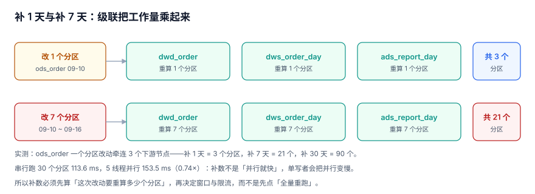

# 补数与回刷：级联、顺序与隔离

补数是批次系统里最容易被低估的动作。点一下「重跑 7 天」，看起来是 7 次运行，实际是 **21 个分区重算**、下游三次重判、以及对账表里 7 行需要重新核对。

本页把补数拆成四件事：申请、按天推进、级联范围、读隔离。

::: tip 一句话定位
本页回答「**补数要动多少东西、按什么顺序动、补的过程中下游读什么**」；补完怎么核平在[重跑与对账](../Reconcile/index.md)。
:::



## 一、申请与明细：一次补数要有身份

补数不是「重跑」的同义词。一次补数有发起人、有范围、有模式、有结论，这些都要落表：

```sql
-- 一次补数申请
CREATE TABLE backfill_request (
  req_id       INTEGER PRIMARY KEY,
  job_id       TEXT NOT NULL,
  date_from    TEXT NOT NULL,
  date_to      TEXT NOT NULL,
  mode         TEXT NOT NULL CHECK (mode IN ('OVERWRITE','SHADOW')),
  status       TEXT NOT NULL CHECK (status IN ('PENDING','RUNNING','DONE','PARTIAL','CANCELLED')),
  requested_by TEXT NOT NULL,
  created_at   TEXT NOT NULL);

-- 按天拆开：一天一行，状态只能向前
CREATE TABLE backfill_item (
  req_id    INTEGER NOT NULL,
  job_id    TEXT NOT NULL,
  data_date TEXT NOT NULL,
  seq       INTEGER NOT NULL,                -- 1..N，按日期升序
  state     TEXT NOT NULL CHECK (state IN ('PENDING','RUNNING','DONE','FAILED')),
  run_id    INTEGER,
  PRIMARY KEY (req_id, job_id, data_date));
```

**为什么必须按天拆行**：补 30 天时，第 17 天失败的概率非常高（上游那天缺文件、那天口径变了）。如果整批只有一个状态，失败只能整批重来；按天拆行则可以「17 天 DONE、13 天 FAILED」，只重跑失败的那段。

::: danger 补数状态可以倒退，是补数系统最贵的一个 bug
`DONE → PENDING` 一旦允许，就会出现「已经发出去的数被重新标记为未完成」，然后被重跑一次、覆盖、再对账——期间任何一次下游取数都可能拿到两个版本。

用一个触发器把状态机钉死：

```sql
CREATE TRIGGER trg_backfill_forward_only BEFORE UPDATE OF state ON backfill_item
WHEN NOT ((OLD.state = 'PENDING' AND NEW.state IN ('RUNNING','FAILED'))
       OR (OLD.state = 'RUNNING' AND NEW.state IN ('DONE','FAILED')))
BEGIN SELECT RAISE(ABORT, 'ILLEGAL_STATE_BACKWARD'); END;
```

实测：`PENDING → DONE` 直接跳步会被拒（必须先 `RUNNING`），`DONE → PENDING` 也会被拒。两次拒绝都是这条触发器的功劳。
:::

## 二、为什么必须按日期升序

补数不是「一堆独立的重跑」，而是一条**有依赖的重算链**。乱序补会制造三种假数据：

| 顺序 | 会发生什么 | 结果 |
| --- | --- | --- |
| 升序（09-10 → 09-16） | 每天的汇总只看当天的明细 | 正确 |
| 降序（09-16 → 09-10） | 先算 16 号，此时 15 号的修正还没落地 | 16 号用的是旧 15 号 |
| 并行乱序 | 两个日期同时重算，共用累加表 | 累加值取决于谁先提交 |

`seq` 列不是装饰：补数器按 `seq` 推进，前一个 `DONE` 才能把下一个置 `RUNNING`。这条规则在「累积型指标」上尤其重要——**累计注册用户、累计 GMV、库存余额**这类指标，只要顺序错一次，后面所有日期都错。

## 三、级联范围：先算再跑

```sql
-- 补数前先算：这次要重算多少个下游分区
WITH RECURSIVE down(job) AS (
  SELECT down_job FROM job_dependency WHERE up_job = :job_id
  UNION SELECT d.down_job FROM job_dependency d JOIN down ON d.up_job = down.job
)
SELECT
  (SELECT COUNT(*) FROM down) + 1                                AS nodes,
  CAST(julianday(:date_to) - julianday(:date_from) AS INTEGER) + 1 AS days,
  ((SELECT COUNT(*) FROM down) + 1)
    * (CAST(julianday(:date_to) - julianday(:date_from) AS INTEGER) + 1) AS partitions;
```

实测的乘法关系：

| 范围 | 节点数 | 分区数 |
| --- | --- | --- |
| 1 天 | 3 | 3 |
| 7 天 | 3 | 21 |
| 30 天 | 3 | 90 |

::: warning 并行补数在一个单写者库上会更慢
实测 30 个分区：串行 **113.6 ms**、5 线程并行 **153.5 ms（0.74×）**。原因不是线程开销，是写锁——SQLite 同一时刻只允许一个写事务，5 个线程互相等锁，重试轮转反而增加延迟。

要在并行里拿到收益，前提是**写者可以并行**（分库分表、列存多分区并发提交、按分区拆成独立文件）。否则正确做法是：减少要重算的分区（按依赖裁剪），而不是加线程。
:::

## 四、影子分区：先比再换

`OVERWRITE` 是「直接替换」，`SHADOW` 是「写到影子位置、比完再换」。后者多一步，但能回答一个关键问题：**这次补数把数改了多少**。

```text
① 作业写 shadow 分区（dt 相同，后缀 _shadow 或在影子表里）
② 跑同一套判据 + 一次「新旧对比」
③ 对比结论落表：行数差、金额差、超阈值则默认不换
④ 人工/规则确认后，一次交换（EXCHANGE / RENAME）上线
```

| 差异类型 | 典型原因 | 默认处置 |
| --- | --- | --- |
| 行数相同、金额相同 | 只重算了但结果一样 | 直接换（成本最低） |
| 行数增加 | 上游补推了漏掉的单 | 换，且通知下游 |
| 行数减少 | 上游删了单 / 去重规则变了 | **不自动换**，要人确认 |
| 金额增加、行数不变 | 金额修正 | 换，并核对下游指标 |

::: danger 「补数一定让数变好」是个错误前提
补数会让数**变**，不一定变**好**。上游删了一批测试单，你在补数时把它们「补」回来了——因为补数用的是新规则 + 旧文件，两者不一致。

所以 `SHADOW` 模式的价值不在技术，而在流程：它把「补数」从一个直接生效的操作，变成一个**有对比、有确认、可回退**的操作。
:::

## 五、读隔离：补的过程中下游读什么

补数期间，同时有三个版本的数在飞：旧分区、正在写的新分区、下游已经算过的旧汇总。隔离策略只有三种，必须选一个：

| 策略 | 做法 | 下游看到 | 代价 |
| --- | --- | --- | --- |
| 版本隔离 | 新版本先写影子，写完原子切换 | 旧版本（直到切换那一刻） | 需要影子空间 |
| 时间窗隔离 | 补数窗口内把下游作业全部暂停 | 旧版本（冻结） | 补数期间报表不出新数 |
| 无隔离 | 直接覆盖 | **可能读到中间态** | 不可接受 |

选第一种的条件是「下游 7×24 可查」；选第二种的条件是「下游只在早上取一次数」。**没有第三种**。

## 六、补数什么时候算「完成」

四个条件全满足才算完成，缺一个都只能是 `PARTIAL`：

1. 所有 `backfill_item.state = 'DONE'`，没有 `FAILED`。
2. 每一天的分区 `state ∈ ('READY','EMPTY')`，没有 `BLOCKED`。
3. 每一天的 `recon_result.verdict = 'OK'`。
4. `batch_audit` 里有这次补数的结论记录（谁发起、改了多少行、谁确认）。

```sql
SELECT
  r.req_id,
  COUNT(*)                                              AS days,
  SUM(i.state='DONE')                                   AS done_days,
  SUM(p.state='BLOCKED')                                AS blocked_days,
  SUM(CASE WHEN c.verdict<>'OK' THEN 1 ELSE 0 END)      AS recon_bad,
  CASE WHEN SUM(i.state='DONE')=COUNT(*)
        AND SUM(p.state='BLOCKED')=0
        AND SUM(CASE WHEN c.verdict<>'OK' THEN 1 ELSE 0 END)=0
       THEN 'DONE' ELSE 'PARTIAL' END                   AS verdict
FROM backfill_request r
JOIN backfill_item i ON i.req_id = r.req_id
LEFT JOIN partition_registry p ON p.job_id=i.job_id AND p.data_date=i.data_date
LEFT JOIN recon_result c ON c.biz_date=i.data_date
WHERE r.req_id = :req_id
GROUP BY r.req_id;
```

## 七、判据清单

| 编号 | 判据 | 不满足时改哪里 |
| --- | --- | --- |
| `BPB-A` | 补数有申请记录（发起人、范围、模式），不是裸跑 | `backfill_request` |
| `BPB-B` | 按天拆成 `backfill_item`，一天一行且有 `seq` | 补数拆分逻辑 |
| `BPB-C` | 状态只能向前，跳步与倒退都被数据库拒绝 | `trg_backfill_forward_only` |
| `BPB-D` | 推进顺序按 `seq` 升序，前一个 `DONE` 才启动下一个 | 补数器主循环 |
| `BPB-E` | 补数前算出「天数 × 闭包大小」并打印/落表 | 补数入口 |
| `BPB-F` | `OVERWRITE` 与 `SHADOW` 两种模式可选，`SHADOW` 有新旧对比结论 | 补数执行器 |
| `BPB-G` | 补数期间下游的读隔离策略被明确选择并写在配置里 | 隔离配置 |
| `BPB-H` | 完成判定看四项（明细、分区状态、对账、审计），不是看进度条 | 完成判定 SQL |

## 八、验证方式

```shell
cd /tmp && python3 - <<'PY'
import sqlite3
con = sqlite3.connect("/tmp/bpprac.db")
q = lambda s: con.execute(s).fetchall()
print("1) 补数明细状态分布：")
print(q("SELECT state, COUNT(*) FROM backfill_item GROUP BY state"))
print("2) 状态倒流的尝试（应抛 ILLEGAL_STATE_BACKWARD）：")
try:
    con.execute("UPDATE backfill_item SET state='PENDING' WHERE data_date='2026-09-02'")
    print("   未被拦住 —— 守卫缺失")
except sqlite3.IntegrityError as e:
    print("   被拒：", e)
print("3) 完成判定：")
print(q("""SELECT req_id, COUNT(*), SUM(state='DONE') FROM backfill_item GROUP BY req_id"""))
PY
```

预期输出：

```text
1) 补数明细状态分布：
[('DONE', 1), ('PENDING', 2)]
2) 状态倒流的尝试（应抛 ILLEGAL_STATE_BACKWARD）：
   被拒： ILLEGAL_STATE_BACKWARD
3) 完成判定：
[(1, 3, 1)]
```

第 3 段显示 3 天里只有 1 天 `DONE`，所以这次补数只能是 `PARTIAL`——**进度条 100% 与「补数完成」不是一回事**。

## 参考资料

- [Apache Airflow: Backfill and catchup](https://airflow.apache.org/docs/apache-airflow/stable/authoring-and-scheduling/backfill-and-catchup.html)
- [dbt: `--full-refresh` 与增量重跑](https://docs.getdbt.com/docs/build/incremental-models)
- [Apache Iceberg: Partition evolution and rewrite](https://iceberg.apache.org/docs/latest/partitioning/)
- [Google SRE Book: Reproducible builds and reruns](https://sre.google/sre-book/data-processing-pipelines/)
