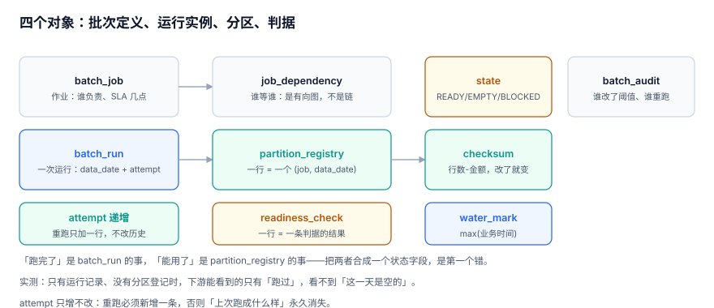

# 批次与实例：作业、运行、尝试与分区

「这个作业昨天跑了没有？」——这个问题的答案，取决于你问的是**作业**、**这一次运行**、还是**这一天的分区**。三者混成一个 `job.status` 字段，是批次系统最常见的第一处设计债。

本页把四个对象拆开：作业定义、运行实例、尝试、分区登记，并给出能把它们钉住的 DDL。

::: tip 一句话定位
本页回答「**一次批次的「身份」由什么构成，重跑为什么必须新增一条记录而不是改旧记录**」；分区怎么写进去在[分区写入](../PartitionWrite/index.md)。
:::



## 一、四个对象与四条边界

| 对象 | 一行代表什么 | 谁写它 | 变更频率 |
| --- | --- | --- | --- |
| `batch_job` | 一个作业的定义：分层、owner、SLA、最大重试 | 配置（人工评审） | 极低 |
| `batch_run` | **一次运行**：`(job, data_date, attempt)` | 调度器 / 补数器 | 每天每作业 1~3 行 |
| `partition_registry` | **一个分区**：`(job, data_date)` 的最新有效结果 | 作业自己（提交后） | 每天每作业 1 行 |
| `readiness_check` | **一条判据**：`(job, data_date, rule_code)` | 判据执行器 | 每天每作业 4~8 行 |

四条边界必须写死：

1. **作业不知道自己的历史**。它只知道这次要处理哪个 `data_date`。
2. **运行不表达「哪一版有效」**。`attempt` 是序号，不是语义；「当前生效」由 `is_current` 表达。
3. **分区只表达「现在能用的那一版」**。历史版本留在运行记录里，不在分区表里。
4. **判据是分区的属性，不是运行的属性**。同一天的判据在重跑后要重算，而不是「上一次跑过就算了」。

::: warning 把「当前生效」放进 `attempt` 的代价
有人用「`attempt` 最大的那条就是当前」来代替 `is_current`。这在**串行重跑**下是对的，在并发下会错：两次重跑同时插入 `attempt=2` 与 `attempt=3`，如果第 2 次比第 3 次晚提交，最终「最大 attempt 的那条」反而是先跑完的那次。`is_current` 是一个**显式位移**：新记录插入时把旧的置 0，同一时刻只能有一条为 1。
:::

## 二、DDL：把约束写进表里

```sql
-- 作业定义：SLA 与 owner 是「可被问责」的两列，不能只写在文档里
CREATE TABLE batch_job (
  job_id      TEXT PRIMARY KEY,
  job_name    TEXT NOT NULL,
  layer       TEXT NOT NULL,                 -- ODS / DWD / DWS / ADS
  sla_minute  INTEGER NOT NULL,              -- 距 00:00 的分钟数，420 = 07:00
  max_retry   INTEGER NOT NULL DEFAULT 3,
  owner       TEXT NOT NULL);

-- 一次运行：同一天可以有多次尝试，但 (job, date, attempt) 唯一
CREATE TABLE batch_run (
  run_id       INTEGER PRIMARY KEY AUTOINCREMENT,
  job_id       TEXT NOT NULL,
  data_date    TEXT NOT NULL,                -- 数据日，不是调度日
  attempt      INTEGER NOT NULL,
  status       TEXT NOT NULL CHECK (status IN ('RUNNING','SUCCESS','FAILED')),
  trigger_type TEXT NOT NULL CHECK (trigger_type IN ('SCHEDULE','BACKFILL','RERUN')),
  started_at   TEXT NOT NULL,
  finished_at  TEXT,
  exit_code    INTEGER,
  is_current   INTEGER NOT NULL DEFAULT 1 CHECK (is_current IN (0,1)),
  UNIQUE (job_id, data_date, attempt));

-- 分区登记：一行 = 一个 (job, data_date)，只保存「当前有效」的那一版
CREATE TABLE partition_registry (
  job_id      TEXT NOT NULL,
  data_date   TEXT NOT NULL,
  run_id      INTEGER NOT NULL,              -- 指向产生这一版的运行
  row_cnt     INTEGER NOT NULL,
  amt_sum     INTEGER NOT NULL,              -- 金额用整数分，不用浮点
  water_mark  TEXT,                          -- max(业务时间)，空分区为 NULL
  checksum    TEXT NOT NULL,                 -- 行数-金额 的指纹
  state       TEXT NOT NULL CHECK (state IN ('READY','EMPTY','BLOCKED')),
  committed_at TEXT NOT NULL,
  PRIMARY KEY (job_id, data_date));
```

三处值得单独说：

- **`data_date` 是业务日，不是调度日**。列名就叫 `data_date`，不要叫 `dt` —— 叫 `dt` 的表，早晚会有人往里塞调度日。
- **金额用整数分**。批次的重跑与对账都靠「相等」判断，浮点让「相等」变成一个概率问题。
- **`water_mark` 允许为空**。空分区没有水位是正常的，把它写成 `1970-01-01` 会让「水位判据」永远通过。

## 三、状态机：四个状态、六条边

```text
batch_run:   RUNNING ──成功──> SUCCESS
                └────失败──> FAILED
             FAILED  ──重跑──> 新的一条 RUNNING（attempt+1）

partition:   (无记录) ──首次提交──> BLOCKED ──判据全过──> READY
                                     └──行数为 0──> EMPTY
             READY/EMPTY ──重跑并提交──> BLOCKED（重新判）──> ...
```

两条纪律：

1. **`READY` 只能由判据产生，不能由作业自己写**。作业提交时写 `BLOCKED`，判据执行器写 `READY` 或 `EMPTY`。这样「谁把它标成就绪的」永远有答案。
2. **重跑不删旧记录**。旧的 `batch_run` 置 `is_current=0`，分区表的 `run_id` 指向新记录；「上次跑成什么样」靠 `run_id` 回溯。

::: danger 三个会静默出错的状态写法
1. **用 `status='DONE'` 同时表示「跑完了」和「数据就绪」**：`insert 0 rows` 也会 `DONE`，下游据此开跑，产出 0 元。
2. **`FAILED` 之后直接改回 `SUCCESS`**：日志里再也看不到那次失败，重试次数统计永久偏低。
3. **空分区不登记**：下游查 `partition_registry` 得到「没有这一行」，与「上游还没跑」无法区分，只能干等或超时。
:::

## 四、实测：48 条运行、54 个分区

在 12 天 × 4 层的语料上跑一遍，得到的计数关系是这套模型的体检指标：

| 指标 | 实测值 | 应该满足 |
| --- | --- | --- |
| `batch_run` 中 `SUCCESS` 条数 | 48 | = 天数 × 层数 = 12 × 4 |
| `partition_registry` 行数 | 48 | = 同上（每个成功运行对应一个分区） |
| 其中 `EMPTY` 的分区 | 4 | = 节假日那天 × 4 层 |
| `readiness_check` 行数 | 96 | = 48 × 2 条判据 |
| 60 天语料上 `dwd` 的分区数 | 54 | 53 个数据日 + 1 个「跨切点单生成的空壳分区」 |

最后一行值得多看两眼：**54 个分区里有 1 个是「谁都没计划要它」的**——某天 23:00 之后的单落到了次日文件里，`dwd` 按文件日分区，于是次日多了一个只有几十行的分区。它不会报错，只会让「分区数 = 天数」这个假设悄悄失效。

```sql
-- 体检：三个计数必须自洽
SELECT
  (SELECT COUNT(*) FROM batch_run WHERE status='SUCCESS')                AS ok_runs,
  (SELECT COUNT(*) FROM partition_registry)                              AS partitions,
  (SELECT COUNT(*) FROM partition_registry WHERE state='EMPTY')          AS empties,
  (SELECT COUNT(*) FROM readiness_check)                                 AS checks;
```

## 五、补数运行与调度运行必须可区分

`trigger_type` 不是装饰字段。它决定了三件事：

| `trigger_type` | 谁发起 | 是否计入「当日正常产出」 | 失败后是否自动重试 |
| --- | --- | --- | --- |
| `SCHEDULE` | 调度器按点触发 | 是 | 是，按 `max_retry` |
| `BACKFILL` | 补数申请（人工/接口） | **否** | 否，由补数器统一推进 |
| `RERUN` | 人工重跑按钮 / 上游修正通知 | 否（但会更新分区） | 否 |

::: warning 补数运行混进「当日产出」会怎样
最典型的症状：某天补了 7 天历史，第二天看「昨日批次数」暴涨 8 倍，SLA 报表、成本报表、值班工时统计全部失真。`trigger_type` 必须在写入 `batch_run` 时就带上，事后从日志里猜是不可靠的。
:::

## 六、判据清单

| 编号 | 判据 | 不满足时改哪里 |
| --- | --- | --- |
| `BPI-A` | `batch_run` 有 `UNIQUE(job_id, data_date, attempt)`，重复投递被数据库拒绝 | `batch_run` 的 DDL |
| `BPI-B` | 「当前生效」由 `is_current` 表达，且同一 `(job,date)` 只有一条为 1 | 重跑写入逻辑 |
| `BPI-C` | `partition_registry` 的 `run_id` 指向产生它的运行，可回溯到 attempt | 分区提交语句 |
| `BPI-D` | `state` 只有 `READY/EMPTY/BLOCKED` 三值，无 `DONE`/`OK` 等别名 | `CHECK` 约束 |
| `BPI-E` | `data_date` 列名与语义一致，不存在名为 `dt` 却存调度日的列 | 表结构与写入 |
| `BPI-F` | 金额列为整数（分），库内不存在金额浮点列 | 列类型 |
| `BPI-G` | `trigger_type` 三值齐全，补数与重跑可从运行记录里直接筛出 | `batch_run` 的写入 |
| `BPI-H` | 上面那张「三个计数自洽」的体检 SQL 返回 `ok_runs = partitions` | 运行/分区写入的一致性 |

## 七、验证方式

```shell
cd /tmp && python3 - <<'PY'
import sqlite3
con = sqlite3.connect("/tmp/bpprac.db")
q = lambda s: con.execute(s).fetchone()

print("ok_runs   =", q("SELECT COUNT(*) FROM batch_run WHERE status='SUCCESS'")[0])
print("partitions=", q("SELECT COUNT(*) FROM partition_registry")[0])
print("empties   =", q("SELECT COUNT(*) FROM partition_registry WHERE state='EMPTY'")[0])
print("current>1 =", q("""SELECT COUNT(*) FROM (SELECT job_id,data_date FROM batch_run
                         WHERE is_current=1 AND status='SUCCESS'
                         GROUP BY job_id,data_date HAVING COUNT(*)>1)""")[0])
PY
```

预期输出：

```text
ok_runs   = 48
partitions= 48
empties   = 4
current>1 = 0
```

第 4 行若不为 0，说明「同一天有两条当前生效」——重跑时忘了把旧的 `is_current` 置 0，下游会随机读到新版本或旧版本。

## 参考资料

- [Apache Airflow 3: Task Instances and try numbers](https://airflow.apache.org/docs/apache-airflow/stable/core-concepts/tasks.html)
- [dbt: About incremental models（unique_key 与重跑语义）](https://docs.getdbt.com/docs/build/incremental-models)
- [Apache Iceberg Spec: Snapshots（一次提交生成一个新快照）](https://iceberg.apache.org/spec/#snapshots)
- [PostgreSQL 18: Constraints](https://www.postgresql.org/docs/18/ddl-constraints.html)
