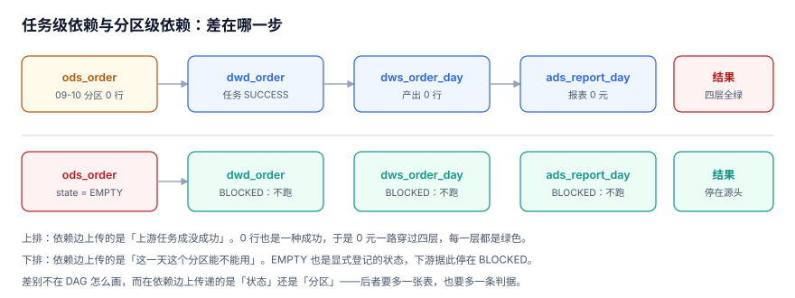

# 依赖与就绪：任务级还是分区级

DAG 画出来是几根箭头，但每根箭头上**传的是什么东西**，决定了系统在异常时的行为。传「任务成功」，0 行会一路穿过去；传「分区状态」，0 行会停在源头。

本页把依赖从「任务之间」下沉到「分区之间」，并给出可执行的闭包查询。

::: tip 一句话定位
本页回答「**下游到底在等什么，等错了会怎样**」；等的这个「分区就绪」怎么判出来，在[就绪与门禁](../ReadinessGate/index.md)。
:::



## 一、两种依赖，两种事故

| 维度 | 任务级依赖 | 分区级依赖 |
| --- | --- | --- |
| 边上传的值 | `status='SUCCESS'` | `partition.state` |
| 0 行的表现 | 正常放行 | 下游 `BLOCKED` |
| 上游重跑后 | 下游不知道 | 下游分区被标为待重算 |
| 跨天补数 | 只能「重跑整条链」 | 只影响对应日期的那一段 |
| 实现成本 | 调度器自带 | 要多一张登记表 + 一条判定 SQL |

**本册主张分区级**，理由不是「更先进」，而是两条实测出来的事实：

1. 60 次调度里 6 次确实读到 0 行（节假日）。任务级依赖下这 6 次都会向下游传播 0。
2. 一个分区改动会牵连 3 个下游节点。区分「哪一天」是补数能不能收敛的前提；任务级依赖没有「哪一天」这个概念。

## 二、DAG 是图，不是链

`ods → dwd → dws → ads` 这种一条线的写法只在小项目里成立。真实链路至少有三个形状：

| 形状 | 例子 | 风险 |
| --- | --- | --- |
| 扇出（1 → N） | `dwd_order` 同时供 `dws_order_day`、`dws_user_day`、`ads_funnel` | 上游一次重跑，N 个下游都要跟着动 |
| 扇入（N → 1） | `dws_order_day` 依赖 `dwd_order` + `dwd_refund` | **扇入的语义必须写死**：全部 READY 才算就绪，还是任一就绪？ |
| 菱形（A→B→D，A→C→D） | 日报依赖两个中间层 | D 会被触发两次，除非按 `(job,date)` 去重 |

```sql
-- 依赖图：只存边，不存「层级」
CREATE TABLE job_dependency (
  up_job   TEXT NOT NULL,
  down_job TEXT NOT NULL,
  PRIMARY KEY (up_job, down_job));

-- 扇入必须显式声明：ALL 表示「全部上游 READY 才跑」
CREATE TABLE job_dependency_policy (
  down_job TEXT PRIMARY KEY,
  fan_in   TEXT NOT NULL CHECK (fan_in IN ('ALL','ANY')));
```

::: danger 扇入默认值选错，比没有依赖更糟
`dws_order_day` 同时依赖订单与退款。如果扇入语义是 `ANY`（任一上游就绪就开跑），那么退款链晚到 40 分钟时，这一天的汇总会**先用旧退款、再也不会重算**——因为订单链已经把它标成 `READY` 了。

`ANY` 只适合「多个可选数据源」的场景（比如两个渠道的流水，谁先到算谁），并且必须配一条「晚到者触发重算」的规则。
:::

## 三、闭包：补数前必须算一遍

补数的成本不是「改几天」，而是「改几天 × 下游扇出」。本专题的语料里，`ods_order` 的下游闭包是 3 个节点：

```sql
-- 下游闭包（含间接）：改 ods_order 会牵连谁
WITH RECURSIVE down(job) AS (
  SELECT down_job FROM job_dependency WHERE up_job = 'ods_order'
  UNION
  SELECT d.down_job FROM job_dependency d JOIN down ON d.up_job = down.job
)
SELECT job FROM down ORDER BY job;
```

```text
ads_report_day
dwd_order
dws_order_day
```

配上一张「天数 × 闭包大小」的乘法表，补数的窗口就能提前算出来：

| 补数范围 | 受影响分区数 | 串行耗时（本机 30 分区 113.6 ms 外推） |
| --- | --- | --- |
| 1 天 | 3 | ~11 ms |
| 7 天 | 21 | ~80 ms |
| 30 天 | 90 | ~340 ms |
| 90 天 | 270 | ~1.0 s |

真实系统的时间要乘上「单分区耗时」，但**乘法关系不变**：补 30 天不是「30 次运行」，是「90 次运行」。

::: warning 补数不要「并行就完了」
实测：30 个分区串行 113.6 ms，5 线程并行 **153.5 ms（0.74×）**——单写者数据库上，并行补数只会把时间花在等锁上。补数要提速，方向是「减少要重算的分区」（按依赖裁剪），不是「开更多线程」。
:::

## 四、环：必须被检测，不能被容忍

```sql
-- 环检测：从每个节点出发，能否回到自己
WITH RECURSIVE walk(start, cur, depth) AS (
  SELECT up_job, down_job, 1 FROM job_dependency
  UNION ALL
  SELECT w.start, d.down_job, w.depth + 1
  FROM walk w JOIN job_dependency d ON d.up_job = w.cur
  WHERE w.depth < 32
)
SELECT COUNT(DISTINCT start) AS nodes_on_cycle FROM walk WHERE start = cur;
```

两个实现细节值得记：

1. **用 `UNION`（去重）而不是 `UNION ALL`**，否则一个环会让递归无限展开；即使加了 `depth` 上限，结果也会被重复路径撑爆。
2. **判定要用 `COUNT(DISTINCT start)`**。第一次写成 `COUNT(*)`，3 个节点的环会被三个起点各数一遍，得到 9 —— **错在断言口径，不在数据**。

## 五、阻塞怎么传播

`BLOCKED` 不是一个「失败」状态，而是一个「还没决定」的状态。它必须沿着依赖图传播，且传播过程要可观察。

| 上游状态 | 下游应该 | 能不能自动恢复 |
| --- | --- | --- |
| `READY` | 正常触发 | — |
| `EMPTY` | 触发，但产出 0（且有记录） | — |
| `BLOCKED`（判据未过） | **不触发**，记一条等待原因 | 上游转 `READY` 后自动恢复 |
| 无记录（没跑/文件没来） | 不触发，升级告警 | 需人工或上游补跑 |
| `FAILED`（运行失败） | 不触发，按重试策略 | 重试成功即恢复 |

::: danger 「阻塞」被实现成「跳过」，等于没有阻塞
最常见的退化写法是：上游 `BLOCKED` 时，下游记一条 `SKIPPED` 然后继续跑后面的日期。结果是那一天的下游分区**根本不存在**，而不是「存在但被标记为未就绪」——两者在下游看来完全不同：前者是「等不到」，后者是「明确知道不能等」。

正确做法：下游写一行 `state='BLOCKED'` 的分区登记（`row_cnt=0`，`checksum='none'`），把「我知道这一天该有数但现在不能有」记下来。
:::

## 六、依赖变更：新增上游的三种影响

| 变更 | 影响 | 必须做的事 |
| --- | --- | --- |
| 给已有作业加一个上游 | 历史分区**没有**这个上游的就绪依据 | 要么回填历史，要么声明「该上游只对新日期生效」 |
| 删掉一个上游 | 依赖变松，可能提前开跑 | 先确认「早跑」不会用到未就绪的数据 |
| 改变扇入语义 | 所有下游的触发时机变化 | 变更前后各跑一次「同一天的重放」，对比分区数与就绪时刻 |

依赖变更属于「配置即代码」的范畴，必须走评审——因为它改的不是一行配置，而是**所有未来日期的行为**，且历史分区不会自动跟着变。

## 七、判据清单

| 编号 | 判据 | 不满足时改哪里 |
| --- | --- | --- |
| `BPD-A` | 依赖边上是分区状态，不是任务退出码 | 依赖判定 SQL |
| `BPD-B` | 每个扇入节点显式声明 `ALL`/`ANY`，无隐含默认 | `job_dependency_policy` |
| `BPD-C` | 存在闭包查询，能对任意作业算出下游节点集合 | 依赖查询脚本 |
| `BPD-D` | 环检测用 `UNION` + `COUNT(DISTINCT start)`，结果为 0 | 检测 SQL |
| `BPD-E` | 上游 `BLOCKED` 时下游写 `BLOCKED` 记录，不是 `SKIPPED` | 下游触发逻辑 |
| `BPD-F` | 上游无记录（没跑）与 `EMPTY`（跑出 0）在下游可区分 | 依赖判定 SQL |
| `BPD-G` | 依赖变更走评审，且有「变更前后重放对比」的记录 | 变更流程 |
| `BPD-H` | 「改 1 天牵连 N 个分区」能在补数前被算出来并打印 | 补数入口 |

## 八、验证方式

```shell
cd /tmp && python3 - <<'PY'
import sqlite3
con = sqlite3.connect("/tmp/bpprac.db")
print("下游闭包：")
for r in con.execute("""WITH RECURSIVE down(job) AS (
    SELECT down_job FROM job_dependency WHERE up_job='ods_order'
    UNION SELECT d.down_job FROM job_dependency d JOIN down ON d.up_job=down.job)
  SELECT job FROM down ORDER BY job"""):
    print(" ", r[0])
print("环上节点数：", con.execute("""WITH RECURSIVE walk(start,cur,depth) AS (
    SELECT up_job,down_job,1 FROM job_dependency
    UNION ALL SELECT w.start,d.down_job,w.depth+1 FROM walk w
    JOIN job_dependency d ON d.up_job=w.cur WHERE w.depth<32)
  SELECT COUNT(DISTINCT start) FROM walk WHERE start=cur""").fetchone()[0])
PY
```

预期输出：

```text
下游闭包：
  ads_report_day
  dwd_order
  dws_order_day
环上节点数： 0
```

第一段给出 3 个节点，意味着补 1 天要重算 3 个分区；第二段必须是 0，非 0 说明依赖图已经不可执行。

## 参考资料

- [Apache Airflow 3: DAG dependencies and trigger rules](https://airflow.apache.org/docs/apache-airflow/stable/core-concepts/dags.html)
- [Apache Airflow: Datasets and data-aware scheduling](https://airflow.apache.org/docs/apache-airflow/stable/authoring-and-scheduling/datasets.html)
- [dbt: Model selection and DAG](https://docs.getdbt.com/reference/node-selection/graph-operators)
- [SQLite: Recursive Common Table Expressions](https://sqlite.org/lang_with.html)
