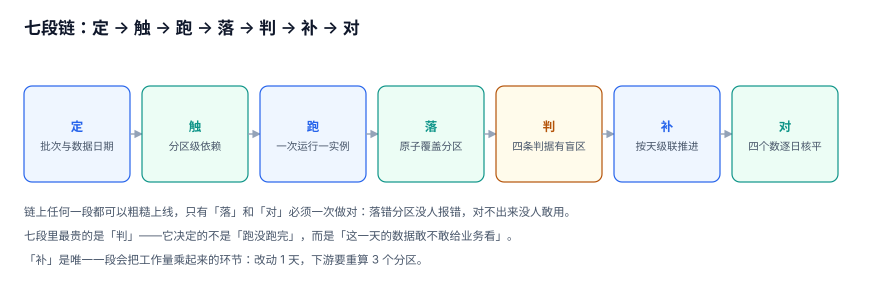

# 总览：三个日期、三种成功与五个安静的失败

离线批次的绝大多数事故，不是「算错了」，而是**「算的那一天」和「以为是那一天」不是同一天**。

本页把整条链上最容易混的三组概念拆开：三个日期、三种成功、三种「这一天的数据」。后面的十章都在这张骨架上落细节。

::: tip 一句话定位
本页回答「**一次 T+1 批次，哪几个时间点是不同的东西，为什么混用它们不会报错**」；具体的表结构与 DDL 从[批次与实例](../BatchInstance/index.md)开始。
:::



## 一、三个日期

任何一次离线运行都同时涉及三个日期，而它们**可以两两不等**：

| 名字 | 英文 | 含义 | 谁决定 |
| --- | --- | --- | --- |
| 调度日 | `schedule_date` / logical date | 这次运行被触发的那个「日历日」 | 调度器 |
| 数据日 | `data_date` / `biz_date` | 这次处理的是**哪一天的业**务 | 上游文件 / 调度参数 |
| 分区日 | `partition_dt` | 结果写进哪个分区 | 作业自己算的 |

T+1 的常规形态是：调度日 S 的 02:00 触发，处理数据日 S-1，写进分区 S-1。**调度日与另外两个差一天是设计，不是 bug**；数据日与分区日差一天才是 bug。

### 2×2：四种写法，只有一种对

把「取数用哪一天」与「落到哪个分区」分别取对/错，得到四种组合。下表是在 60 天语料上、以调度日 `2026-09-15 02:00` 为起点实测的结果（此刻可用的文件是数据日 ≤ `2026-09-14`）：

| 取数日 | 分区日 | 读到行数 | 后果 |
| --- | --- | --- | --- |
| `S`（`date('now')`） | `S` | **0** | 每天 0 行，且 `exit 0`——最危险的一种 |
| `S-1` | `S-1` | 2,017 | 正确 |
| `S-1` | `S` | 2,017 | 数据对、分区错：每天覆盖同一个 `S` 分区，`S-1` 分区永远空 |
| `S` | `S-1` | **0** | 分区对、取数错：同样每天 0 行 |

::: danger 四种里两种会「安静地跑 60 天 0 行」
把上面第一行连跑 60 天：**60 次运行全部 `exit 0`，真正读到数据的 0 次**。面板是绿的、日志里只有「processed 0 rows」这一行，没有任何告警——因为从调度的角度看，它确实成功了。

第三行更隐蔽：数据完全正确，只是落错了分区。如果下游只看「最新分区」，它看到的是「昨天有数、前天没数」，很容易被解释成「前天业务停摆」。
:::

### 为什么会有人写成 `date('now')`

因为它**在开发和补数时都是对的**。手工跑一次 `python job.py`，`date('now')` 正好是数据日，一切正常；上了调度才发现每天差一天。

正确的做法只有一条：**日期由外部注入，作业内部不许调用任何「当前时间」**。

```python
# job.py：只读参数，不算日期
import sys
data_date = sys.argv[1]              # 由调度传入，形如 2026-09-14
assert len(data_date) == 10 and data_date[4] == "-", "data_date 必须由调度注入"
partition_dt = data_date             # 分区日恒等于数据日，不做任何偏移
```

对应地在调度里显式传参（Airflow 3 的写法，`data_interval_start` 才是「数据日」）：

```python
# dags/order_daily.py
import pendulum
from airflow.sdk import dag, task

@dag(schedule="0 2 * * *", start_date=pendulum.datetime(2026, 9, 1, tz="Asia/Shanghai"),
     catchup=False, max_active_runs=1)
def order_daily():
    @task
    def load(**ctx):
        # data_interval_start 是本次运行负责的数据区间的起点 = 数据日
        data_date = ctx["data_interval_start"].in_timezone("Asia/Shanghai").to_date_string()
        return data_date
    load()

order_daily()
```

## 二、三种「成功」

同一个「成功」，在三个层面上是三件不同的事。它们的判据、观察者、失效形态都不一样。

| 层面 | 判据 | 谁在看 | 失效的样子 |
| --- | --- | --- | --- |
| **任务成功** | 进程退出码 0 | 调度面板 | 读到 0 行也是成功 |
| **分区就绪** | `partition_registry` 有一行且 `state='READY'` | 下游作业 | 有一天整行不存在，下游「等不到」也「不报错」 |
| **数据可用** | 逐日对账 `verdict='OK'` | 业务 / 数据 owner | 对得平，但对的是重跑后的那一版 |

::: warning 三层之间没有自动蕴含关系
- 任务成功 ⇏ 分区就绪：`insert 0 rows` 也退出 0。
- 分区就绪 ⇏ 数据可用：判据只看行数与水位，不看「与源侧对不对」。
- 数据可用 ⇏ 历史可复现：如果重跑覆盖了旧分区，今天的「可用」换掉的是昨天已经发出去的那份数。

所以三层的记录必须分开存：运行记录在 `batch_run`、就绪状态在 `partition_registry`、对账结论在 `recon_result`。**把它们合成一个 `status` 字段，是这套系统第一次重构时一定会做的事，也是第二次重构时要拆开的事。**
:::

## 三、一天的完整时间线

把七段链摊在时间轴上，能看清「等待」占了多大比重。下面这条时间线来自本专题的语料与实测（上游文件平均在 00:28 到达，四层链路，SLA 07:00）：

| 时刻 | 事件 | 这一段谁在等 |
| --- | --- | --- |
| D+1 00:00 | 数据日 D 结束 | — |
| D+1 00:28 | 上游文件落到对象存储（p50；p95 是 06:20） | ODS 作业在等文件 |
| D+1 00:38 | ODS 作业被轮询发现（10 分钟一次） | 下游在等 ODS |
| D+1 01:20 | ODS 分区 `READY` + 判据通过 | DWD 在等分区 |
| D+1 01:50 | DWD → DWS → ADS 依次完成 | 业务在等报表 |
| D+1 02:16 | 中位就绪时间（p95 是 08:05） | — |
| D+1 07:00 | SLA | 60 天里超了 8 天 |

三件事在这张表上很显眼：

1. **轮询是固定浪费**：三层各等一次 10 分钟轮询，平均每天多花 30 分钟，占中位就绪时间的 22.0%。
2. **尾部才是 SLA 的敌人**：上游文件 p95 到 06:20，比中位数晚 5 小时 52 分；就绪时间 p95 08:05，超 SLA 的那 8 天全部来自这一段。
3. **计算不是瓶颈**：把计算提速 50%，60 天里只救回 2 天；把轮询改成事件驱动（省 30 分钟），一天都救不回——因为那 8 天里最小的超标幅度是 35 分钟。

## 四、五个安静的失败

这五件事的共同点是：**面板是绿的、接口返回 200、报表能打开**。


1. **空分区当成成功**：60 次运行全部 `exit 0`，其中 6 次真的读到 0 行（国庆）。节假日这样是对的；上游漏推时，界面一模一样。
2. **分区落错一天**：数据对、分区错，每天覆盖同一个分区，被覆盖的那天永久空白。
3. **追加而不是覆盖**：同一分区跑 3 次，1,916 行变 5,748 行（3.0×），`SUM` 类指标跟着翻 3 倍。
4. **缺的天不是 0，是不存在**：报表里 10 月只有 24 天（国庆 7 天没有任何分区），用「总额 ÷ 有数据的天」算出来的日均，比按日历 31 天算高 29.17%。
5. **重跑没带走下游**：DWD 重跑一天，行数与源差 1,916；ADS 仍按旧分区汇总——四个数各自都能自证。

## 五、三条反模式

::: danger 这三条在本库的实测里都付过代价
1. **用 `date('now')` 当数据日期**：任务在 02:00 跑，`date('now')` 给的是调度日；那天的文件要等次日 00:28 才生成，于是每次都读到 0 行、每次都成功。正确写法是把 `data_date` 作为参数注入，并在作业入口断言格式。
2. **用「任务成功」当依赖条件**：0 行也是一种成功，于是 0 元一路穿过四层，每一层都是绿色。依赖边上必须传「分区状态」，见[依赖与就绪](../Dependency/index.md)。
3. **覆盖写不开事务**：`DELETE` 提交后、`INSERT` 提交前，读者读到的是空分区。实测自动提交下读到 0 行、显式事务下读到旧的 1,916 行——差别只在一个 `BEGIN`。
:::

## 六、起步顺序

如果只能改一件事，按这个顺序：

1. **先把数据日期变成参数**。所有作业不许自己算日期，只读调度传进来的 `data_date`；分区列必须等于它。
2. **再给分区建一张登记表**。`(job_id, data_date)` 一行，带行数、金额、水位、校验和、状态。没有这张表，后面所有判据都无处落脚。
3. **然后把依赖从「任务」改成「分区」**。下游等的不是「上游跑完了」，是「上游这一天的分区是 `READY`」。
4. **最后才谈补数与 SLA**。补数的成本是级联算出来的，SLA 的瓶颈在预算里最不受控的那一段——两者都要先有度量再优化。

## 七、判据清单

| 编号 | 判据 | 不满足时改哪里 |
| --- | --- | --- |
| `BPN-A` | 每个作业的数据日期都来自调度参数，代码里搜不到 `now()` / `CURRENT_DATE` | 该作业入口脚本 |
| `BPN-B` | `partition_dt` 恒等于 `data_date`，且有一条 SQL 能验证全表成立 | `partition_registry` 的写入逻辑 |
| `BPN-C` | 三层记录分表存放：运行、就绪、对账，不存在「合成一个 status」 | 表结构 |
| `BPN-D` | 「0 行」有独立状态（`EMPTY`），不与 `READY` 混用 | `partition_registry.state` 的取值 |
| `BPN-E` | 空分区的下游会停在 `BLOCKED`，而不是产出 0 元 | 依赖判定 SQL |
| `BPN-F` | 每个分区有 `water_mark`（`max(业务时间)`），且能查出来 | 分区写入语句 |
| `BPN-G` | 存在一个「逐日对账」结论表，且能按 `biz_date` 查最近 30 天 | `recon_result` |
| `BPN-H` | 上述七条各有一条可执行命令，能在一个干净库上复现 | 验收脚本 |

## 八、验证方式

在任意一个已建好的批次库上跑下面三条，重点是**第二条必须返回 0 行**：

```shell
cd /tmp && python3 - <<'PY'
import sqlite3
con = sqlite3.connect("/tmp/bplab.db")
q = lambda s: con.execute(s).fetchall()

print("1) 分区日与数据日不一致的分区：")
print(q("SELECT job_id, data_date FROM partition_registry WHERE data_date NOT IN (SELECT DISTINCT dt FROM ods_order)")[:5])

print("2) 标了 READY 但行数为 0 的分区（必须为空）：")
print(q("SELECT job_id, data_date FROM partition_registry WHERE state='READY' AND row_cnt=0"))

print("3) 最近 5 天的就绪时刻与 SLA 差：")
for r in q("SELECT job_id, data_date, lag_min FROM v_batch_lag ORDER BY data_date DESC LIMIT 5"):
    print(r)
PY
```

预期输出（前两段）：

```text
1) 分区日与数据日不一致的分区：
[]
2) 标了 READY 但行数为 0 的分区（必须为空）：
[]
```

第 2 段若不为空，说明「空分区」被当成了「就绪分区」，直接读[就绪与门禁](../ReadinessGate/index.md)的三态设计——**这是本专题里最便宜能修、后果最贵的一个 bug**。

## 与「全球化与时区本地化工程」专题的分工（第 269 天补充）

| 维度 | 本页回答 | 专题回答 |
| --- | --- | --- |
| 对象 | 调度日 / 数据日 / 分区日，任务成功 / 分区就绪 / 数据可用 | [业务归属日 `biz_date` 的日切与版本](../../Globalization/CalendarAndCutoff/index.md) |
| 边界 | 批次、补数与分区就绪 | 时间字段契约、locale 与驻留区 |
| 不重复 | 不再讲时区规则与格式化 | 不重复就绪判据与补数级联 |

**本页特有的一处坑**：把「分区日」直接当「营业日」交给下游报表。两个日期名字像、定义不同：**整体错日只有水位抓得住**（本页已有判据），而「分区日 ≠ 营业日」这种错法连水位都看不出来，因为每个分区都准时就绪。正确写法：下游消费方必须显式声明读的是 `partition_date` 还是 `biz_date`，在接口契约里写死字段名；跨区场景下一律由 `calendar_day` 派生，不允许按名字猜。

## 参考资料

- [Apache Airflow 3: DAGs and Task Instances](https://airflow.apache.org/docs/apache-airflow/stable/core-concepts/dags.html)
- [Apache Airflow: Time zones and data intervals](https://airflow.apache.org/docs/apache-airflow/stable/authoring-and-scheduling/timezone.html)
- [Google SRE Book: Data Processing Pipelines](https://sre.google/sre-book/data-processing-pipelines/)
- [dbt: Incremental models](https://docs.getdbt.com/docs/build/incremental-models)
