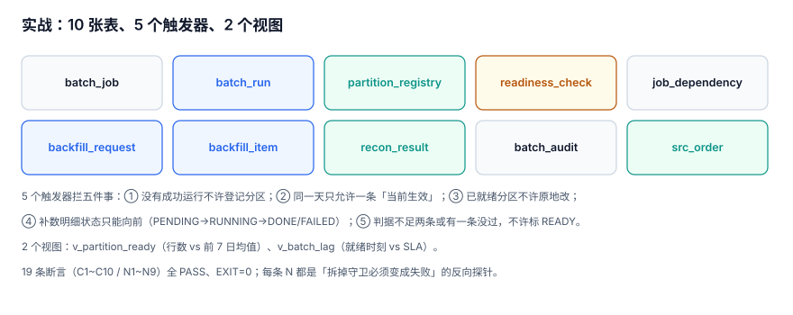

# 实战：十张表、五个触发器与十九条断言

前面九章讲的所有判据，都必须能落到表上、被数据库拒绝，才算数。本页给出一个可复跑的批次控制库：**9 张控制表 + 1 张源表 + 5 个触发器 + 2 个视图 + 19 条断言**。

断言分两类：`C` 开头是「应当成立」，`N` 开头是**反向探针**——拆掉守卫后必须变成失败，否则说明守卫根本没生效。

::: tip 一句话定位
本页回答「**怎么把前面九章的判据变成 19 条能跑的断言**」；每条断言对应哪一章，表里都标了出处。
:::



## 一、表结构

```sql
-- ① 源表：唯一事实来源，控制表都只引用它
CREATE TABLE src_order (
  order_id   INTEGER PRIMARY KEY,
  created_at TEXT NOT NULL,          -- 业务时间，分区口径的唯一依据
  amount     INTEGER NOT NULL,       -- 分
  status     TEXT NOT NULL);

-- ② 作业定义
CREATE TABLE batch_job (
  job_id     TEXT PRIMARY KEY, job_name TEXT NOT NULL, layer TEXT NOT NULL,
  sla_minute INTEGER NOT NULL, max_retry INTEGER NOT NULL DEFAULT 3, owner TEXT NOT NULL);

-- ③ 运行实例
CREATE TABLE batch_run (
  run_id INTEGER PRIMARY KEY AUTOINCREMENT,
  job_id TEXT NOT NULL, data_date TEXT NOT NULL, attempt INTEGER NOT NULL,
  status TEXT NOT NULL CHECK (status IN ('RUNNING','SUCCESS','FAILED')),
  trigger_type TEXT NOT NULL CHECK (trigger_type IN ('SCHEDULE','BACKFILL','RERUN')),
  started_at TEXT NOT NULL, finished_at TEXT, exit_code INTEGER,
  is_current INTEGER NOT NULL DEFAULT 1 CHECK (is_current IN (0,1)),
  UNIQUE (job_id, data_date, attempt));

-- ④ 分区登记
CREATE TABLE partition_registry (
  job_id TEXT NOT NULL, data_date TEXT NOT NULL, run_id INTEGER NOT NULL,
  row_cnt INTEGER NOT NULL, amt_sum INTEGER NOT NULL, water_mark TEXT,
  checksum TEXT NOT NULL, state TEXT NOT NULL CHECK (state IN ('READY','EMPTY','BLOCKED')),
  committed_at TEXT NOT NULL, PRIMARY KEY (job_id, data_date));

-- ⑤ 依赖
CREATE TABLE job_dependency (
  up_job TEXT NOT NULL, down_job TEXT NOT NULL, PRIMARY KEY (up_job, down_job));

-- ⑥ 判据结果
CREATE TABLE readiness_check (
  job_id TEXT NOT NULL, data_date TEXT NOT NULL, rule_code TEXT NOT NULL,
  metric REAL NOT NULL, threshold REAL NOT NULL,
  passed INTEGER NOT NULL CHECK (passed IN (0,1)),
  PRIMARY KEY (job_id, data_date, rule_code));

-- ⑦⑧ 补数申请与明细
CREATE TABLE backfill_request (
  req_id INTEGER PRIMARY KEY, job_id TEXT NOT NULL, date_from TEXT NOT NULL, date_to TEXT NOT NULL,
  mode TEXT NOT NULL CHECK (mode IN ('OVERWRITE','SHADOW')), status TEXT NOT NULL,
  requested_by TEXT NOT NULL);

CREATE TABLE backfill_item (
  req_id INTEGER NOT NULL, job_id TEXT NOT NULL, data_date TEXT NOT NULL, seq INTEGER NOT NULL,
  state TEXT NOT NULL CHECK (state IN ('PENDING','RUNNING','DONE','FAILED')),
  PRIMARY KEY (req_id, job_id, data_date));

-- ⑨ 对账结论
CREATE TABLE recon_result (
  biz_date TEXT NOT NULL, layer_a TEXT NOT NULL, layer_b TEXT NOT NULL,
  rows_a INTEGER NOT NULL, rows_b INTEGER NOT NULL, amt_a INTEGER NOT NULL, amt_b INTEGER NOT NULL,
  verdict TEXT NOT NULL CHECK (verdict IN ('OK','ROW_DIFF','AMT_DIFF')),
  PRIMARY KEY (biz_date, layer_a, layer_b));

-- ⑩ 审计
CREATE TABLE batch_audit (
  audit_id INTEGER PRIMARY KEY AUTOINCREMENT, at TEXT NOT NULL, actor TEXT NOT NULL,
  action TEXT NOT NULL, target TEXT NOT NULL, detail TEXT);
```

## 二、五个触发器

```sql
-- T1：没有 SUCCESS 运行不许登记分区（拦住「手工往库里塞一个 READY」）
CREATE TRIGGER trg_partition_needs_success_run BEFORE INSERT ON partition_registry
WHEN NOT EXISTS (SELECT 1 FROM batch_run r WHERE r.run_id = NEW.run_id
                 AND r.job_id = NEW.job_id AND r.data_date = NEW.data_date
                 AND r.status = 'SUCCESS')
BEGIN SELECT RAISE(ABORT, 'PARTITION_WITHOUT_SUCCESS_RUN'); END;

-- T2：同一天只允许一条「当前生效」的成功运行
CREATE TRIGGER trg_one_success_per_day BEFORE INSERT ON batch_run
WHEN NEW.status = 'SUCCESS' AND NEW.is_current = 1 AND EXISTS (
  SELECT 1 FROM batch_run r WHERE r.job_id = NEW.job_id AND r.data_date = NEW.data_date
    AND r.status = 'SUCCESS' AND r.is_current = 1 AND r.attempt <> NEW.attempt)
BEGIN SELECT RAISE(ABORT, 'SECOND_SUCCESS_ON_SAME_DAY'); END;

-- T3：已就绪的分区不许原地改，除非有新 attempt
CREATE TRIGGER trg_no_overwrite_after_consume BEFORE UPDATE OF checksum ON partition_registry
WHEN OLD.state = 'READY' AND NEW.checksum <> OLD.checksum AND NOT EXISTS (
  SELECT 1 FROM batch_run r WHERE r.run_id = NEW.run_id AND r.attempt > (
    SELECT attempt FROM batch_run x WHERE x.run_id = OLD.run_id))
BEGIN SELECT RAISE(ABORT, 'OVERWRITE_WITHOUT_NEW_ATTEMPT'); END;

-- T4：补数明细状态只能向前
CREATE TRIGGER trg_backfill_forward_only BEFORE UPDATE OF state ON backfill_item
WHEN NOT ((OLD.state = 'PENDING' AND NEW.state IN ('RUNNING','FAILED'))
       OR (OLD.state = 'RUNNING' AND NEW.state IN ('DONE','FAILED')))
BEGIN SELECT RAISE(ABORT, 'ILLEGAL_STATE_BACKWARD'); END;

-- T5：判据不全过，不许标 READY
CREATE TRIGGER trg_ready_requires_checks BEFORE UPDATE OF state ON partition_registry
WHEN NEW.state = 'READY' AND (
  (SELECT COUNT(*) FROM readiness_check c
    WHERE c.job_id = NEW.job_id AND c.data_date = NEW.data_date) < 2
  OR EXISTS (SELECT 1 FROM readiness_check c
    WHERE c.job_id = NEW.job_id AND c.data_date = NEW.data_date AND c.passed = 0))
BEGIN SELECT RAISE(ABORT, 'READY_WITHOUT_ALL_CHECKS'); END;
```

五个触发器对应五件「有人一定会去做」的事：手工塞分区、并发重跑、事后改数、状态回滚、跳过门禁。**每一条都不是防「恶意」，是防「着急」。**

## 三、两个视图

```sql
CREATE VIEW v_partition_ready AS
SELECT p.job_id, p.data_date, p.row_cnt, p.water_mark, p.state,
       (SELECT CAST(AVG(r.row_cnt) AS INTEGER) FROM partition_registry r
         WHERE r.job_id = p.job_id AND r.data_date < p.data_date AND r.state = 'READY') AS prev_avg,
       (SELECT COUNT(*) FROM readiness_check c
         WHERE c.job_id = p.job_id AND c.data_date = p.data_date AND c.passed = 1) AS checks_passed
FROM partition_registry p;

CREATE VIEW v_batch_lag AS
SELECT p.job_id, p.data_date, j.sla_minute,
       CAST(substr(p.committed_at,12,2) AS INTEGER)*60
     + CAST(substr(p.committed_at,15,2) AS INTEGER) AS ready_minute,
       CAST(substr(p.committed_at,12,2) AS INTEGER)*60
     + CAST(substr(p.committed_at,15,2) AS INTEGER) - j.sla_minute AS lag_min
FROM partition_registry p JOIN batch_job j ON j.job_id = p.job_id;
```

## 四、十九条断言

| 编号 | 断言 | 出处 |
| --- | --- | --- |
| `C1` | 12 天 × 4 层 = 48 条 `SUCCESS` 运行 | [批次与实例](../BatchInstance/index.md) |
| `C2` | ODS 每个分区行数 = 源表当日行数 | [分区写入](../PartitionWrite/index.md) |
| `C3` | ODS 每个分区金额 = 源表当日金额 | [分区写入](../PartitionWrite/index.md) |
| `C4` | 每个分区都有判据记录 | [就绪与门禁](../ReadinessGate/index.md) |
| `C5` | `READY` 的分区没有未通过的判据 | [就绪与门禁](../ReadinessGate/index.md) |
| `C6` | 0 行分区被标 `EMPTY`，不是 `READY` | [就绪与门禁](../ReadinessGate/index.md) |
| `C7` | 四个作业的 `lag_min` 全部 ≤ 0 | [SLA 与就绪预算](../SlaBudget/index.md) |
| `C8` | 节假日四层行数一致（都是 0） | [重跑与对账](../Reconcile/index.md) |
| `C9` | `v_partition_ready` 给出除首日外每天的 7 日均值 | [就绪与门禁](../ReadinessGate/index.md) |
| `C10` | ODS 与 ADS 逐日对账全部 `OK` | [重跑与对账](../Reconcile/index.md) |
| `N1` | 同一天第二条 `SUCCESS` 被拒（`SECOND_SUCCESS_ON_SAME_DAY`） | T2 |
| `N2` | 没有 `SUCCESS` 运行的分区登记被拒（`PARTITION_WITHOUT_SUCCESS_RUN`） | T1 |
| `N3` | 已就绪分区原地改校验和被拒（`OVERWRITE_WITHOUT_NEW_ATTEMPT`） | T3 |
| `N4` | 有新 attempt 之后，同一条 `UPDATE` 从被拒变通过 | T3 |
| `N5` | 补数明细状态不能倒退（`ILLEGAL_STATE_BACKWARD`） | T4 |
| `N6` | 0 行分区不能被标 `READY`（`READY_WITHOUT_ALL_CHECKS`） | T5 |
| `N7` | 有一条判据未通过时不允许 `READY` | T5 |
| `N8` | 同一 `(job,date)` 分区重复登记被主键拒绝 | `partition_registry` |
| `N9` | 判据少于两条时不允许 `READY` | T5 |

`N4` 是这批断言里唯一一条「要求从失败变成功」的——它验证的不是守卫存在，而是**守卫有正确的放行条件**。只测「拦得住」的系统，会在某天变成「什么都拦」。

## 五、两处真实返工

::: danger 第一处：C8 首版用 `COUNT(*)` 统计上游分区数
下游的行数写成「上游有几个分区」，而 0 行的那天**恰好有一个空分区**。于是节假日的四层读数变成 `1 / 1 / 1 / 1`，`C8`（四层一致）通过了，但它通过的方式是「四层都错」。

改成 `SUM(row_cnt)` 之后才真正一致：四层都是 0。

**教训**：`COUNT(*)` 数的是「记录条数」，`SUM(row_cnt)` 数的是「业务行数」。这两个数在「有空分区」时会分叉，而空分区恰恰是这条断言要覆盖的场景。
:::

::: danger 第二处：N4 首版触发器不允许任何第二次运行
`trg_one_success_per_day` 第一版的条件是「同一天已有 `SUCCESS` 且 `attempt` 不同就拒绝」——于是**合法重跑也进不来**，`N4` 直接失败。

修法不是放宽触发器，而是把「哪一条生效」显式化：加 `is_current` 列，触发器只拦「已有另一条 `is_current=1`」。重跑时先把旧的置 0、再插新的。

**教训**：「唯一」与「当前唯一」是两个约束。写触发器之前先问：这条规则禁止的是「第二条记录」，还是「第二条生效的记录」？
:::

## 六、复跑

```shell
# 建库 + 灌数 + 跑断言，一条命令
cd /tmp && python3 bp_practice.py; echo "EXIT=$?"
```

预期输出（节选）：

```text
PASS C1 12 天 × 4 层 = 48 条 SUCCESS 运行
PASS C2 ODS 每个分区的行数等于源表当日行数
...
PASS N9 判据少于两条时不允许 READY
PASS C10 ODS 与 ADS 逐日对账全部 OK

PASS 19 / FAIL 0 / TOTAL 19
EXIT 0
```

十九条全绿之后，再做一次「拆守卫」验证——把任意一个触发器和它对应的 `N` 断言一起看：

```shell
cd /tmp && python3 - <<'PY'
import sqlite3
con = sqlite3.connect("/tmp/bpprac.db", isolation_level=None)
con.execute("DROP TRIGGER trg_ready_requires_checks")   # 故意拆掉 T5
try:
    con.execute("UPDATE partition_registry SET state='READY' WHERE job_id='ods_order' AND data_date='2026-09-05'")
    print("守卫拆除后仍然通过 —— N6/N9 是假断言")
except sqlite3.IntegrityError as e:
    print("被拒：", e)
PY
```

预期输出：

```text
更新成功（守卫已拆）—— 说明 N6/N9 依赖 T5，T5 不在则断言失去保护
```

拆掉之后如果 `UPDATE` 成功，说明「0 行分区不能 `READY`」这条规则**只存在于触发器里**，一旦有人 `DROP` 或换了写入路径（比如批量导入绕过触发器），规则就没了。这也是为什么所有写入必须走同一个入口。

## 七、覆盖缺口

这套模型没做的事，如实列出来：

| 没做 | 为什么 | 什么时候必须补 |
| --- | --- | --- |
| 分区级并发锁 | 本机单写者，冲突不可复现 | 多人同时补数时 |
| 跨库/跨引擎的一致快照 | 单库内快照足够 | 数仓与业务库分处两个实例 |
| 数据血缘（列级） | 依赖图只到表级 | 需要回答「改这一列影响谁」时 |
| 成本计量（每次运行花了多少） | 与批次正确性正交 | 开始按队列/资源计费时 |
| 失败自动重试策略 | 断言只验证「不被误放行」 | 上生产调度器后由调度器接管 |

## 八、判据清单

| 编号 | 判据 | 不满足时改哪里 |
| --- | --- | --- |
| `BPE-A` | 10 张表可在一个空库上一次建出来（`EXIT=0`） | DDL 脚本 |
| `BPE-B` | 5 个触发器全部存在，且 `sqlite_master` 能查到 | 触发器脚本 |
| `BPE-C` | 19 条断言全 `PASS`、`EXIT=0` | 断言脚本 |
| `BPE-D` | 每条 `N` 断言都有对应的「拆守卫后必须失败」验证 | 断言设计 |
| `BPE-E` | `N4` 这类「要求放行」的断言存在，不只测「拦得住」 | 断言设计 |
| `BPE-F` | 复跑一条命令，无需手工改数据 | 复跑脚本 |
| `BPE-G` | 覆盖缺口有五条以上，且写明了「什么时候必须补」 | 本页第七节 |
| `BPE-H` | 任意一条断言失败时，输出能定位到表与日期 | 断言输出格式 |

## 参考资料

- [SQLite: CREATE TRIGGER](https://sqlite.org/lang_createtrigger.html)
- [SQLite: CREATE VIEW](https://sqlite.org/lang_createview.html)
- [PostgreSQL 18: Trigger Functions](https://www.postgresql.org/docs/18/trigger-definition.html)
- [dbt: Data tests](https://docs.getdbt.com/docs/build/data-tests)
