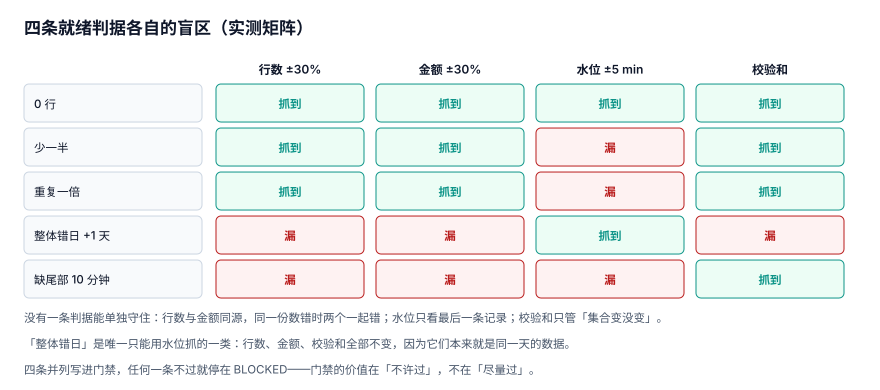

# 就绪与门禁：四条判据各自的盲区

「这一天的分区算不算就绪」这个问题，答案不能是「跑完了」。它需要一组判据，而**任何单条判据都能被某种故障绕过去**——所以判据必须并列、必须落表、必须有一条「不许过」的路径。

本页给出四条判据、一张实测的盲区矩阵，以及阈值该怎么定。

::: tip 一句话定位
本页回答「**凭什么把 `BLOCKED` 改成 `READY`，以及凭什么不改**」；改完之后下游怎么被触发在[依赖与就绪](../Dependency/index.md)。
:::



## 一、四条判据

| 判据 | 输入 | 抓什么 | 抓不到什么 |
| --- | --- | --- | --- |
| `ROW_BAND` | 当日行数 vs 前 7 日均值 | 少一半、多一倍、0 行 | 行数没变但日期错了 |
| `AMT_BAND` | 当日金额 vs 前 7 日均值 | 同上（金额口径） | 同上 |
| `WATERMARK` | `max(业务时间)` vs 基线 | 整体错日、尾部缺、0 行 | 重复插入（水位不变） |
| `CHECKSUM` | 行集合指纹（`md5(排序后的 id)`） | 重复、尾部缺、集合变化 | 整体错日（集合没变） |

落表：

```sql
CREATE TABLE readiness_check (
  job_id     TEXT NOT NULL,
  data_date  TEXT NOT NULL,
  rule_code  TEXT NOT NULL,            -- ROW_BAND / AMT_BAND / WATERMARK / CHECKSUM
  metric     REAL NOT NULL,
  threshold  REAL NOT NULL,
  passed     INTEGER NOT NULL CHECK (passed IN (0,1)),
  checked_at TEXT NOT NULL,
  PRIMARY KEY (job_id, data_date, rule_code));
```

## 二、盲区矩阵：五类故障 × 四条判据

在 1,916 行的基线上注入五类故障，看每条判据抓不抓得住：

| 故障 | `ROW_BAND` | `AMT_BAND` | `WATERMARK` | `CHECKSUM` |
| --- | --- | --- | --- | --- |
| 0 行 | 抓到 | 抓到 | 抓到 | 抓到 |
| 少一半 | 抓到 | 抓到 | **漏** | 抓到 |
| 重复一倍 | 抓到 | 抓到 | **漏** | 抓到 |
| 整体错日 +1 天 | **漏** | **漏** | 抓到 | **漏** |
| 缺尾部 10 分钟 | **漏** | **漏** | **漏** | 抓到 |

三条结论：

1. **「整体错日」只有水位抓得住**。行数、金额、指纹全部不变——因为它们本来就是同一天的数据，只是被写进了另一个分区。这一类故障在纯行数门禁下 100% 通过。
2. **「重复一倍」只有水位抓不住**。重复行的 `max(created_at)` 与原来一样，水位判据毫无反应。
3. **「缺尾部」是最难的一类**：行数变化可能小于 30%，金额变化同理，水位却还停在 22:49。这条只有校验和（或一条「水位必须 ≥ 23:00」的硬规则）能抓。

::: danger 只写两条判据的系统，等于只防住了两类事故
最常见的组合是「行数 + 金额」——它们同源，同一份数错时**两个一起错**，实际只相当于一条判据。四条判据的成本很低（一次聚合 + 一次指纹），收益是覆盖了四类互不重叠的故障。
:::

## 三、阈值：3σ 还是固定带宽

两条常见规则，在 60 天语料上各跑一遍（大促日真实 2.6×、漏推日真实 0.4×、节假日 0 行）：

| 规则 | 平稳期误拦 | 大促日（真实 2.6×） | 漏推日（真实 0.4×） | 节假日（0 行） |
| --- | --- | --- | --- | --- |
| 前 14 天 3σ | 0 天 | **拦**（误拦） | **漏** | 拦 |
| 前 7 天中位数 ±30% | 0 天 | **拦**（误拦） | 拦 | 拦 |

两条规则在平稳期都不误拦，差别在**对真实波动的容忍**：

- **3σ 的宽度由历史波动决定**。业务平稳时窗口很窄，一点点正常波动就触发；业务本身波动大时窗口很宽，真故障也进不来。
- **固定带宽的宽度由业务语义决定**。±30% 对「日均 2,000 单」是合理的，对「日均 20 单」就太宽（±30% 只有 6 单的容差，而泊松波动本身就超过这个数）。

所以真实的门禁要**两层**：

```text
第一层（自动）：固定带宽，阈值按「业务允许的波动」定，宁可宽一点
第二层（人工）：超出带宽 → 停在 BLOCKED，等人看一眼再放行
```

::: warning 大促日一定会被误拦，这是设计而不是缺陷
实测里大促日（2.6×）两条规则都拦。这不是「规则不好」，而是「自动化不该替业务决定 2.6 倍是不是合理」。正确做法是**日历表**：把已知的大促、月末、节假日写进 `batch_calendar`，当天用另一套阈值（或直接标记「已备案」），放行时留一条审计。

门禁的价值在「不许过」，不在「尽量过」。一个从不拦人的门禁，等于没有门禁。
:::

## 四、日历例外必须显式

```sql
CREATE TABLE batch_calendar (
  cal_date  TEXT PRIMARY KEY,
  day_type  TEXT NOT NULL CHECK (day_type IN ('NORMAL','HOLIDAY','PROMO','MONTH_END')),
  expect_ratio REAL NOT NULL,          -- 相对常态的期望倍数，节假日 = 0
  note      TEXT);

-- 判据执行时先查日历：有备案的日期，用 expect_ratio 修正基线
SELECT
  CASE c.day_type
    WHEN 'HOLIDAY' THEN 0
    WHEN 'PROMO'   THEN c.expect_ratio
    ELSE 1 END AS ratio
FROM batch_calendar c WHERE c.cal_date = :data_date;
```

没有日历表会怎样：国庆 7 天的 0 行每次都被判据拦下，值班同学连续 7 天收到「分区为空」的告警，第 8 天开始忽略告警——**这才是漏推真正发生的那天没人管的原因**。

## 五、三态门禁与人工放行

| 状态 | 含义 | 谁能写 | 下游行为 |
| --- | --- | --- | --- |
| `READY` | 判据全过 | 判据执行器 | 触发 |
| `EMPTY` | 行数为 0 且日历允许 | 判据执行器 | 触发，产出 0 |
| `BLOCKED` | 有一条判据没过，或还没判 | 作业提交 + 判据执行器 | 不触发 |

人工放行是必要的，但它必须是**一条记录**，不是一次点击：

```sql
-- 放行 = 新增一条 override 记录 + 把状态改成 READY，两件事在同一事务里
INSERT INTO batch_audit (at, actor, action, target, detail)
VALUES (datetime('now'), 'oncall@zhang', 'OVERRIDE', 'ods_order/2026-09-10',
        'ROW_BAND 未过：1320 vs 基线 1916（-31%），经确认上游分批推送，放行');
```

三个约束：

1. **放行必须写明原因**，原因里要有「哪个判据、读数多少、为什么可接受」。
2. **放行不修改判据结果**。`readiness_check.passed` 仍然是 0，只是分区状态被人工改成 `READY`——这样「这一天被人工放行过」永远查得到。
3. **放行不能批量**。一次放行 30 天，等于关掉了门禁。

## 六、判据清单

| 编号 | 判据 | 不满足时改哪里 |
| --- | --- | --- |
| `BPG-A` | 四条判据齐全（行数、金额、水位、校验和），且都落 `readiness_check` | 判据执行器 |
| `BPG-B` | 每条判据都有「抓不到什么」的书面说明，写在页面或配置注释里 | 判据配置 |
| `BPG-C` | 阈值有来源（业务允许波动），不是「随手 ±30%」 | 阈值配置 |
| `BPG-D` | 存在 `batch_calendar`，节假日/大促/月末有备案 | 日历表 |
| `BPG-E` | 判据不全过时分区停在 `BLOCKED`，不会自动变 `READY` | 状态写入 |
| `BPG-F` | 人工放行留 `batch_audit` 记录，且不改 `readiness_check.passed` | 放行接口 |
| `BPG-G` | 0 行分区只有「日历允许」时才标 `EMPTY`，否则 `BLOCKED` | 判据逻辑 |
| `BPG-H` | 五类故障各有一条注入用例，且矩阵结果与本页一致 | 判据测试 |

## 七、验证方式

```shell
cd /tmp && python3 - <<'PY'
import sqlite3
con = sqlite3.connect("/tmp/bpprac.db")
q = lambda s: con.execute(s).fetchall()
print("1) 判据不过却标了 READY 的分区（必须为空）：")
print(q("""SELECT p.job_id, p.data_date FROM partition_registry p
  WHERE p.state='READY' AND EXISTS (SELECT 1 FROM readiness_check c
    WHERE c.job_id=p.job_id AND c.data_date=p.data_date AND c.passed=0)"""))
print("2) 节假日四层的状态：")
print(q("SELECT job_id, state, row_cnt FROM partition_registry WHERE data_date='2026-09-05' ORDER BY job_id"))
print("3) 每个分区的判据条数（必须 >=2）：")
print(q("SELECT MIN(n) FROM (SELECT COUNT(*) n FROM readiness_check GROUP BY job_id,data_date)"))
PY
```

预期输出：

```text
1) 判据不过却标了 READY 的分区（必须为空）：
[]
2) 节假日四层的状态：
[('ads_report_day', 'EMPTY', 0), ('dwd_order', 'EMPTY', 0), ('dws_order_day', 'EMPTY', 0), ('ods_order', 'EMPTY', 0)]
3) 每个分区的判据条数（必须 >=2）：
[(2,)]
```

第 1 段不为空，说明「状态」与「判据」脱钩了——这是门禁失效最直接的信号；第 2 段若出现 `READY` 且 `row_cnt=0`，说明空分区被当成了正常分区。

## 与「事件驱动集成与 CDC 工程」专题的分工（第 270 天补充）

| 本页回答 | 专题回答 | 边界 |
| --- | --- | --- |
| 分区就绪判据、门禁与补数触发 | [事件驱动集成与 CDC 工程](../../EventIntegration/index.md)：水位取所有分区位点最小值、时间滞后 SLA | 本页判「分区能不能读」，专题判「跨系统能不能宣布追平」 |

**一页一坑**：用平均位点或最大位点宣布追平：四个分区位点 `{1200,1180,1210,900}` 的水位应是 900，取最大值会漏掉慢分区 310 条的差距。

::: danger 水位由最慢的分区决定
监控必须按分区展开，聚合值会掩盖落后；「消费完 N 条」不等于「可以对外宣布对齐」，只有水位越过目标位点才算。
:::

## 参考资料

- [dbt: Data tests（unique / not_null / accepted_values）](https://docs.getdbt.com/docs/build/data-tests)
- [Great Expectations: Core concepts](https://docs.greatexpectations.io/docs/core/introduction/)
- [Apache Airflow: Asset (Dataset) health checks](https://airflow.apache.org/docs/apache-airflow/stable/authoring-and-scheduling/datasets.html)
- [Google SRE Workbook: Alerting on SLOs](https://sre.google/workbook/alerting-on-slos/)
