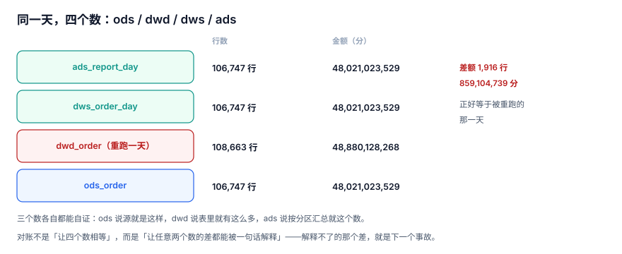

# 重跑与对账：四个数怎么核平

同一天的数据，在库里至少有四个数：源表、明细层、汇总层、报表层。它们**不需要相等**——分层本来就会去重、聚合、过滤——但它们之间的差必须能被一句话解释。

对账要解决的就是这件事：**把「差」变成「已知的差」**。

::: tip 一句话定位
本页回答「**差在哪一层、为什么差、差多少算正常**」；把差改掉（补数）在[补数与回刷](../Backfill/index.md)。
:::



## 一、一次重跑之后的四个数

在 60 天语料上，把 `dwd_order` 的某一天重跑了一次（写成了追加），对账视图给出四个数：

| 层 | 行数 | 金额（分） | 与源侧的差 |
| --- | --- | --- | --- |
| `ods_order` | 106,747 | 48,021,023,529 | — |
| `dwd_order` | **108,663** | **48,880,128,268** | +1,916 行 / +859,104,739 |
| `dws_order_day` | 106,747 | 48,021,023,529 | 0 |
| `ads_report_day` | 106,747 | 48,021,023,529 | 0 |

三个观察：

1. **差额正好等于「被重跑的那一天」的行数与金额**（1,916 行）。这不是巧合，是「追加写」的指纹。
2. **汇总层没变**。因为它是在重跑**之前**算的——这正是「重跑没带走下游」的形态。
3. **四个数各自都能自证**。`ods` 说源就是这样，`dwd` 说表里就有这么多，`ads` 说按分区汇总就这个数。**没有一个是「坏」的，只有「不一致」的。**

::: danger 只对总数，等于没对
如果只比「四个数的总额」，上表会得到「差 1,916 行」，然后呢？不知道差在哪一天、不知道是漏还是重、不知道该重跑哪一段。

对账的最小粒度是**天**（`biz_date`），因为补数与重跑的最小单位就是天。按天对，差的形态立刻能读出原因。
:::

## 二、四类差异，四种处置

| 类型 | 形态 | 典型原因 | 处置 |
| --- | --- | --- | --- |
| **漏** | 下游少 | 上游某天没跑、分区 `BLOCKED` | 补数 + 重算下游 |
| **多** | 下游多 | 追加写、重复装载、过滤条件丢了 | 修正写入方式 + 重跑 |
| **重** | 同一天有多个版本 | 重跑没置 `is_current=0` | 修正 `is_current` + 重算 |
| **差** | 行数对、金额不对 | 金额口径不同（含税/不含税、四舍五入） | 定义口径，不改数据 |

「重」是最容易漏的一类：行数看起来对（因为查询带了 `WHERE is_current=1`），但如果视图忘了带这个条件，就会把两个版本一起算进去。

```sql
-- 「重」的检测：同一天存在多个当前生效的版本
SELECT job_id, data_date, COUNT(*) AS versions
FROM batch_run
WHERE status = 'SUCCESS' AND is_current = 1
GROUP BY job_id, data_date
HAVING COUNT(*) > 1;          -- 必须返回 0 行
```

## 三、对账表：结论要落库

```sql
CREATE TABLE recon_result (
  biz_date TEXT NOT NULL,
  layer_a  TEXT NOT NULL,
  layer_b  TEXT NOT NULL,
  rows_a   INTEGER NOT NULL,
  rows_b   INTEGER NOT NULL,
  amt_a    INTEGER NOT NULL,
  amt_b    INTEGER NOT NULL,
  verdict  TEXT NOT NULL CHECK (verdict IN ('OK','ROW_DIFF','AMT_DIFF')),
  noted_at TEXT NOT NULL,
  note     TEXT,
  PRIMARY KEY (biz_date, layer_a, layer_b));
```

三条纪律：

1. **每次重跑后必须重对**。重跑会改分区，旧的对账结论立刻失效。用触发器或作业依赖把「重跑 → 重对」串起来。
2. **`verdict` 只有三值**，不要加 `WARN`、`MINOR`——一旦有中间态，所有人都会选中间态。
3. **`note` 必须写「差在哪」**，不是「已确认」。`已确认` 三个月后没人知道确认了什么。

## 四、口径差异：最贵的一类「差」

金额对不上，但不该改数据——因为两边口径不同。常见六种：

| 口径 | A 侧 | B 侧 | 差多少 |
| --- | --- | --- | --- |
| 含税 / 不含税 | 订单金额含税 | 财务确认收入不含税 | 税率（如 6%/13%） |
| 下单 / 支付 | 下单即计入 | 支付成功才计入 | 未支付比例 |
| 退款处理 | 单独一行负数 | 冲减原单 | 行数差、金额同 |
| 时区 | 本地日切 | UTC 日切 | 跨零点订单（本库 4.20%） |
| 四舍五入 | 每行舍入再求和 | 求和后再舍入 | 行数量级 × 0.5 分 |
| 去重 | 按 `order_id` | 按 `(order_id, sku)` | 多品类订单的行数 |

::: warning 口径差异不要「修数据」，要「修定义」
一旦为了让两个数相等而去改数据，下一次对账会以新的错为基准。正确做法是把口径写成一条**可执行的判据**（比如「A 侧金额 × (1-税率) 应等于 B 侧金额，误差 < 0.01%」），然后让这条判据长期跑。

时区那条在本库的实测里最典型：23:00 之后的单有 35% 会落到次日文件，**4.20% 的订单天然被算在「错的那一天」**——这不是 bug，是源系统的切点，只能靠口径声明，不能靠改数据。
:::

## 五、按天对账的 SQL

```sql
-- 逐日对账：ods 与 ads 的行数、金额
INSERT INTO recon_result (biz_date, layer_a, layer_b, rows_a, rows_b, amt_a, amt_b, verdict, noted_at)
SELECT
  o.dt,
  'ods_order', 'ads_report_day',
  o.cnt, COALESCE(a.cnt, 0),
  o.amt, COALESCE(a.amt, 0),
  CASE WHEN o.cnt = COALESCE(a.cnt,0) AND o.amt = COALESCE(a.amt,0) THEN 'OK'
       WHEN o.cnt <> COALESCE(a.cnt,0) THEN 'ROW_DIFF'
       ELSE 'AMT_DIFF' END,
  datetime('now')
FROM (SELECT dt, COUNT(*) cnt, SUM(amount) amt FROM ods_order GROUP BY dt) o
LEFT JOIN (SELECT SUBSTR(dt,1,10) dt, SUM(cnt) cnt, SUM(amt) amt
           FROM dws_order_day GROUP BY 1) a ON a.dt = o.dt;
```

注意 `LEFT JOIN` 的方向：以**源侧**为基准，缺失的汇总行补 0 并判 `ROW_DIFF`。反过来（以汇总为基准）会让「源侧多出来的天」完全看不见。

## 六、日报：把「差」变成趋势

单日的差是事件，连续多日的差是**趋势**，两者要看的图不一样：

| 指标 | 看什么 | 阈值 |
| --- | --- | --- |
| 当日 `ROW_DIFF` 天数 | 今天有没有差 | 0 |
| 近 7 日累计差异行数 | 差在收敛还是扩散 | 单调不增 |
| 差异首次出现的日期 | 是哪次变更引入的 | 与变更记录对齐 |
| 人工放行次数 | 门禁是否形同虚设 | 每周 ≤ 2 |

第四行常被忽略：**放行次数上升，说明判据阈值该调了，而不是「最近数据质量差」**。

## 七、判据清单

| 编号 | 判据 | 不满足时改哪里 |
| --- | --- | --- |
| `BPU-A` | 对账粒度是「天」，不是「总额」 | 对账 SQL |
| `BPU-B` | 四类差异（漏/多/重/差）各有检测 SQL | 对账脚本 |
| `BPU-C` | 「重」有独立检测：`is_current` 冲突查询返回 0 行 | `batch_run` 查询 |
| `BPU-D` | 每次重跑后自动重对，对账结论有 `noted_at` 可判新旧 | 重跑后置逻辑 |
| `BPU-E` | `verdict` 只有三值，无中间态 | `CHECK` 约束 |
| `BPU-F` | 口径差异写成判据（含容差），不靠改数据抹平 | 口径判据 |
| `BPU-G` | 差异日报含「首次出现日期」与「人工放行次数」 | 日报 SQL |
| `BPU-H` | 任意一天的任意两层，差都能被一条 SQL 定位到具体分区 | 对账下钻脚本 |

## 八、验证方式

```shell
cd /tmp && python3 - <<'PY'
import sqlite3
con = sqlite3.connect("/tmp/bplab.db")
q = lambda s: con.execute(s).fetchall()
print("1) 四层读数：")
for t, sql in [("ods", "SELECT COUNT(*),SUM(amount) FROM ods_order"),
               ("dwd", "SELECT COUNT(*),SUM(amount) FROM dwd_order"),
               ("dws", "SELECT SUM(cnt),SUM(amt) FROM dws_order_day"),
               ("ads", "SELECT SUM(cnt),SUM(amt) FROM ads_report_day")]:
    print("  ", t, q(sql)[0])
print("2) 差异最大的 3 天：")
print(q("""SELECT dt, COUNT(*), SUM(amount) FROM dwd_order
           GROUP BY dt ORDER BY COUNT(*) DESC LIMIT 3"""))
PY
```

预期输出（重跑过一天之后）：

```text
1) 四层读数：
   ods (106747, 48021023529)
   dwd (108663, 48880128268)
   dws (106747, 48021023529)
   ads (106747, 48021023529)
2) 差异最大的 3 天：
[('2026-09-10', 3832, 1718209478), ...]
```

第 2 段里 `2026-09-10` 是 3,832 行——**正好是源侧 1,916 的两倍**。这就是「追加写」的指纹：倍数关系，而不是随机误差。

## 与「事件驱动集成与 CDC 工程」专题的分工（第 270 天补充）

| 本页回答 | 专题回答 | 边界 |
| --- | --- | --- |
| 批次任务产出的对账口径与差异分类 | [事件驱动集成与 CDC 工程](../../EventIntegration/index.md)：跨系统逐块校验和、差异定位与回查事件表 | 本页对账对象是分区/批次，专题对账对象是源库与下游副本 |

**一页一坑**：用抽样代替逐块比对：下游 100,000 行注入 50 行差异时，抽样 0.1% 命中 4.88%（漏 95.12%），抽样 1% 仍漏 60.65%；100 块逐块校验和命中 100% 且能定位到块。

::: danger 抽样的「没问题」几乎没有信息量
差异率低时，命中概率近似 `1-(1-p)^k`，样本量必须按目标差异率反推。比较时还要把「状态 + 版本」纳入哈希，只比主键会得到假绿。
:::

## 参考资料

- [dbt: Data tests 与 source freshness](https://docs.getdbt.com/docs/build/data-tests)
- [Apache Iceberg: Snapshots and time travel（as-of 查询）](https://iceberg.apache.org/docs/latest/Spark-queries/#time-travel)
- [Google SRE Book: Data Processing Pipelines](https://sre.google/sre-book/data-processing-pipelines/)
- [Kimball: The Data Warehouse Toolkit（一致性维度与总线矩阵）](https://www.kimballgroup.com/data-warehouse-business-intelligence-resources/books/)
