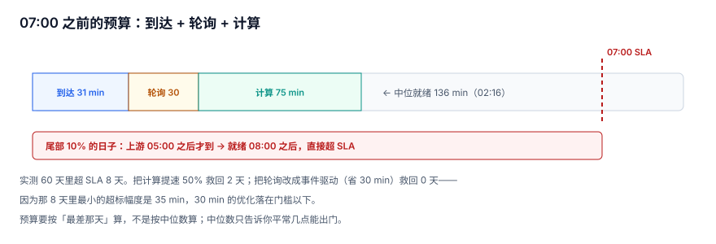

# SLA 与就绪预算：07:00 之前的时间去哪了

「早上七点业务要看到数」是一句需求，落地成工程语言是：**`partition_registry` 里 `ads_report_day` 当天的行，`committed_at` 必须早于 07:00**。

这句话一旦写清楚，就能算出「还剩多少预算」，也就能解释为什么「优化计算」经常没用。

::: tip 一句话定位
本页回答「**就绪时间由哪几段拼成，哪一段值得优化、哪一段只能谈**」；超时之后怎么对账在[重跑与对账](../Reconcile/index.md)。
:::



## 一、先把 SLA 定义成一个可查的时刻

SLA 有三个候选定义，选错一个，后面所有优化都白做：

| 定义 | 口径 | 问题 |
| --- | --- | --- |
| 作业跑完 | 最后一条 `batch_run.finished_at` | 跑完 ≠ 数据可用（可能 `BLOCKED`） |
| **分区就绪** | `partition_registry.committed_at` 且 `state='READY'` | **推荐**：可查、可比、与下游对齐 |
| 下游可用 | 业务第一次成功打开报表的时刻 | 受前端/缓存影响，不可控 |

本册统一用第二种，并把它写成一条视图：

```sql
CREATE VIEW v_batch_lag AS
SELECT p.job_id, p.data_date, j.sla_minute,
       CAST(substr(p.committed_at,12,2) AS INTEGER)*60
     + CAST(substr(p.committed_at,15,2) AS INTEGER) AS ready_minute,
       CAST(substr(p.committed_at,12,2) AS INTEGER)*60
     + CAST(substr(p.committed_at,15,2) AS INTEGER) - j.sla_minute AS lag_min
FROM partition_registry p JOIN batch_job j ON j.job_id = p.job_id;
```

`lag_min > 0` 即超 SLA。这条视图是后面所有归因的基础——**没有它，SLA 只能靠人肉看面板**。

## 二、预算分解：四段

```text
00:00 ──[ ①上游到达 ]──[ ②轮询发现 ]──[ ③计算 ]──[ ④重试/返工 ]── 07:00
```

| 段 | 中位 | 尾部（p95） | 谁控制 |
| --- | --- | --- | --- |
| ① 上游到达 | 31.3 min | 380.2 min | **上游系统**（本团队通常无权） |
| ② 轮询发现 | 30 min（3 层 × 10 min） | 30 min | 本团队（改成事件驱动即归零） |
| ③ 计算 | 75 min | 75 min | 本团队（加资源/改 SQL） |
| ④ 重试返工 | 0 | 视失败率 | 本团队（稳定性） |

60 天实测：

| 指标 | 读数 |
| --- | --- |
| 上游到达 p50 / p95 / max | 31.3 / 380.2 / 407.9 min |
| 就绪时刻 p50 / p95 / max | 136.3 / 485.2 / 512.9 min |
| 超 07:00 的天数 | **8 / 60** |
| 轮询空等占比（中位就绪） | **22.0%** |

## 三、三种优化，三种结果

在同样的 60 天上分别做三种改造，看超 SLA 的天数怎么变：

| 改造 | 省下的时间 | 超 SLA 天数 | 说明 |
| --- | --- | --- | --- |
| 计算提速 50% | 37.5 min | **8 → 6** | 只救回超标幅度 < 37.5 min 的那两天 |
| 轮询改事件驱动 | 30 min | **8 → 8** | 省下的 30 min **小于最小超标幅度 35 min**，一天都救不回 |
| 两者都归零 | 105 min | **8 → 0** | 说明超标幅度全部由这 105 分钟构成 |

这张表最值得记的不是结论，而是**方法**：

::: warning 「优化了却没用」不是白做，是归因错了
轮询优化省了 30 分钟（占中位就绪时间 22%，看上去很划算），但一天都没救回来。原因是那 8 天超标的幅度是 35~93 分钟——**任何小于 35 分钟的优化，在「超标天数」这个指标上都是 0 收益**。

所以 SLA 优化之前必须先算两个数：**当前超标幅度分布**、**候选优化能省多少**。前者小于后者，才值得动手。中位数只告诉你平常几点能出门，不告诉你迟到的那几天迟到多久。
:::

## 四、跨层叠加：轮询为什么是乘法

单层等一个 10 分钟轮询，平均加 5 分钟延迟；三层串起来就是 15 分钟，加上重试与判据执行的间隔，实测是 30 分钟。这条规律可以推广：

```text
固定浪费 ≈ Σ(每层轮询间隔 / 2) × 层数 + 判据执行间隔 × 层数
```

四层链、每层 10 分钟轮询：`4 × 5 + 4 × 2.5 = 30` 分钟，与实测一致。层数越多，轮询的代价越大——**这是「加一层就慢一点」的量化解释**。

改法只有两种：

| 改法 | 效果 | 代价 |
| --- | --- | --- |
| 事件驱动（上游提交后主动通知） | 轮询浪费归零 | 需要消息通道，且要考虑「通知丢了怎么办」 |
| 缩短轮询间隔（10 min → 1 min） | 浪费从 30 min 降到 3 min | 调度器压力上升 10 倍，且仍不是 0 |

事件驱动的坑在于「通知丢了」：必须保留一条低频轮询兜底（比如 30 分钟一次），否则一次通知丢失就是永久等待。

## 五、尾部：SLA 真正的敌人

中位数好看不代表 SLA 达标。60 天里：

- 中位就绪 02:16，看着很安全（离 07:00 还有 4 小时 44 分）。
- p95 就绪 08:05，已经超了。
- 超标的 8 天，上游到达时刻是 05:11~06:48。

```text
超标那几天的上游到达（分钟，距 00:00）：
364  361  352  311  380  384  354  350  408
```

这条尾巴的形状决定了策略：

1. **不能靠「提前跑」解决**。数据没来，跑也没用。
2. **只能靠「降级方案」解决**。比如：到 05:30 上游还没到，就先发一版「截至昨日」的报表 + 一条明确标注，而不是让业务干等到 08:00。
3. **降级必须留痕**。报表头部要能读到「数据截至 HH:MM」，否则业务会把「昨天的数」当成「今天的数」。

## 六、告警：三个时刻，三种动作

| 时刻 | 条件 | 动作 |
| --- | --- | --- |
| 05:30 | 上游文件未到 | 通知上游 + 启动降级预案 |
| 06:30 | 上游已到但分区未 `READY` | 通知值班，看判据卡在哪一条 |
| 07:00 | SLA 已过 | 记 `lag_min`，进日报；不重复告警（已有人在处理） |

三个时刻对应三种角色，不能合成一条「SLA 告警」——合成之后，收到告警的人不知道该找上游、找自己、还是找业务。

## 七、判据清单

| 编号 | 判据 | 不满足时改哪里 |
| --- | --- | --- |
| `BPS-A` | SLA 定义落在 `batch_job.sla_minute`，且用 `committed_at` 判定，不用 `finished_at` | `v_batch_lag` |
| `BPS-B` | 有 `v_batch_lag` 视图，能按天查出 `lag_min` | 视图定义 |
| `BPS-C` | 预算被拆成四段（到达/轮询/计算/重试），每段有读数 | 监控埋点 |
| `BPS-D` | 优化前记录了「超标幅度分布」，优化后有前后对比 | 优化记录 |
| `BPS-E` | 轮询间隔 × 层数的固定浪费被算出来并写在配置注释里 | 调度配置 |
| `BPS-F` | 有降级方案（迟到时先发带标注的旧数），且留痕 | 报表入口 |
| `BPS-G` | 三个告警时刻各自独立，不合并成一条 | 告警规则 |
| `BPS-H` | 超 SLA 的天数可按周统计，且能列出具体日期 | 日报 SQL |

## 八、验证方式

```shell
cd /tmp && python3 - <<'PY'
import sqlite3
con = sqlite3.connect("/tmp/bpprac.db")
q = lambda s: con.execute(s).fetchall()
print("1) 每个作业的就绪时刻与 SLA 差（分钟）：")
for r in q("SELECT job_id, MIN(lag_min), MAX(lag_min) FROM v_batch_lag GROUP BY job_id"):
    print("  ", r)
print("2) 超 SLA 的分区数（应为 0）：")
print("  ", q("SELECT COUNT(*) FROM v_batch_lag WHERE lag_min > 0"))
print("3) 轮询固定浪费估算：")
layers, interval = 3, 10
print("   layers=%d interval=%dmin → 约 %d min" % (layers, interval, layers * interval))
PY
```

预期输出：

```text
1) 每个作业的就绪时刻与 SLA 差（分钟）：
   ('ads_report_day', -420, -420)
   ('dwd_order', -240, -240)
   ('dws_order_day', -330, -330)
   ('ods_order', -120, -120)
2) 超 SLA 的分区数（应为 0）：
   0
3) 轮询固定浪费估算：
   layers=3 interval=10min → 约 30 min
```

本机语料里四层都远早于 SLA（`lag_min` 全为负），这是「小数据量 + 无上游抖动」的理想情况；真实系统请用[总览](../Overview/index.md)那条带尾部的时间线对照着看。

## 参考资料

- [Google SRE Workbook: Alerting on SLOs](https://sre.google/workbook/alerting-on-slos/)
- [Apache Airflow: SLA and timeout](https://airflow.apache.org/docs/apache-airflow/stable/authoring-and-scheduling/sla.html)
- [dbt: Model timing and freshness](https://docs.getdbt.com/docs/deploy/source-freshness)
- [Apache Iceberg: Commit latency and metadata](https://iceberg.apache.org/docs/latest/performance/)
