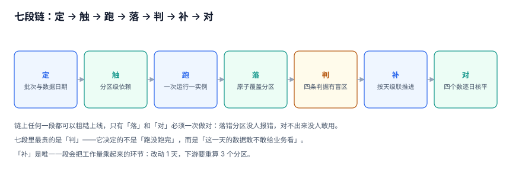
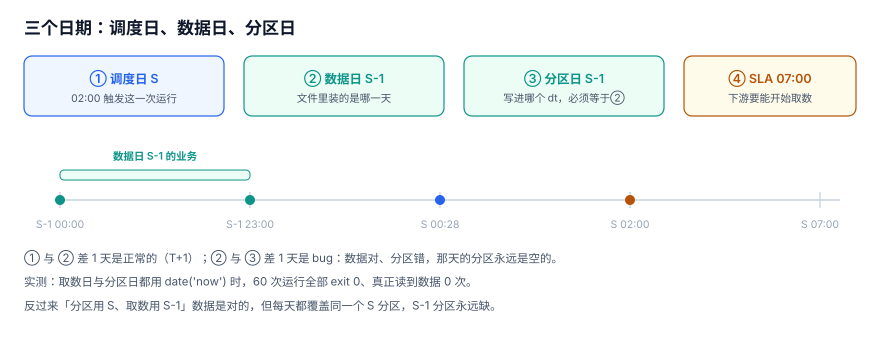

# 离线批次与补数工程

每天凌晨两点，调度器把几百个任务依次点亮，早上七点业务打开报表。这一整套流程里最容易被忽略的一句话是：**「今天的数跑完了」到底是什么意思？**

任务退出码是 0、调度面板全绿、分区里有行——这三件事可以同时成立，而报表仍然是错的。反过来，分区里一行都没有，也可能是完全正确的（那天真的没交易）。

本专题只回答一个问题：**一次 T+1 批次，凭什么说「昨天的数据好了」；说不好的时候，怎么保证它没有被当成好的用出去。**

::: tip 一句话理解
调度系统回答的是「任务跑了没有」，批次工程回答的是「**这一天的分区，敢不敢给下游用**」。前者看退出码，后者看证据。
:::

## 本专题回答什么、不回答什么

库内与「批次」沾边的册子有六处，主讲的东西完全不同。下表把分工写死，避免同一个问题被两册各答一遍。

| 问题的主语 | 由谁回答 | 具体页面 |
| --- | --- | --- |
| 表怎么分层、事实与维度怎么切、粒度和 SCD 怎么定 | 建模视角 | [数仓建模](../../DB/DataWarehouse/index.md) |
| cron 表达式什么语义、misfire 怎么补跑、选主与分片怎么做 | 调度器视角 | [分布式任务调度](../DistributedScheduling/index.md) |
| 批量文件怎么落地、编码与回执怎么做 | 交换视角 | [批量数据交换工程](../BulkDataExchange/index.md) |
| 增量怎么捕获、日志怎么解析 | 同步视角 | [数据同步与 CDC](../../DB/CDC/index.md) |
| 同一次请求被重试怎么只生效一次 | 幂等视角 | [幂等与状态机](../IdempotencyStateMachine/index.md) |
| 规则怎么定阈值、异常怎么定义 | 质量视角 | [数据质量](../../DB/DataGovernance/DataQuality/index.md) |
| **这一天的分区怎么原子落地、凭什么叫就绪、补数怎么级联、四个数怎么核平** | **本册** | 就是你现在看的这一册 |

分界线一句话：**主语是「这个任务几点跑、失败重试几次」，看调度那一册；主语是「这个分区里的数据是哪一天的、能不能给下游用、重跑之后下游要不要跟着重算」，看本册。**

## 三个「这一天的数据」

同一个「昨天的订单」，在系统里有三种身份。它们可以同时成立，也可以只成立一种——而绝大多数「报表错了但没人发现」的事故，是把第一种当成了第三种。

| 身份 | 它是什么 | 判定方式 | 失效的样子 |
| --- | --- | --- | --- |
| **任务成功** | 那个作业的进程退出码是 0 | 调度面板显示绿色 | 读到 0 行也算成功，`exit 0` 不区分「没数据」和「没读到」 |
| **分区就绪** | 那个 `(job, data_date)` 的分区有一条登记，状态是 `READY` | 查 `partition_registry` 一行 | 行在，但判据只看了行数，没看水位 |
| **数据可用** | 下游按这个分区算出来的数，与源侧可以对平 | 逐日对账 `verdict = OK` | 对得平，但对的是重跑过的那一版 |

::: warning 三个身份不能互相替代
「退出码 0」不等于「分区就绪」（可能读到 0 行），「分区就绪」也不等于「数据可用」（可能对不上账）。判据必须各自写一条，不能用一个 `SELECT COUNT(*)` 交差。
:::

## 七段链

| 段 | 这一段在干什么 | 最容易安静出错的地方 | 对应章节 |
| --- | --- | --- | --- |
| 定 | 定下「哪一天的数据、落到哪个分区」 | 取数日与分区日各错一天，组合出四种写法 | [批次与实例](BatchInstance/index.md) |
| 触 | 上游分区就绪才触发下游 | 依赖边传的是「任务成功」而不是「分区可用」 | [依赖与就绪](Dependency/index.md) |
| 跑 | 一次运行 = 一个实例 + 一个 attempt | 重跑覆盖上次的结论，历史消失 | [批次与实例](BatchInstance/index.md) |
| 落 | 原子地替换一个分区 | 删完还没插的窗口被下游读到 | [分区写入](PartitionWrite/index.md) |
| 判 | 四条判据 + 阈值，决定 READY 还是 BLOCKED | 每条判据都有盲区，单看一条守不住 | [就绪与门禁](ReadinessGate/index.md) |
| 补 | 按天推进、级联下游、限流 | 补 1 天要重算 3 个分区，补 7 天是 21 个 | [补数与回刷](Backfill/index.md) |
| 对 | 让任意两个数的差都能被解释 | 只对总数、不对日期，差在「哪一天」上看不出来 | [重跑与对账](Reconcile/index.md) |

## 本专题的起点：一份可复跑的语料

全专题的读数来自同一份本机语料（Python 3.13.12 + SQLite 3.50.4，固定种子 `20261110`，脚本不入库）：

| 数据集 | 规模 | 用途 |
| --- | --- | --- |
| 订单源表 | 60 天 / **106,845 行** / 53 个有数据日（国庆 7 天为 0） | 日期语义、幂等、就绪、对账 |
| 跨切点订单 | **4,490 行（4.20%）**，业务时间在 23:00 之后、落到次日文件 | 迟到数据与分区口径 |
| 控制库 | 9 张控制表 + 1 张源表，**32.8 MB** | 实战页的触发器与断言 |

所有数字都可以按[实战](Practice/index.md)页给出的 DDL 与命令复跑，包括那些看起来不合理的（追加写 3 次变 3 倍、`date(dt)` 比 `dt` 慢 176 倍）。

## 五个安静的失败

这五件事的共同点是：**面板是绿的、接口返回 200、报表能打开，只有对账或复核才会暴露**。

1. **空分区当成成功**：60 次运行全部 `exit 0`，其中 6 次真的读到 0 行。节假日里这是对的，上游漏推时这是灾难——两种情况的界面完全一样。
2. **分区落错一天**：数据是对的，分区日期用了调度日，于是每天覆盖同一个分区，被覆盖的那天永久空白。
3. **追加而不是覆盖**：同一分区跑 3 次，1916 行变 5748 行（3.0×），所有 `SUM` 类指标跟着翻 3 倍。
4. **缺的天不是 0，是不存在**：报表里 10 月只有 24 天，用「总额 ÷ 有数据的天」算日均，比按日历 31 天算高 29.17%。
5. **重跑没带走下游**：dwd 重跑一天，行数 108,663 vs 源 106,747，差 1,916 行；而 ads 仍是按旧分区汇总的 106,747 —— 四个数各自都能自证。

## 三条反模式

::: danger 这三条在本库的实测里都付过代价
1. **用 `date('now')` 当数据日期**：任务在 02:00 跑，`date('now')` 给的是调度日；那天的文件要等到次日 00:28 才生成，于是**每次都读到 0 行、每次都成功**。日期必须由调度参数注入，不能由任务自己猜。
2. **用「任务成功」当依赖条件**：0 行也是一种成功，于是 0 元一路穿过四层，每一层都是绿色。依赖边上要传的是「分区状态」，不是「退出码」。
3. **覆盖写不开事务**：`DELETE` 提交后、`INSERT` 提交前，读者读到的是空分区。实测自动提交下读到 0 行，显式事务下读到旧的 1,916 行——差别只在一个 `BEGIN`。
:::

## 起步顺序

如果只能改一件事，按这个顺序：

1. **先把数据日期变成参数**。所有作业不许自己算日期，只读调度传进来的 `data_date`；分区列必须等于它。这一条能消掉一半「数对不上」。
2. **再给分区建一张登记表**。`(job_id, data_date)` 一行，带 `row_cnt`、`amt_sum`、`water_mark`、`checksum`、`state`。没有这张表，后面所有判据都无处落脚。
3. **然后把依赖从「任务」改成「分区」**。下游等的不是「上游跑完了」，是「上游这一天的分区是 READY」。
4. **最后才谈补数与 SLA**。补数的成本是级联算出来的（1 天 → 3 个分区），SLA 的瓶颈在预算里最不受控的那一段（上游到达），两者都要先有度量再优化。

## 目录

| 章节 | 它管的那一段 | 一句话 |
| --- | --- | --- |
| [总览：三个日期、三种成功与五个安静的失败](Overview/index.md) | 全景 | 先把「跑完了」和「能用了」拆开 |
| [批次与实例：作业、运行、尝试与分区](BatchInstance/index.md) | 定 + 跑 | 重跑只加一行，不改历史 |
| [分区写入：覆盖、空窗与原子提交](PartitionWrite/index.md) | 落 | 一个 `BEGIN` 值 1,916 行 |
| [依赖与就绪：任务级还是分区级](Dependency/index.md) | 触 | 0 行也是一种成功，所以要传状态 |
| [就绪与门禁：四条判据各自的盲区](ReadinessGate/index.md) | 判 | 没有一条判据能单独守住 |
| [补数与回刷：级联、顺序与隔离](Backfill/index.md) | 补 | 补 7 天 = 21 个下游分区 |
| [SLA 与就绪预算：07:00 之前的时间去哪了](SlaBudget/index.md) | 判 | 省 30 分钟救不回任何一天 |
| [重跑与对账：四个数怎么核平](Reconcile/index.md) | 对 | 差要能被一句话解释 |
| [实战：十张表、五个触发器与十九条断言](Practice/index.md) | 全链 | 约束落在表上才算数 |
| [常见问题与分诊](FAQ/index.md) | — | 十个被反复问到的判断题 |

## 本专题的判据族

本专题共 **10 族 80 条判据**，每章 8 条，逐条可判定。

| 族 | 覆盖 | 页 |
| --- | --- | --- |
| `BPN-A ~ BPN-H` | 三个日期、三种成功、七段链、五个失败、三条反模式、起步顺序、边界、验收入口 | [总览](Overview/index.md) |
| `BPI-A ~ BPI-H` | 作业与实例分离、attempt 只增、`is_current`、状态机、分区登记、补数与调度运行区分、审计、实例验收 | [批次与实例](BatchInstance/index.md) |
| `BPW-A ~ BPW-H` | 三种写法、空窗、原子提交、幂等键、空分区登记、分区裁剪、列类型、写入验收 | [分区写入](PartitionWrite/index.md) |
| `BPD-A ~ BPD-H` | 任务级与分区级、扇出、扇入、跨层等待、环形依赖、阻塞传播、依赖变更、依赖验收 | [依赖与就绪](Dependency/index.md) |
| `BPG-A ~ BPG-H` | 四条判据、盲区矩阵、阈值选型、日历例外、三态门禁、判据落表、人工放行、门禁验收 | [就绪与门禁](ReadinessGate/index.md) |
| `BPB-A ~ BPB-H` | 补数申请、按天明细、级联范围、影子分区、顺序推进、限流、读隔离、补数验收 | [补数与回刷](Backfill/index.md) |
| `BPS-A ~ BPS-H` | SLA 定义、预算分解、轮询与事件、上游尾部、归因、跨层叠加、告警接线、SLA 验收 | [SLA 与就绪预算](SlaBudget/index.md) |
| `BPU-A ~ BPU-H` | 四个数、四类差异、快照口径、重跑后必对、差异登记、口径变更、日报、对账验收 | [重跑与对账](Reconcile/index.md) |
| `BPE-A ~ BPE-H` | 十表 DDL、五触发器、两视图、十九条断言、负向探针、复跑、覆盖缺口、交付 | [实战](Practice/index.md) |
| `BPQ-A ~ BPQ-H` | 十个判断题、三步分诊、失败归类、补数决策、SLA 谈判、口径争议、迁移路径、验收口径 | [常见问题](FAQ/index.md) |

## 版本组织：本专题不建版本目录

本册面向的不是某一代产品。**「数据日期必须由参数注入」「分区必须原子替换」「就绪必须有证据」这三条，在 2010 年的 Shell + crontab 与 2026 年的调度平台上都是同一句话。**

所以按「链上的一段」分族，不按产品版本分目录。需要按大版本建目录的是「同一份代码两套写法」那类主题，库内已有范式可对照：

- [Spring 5](../Java/Frame/Spring/Spring5/index.md) 与 [Spring 6](../Java/Frame/Spring/Spring6/index.md)：两代 API 不兼容，旧版保留并标注状态。
- [Vue 2](../../Frontend/Frame/Vue/Vue2/index.md) 与 [Vue 3](../../Frontend/Frame/Vue/Vue3/index.md)：同一框架两套响应式写法。
- [GraphQL 16](../GraphQL/Graphql16/index.md) 与 [GraphQL 17](../GraphQL/Graphql17/index.md)：规范两版并存。

批次工程没有这种分裂：Airflow 2 换成 3、DolphinScheduler 3 换成 4、自研调度换成云上托管，判据一个字都不用改。产品差异写在[分布式任务调度](../DistributedScheduling/index.md)里，本册只在需要对照调度语义时引用它。

## 阅读顺序

- **只要结论**：读[总览](Overview/index.md)的「五个安静的失败」，五分钟能对上自己的系统。
- **正在被「昨天的数还是空的」折磨**：按 [批次与实例](BatchInstance/index.md) → [依赖与就绪](Dependency/index.md) 读。
- **要对账但对不出来**：直接看[重跑与对账](Reconcile/index.md)的四类差异，再回头补[实战](Practice/index.md)的表结构。

## 参考资料

- [Apache Airflow 3 Documentation: DAGs and Task Instances](https://airflow.apache.org/docs/apache-airflow/stable/core-concepts/dags.html)
- [Apache Airflow: Data Interval and Logical Date](https://airflow.apache.org/docs/apache-airflow/stable/authoring-and-scheduling/timezone.html)
- [dbt Docs: About incremental models](https://docs.getdbt.com/docs/build/incremental-models)
- [PostgreSQL 18: Partitioning](https://www.postgresql.org/docs/18/ddl-partitioning.html)
- [Apache Iceberg Spec: Snapshots and Atomic Commits](https://iceberg.apache.org/spec/)
- [Google SRE Book: Data Processing Pipelines](https://sre.google/sre-book/data-processing-pipelines/)
