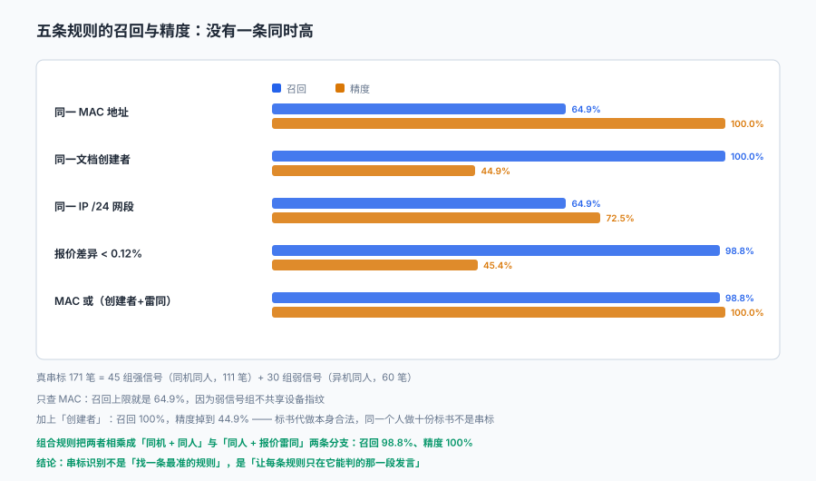

# 围标串标识别：召回 65% 的规则，看起来最准

三家投标人的标书，MAC 地址完全相同。

系统判定「疑似串标」，三家全部废标。三天后收到投诉：**这三家都是在同一家打印店打的标书，打印店只有一台能连内网的电脑。**

招标人败诉。

::: tip 一句话理解
串标识别的产物不是「结论」，是**线索 + 证据强度**。把线索当结论用，会让真正的串标更容易得手——因为它教会了所有人避开那一条指标。
:::

本页判据族 `BTS-A` ~ `BTS-H`，共 8 条。



## 一、法条里已经写好的六种「视为」

条例第四十条列了六种「视为投标人相互串通投标」的情形，它们同时也是六种可采集的信号：

| 法条情形 | 可采集的信号 | 采集难度 |
| --- | --- | --- |
| 不同投标人的投标文件由同一单位或个人编制 | 文档属性里的作者、最后修改人 | 低（电子标书自带） |
| 不同投标人委托同一单位或个人办理投标事宜 | 委托代理人身份信息 | 中（需实名） |
| 投标文件载明的项目管理成员为同一人 | 项目经理/技术负责人姓名与证件号 | 低（结构化字段） |
| 投标文件异常一致或投标报价呈规律性差异 | 文本相似度、报价差分 | 中（需算法） |
| 投标文件相互混装 | 文件内出现他人名称 | 中（需文本检索） |
| 投标保证金从同一单位或个人账户转出 | 付款账户名与账号 | 低（银行回单） |

**六种情形里有四种是「结构化字段就能查」的**，不需要复杂算法。真正难的是第三、四种：文本相似度与报价规律。

还有一条不在第四十条里，但同样重要——条例第三十四条：

```text
单位负责人为同一人或者存在控股、管理关系的不同单位，
不得参加同一标段投标或者未划分标段的同一招标项目投标。
```

这条查的是**股权与人事关联**，需要外部数据（工商、社保），是六种信号之外的一层。

## 二、本机读数：五条规则，没有一条同时高

在 3,000 份投标、300 个项目里植入 171 笔真串标：45 组「同机同人」（111 笔）+ 30 组「异机同人」（60 笔，只共享创建者与报价步长，不共享设备）。噪声是 220 份「同一家标书代理代做」与 45 份「同一代理机构上传」。

| 规则 | 命中 | 真 | 误报 | 召回 | 精度 |
| --- | --- | --- | --- | --- | --- |
| 同一 MAC 地址 | 111 | 111 | 0 | **64.9%** | **100%** |
| 同一文档创建者 | 381 | 171 | 210 | 100% | **44.9%** |
| 同一 IP /24 网段 | 153 | 111 | 42 | 64.9% | 72.5% |
| 报价差异 < 0.12% | 372 | 169 | 203 | 98.8% | 45.4% |
| 同一 MAC + 同一创建者 | 109 | 109 | 0 | 63.7% | 100% |
| MAC 或（创建者 + 报价雷同） | 169 | 169 | 0 | **98.8%** | **100%** |

这张表要横着读，三行一组：

**第一组（第 1、5 行）：精度满分，召回只有 65%。** 「同一 MAC」一条误报都没有，看起来最可靠——但它漏掉了整整 30 组弱信号，因为那些组根本不共享设备。**一个 100% 精度的规则，往往意味着它只抓最明显的那些。**

**第二组（第 2、4 行）：召回接近满分，精度不到一半。** 「同一创建者」抓到全部 171 笔，但另外误报 210 笔——因为标书代做是合法业务，同一个代理做十份标书不是串标。**召回高的规则，惩罚的是整个行业。**

**第三组（第 6 行）：组合规则。** 它不是「加权求和」，是**分支**：`同一 MAC`（设备层证据）或 `同一创建者 且 报价雷同`（人 + 行为两层证据同时成立）。两条分支各自要求「两个维度同时命中」，误报被压到 0，召回保持 98.8%。

::: warning 「精度 100%」这句话本身有陷阱
上面所有精度都是在**已知埋点**的数据上算的。真实场景没有 ground truth，你只能看到「命中了多少」，看不到「漏了多少」。

所以工程上应当反过来用：**用精度高的规则做「立案」，用召回高的规则做「扩展」**——先由 MAC 相同定案，再由创建者相同去查这个人还投过哪些项目。
:::

## 三、报价规律性差异：最常见的串标手法

「报价呈规律性差异」是最难查也最常见的一种。三种典型形态：

| 形态 | 例子 | 识别方式 |
| --- | --- | --- |
| 等差 | 480 万 / 490 万 / 500 万 | 相邻差值恒定（±0.5%） |
| 等比 | 480 万 / 489.6 万 / 499.4 万（各 +2%） | 相邻比值恒定（±0.1%） |
| 固定下浮 | 都在控制价基础上下浮 8.00% / 8.05% / 8.10% | 与控制价比值的差 < 0.1% |

第三种在工程标里最多，因为控制价是公开的，围标方只需要在控制价上做微小的差异化下浮。

```python
def arithmetic_pattern(prices, tol=0.005):
    """判断一组报价是否呈等差（相邻差值相对稳定）"""
    prices = sorted(prices)
    if len(prices) < 3:
        return False
    diffs = [prices[i+1] - prices[i] for i in range(len(prices) - 1)]
    avg = sum(diffs) / len(diffs)
    if avg <= 0:
        return False
    return all(abs(d - avg) / avg <= tol for d in diffs)

print(arithmetic_pattern([4_800_000, 4_900_000, 5_000_000]))   # True
print(arithmetic_pattern([4_800_000, 4_905_000, 5_012_000]))   # False
```

两点要注意：

1. **样本少于 3 家时这个方法无效**——两家的「等差」没有意义，任何两个数都构成等差。所以本机数据里 2 家组只能靠「差异 < 0.12%」判定。
2. **要相对化，不要绝对化**：480 万和 481 万差 1 万，看似接近，相对差只有 0.21%；而 80 万和 82 万差 2 万，相对差 2.5%。**用绝对差额做阈值，在大额标上会失效。**

## 四、文本相似度：不能只看「像不像」

投标文件的技术方案大量引用规范条文、标准表格，天然高度相似。直接算余弦相似度，正常竞标的相似度也可能到 0.85。

| 方法 | 正常竞标 | 串标 | 可用性 |
| --- | --- | --- | --- |
| 全文余弦相似度 | 0.70~0.90 | 0.95+ | 低（区分度不够） |
| 去掉公共条款后的相似度 | 0.20~0.50 | 0.85+ | 中 |
| 段落级「异常一致」数 | 0~3 段 | 20+ 段 | 高 |
| 错别字/病句同时出现 | 0 | ≥1 处 | **很高** |

最后一行是实践里最有效的一条：**同一处错别字、同一个异常空格、同一句不通顺的话，同时出现在两份标书里**——这几乎不可能是巧合。它不需要算法，只需要把文本规范化后做「异常片段」比对。

## 五、从线索到处置：四级强度

| 级别 | 证据 | 处置 |
| --- | --- | --- |
| L1 提示 | 单一弱信号（同一 IP /24） | 记录，不告警 |
| L2 关注 | 单一强信号（同一 MAC、报价等差） | 提示评标委员会注意 |
| L3 核查 | 两个不同维度同时命中（设备 + 人） | 要求投标人书面说明 |
| L4 认定 | 法条明确的六种情形之一，且有可验证证据 | 按无效投标处理，报监督部门 |

**只有 L4 才能废标。** 前三级的产物是「一张待核查清单」，不是处理决定。

这个分级解决了一个现实矛盾：如果 L2 就废标，误伤率太高（本机 MAC 规则在真实场景的误报率绝不为 0）；如果只做 L4，那系统等于没有识别能力。

## 六、数据模型：证据要能复算

```sql
CREATE TABLE collusion_flag (
  flag_id     TEXT PRIMARY KEY,
  project_id  TEXT NOT NULL REFERENCES purchase_project,
  bid_id      TEXT NOT NULL REFERENCES bid,
  group_key   TEXT NOT NULL,          -- 同组标识（同一 MAC / 同一创建者等）
  rule_code   TEXT NOT NULL,          -- MAC_SAME / CREATOR_SAME / PRICE_ARITH ...
  level       INTEGER NOT NULL CHECK (level BETWEEN 1 AND 4),
  evidence    TEXT NOT NULL,          -- JSON：原始值 + 比对对象
  created_at  TEXT NOT NULL,
  reviewed_by TEXT,
  reviewed_at TEXT,
  conclusion  TEXT CHECK (conclusion IN ('成立','不成立','无法判定'))
);
```

三个设计点：

1. **`evidence` 存原始值与比对对象**，不存「相似度 0.97」这种结论。一年后复核时，原始值还能重算，结论不能。
2. **`reviewed_by` 必填才算闭环**——只有机器判定、没有人工复核的清单，在投诉时无法作为依据（也违反「线索不是结论」的原则）。
3. **`conclusion` 允许「无法判定」**：强行二分会逼着人做没有依据的判断。

## 七、本页判据

| 判据 | 断言 | 验证方式 |
| --- | --- | --- |
| `BTS-A` | 六种法定情形都有对应的规则码 | 规则表能覆盖条例第四十条六项 |
| `BTS-B` | 每条线索带原始证据 | `evidence` 非空且可解析为 JSON |
| `BTS-C` | 线索分级，只有 L4 可废标 | 废标记录都能关联到 `level = 4` 的线索 |
| `BTS-D` | 人工复核闭环 | `conclusion` 为空的 L3 及以上线索数为 0（超过 N 天） |
| `BTS-E` | 报价规律用相对差而非绝对差 | 规则实现里不出现绝对金额阈值 |
| `BTS-F` | 少于 3 家的等差判定被禁用 | 2 家组只走「差异率」规则 |
| `BTS-G` | 文本相似度剥离公共条款 | 相似度计算前有「去规范条文」步骤 |
| `BTS-H` | 识别结果可按规则统计召回/精度 | 有标注集时能算出每条的召回与精度 |

## 验证方式

```shell
# 1. 规则覆盖率（期望 6 行，对应条例第四十条六项）
sqlite3 bt.db "select rule_code, count(*) from collusion_flag group by rule_code;"

# 2. 无证据的线索（期望 0）
sqlite3 bt.db "select count(*) from collusion_flag where evidence is null or evidence = '';"

# 3. 未复核的 L3+ 线索（超过 7 天仍未复核的，必须有人处理）
sqlite3 bt.db "select count(*) from collusion_flag
               where level >= 3 and conclusion is null
                 and julianday('now') - julianday(created_at) > 7;"

# 4. 同一组线索是否跨了多个规则（跨规则 = 证据更强）
sqlite3 bt.db "select group_key, count(distinct rule_code) c from collusion_flag
               group by group_key having c >= 2 order by c desc;"
```

第 4 步是这套设计里最有用的一个查询：**同一个组被两条不同规则同时命中，才是「L3 核查」的入口**。单条规则命中只能是提示。

## 参考资料

- 《中华人民共和国招标投标法实施条例》第三十九条：属于投标人相互串通投标的五种情形（协商报价、约定中标人、约定放弃、同一组织成员协同、其他联合行动）。
- 《中华人民共和国招标投标法实施条例》第四十条：视为投标人相互串通投标的六种情形（同一单位或个人编制、委托同一单位或个人办理、项目管理成员同一人、文件异常一致或报价呈规律性差异、文件相互混装、保证金从同一账户转出）。
- 《中华人民共和国招标投标法实施条例》第三十四条：与招标人存在利害关系可能影响公正性的不得参加投标；单位负责人为同一人或存在控股、管理关系的不同单位，不得参加同一标段投标。
- 《中华人民共和国招标投标法》第三十二条：投标人不得相互串通投标报价，不得排挤其他投标人的公平竞争。
- 与本页相邻：[招标文件与资格条件](../Document/index.md)、[评标、专家与评分](../Evaluation/index.md)、[定标、公示与合同](../Award/index.md)。
