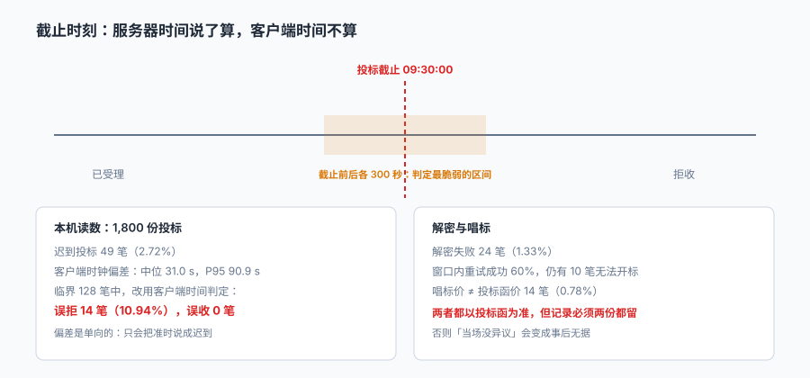

# 开标与解密：同一秒钟，两台机器给出两个答案

投标人 A 的电脑显示 09:29:58，点了上传，回执「成功」。服务器收到的时间是 09:30:04。

投标人 B 的电脑显示 09:30:02，实际服务器收到 09:29:57。

A 被判迟到、B 被判准时。**两个人都没说谎，他们的电脑确实这么显示的。**

::: tip 一句话理解
截止时刻是一个**单点**，而判定它需要**一个时钟**。招投标里唯一合法的时钟是招标人的服务器时钟；客户端时钟只是「投标人看到的时间」，它可以是证据，不能是依据。
:::

本页判据族 `BTK-A` ~ `BTK-H`，共 8 条。



## 一、开标这一步到底在做什么

很多人以为开标是「念价格」。实际它要完成四件事，缺一件都会在事后变成争议：

| 动作 | 产物 | 缺了会怎样 |
| --- | --- | --- |
| 宣布纪律与参会人员 | 开标记录首页 | 无法证明谁在场 |
| 检查投标文件密封/解密 | 解密结果清单 | 无法证明「没被提前打开」 |
| 唱标并记录 | 唱标表（报价、工期、质量承诺） | 无法证明「当场说了什么」 |
| 投标人确认签字 | 签收记录 | 事后无法反驳「我没听到」 |

其中「唱标表」与「投标函」是两个来源。**它们必须一致，不一致时以投标函为准**——但两份都必须留档，因为唱标时的差异是「当场可提异议」的唯一窗口。

## 二、截止时刻：为什么不能用客户端时间

本机对 1,800 份投标做了模拟：递交时刻按「截止前集中到达」分布（中位约 63 分钟前），2.72% 迟到；每个客户端有一个 σ=45 秒的时钟偏差。

| 指标 | 值 |
| --- | --- |
| 迟到投标 | 49 / 1,800（**2.72%**） |
| 客户端时钟偏差 \|skew\| | 中位 **31.0 s**，P95 **90.9 s** |
| 截止前后 300 秒内递交 | 128 笔 |
| 其中改用客户端时间判定 | **误拒 14 笔（10.94%），误收 0 笔** |

三个结论：

1. **偏差是单向的**：本机模拟里只出现「误拒」，没有「误收」。因为迟到的那 2.72% 大多在截止后几十秒内到达，而偏差要超过这个间隔才会把迟到翻成准时——概率低但不为零。
2. **10.94% 的误判率，是在「临界 300 秒」这个小样本里**。整体误判率只有 0.78%，但所有争议都发生在那 128 笔里。
3. **中位偏差 31 秒听起来很小**，可截止时刻是精确到秒的判定，31 秒足够改变结论。

::: danger 三个「看起来更公平」的做法，实际都更糟
1. **取客户端与服务器时间的平均值**：这等于让投标人可以影响判定结果——只要把本机时间调慢，平均值就被拉向「准时」。
2. **给一个宽限期（如截止后 60 秒内仍接受）**：宽限期对所有按时到达的人不公平，而且会让「迟到」这个状态失去意义。
3. **以「上传开始时间」为准**：上传可能持续几分钟，开始时间早但完成时间晚的标书，内容并不完整。
:::

## 三、解密：失败之后还有没有第二次机会

电子开标的核心是「投标截止前谁也打不开」。这靠的是加密 + CA 证书，解密需要投标人的数字证书。

| 环节 | 失败原因 | 后果 |
| --- | --- | --- |
| 证书过期 | 投标人未及时更新 | 无法解密，视为撤销投标 |
| 密码错误 | 遗忘/输错 | 通常有 3 次重试机会 |
| 介质损坏 | U 盾损坏 | 需要现场补救流程 |
| 平台故障 | 解密服务不可用 | **不能算投标人责任**，应顺延 |

本机读数：解密失败 24 笔（1.33%），窗口内重试成功 60%，**仍有 10 笔无法开标**。

第四行的区分极其重要：**同样的「解不开」，一个是投标人的问题，一个是平台的问题，处理方式完全相反。** 系统里如果没有区分「失败原因」，就只能一刀切按「视为撤销」处理——而那会把平台故障的后果转嫁给投标人。

```sql
CREATE TABLE bid_decrypt (
  bid_id      TEXT PRIMARY KEY REFERENCES bid,
  attempt_no  INTEGER NOT NULL,
  started_at  TEXT NOT NULL,
  finished_at TEXT,
  result      TEXT NOT NULL CHECK (result IN ('OK','BAD_PASSWORD','NO_CERT','CERT_EXPIRED','PLATFORM_ERR')),
  operator    TEXT
);
```

`result` 的枚举里必须留一个 `PLATFORM_ERR`。没有它，运维故障就会被记成投标人失误。

## 四、投标人少于 3 个：不得开标

条例第四十四条：**投标人少于 3 个的，不得开标；招标人应当重新招标。**

这条规则有一个常被误解的地方：**「3 个」指的是有效投标人，不是递交数**。如果 5 家递交、2 家解密失败，有效投标人是 3 家，可以开标；如果 5 家递交、3 家解密失败，有效投标人 2 家，不得开标。

```sql
-- 开标前的有效性判定：解密成功且保证金到账
SELECT COUNT(*) FROM bid b
JOIN bid_bond bn ON bn.bid_id = b.bid_id
WHERE b.project_id = :pid
  AND b.decrypt_ok = 1
  AND bn.paid_at IS NOT NULL
  AND b.withdraw_at IS NULL;
```

这个查询的每一行条件都对应一次真实的争议：`decrypt_ok`（解得开吗）、`paid_at`（钱到了吗）、`withdraw_at`（撤回了没有）。

## 五、开标记录：五份材料

一次合规的开标，事后应当能拿出五份材料：

| 材料 | 关键内容 | 谁签 |
| --- | --- | --- |
| 开标记录 | 时间、地点、参会人、投标人名单 | 主持人 + 记录人 |
| 解密结果清单 | 每份标书的解密状态与时间 | 平台自动生成 |
| 唱标表 | 报价、工期、质量、优惠承诺 | 唱标人 + 记录人 |
| 投标人确认表 | 对唱标内容的确认或异议 | 各投标人代表 |
| 异议记录 | 当场提出的异议与答复 | 双方 |

五份材料里，「投标人确认表」最容易被简化成一张签到表。**签到只能证明人来了，不能证明他确认了内容**——而「当场没有异议」是后续驳回投诉的关键依据。

## 六、时间同步：把偏差做成可监控的指标

既然判定必须用服务器时间，就要保证服务器时间本身是准的：

| 措施 | 作用 | 验证方式 |
| --- | --- | --- |
| NTP 同步（多源） | 服务器时钟与国家标准时间对齐 | `chronyc tracking` 偏移 < 50 ms |
| 判定服务单一 | 只有一个服务写 `submitted_at` | 代码里只有一处赋值 |
| 偏差上报 | 客户端时间与服务器时间差入库 | 可按项目统计 P95 |
| 时间戳签名 | 防篡改 | 校验签名可复算 |

第三行是这套设计里最有价值的一点：**把「客户端偏差」当作一个正常的业务字段记下来**。它平时没用，一旦出现「那天有 5 家被判迟到」的争议，你可以立刻回答「那 5 家的客户端分别慢了多少秒」。

::: warning 时间戳不要用本地时区字符串
`2026-11-20 09:30:00` 这个字符串在没有时区的情况下是歧义的。跨时区投标（比如海外投标人）或跨夏令时（部分国家）时，同一个字符串对应两个时刻。**判定时刻一律存 UTC 或带偏移量的 ISO 8601 时间**，展示时再转本地时区。
:::

## 七、本页判据

| 判据 | 断言 | 验证方式 |
| --- | --- | --- |
| `BTK-A` | 递交时刻只由服务器写入 | 全库只有一处写 `submitted_at` 的代码路径 |
| `BTK-B` | 客户端时间单独存且不参与判定 | `client_time` 存在但不出现在判定 SQL 里 |
| `BTK-C` | 解密失败按原因分类 | `result` 枚举包含 `PLATFORM_ERR` |
| `BTK-D` | 有效投标人数据可实时算出 | 开标前能查出有效家数，且与解密清单一致 |
| `BTK-E` | 有效投标人 <3 时禁止开标 | 构造 2 家有效投标，开标动作被拒 |
| `BTK-F` | 唱标价与投标函价都可查 | 两列都存在，差异有清单 |
| `BTK-G` | 开标记录含投标人确认 | 存在确认表实体或签名字段 |
| `BTK-H` | 时间戳带时区 | 存储格式为 ISO 8601 带偏移或 UTC |

## 验证方式

```shell
# 1. 有效投标人（开标前必须 ≥3）
sqlite3 bt.db "select count(*) from bid b join bid_bond bn on bn.bid_id=b.bid_id
               where b.project_id='P-2026-001' and b.decrypt_ok=1
                 and bn.paid_at is not null and b.withdraw_at is null;"

# 2. 解密失败按原因分布（期望能看到 PLATFORM_ERR 这一档，哪怕是 0）
sqlite3 bt.db "select result, count(*) from bid_decrypt group by result;"

# 3. 唱标价与投标函价不一致的清单
sqlite3 bt.db "select b.bid_id, b.price, o.read_price from bid b
               join bid_opening_line o on o.bid_id=b.bid_id
               where abs(b.price - o.read_price) > 0.005;"
# 期望为空；不为空时以投标函价为准，并保留两份记录
```

第 2 步的输出里如果完全没有 `PLATFORM_ERR` 这一档，说明系统根本没区分「平台故障」与「投标人失误」——那是比统计数字更严重的问题。

## 参考资料

- 《中华人民共和国招标投标法》第三十四条：开标应当在招标文件确定的提交投标文件截止时间的同一时间公开进行；开标地点应当为招标文件中预先确定的地点。
- 《中华人民共和国招标投标法实施条例》第四十四条：投标人少于 3 个的，不得开标，招标人应当重新招标；投标人对开标有异议的，应当在开标现场提出，招标人应当当场作出答复并制作记录。
- 《中华人民共和国招标投标法实施条例》第三十六条：未通过资格预审的申请人提交的投标文件，以及逾期送达或者不按照招标文件要求密封的投标文件，招标人应当拒收；应当如实记载送达时间和密封情况并存档备查。
- RFC 3339《Date and Time on the Internet: Timestamps》：带偏移量的时间戳表示，本页「时间戳必须带时区」的依据。
- 与本页相邻：[投标与保证金](../Bid/index.md)、[评标、专家与评分](../Evaluation/index.md)、[公告、发售与澄清](../Timeline/index.md)。
