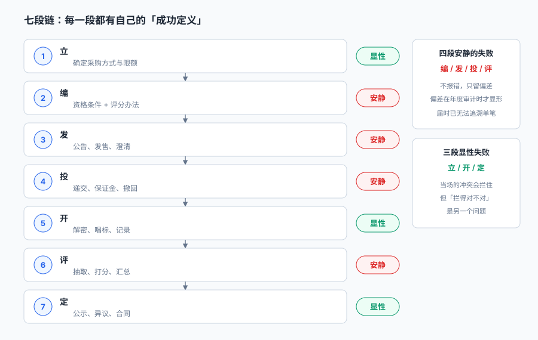

# 总览：七段链与三个「公平」

一张中标通知书上只有三行字：项目名称、中标人、中标价。签字盖章，寄出去，整个流程就算完成了。

**但那张纸上没有一个字提到：这五家是怎么被选进来的、这家的 501 万是怎么算出来的、为什么不是那家报 480 万的。** 三个问题分别对应三种失败——机会被收窄、规则被改写、结果被重算——而它们都不会让系统报错。

::: tip 一句话理解
招投标的信息系统不是「流程引擎 + 附件柜」，而是**三张可对账的表**：谁能进来（资格）、按什么比（规则）、谁赢了以及凭什么（结果）。三张表任何一张缺失，这场招标就退化成一次有记录的采购。
:::

本页判据族 `BTO-A` ~ `BTO-H`，共 8 条。定义表在第九节「本页判据」。

## 一、七段链：每一段都有自己的「成功定义」

| 段 | 业务方以为的成功 | 系统实际判断的成功 | 差在哪 |
| --- | --- | --- | --- |
| ① 立 | 项目批了 | 方式合规、标段没规避、限额算对 | 限额按「单笔」而不是「可合并」 |
| ② 编 | 文件发出去了 | 资格条件与合同履行相关、评分办法可复算 | 「相关」无法机检，只能结构化 |
| ③ 发 | 公告挂了 5 天 | 折算后 ≥5 个工作日，澄清 ≥15 日前 | 自然日与工作日不是一个数 |
| ④ 投 | 收到 5 份标书 | 5 份都在截止前到达且保证金到账 | 到账时点与递交时点是两件事 |
| ⑤ 开 | 都解开了 | 全部在窗口内解密成功且唱标留双份 | 失败的那份没有记录 |
| ⑥ 评 | 分打完了 | 专家合规、原始分可查、汇总口径唯一 | 换一种加法就换冠军 |
| ⑦ 定 | 合同签了 | 公示够日、异议已答、三价一致 | 三个价格各写各的 |



四段「安静」的失败有一个共同形状：**它不产生异常，只产生一个偏差**。偏差会随着项目数量累加，最后以「这个单位总是那几家中标」「这个品目的价格年年涨」的形式出现在年度审计里，而那时已经无法追溯到具体是哪一单。

## 二、三个「公平」对应的三组字段

「公平」在制度语言里是原则，在系统里必须落成字段，否则无法判定、也无法举证：

| 公平 | 判定问题 | 最小字段集 | 判定方式 |
| --- | --- | --- | --- |
| 机会公平 | 该能投的是不是都能投 | `announcement.publish_at` / `period_workdays` / `tender_doc.qual_json` | 折算工作日 + 条件逐条通过率 |
| 规则公平 | 尺子在开标前是否固定 | `tender_doc.version` / `score_rule` / `score.obj_score` | 版本号 + 权重和 + 客观分复核 |
| 结果公平 | 第一名的分能不能复算 | `score`（原始）+ `award.award_price` + `contract.amount` | 用同一口径重算 + 三价差额 |

三组字段里，**规则公平最难落**。因为「评分办法」在现实里常常是一段 Word，而一段 Word 有三种读法：

```text
技术分 45 分：方案完整性 20 分、可行性 15 分、创新性 10 分
```

这段话里有三个隐含决定：**每项是独立打分还是整体打分、分数是否允许小数、去掉最高最低后按几项平均**。三个决定不同，同一批标书会得到不同的排名——本机实测 300 个项目里，仅仅把「算术平均」换成「去掉一个最高一个最低」，**第一名就有 13 个（4.33%）换了人**。

::: danger 三件事必须写进数据模型，不能留给「招标文件里写清楚」
1. **评分办法要结构化成「项 + 权重 + 打分方式」**：只存一段文本，无法在开标后锁定「用哪一版规则算」，也无法回答「这一分是怎么来的」。
2. **原始分必须逐专家、逐项落库**：只落汇总分的评分表，事后无法做客观分复核——本机 2,606 条客观分记录里 **238 条（9.13%）** 与证书数量对不上。
3. **期限必须同时落「起算点」和「口径」**：`period_days` 存 20 但没存「自然日还是工作日」，跨一个国庆就会差 5 个工作日。
:::

## 三、机会公平：为什么「通过 3 家」可能是个坏消息

法规规定投标人少于 3 个不得开标。这条规则的用意是**保证竞争**，但系统实现时容易变成**保证数字**：

```text
资格审查通过：3 家（满足「不少于 3 家」）
→ 流程判定：可以开标
```

而实际情况可能是：这个品目在当地有 40 家潜在供应商，其中 36 家被「注册资本 ≥1000 万 + 近 3 年本地同类业绩 ≥3 + 本地设有分公司」这三条筛掉了。

本机实测（4,000 家样本折算 40 家潜在投标人）：

| 条件组合 | 通过率 | 折算投标人 | 流标率（400 次模拟） |
| --- | --- | --- | --- |
| 注册资本 + ISO9001 + 本地业绩 + 本地分公司 | 8.88% | 3.5 家 | **33.00%** |
| 去掉后两条「本地」条件 | 43.75% | 17.5 家 | 0.00% |

**同一个项目，同一批供应商，只是少写两条与合同履行无关的条件，投标人从 3.5 家变成 17.5 家，流标率从 33% 变成 0。** 而系统在两种情况下都会显示「资格审查通过 3 家，符合规定」——它不知道 3 家是筛出来的。

## 四、规则公平：为什么「换个加法」会换冠军

一次评标的分数可以写成三层：

```text
总分 = Σ(项得分 × 项权重) + 价格分
价格分 = 评标基准价 / 投标价 × 价格权重
```

三层里有两层会被「口径」影响：

| 口径选择 | 选项 A | 选项 B | 差异（本机） |
| --- | --- | --- | --- |
| 专家汇总 | 算术平均 | 去掉一个最高一个最低 | 冠军变化 4.33% |
| 价格基准 | 最低评标价 | 平均价下浮 | 价格分整体平移 |
| 小数位 | 保留 2 位 | 保留 4 位 | 相邻名次 5.07% 在 0.1 分内 |

第二行值得单独说：**价格分不是线性的**。基准价 800 万元时：

| 投标价 | 价格分（权重 30） |
| --- | --- |
| 800 万 | 30.00 |
| 880 万 | 27.27 |
| 1,000 万 | 24.00 |
| 1,200 万 | 20.00 |

800 万到 1,000 万，价差 200 万（+25%），分差 **6 分**；而技术分通常整页只差 1~2 分。所以「价格权重 30%」不等于「价格不决定胜负」——**它决定的方式是通过一条反比曲线，而不是一条直线**。

::: warning 「保留两位小数」不是格式问题
本机 2,306 对相邻名次里，**117 对（5.07%）的分差小于 0.10 分**。这意味着「四舍五入到两位」这个动作，在 5% 的场合会直接决定谁第一。要么在评分办法里写死「分数保留四位、排名用未舍入值」，要么准备好回答「为什么并列却选了这家」。
:::

## 五、结果公平：三个价格与一条差额

一个项目从招标到履约，至少出现三个价格：

| 价格 | 写入时点 | 谁负责 | 与上一个的关系 |
| --- | --- | --- | --- |
| 估算价 | 立项 | 采购人 | 保证金基数、限额判定的依据 |
| 中标价 | 定标 | 评标委员会 + 采购人 | 必须等于中标人投标函报价 |
| 合同价 | 签约 | 采购人 + 中标人 | 允许调整，但必须**有据** |

本机 300 个项目里：

- 中标价 ≠ 合同价 **38 个（12.67%）**，合计差 **−290,513.61 元**；
- 超 30 日才签约 **34 个（11.33%）**；
- 中标人放弃 **12 个（4.00%）**，需要顺延第二候选人。

差额不大，问题在于**没有一个项目记录了差额来源**。是暂列金额扣减、还是让利、还是录入错误？三种解释对应三种完全不同的处理：前两种合法，第三种是缺陷。

## 六、五个必须承认的现实

写这一册时，有五件事必须先承认，否则后面所有设计都会走偏：

1. **法规是硬约束，不是参考。** 20 日、15 日、5 日、3 日、30 日这些数字不是「建议配置」，是条文的字面意思；把它们做成可配置项，等于给自己留了一个违规开关。
2. **「工作日」没有全局定义。** 它依赖属地的放假安排，且每年变化。系统必须有一张可维护的日历表，而不是 `date.weekday() < 5`。
3. **专家打分是人给的。** 本机 2,090 个专家分里 3.35% 偏离项目均值超过 1.5σ——这不是异常，是人的正常分布。设计要做的不是消除它，是让它**可见且可复核**。
4. **串标识别只能给线索，不能给结论。** 本机组合规则召回 98.8%、精度 100%，但那是在**已知埋点**的数据上；真实场景里没有 ground truth。
5. **电子化的收益不在「省纸」。** 在于**每一个动作都带时间戳与操作者**——这正是纸质流程最难举证的部分。

## 七、一条最小可复核链路

把上面所有东西压成一条链路，只需要六张表：

```text
purchase_project（方式 / 限额 / 截止）
  └─ tender_doc（资格条件 / 评分办法 / 版本）
  └─ announcement（公告期 / 折算工作日）
  └─ bid（投标人 / 递交时刻 / 报价 / 解密状态）
       └─ bid_bond（金额 / 缴纳 / 退还）
  └─ expert_assign（专家 / 回避）→ score（原始分 / 逐项）
  └─ award（中标人 / 中标价 / 公示期）→ contract（合同价 / 签约日）
```

再补三张从属表（`bidder`、`expert`、`audit_log`）与两张判定表（`objection`、`collusion_flag`），就是[实战](../Practice/index.md)里的 11 张表。

## 八、读这一册的三种方式

| 你是 | 建议路径 | 重点看 |
| --- | --- | --- |
| 要建系统的人 | 立 → 编 → 发 → 投 → 开 → 评 → 定 → 实战 | 每页的「判据」表与 DDL |
| 要审流程的人 | 总览 → 时间 → 定标 → 串标 | 每页的「本机读数」与失败形状 |
| 要答投诉的人 | 文件 → 时间 → 开标 → 评标 | 每页的「怎么举证」小节 |

## 九、本页判据

| 判据 | 断言 | 验证方式 |
| --- | --- | --- |
| `BTO-A` | 七段中每一段都有独立的产物表 | 表清单里能找到 7 段对应的表，且无一段共用同一张表 |
| `BTO-B` | 资格条件以结构化形式落库 | `tender_doc.qual_json` 可被解析为条件列表 |
| `BTO-C` | 期限同时落起算点与计算口径 | 期限表含 `start_at` 与 `day_basis` 两列 |
| `BTO-D` | 评分办法带版本号 | `tender_doc.version` 唯一且递增 |
| `BTO-E` | 原始分逐专家逐项落库 | `score` 表主键含 `(bid_id, expert_id)` |
| `BTO-F` | 中标价必须等于中标人投标价 | 差异行数为 0（触发器强制） |
| `BTO-G` | 三个价格各有独立字段 | 能查到 `estimate` / `award_price` / `contract.amount` 三列 |
| `BTO-H` | 每个「率」都写明分母 | 报表定义里每个率都有 `denominator` 字段 |

## 验证方式

```shell
# 1. 七段产物表齐全（在实战库上跑，期望 11）
sqlite3 bt.db "select count(*) from sqlite_master where type='table' and name not like 'sqlite_%';"

# 2. 期限口径必须显式（期望至少一行输出，说明列存在）
sqlite3 bt.db "select name from pragma_table_info('announcement') where name in ('day_basis','period_workdays');"

# 3. 汇总口径会改变结论（不依赖数据库，直接算）
python3 -c "print(round(8000000/8800000*30,2), round(8000000/10000000*30,2))"
# 期望：27.27 24.0  —— 200 万价差换 3.27 分，这就是「价格权重 30」的真实力度
```

第 3 步不是凑数：它是本册所有「口径决定结论」论断的最小证明——同一组价格，换一个分母，名次就变。

## 参考资料

- 《中华人民共和国招标投标法》第三十七条：评标委员会由招标人的代表和有关技术、经济等方面的专家组成，成员人数为五人以上单数，其中技术、经济等方面的专家不得少于成员总数的三分之二。
- 《中华人民共和国招标投标法实施条例》第三十二条：招标人不得以不合理的条件限制、排斥潜在投标人，列举七种情形，其中第（三）项明确禁止「以特定行政区域或者特定行业的业绩、奖项作为加分条件或者中标条件」。
- 《必须招标的工程项目规定》（国家发展改革委令第 16 号）第五条：施工 400 万元、货物 200 万元、服务 100 万元的规模标准。
- ISO/IEC 25010:2011《系统与软件质量模型》：功能正确性与可审计性视角，本页「每段都有自己的成功定义」借用了其中的「适合性」划分。
- 与本页相邻：[采购方式与限额](../Method/index.md)、[评标、专家与评分](../Evaluation/index.md)、[定标、公示与合同](../Award/index.md)。
