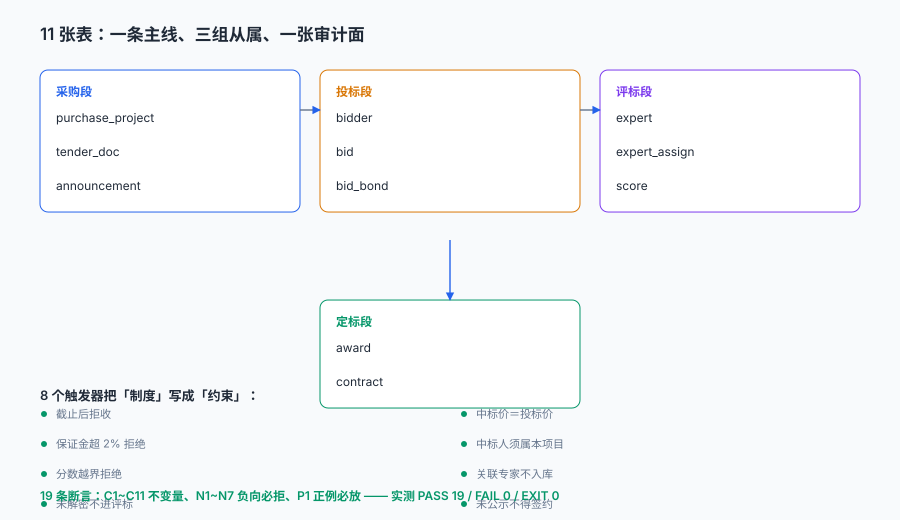

# 实战：11 张表、8 个触发器、19 条断言

前面九页讲了「应该怎样」。这一页只做一件事：**把它写成能被脚本判定的东西**。

判定标准很朴素——如果一条规则不能写成一条 SQL 或一个触发器，那它就还停留在「制度」层面；制度靠人执行，人换了就没了。

::: tip 一句话理解
这一页的产物不是「一套表结构」，是**一份可以每天跑的合规检查**。19 条断言里，11 条是「不变量必须为 0」，7 条是「非法动作必须被拒」，1 条是「合法动作必须放行」——三条腿缺一条，这套设计就没有被真正验证过。
:::

本页判据族 `BTX-A` ~ `BTX-H`，共 8 条。

## 一、11 张表怎么分的



| 簇 | 表 | 职责 |
| --- | --- | --- |
| 采购段 | `purchase_project` / `tender_doc` / `announcement` | 定规则、定时间、定资格 |
| 投标段 | `bidder` / `bid` / `bid_bond` | 谁投、投了什么、钱到没到 |
| 评标段 | `expert` / `expert_assign` / `score` | 谁评、有没有回避、打了多少分 |
| 定标段 | `award` / `contract` | 谁中、多少钱签 |

四个簇之间是**单向依赖**：后一段引用前一段，前一段不引用后一段。这条约束看起来平淡，它保证的是「任何一段的数据都能独立重放」——采购段的数据不需要投标段就能算出「这个项目该不该公开招标」。

```sql
CREATE TABLE purchase_project (
  project_id TEXT PRIMARY KEY, name TEXT NOT NULL,
  category TEXT NOT NULL, estimate REAL NOT NULL CHECK (estimate > 0),
  method TEXT NOT NULL CHECK (method IN ('公开招标','邀请招标','竞争性磋商','单一来源')),
  limit_amount REAL NOT NULL, deadline TEXT NOT NULL);

CREATE TABLE bid (
  bid_id TEXT PRIMARY KEY,
  project_id TEXT NOT NULL REFERENCES purchase_project,
  bidder_id TEXT NOT NULL REFERENCES bidder,
  submitted_at TEXT NOT NULL, price REAL NOT NULL CHECK (price > 0),
  decrypt_ok INTEGER NOT NULL DEFAULT 1,
  doc_mac TEXT, doc_creator TEXT,
  UNIQUE (project_id, bidder_id));          -- 同一投标人只能投一次

CREATE TABLE bid_bond (
  bond_id TEXT PRIMARY KEY, bid_id TEXT NOT NULL UNIQUE REFERENCES bid,
  amount REAL NOT NULL CHECK (amount > 0),
  paid_at TEXT NOT NULL, refunded_at TEXT);

CREATE TABLE award (
  project_id TEXT PRIMARY KEY REFERENCES purchase_project,
  winner_bid_id TEXT NOT NULL REFERENCES bid, award_price REAL NOT NULL,
  public_from TEXT NOT NULL, public_to TEXT NOT NULL);
```

完整 11 张表的 DDL 在附录脚本里，这里只挑三张说明设计意图：

- **`bid` 的 `UNIQUE(project_id, bidder_id)`** 不只是防重复，它同时是「同一投标人只能投一次」这条规则的执行点——没有它，接口层的判重会在并发下失败。
- **`bid_bond` 的 `UNIQUE(bid_id)`** 把「一份投标一份保证金」写进了结构，而不是靠业务代码保证。
- **`award.project_id` 是主键**，一个项目只能定标一次。想顺延第二候选人，必须先删掉或作废原记录——这个动作会被审计看到。

## 二、8 个触发器：把制度写成约束

| 触发器 | 挡住什么 | 对应条款 |
| --- | --- | --- |
| `trg_bid_after_deadline` | 截止后递交 | 条例第三十六条 |
| `trg_bond_over_cap` | 保证金超 2% 或超 80 万 | 条例第二十六条 |
| `trg_score_range` | 分数越界 | 评分办法 |
| `trg_score_needs_decrypt` | 未解密进入评标 | 开标规则 |
| `trg_award_price_mismatch` | 中标价 ≠ 投标价 | 招标投标法第四十六条 |
| `trg_award_winner_in_project` | 中标人不属于本项目 | 基本约束 |
| `trg_expert_conflict` | 关联专家入库 | 条例第四十六条 |
| `trg_contract_requires_publicity` | 未公示满 3 日就签约 | 条例第五十四条 |

两个触发器的写法值得展开。

**保证金上限：两条规则压成一个 `MIN`。**

```sql
CREATE TRIGGER trg_bond_over_cap BEFORE INSERT ON bid_bond
WHEN NEW.amount > MIN(0.02 * (SELECT estimate FROM purchase_project p
        JOIN bid b ON b.project_id = p.project_id WHERE b.bid_id = NEW.bid_id), 800000)
BEGIN SELECT RAISE(ABORT, 'BOND_OVER_CAP'); END;
```

写成一个 `MIN` 而不是两个 `WHEN` 分支，是因为「2% 与 80 万取小」本身就是一条规则。分成两个分支时，很容易写成「超过 2% 拒绝 或 超过 80 万拒绝」，那是**或**，会误拒所有超过 80 万但不到 2% 的合法小额标。

**签约前必须有公示：用 `NOT EXISTS` 表达前置条件。**

```sql
CREATE TRIGGER trg_contract_requires_publicity BEFORE INSERT ON contract
WHEN NOT EXISTS (
  SELECT 1 FROM award WHERE project_id = NEW.project_id
    AND julianday(public_to) - julianday(public_from) >= 3)
BEGIN SELECT RAISE(ABORT, 'NO_PUBLICITY_3D'); END;
```

`WHEN NOT EXISTS (...)` 这个形状可以套用到所有「A 之前必须先有 B」的约束上：合同前要有公示、付款前要有验收、发货前要有出库单。

## 三、19 条断言：三种腿

| 组 | 条数 | 判什么 | 失败意味着 |
| --- | --- | --- | --- |
| C（不变量） | 11 | 数据里不该出现的状态数量为 0 | 已经有脏数据 |
| N（负向） | 7 | 非法动作必须被拒 | 约束没生效 |
| P（正例） | 1 | 合法动作必须放行 | 约束写过头了 |

P 组只有一条，但它不可省：**只测「该拒的拒了」，不测「该放的放了」，很容易把系统写成谁都进不来。**

### C 组：不变量

```sql
-- C1 参与投标家数 ≥3
SELECT COUNT(*) FROM (SELECT project_id FROM bid GROUP BY project_id HAVING COUNT(*) < 3);
-- C2 保证金不超 2% 且不超 80 万
SELECT COUNT(*) FROM bid_bond bn JOIN bid b ON b.bid_id=bn.bid_id
  JOIN purchase_project p ON p.project_id=b.project_id
 WHERE bn.amount > MIN(0.02*p.estimate, 800000);
-- C6 已签约项目的公示 ≥3 日
SELECT COUNT(*) FROM award a JOIN contract c ON c.project_id=a.project_id
 WHERE julianday(a.public_to)-julianday(a.public_from) < 3;
-- C11 技术经济专家不少于 2/3
SELECT COUNT(*) FROM (
  SELECT a.project_id, SUM(CASE WHEN e.major='技术经济' THEN 1 ELSE 0 END)*3.0/COUNT(*) r
    FROM expert_assign a JOIN expert e ON e.expert_id=a.expert_id
   GROUP BY a.project_id HAVING r < 2);
```

### N 组：负向用例

```python
def must_fail(name, sql, *a):
    try:
        db.execute(sql, *a); db.commit()
        check(name, False, "(未拦住)")
    except (sqlite3.IntegrityError, sqlite3.OperationalError) as e:
        db.rollback(); check(name, True, f"→ {e}")

must_fail("N1 截止后递交被拒",
          "INSERT INTO bid VALUES('BDX','P-2026-001','B0','2026-11-20 09:31:00',1,1,'M0','U0')")
must_fail("N5 未公示满 3 日签合同被拒",
          "INSERT INTO contract VALUES('CTX','P-2026-002',800000,'2026-11-27 10:00:00')")
```

### 运行结果

```text
PASS C1 参与投标家数 ≥3
PASS C2 保证金不超 2% 且不超 80 万
PASS C3 中标价 = 中标人投标价
PASS C4 评标专家 ≥5 且为单数
PASS C5 同一专家不重复入库
PASS C6 已签约项目的公示 ≥3 日
PASS C7 合同价与中标价偏差 ≤1.5%（有据可查）
PASS C8 评分全部在值域内
PASS C9 进入评标的投标均已解密
PASS C11 技术经济专家不少于 2/3
PASS C10 公告期折算 ≥5 个工作日
PASS N1 截止后递交被拒 → BID_AFTER_DEADLINE
PASS N2 保证金超 2% 被拒 → BOND_OVER_CAP
PASS N3 同一投标人重复投标被拒 → bid.project_id, bid.bidder_id
PASS N4 分数越界被拒 → SCORE_OUT_OF_RANGE
PASS N5 未公示满 3 日签合同被拒 → NO_PUBLICITY_3D
PASS N6 关联专家入库被拒 → EXPERT_CONFLICT
PASS N7 未解密投标进入评标被拒 → BID_NOT_DECRYPTED
PASS P1 公示满 3 日后签合同放行 → CT1

表 11 张 / 触发器 8 个 / 投标 9 份 / 评分 25 条
PASS 19 / FAIL 0
EXIT=0
```

## 四、写这套东西时踩的两个坑

第一个坑：**保证金基数用错了。**

初版按「投标报价的 2%」算保证金，结果触发器立刻拦住了自己构造的正例——因为中标候选人的报价是 480 万，2% 是 9.6 万，而我按估算价 500 万的 2%（10 万）录入。

正确口径是**估算价的 2%**（条例第二十六条）。这个坑很典型：**规则没写错，但基数选错了，两者都「看起来对」**。所以 `bid_bond` 表里不该存一个算好的金额就完事，最好同时存 `base_amount`（基数是估算价）与 `rate`（2%），让复算成为可能。

第二个坑：**不变量写成了「全局」，把负向用例的数据也算进去了。**

`C6 中标公示 ≥3 日` 最初写成「所有 award 的公示期都 ≥3 日」，结果永远失败——因为 N5 的负向用例**故意**造了一条公示 1 天的 award。

正确写法是把不变量限定在「已经产生后果的范围」内：

```sql
-- 错：所有 award 都要满 3 日
SELECT COUNT(*) FROM award WHERE julianday(public_to)-julianday(public_from) < 3;
-- 对：只有「已经签约」的项目才要求公示满 3 日
SELECT COUNT(*) FROM award a JOIN contract c ON c.project_id=a.project_id
 WHERE julianday(a.public_to)-julianday(a.public_from) < 3;
```

这条教训可以推广：**不变量要绑在「后果」上，不要绑在「记录」上。** 一条公示不足 3 日但尚未签约的 award，是「还没出事」，不是「已经出错」；而一旦签了合同，它就变成了不可逆的违规。

## 五、这套断言怎么用

| 场景 | 跑哪几条 | 频率 |
| --- | --- | --- |
| 每次发版前 | 全部 19 条 | 每次 |
| 每日巡检 | C1、C2、C6、C10、C11 | 每天 |
| 项目结项前 | C3、C7、C10、C11 + 人工复核 | 每项目 |
| 投诉举证 | 该项目相关的 C 组 + 对应 N 组的约束定义 | 按需 |

「每日巡检」这一档是这套设计真正的价值：**它让「合规」从一次性验收变成了持续状态**。19 条断言里如果有任何一条从 0 变成 1，说明当天有一笔操作越过了红线——而不是等到年度审计才发现。

## 六、本页判据

| 判据 | 断言 | 验证方式 |
| --- | --- | --- |
| `BTX-A` | 11 张表全部建成 | `sqlite_master` 里表数为 11 |
| `BTX-B` | 8 个触发器全部生效 | 触发器数为 8 |
| `BTX-C` | 每条 C 组断言结果为 0 | 11 条查询全部返回 0 |
| `BTX-D` | 每条 N 组用例都被拒绝 | 7 条 `must_fail` 全部 PASS |
| `BTX-E` | 正例不被误拒 | P1 插入成功 |
| `BTX-F` | 保证金基数可复算 | 表里有基数与费率，或可由估算价推出 |
| `BTX-G` | 不变量绑定后果而非记录 | C6 类断言都带 `JOIN contract` 之类的前置 |
| `BTX-H` | 断言可一键运行且退出码可判 | 脚本 `EXIT=0` 表示全绿 |

## 验证方式

```shell
# 1. 建表与触发器数量（期望 11 与 8）
sqlite3 bt.db "select type, count(*) from sqlite_master
               where type in ('table','trigger') and name not like 'sqlite_%' group by type;"

# 2. 全部断言（把附录脚本存为 bt_practice.py 后运行）
python3 bt_practice.py; echo "EXIT=$?"
# 期望：PASS 19 / FAIL 0 / EXIT=0

# 3. 单独验一条最容易被写松的不变量
sqlite3 bt.db "select count(*) from award a join contract c on c.project_id=a.project_id
               where julianday(a.public_to)-julianday(a.public_from) < 3;"
# 期望 0
```

第 2 步的 `EXIT` 是关键：**判据要能被 CI 判定，就不能只输出「通过」两个字，必须有退出码。**

## 参考资料

- 《中华人民共和国招标投标法》第四十六条：自中标通知书发出之日起三十日内订立书面合同，不得再行订立背离合同实质性内容的其他协议。
- 《中华人民共和国招标投标法实施条例》第二十六条（保证金 2% 上限）、第四十四条（投标人少于 3 个不得开标）、第五十四条（公示不少于 3 日）、第五十七条（签约后 5 日内退还保证金及利息）。
- SQLite 官方文档《CREATE TRIGGER》：`BEFORE INSERT ... WHEN ... BEGIN SELECT RAISE(ABORT, ...); END;` 的语义与 `RAISE` 三种级别（`IGNORE` / `ABORT` / `FAIL` / `ROLLBACK`）。
- SQLite 官方文档《Date And Time Functions》：`julianday()` 返回儒略日浮点数，两值相减即天数差，是本册所有「期限够不够」判定的基础。
- 与本页相邻：[总览](../Overview/index.md)、[评标、专家与评分](../Evaluation/index.md)、[定标、公示与合同](../Award/index.md)。
