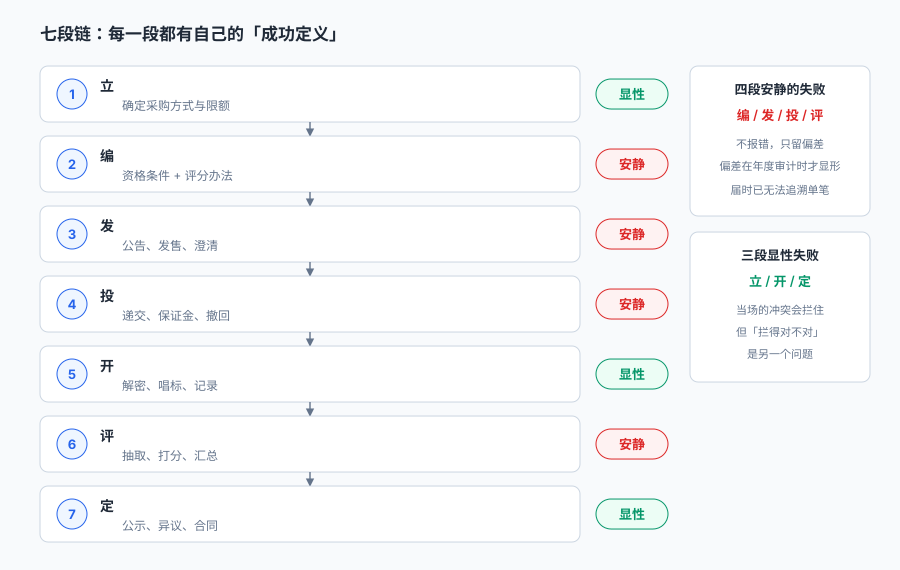
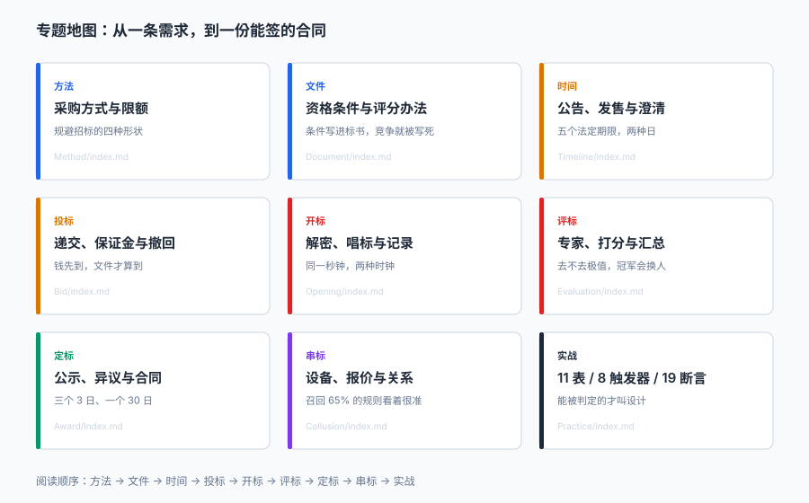

# 招投标与电子采购交易工程

<p style="text-align:center;"></p>

一个 480 万元的机房改造项目，从立项到签合同走了 47 天：公告挂了 7 天，招标文件卖了 5 天，投标人交了 5 份标书，专家打了 5 轮分，中标候选人公示 3 天，合同签了。**每一个动作都有记录，每一个期限都在范围内，监管平台上显示「流程完整」。**

但如果有人问三个问题——**为什么是这 5 家来投、为什么是这家赢、为什么这个价能签**——系统给不出答案。它只存了结果：5 份标书、一张评分汇总表、一份合同。中间那 46 天里，资格条件是怎么写的、澄清改了什么、评分为什么是这个权重、专家是怎么抽的，全散在附件与邮件里。

::: tip 一句话理解
招投标系统的产物不是「一份合同」，是**一条能被独立复核的竞争过程**：谁被允许参加、凭什么规则比、谁按什么口径算的分、谁在什么时点做的决定。四件事里任何一件没有落库，这场招标就只是一次「有记录的采购」。
:::

## 一、这个专题讲什么

从「这个项目要不要招标」到「合同签完、保证金退完」，一次采购要走七段：

| 段 | 这一段在做什么 | 产物 | 失败是否安静 |
| --- | --- | --- | --- |
| ① 立 | 定采购方式、拆标段、算限额 | `purchase_project` | 显性（方式错了审计会问） |
| ② 编 | 写资格条件、评分办法、实质性条款 | `tender_doc` | **安静**（条件写窄了，下一个流标的项目才显形） |
| ③ 发 | 发公告、发售文件、发澄清 | `announcement` | **安静**（期限差一天，没人会报错） |
| ④ 投 | 递交、缴保证金、撤回 | `bid` + `bid_bond` | **安静**（保证金没到账，标书照样进库） |
| ⑤ 开 | 解密、唱标、做记录 | `bid.decrypt_ok` | 显性（解不开就当場看见） |
| ⑥ 评 | 抽专家、打分、汇总、复核 | `score` | **安静**（去不去极值，冠军会换人） |
| ⑦ 定 | 公示、处理异议、签合同、退保证金 | `award` + `contract` | 显性（公示期不够会被投诉） |



七段里**四段的失败是安静的**。它们的共同形状是：**系统返回了一个合法结果，但那个结果不成立**——资格条件把 40 家筛成 3.5 家，系统显示「资格审查通过 3 家」，符合「不少于 3 家」的规则；澄清晚发了 6 天，系统显示「已通知全部潜在投标人」，符合「已发出」的规则；评分用了算术平均而不是去极值，系统显示「汇总完成」，符合「有总分」的规则。

## 二、三个「公平」

招投标的合法性最终落在三个「公平」上，而这三个词在系统里各自对应一组**可判定的字段**，不是三句口号：

| 公平 | 它到底在说什么 | 系统里靠什么成立 | 缺失后的典型症状 |
| --- | --- | --- | --- |
| 机会公平 | 该知道的都知道了，该能投的都能投 | 公告期、发售期、澄清送达时间、资格条件 | 潜在投标人 40 家变 3.5 家，流标率 33% |
| 规则公平 | 同一套尺子量所有人，且尺子在开标前就固定 | 评分办法版本 + 权重 + 客观分口径 | 同一份标书换一种加法就换一个中标人（4.33%） |
| 结果公平 | 算出来的第一就是第一，改动要留痕 | 评分原始表 + 汇总口径 + 复核记录 + 公示 | 中标价与合同价差 12.67%，且差额无归因 |

三个公平不是并列关系，是**串联**：机会不公平的时候，规则再公平也只是一场小范围比赛；规则不公平的时候，结果再「合规」也无法复核。

## 三、三个「多少钱」

一个招投标项目里有三组金额，每一组都有自己的时间轴与责任人，混在一起就会出现「账上有钱、账外有账」：

| 口径 | 什么时候产生 | 谁在看 | 写错了会怎样 |
| --- | --- | --- | --- |
| 估算价 `estimate` | 立项时 | 采购人、财政 | 保证金基数错、限额判定错 |
| 中标价 `award_price` | 定标时 | 中标人、审计 | 与投标函不一致即废标风险 |
| 合同价 `contract.amount` | 签约时 | 财务、履约 | 与中标价差 12.67% 且无归因 |

本机实测：300 个项目里 **38 个（12.67%）合同价与中标价不一致，合计差 −290,513.61 元**。差额本身不大，但**没有一个项目记录了差额来源**——是暂列金额扣减、还是让利、还是录入错误，事后无法区分。

::: danger 三件事必须写进数据模型，不能留给「附件里说明」
1. **资格条件必须是结构化字段**，不是一段 Word：写成 `qual_json` 之后才能统计「这条条件筛掉了多少人」，也才能在投诉时回答「这条条件与合同履行有关吗」。
2. **评分必须落三样：原始分、权重、汇总口径**。只落总分的评分表，无法回答「换个汇总方法会不会换冠军」——而本机 4.33% 的项目确实会换。
3. **每一个法定期限都要落「起算点 + 计算口径（日 / 工作日）」**：只落一个截止日期，等于把「20 日」和「20 个工作日」的差别藏进了字符串里。
:::

## 四、五种「看起来都对」的失败

这五种失败在本库里反复出现，每一种都能通过「流程完整」的检查：

| 失败 | 看起来对在哪 | 实际错在哪 | 本机读数 |
| --- | --- | --- | --- |
| 化整为零 | 每包都没到限额，逐笔看全合规 | 同一项目可合并的采购被切开 | 组级召回 91.11%，窗口精度 63.59% |
| 条件写窄 | 资格审查「通过 3 家，符合规定」 | 3 家是筛出来的，不是自然形成的 | 通过率 8.88%，流标 33.00% |
| 期限按自然日 | 公告「挂了 5 天」 | 折算工作日只有 3 天 | 25.60% 的项目不足 5 个工作日 |
| 时钟用客户端 | 投标人「显示 09:29:58 提交」 | 服务器已过 09:30:00 | 临界 128 笔中 14 笔误判（10.94%） |
| 汇总用算术平均 | 「所有专家一视同仁」 | 一个畸高分就能改写冠军 | 第一名变化 4.33% |

## 五、专题地图



| 阶段 | 页面 | 一句话 |
| --- | --- | --- |
| 立 | [采购方式与限额](Method/index.md) | 规避招标的四种形状，只有一种会被系统拦住 |
| 编 | [招标文件与资格条件](Document/index.md) | 条件写进标书的那一刻，竞争范围就定了 |
| 发 | [公告、发售与澄清](Timeline/index.md) | 五个法定期限，落在两种「日」上 |
| 投 | [投标与保证金](Bid/index.md) | 钱没到账，标书就不算到 |
| 开 | [开标与解密](Opening/index.md) | 同一秒钟，两台机器给出两个答案 |
| 评 | [评标、专家与评分](Evaluation/index.md) | 去不去极值，冠军会换人 |
| 定 | [定标、公示与合同](Award/index.md) | 三个 3 日、一个 30 日，中间还有一次回头 |
| 查 | [围标串标识别](Collusion/index.md) | 召回 65% 的规则，看起来最准 |
| 落地 | [实战：11 表 / 8 触发器 / 19 断言](Practice/index.md) | 能被脚本判定的，才叫设计 |

## 六、和相邻专题的分工

本册只讲「一次采购怎么被组织成一场可复核的竞争」。相邻主题已经讲透的部分，这里不重复：

| 相邻专题 | 它讲什么 | 本专题不重复讲 |
| --- | --- | --- |
| [采购到付款](../ProcureToPay/Overview/index.md) | 请购、订单、收货、三单匹配 | 招标**之前的采购方式判定**与竞争过程 |
| [供应商协同](../SupplierCollaboration/Overview/index.md) | 供应商门户、价格协议、对账 | 供应商的**资格准入**与黑名单 |
| [合同版本演进](../ContractEvolution/index.md) | 条款版本、兼容、废弃 | 中标后的**合同一致性**只讲与中标价的关系 |
| [审批流引擎](../WorkflowEngine/ApprovalFlow/index.md) | 流程定义、会签、加签 | 采购方式变更的审批只讲**阈值与留痕** |
| [权限与授权](../Auth/Authorization/index.md) | 角色、数据权限、越权检测 | 评标区的**物理隔离**只在解密页提一句 |
| [全面预算](../Budgeting/Overview/index.md) | 预算编制、占用、执行 | 招标只讲**估算价与限额**的关系 |
| [会计分录](../Ledger/DoubleEntry/index.md) | 借贷、期间、结转 | 保证金只讲**收退时点与利息** |
| [固定资产](../FixedAsset/Overview/index.md) | 卡片、折旧、盘点 | 招标形成资产只讲**合同价入账口径** |
| [质量管理](../QualityManagement/Overview/index.md) | 抽样、判定、CAPA | 评标里的「客观分复核」只讲**证书计数** |
| [主数据与标准](../../DB/DataGovernance/StandardsMasterData/index.md) | 编码标准、主数据治理 | 采购品目只讲**能不能合并**这一件事 |

## 七、版本组织：为什么不建版本目录

招投标侧最常见的疑问是「电子招投标和纸质招投标，文档是不是要分一代」。本册**不建 `BiddingTender/V1` 这类目录**，三条理由：

1. **换代的是载体，判据一字没变。** 纸质标书、电子标书、区块链存证，变的只是 `bid.media` 的枚举值；「资格条件要可复核、期限要够、评分要能复算、公示要留痕」这四条从 2000 年《招标投标法》施行起就成立。
2. **并存差异是辖区与行业，不是代际。** 工程、货物、服务、政府采购、国企采购的差别在**限额标准与监督部门**，不在链路本身。用版本目录去装「政府采购」，会把适用范围问题伪装成代码分支问题。
3. **真正需要版本目录的是「同一份代码两套写法」。** 本库已有先例：[Spring5](../Java/Frame/Spring/Spring5/index.md) / [Spring6](../Java/Frame/Spring/Spring6/index.md)、[Vue2](../../Frontend/Frame/Vue/Vue2/index.md) / [Vue3](../../Frontend/Frame/Vue/Vue3/index.md)——同一框架两代 API 并存，旧版必须原样保留并标注维护状态。招投标不是这种情形：一套写法要接不同辖区，差异落在限额表与监督节点上。

::: info 旧规则版本的处置口径
遇到仍在执行旧版限额标准或旧版评标办法的项目，**不新建章节**，在[采购方式与限额](Method/index.md)的限额对照表里加一行，标注「仅存量项目适用，新立项不再采用」。这条口径与 Spring5 / Vue2 的处理一致：旧内容保留、标注状态、不覆盖。
:::

## 八、建议阅读顺序

1. 先读[总览：七段链与三个「公平」](Overview/index.md)——把「可复核的竞争过程」这个概念立起来。
2. 再读[采购方式与限额](Method/index.md)与[招标文件与资格条件](Document/index.md)——这两页决定「谁能进来」。
3. 然后是两段「时间与钱」的：[公告、发售与澄清](Timeline/index.md)、[投标与保证金](Bid/index.md)。
4. 接着是两段「当场出结果」的：[开标与解密](Opening/index.md)、[评标、专家与评分](Evaluation/index.md)。
5. 最后读[定标、公示与合同](Award/index.md)与[围标串标识别](Collusion/index.md)，按[实战](Practice/index.md)把 11 张表建出来，跑一遍 19 条断言。

## 九、本册的读数从哪来

所有数字来自一台 16 GB 笔记本上的 SQLite 3.50.4 / Python 3.13，种子 `20261105`，规模是 1,351 条采购需求、500 个项目的时间轴、1,800 份投标、300 个项目的评分、3,000 份投标文件的串标识别，**不是生产数据，也不是压测结论**。

| 读数 | 值 | 出现在 |
| --- | --- | --- |
| 达公开招标标准 / 未公开 | 531 条（39.30%）/ 69 条（12.99%） | [方法](Method/index.md) |
| 拆分识别 | 召回 91.11%、窗口精度 63.59% | [方法](Method/index.md) |
| 资格条件通过率 | 8.88% → 43.75%（4.93 倍） | [文件](Document/index.md) |
| 流标率 | 33.00% → 0.00% | [文件](Document/index.md) |
| 期限不足 | 25.60% / 12.60% / 26.40% | [时间](Timeline/index.md) |
| 保证金逾期退还 | 23.28%，7,447.75 万元·天 | [投标](Bid/index.md) |
| 临界投标误判 | 14 / 128（10.94%） | [开标](Opening/index.md) |
| 汇总口径换冠军 | 13 / 300（4.33%） | [评标](Evaluation/index.md) |
| 中标价 ≠ 合同价 | 38 / 300（12.67%） | [定标](Award/index.md) |
| 串标组合规则 | 召回 98.8%、精度 100% | [串标](Collusion/index.md) |
| 断言通过 | 19 / 19，退出码 0 | [实战](Practice/index.md) |

::: warning 这些数字不能直接当业务基线
单机 SQLite 与真实交易平台的并发、专家库规模都不是一回事。本文用它们判断**方向和量级**（例如「期限按自然日与按工作日不是一回事」「汇总口径会改变冠军」），不用它们承诺流标率或节资率。凡涉及法规的结论，都以条文原文为准并在页内标注条号。
:::

## 验证方式

```shell
# 1. 目录与配图齐全（11 页 + 12 个资源）
find docs/Backend/BiddingTender -name "index.md" | wc -l   # 期望 11
ls docs/Backend/BiddingTender/assets | wc -l               # 期望 12

# 2. 判据族不撞号（应只输出本册 10 个前缀）
grep -rho "BT[A-Z]-[A-H]" docs/Backend/BiddingTender | cut -c1-3 | sort -u

# 3. 链接与配图全部可解析（在仓库根目录）
pnpm docs:build
```

第 2 步的输出应当是 `BTB BTD BTE BTK BTL BTM BTO BTS BTW BTX` 十个前缀；少一个说明有页面漏写判据，多一个说明撞了别人的族名。

## 参考资料

- 《中华人民共和国招标投标法》（2017 年修正）第二十四条（提交投标文件不少于二十日）、第三十四条（开标与截止同一时间）、第三十七条（评标委员会五人以上单数、技术经济专家不少于三分之二）、第四十六条（三十日内订立合同）。
- 《中华人民共和国招标投标法实施条例》（国务院令第 613 号，2019 年修订）第十六条（发售期不少于五日）、第二十一条（澄清修改十五日前）、第二十六条（投标保证金不超过估算价 2%）、第四十四条（投标人少于三个不得开标）、第五十四条（公示不少于三日）、第五十七条（签约后五日内退还保证金及利息）。
- 《必须招标的工程项目规定》（国家发展改革委令第 16 号）第五条：施工 400 万元以上、重要设备材料 200 万元以上、勘察设计监理 100 万元以上必须招标。
- GB/T 7408—2005《数据元和交换格式 信息交换 日期和时间表示法》：公告期与截止时间的表示格式；本册要求期限同时落「起算点」与「日 / 工作日」口径，正是为应对其中日期与时间间隔的表示差异。
- 与本册相邻：[采购到付款](../ProcureToPay/Overview/index.md)、[供应商协同](../SupplierCollaboration/Overview/index.md)、[合同版本演进](../ContractEvolution/index.md)。
