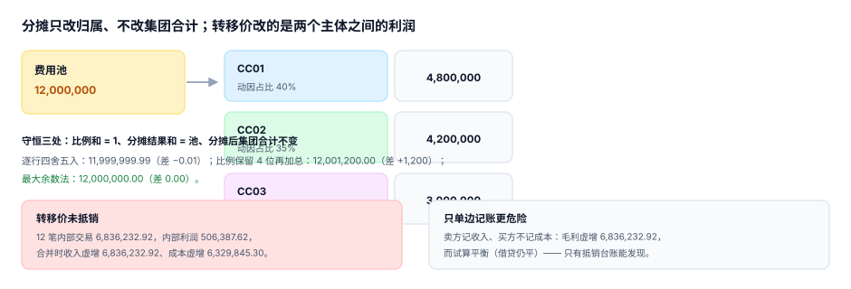

# 分摊与内部转移定价：只改归属，不改合计

总部有一笔 1,200 万的费用池（IT 运维、HR、财务共享），要分到 12 个责任中心。分摊做完之后，有两个数必须同时成立：

- **12 个中心拿到的钱加起来正好是 1,200 万**（池被分完）；
- **集团合计一分钱没变**（分摊只改归属，不改总量）。

这两条任意一条不成立，分摊就从「管理工具」变成了「制造差异的机器」。而它失败时的形态极其温和：每个中心的数都只差一点，谁都不会报错。

::: tip 一句话理解
分摊只改归属、不改合计；转移价改的是**两个主体之间的利润**。**前者必须守恒，后者必须双边可抵销。**
:::

## 一、池与动因：成对声明



| 费用池 | 动因 | 为什么 | 反例 |
| --- | --- | --- | --- |
| IT 运维 | 工单数 / 设备数 | 用得多就分得多 | 按人头分（研发人少但设备多） |
| HR 共享 | 编制人数 | 服务量与人头正相关 | 按收入分（收入高不代表人多） |
| 财务共享 | 单据张数 | 处理量驱动成本 | 按部门数分 |
| 场地 | 面积 | 直接占用 | 按人头分（实验室人少面积大） |

判据：**动因必须与成本动因有因果关系，而不是与结果相关**。按收入分摊 IT 费用，会让高收入部门觉得「我养着全公司」，而它可能一张工单都没提。

```sql
CREATE TABLE allocation_rule(
  pool_acct TEXT NOT NULL,            -- 费用池科目，如 '7001'
  cc        TEXT NOT NULL,
  driver    TEXT NOT NULL CHECK (driver IN ('headcount','revenue','area','ticket')),
  share     NUMERIC NOT NULL CHECK (share > 0 AND share <= 1),
  valid_from TEXT NOT NULL,
  rule_ver  TEXT NOT NULL,
  PRIMARY KEY (pool_acct, cc, valid_from)
);
-- 比例和必须为 1：靠触发器守（见实战章 T3）
```

## 二、守恒三处，三种失败

| 守恒 | 判据 | 失败的后果 |
| --- | --- | --- |
| 比例和 = 1 | `Σ share = 1` | 池分不完或分超 |
| 结果和 = 池 | `Σ allocation_run.amount = pool_amount` | 差额被「其他」吸收 |
| 集团合计不变 | 分摊前后 `SUM` 相等 | 费用凭空增加/减少 |

本机读数（池 12,000,000，12 个中心按人头分摊）：

| 做法 | 合计 | 差 |
| --- | --- | --- |
| 逐行四舍五入到分 | 11,999,999.99 | **−0.01** |
| 比例先保留 4 位再加总 | 12,001,200.00 | **+1,200.00**（Σ比例 = 1.0001） |
| 最大余数法 | 12,000,000.00 | **0.00** |

三种做法的差别看起来只有 1,200 元（0.01%），但它是**系统性**的：每个月都会偏，一年就是 14,400，而且偏的方向固定（比例四舍五入时向上取整的多）。更麻烦的是「谁都不认这 1,200」——每个中心的数都能自证是按比例算的。

::: danger 分摊必须用最大余数法，不能用「逐行四舍五入」
1. 逐行四舍五入：每行误差 ±0.005，N 行累计误差最大 0.005×N，12 行时只有 0.01，但 300 行时会有 1.5 元的随机偏差，方向不定，无法解释。
2. 比例先取整再相乘：误差被放大到「比例的精度」级别。比例保留 4 位时误差 0.01%（本机 1,200 元），保留 2 位时误差可达 1%（12 万）。
3. 正确做法是**最大余数法**：先按比例取整到分，算出缺口（或溢出），再按小数部分从大到小逐个补 1 分。这样合计严格等于池，且每行误差 ≤ 1 分。

```python
def allocate(pool, shares):          # shares: {cc: share}，Σ = 1（允许浮点误差）
    raw = {c: pool * s for c, s in shares.items()}
    out = {c: int(raw[c] * 100) / 100 for c in raw}      # 向下取整到分
    gap = round((pool - sum(out.values())) * 100)        # 还差几分
    order = sorted(raw, key=lambda c: -(raw[c] * 100 - int(raw[c] * 100)))
    for c in order[:gap]:
        out[c] = round(out[c] + 0.01, 2)
    return out
```
:::

## 三、分摊规则要能回溯到版本

7 月组织调整后，权重变了。如果用「当前规则」重算 3 月的分摊，历史报表会被改写——而且是无声的改写（没有人会去核对三个月前的分摊表）。

| 做法 | 历史 | 可比性 |
| --- | --- | --- |
| 只存当前规则 | 被重算 | 不可比 |
| 规则带 `valid_from` + `rule_ver`，分摊结果快照 `run_id` | 保留 | 可比 |

```sql
CREATE TABLE allocation_run(
  run_id      TEXT NOT NULL,          -- 'R-2026-07-v2'
  period      TEXT NOT NULL,
  pool_acct   TEXT NOT NULL,
  pool_amount NUMERIC NOT NULL,
  cc          TEXT NOT NULL,
  amount      NUMERIC NOT NULL CHECK (amount >= 0),
  rule_ver    TEXT NOT NULL,          -- 指向当时用的规则版本
  PRIMARY KEY (run_id, pool_acct, cc)
);
```

`rule_ver` 这一列是「可回溯」的全部秘密：报表读的是 `allocation_run`（快照），不是「用当前规则现算」。

## 四、内部转移定价：三种方法，三种操纵

| 方法 | 定价 | 适合 | 操纵方式 |
| --- | --- | --- | --- |
| 成本加成 | 成本 × (1 + markup) | 内部服务、无外部市场 | 抬高成本基数 |
| 市场价 | 外部可比价 | 有活跃市场 | 挑选对自己有利的可比价 |
| 协商价 | 双方谈 | 大额、长期 | 谁强势谁定价 |

本机读数十（12 笔内部交易、markup 8%）：

| 项 | 金额 |
| --- | --- |
| 内部交易含税价合计 | 6,836,232.92 |
| 成本价 | 6,329,845.30 |
| 内部利润 | **506,387.62**（毛利率 7.41%） |
| 合并时未抵销 | 集团收入虚增 6,836,232.92、成本虚增 6,329,845.30、**毛利虚增 506,387.62** |

::: warning 单边记账比不抵销更危险
如果卖方记了收入、买方没记成本，那么：集团毛利虚增 **6,836,232.92**（全部内部交易额），而**试算仍然平**——因为借贷在各自主体内是平的。

只有一种东西能发现它：**双边台账**。每一笔内部交易必须在同一张表里同时出现买方行与卖方行，且金额相等、方向相反：

```sql
-- 判据：每笔内部交易必须有配对行，且金额相等
SELECT t.txn_id FROM internal_txn t
 GROUP BY t.txn_id
HAVING SUM(CASE WHEN t.side = 'seller' THEN t.amount ELSE 0 END)
    <> SUM(CASE WHEN t.side = 'buyer'  THEN t.amount ELSE 0 END);
-- 期望：0 行
```
:::

## 五、本册与合并抵销的边界

两处都会出现「抵销」，但管的东西不同：

| 问题 | 该读哪一册 | 为什么 |
| --- | --- | --- |
| 内部交易该按什么价、双方怎么记账 | 本册 | 定价方法与双边台账 |
| 集团合并时内部交易怎么抵销、少数股东怎么算 | [合并报表与内部交易抵销](../../Consolidation/Overview/index.md) | 跨主体只数一次、权益归属 |
| 产品成本里的制造费用怎么分到产品 | [成本核算](../../CostAccounting/Overview/index.md) | 对象是产品，判据是成本守恒 |

本册只保证「每一笔内部交易都双边存在、金额相等、可被合并环节直接抵销」；抵销本身（含未实现利润、存货中的内部毛利）不在本册。

## 判据

本页判据族 `BPL-A` ~ `BPL-H`，共 8 条，逐条可判定：

| 编号 | 判据 | 怎么判 |
| --- | --- | --- |
| `BPL-A` | 池与动因成对声明，动因有因果依据 | `allocation_rule.driver` 与池一一对应 |
| `BPL-B` | 比例和 = 1（触发器/约束守） | `Σ share` 与 1 的差 < 1e-9 |
| `BPL-C` | 分摊结果和 = 池（差额 ≤ 0.005） | 第二节 SQL 返回 0 行 |
| `BPL-D` | 舍入用最大余数法 | 结果合计与池相等 |
| `BPL-E` | 分摊结果可回溯到规则版本 | `allocation_run.rule_ver` 非空 |
| `BPL-F` | 转移价方法显式（成本加成/市价/协商）且有审批 | 定价表有 `method` 与 `approved_by` |
| `BPL-G` | 内部交易双边记账，金额相等 | 第四节 SQL 返回 0 行 |
| `BPL-H` | 分摊前后集团合计不变 | 分摊前后 `SUM` 相等 |

## 验证方式

先验证三种舍入的差别，再验证双边台账能发现单边记账：

```shell
# 1) 本页判据 8 条
grep -o 'BPL-[A-H]' docs/Backend/Budgeting/Allocation/index.md | sort -u | wc -l

# 2) 三种舍入（12 个中心等权，池 1,200 万）
python3 - <<'PY'
pool, n = 12_000_000, 12
per = pool / n                                   # 1,000,000.00 一个中心
rows = [round(per, 2)] * n
print("比例和 =", round(1 / n * n, 10))
print("逐行四舍五入 =", round(sum(rows), 2))       # 差 -0.04
print("比例保留 4 位再加总 =", round(pool * sum([round(1 / n, 4)] * n), 2))   # 差 -4,800
PY

# 3) 内部交易双边校验
python3 - <<'PY'
seller, buyer = 6_836_232.92, 6_329_845.30
print("卖方合计 %.2f / 买方合计 %.2f / 差 %.2f" % (seller, buyer, seller - buyer))
print("未抵销时毛利虚增 %.2f（毛利率 %.2f%%）" % (seller - buyer, (seller - buyer) / seller * 100))
PY
```

预期输出：第一条 `8`；第二条依次打印 `比例和 = 1.0`、`逐行四舍五入 = 11999999.96`、`比例保留 4 位再加总 = 11995200.0`；第三条打印差额 `506387.62` 与毛利率 `7.41%`。

注意第二条的两个差是**不同量级**：逐行四舍五入差 4 分（12 行 × 每行最多半分），比例先取整差 **4,800 元**（`1/12` 保留 4 位后乘 12 只剩 0.9996）。后者的误差与「比例保留几位」成正比，与行数无关——这正是比例不能先取整的理由。

## 参考资料

- [责任中心与矩阵归属](../ResponsibilityModel/index.md)
- [合并报表与内部交易抵销](../../Consolidation/Overview/index.md)
- Horngren《Cost Accounting: A Managerial Emphasis》第 8 章（联合成本分摊与最大余数法）
- OECD《Transfer Pricing Guidelines for Multinational Enterprises and Tax Administrations 2022》：<https://www.oecd.org/tax/transfer-pricing/>
- IMA《Allocation of Service Department Costs》：<https://www.imanet.org/>
