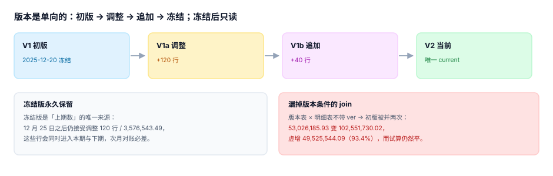

# 审批与版本：版本是单向的，冻结是物理的

审批解决「谁能批多少」，版本解决「批的是哪一版」。这两件事在流程图上通常画成一个方框，在系统里却必须是两套结构：**审批是有序的动作，版本是只增不改的记录**。

它们共同的失败方式是「看起来批过了」：金额按不含税判、拆成五笔绕开二级审批、版本表加了新行但旧行没失效。三种都不报错。

::: tip 一句话理解
审批管的是**这一笔**能不能花，版本管的是**这一年**授权了多少。**混在一起的后果是：批过的那一笔记在了上一版预算里。**
:::

## 一、审批矩阵：三个维度，不是一个阈值

| 维度 | 取值 | 影响什么 |
| --- | --- | --- |
| 金额 | < 50 万 / 50~200 万 / > 200 万 | 审批级次（L1 / L2 / L3） |
| 科目 | 费用类 / 资本类 / 人力类 | 会签部门（财务 / 投资 / HR） |
| 组织 | 成本中心 / 利润中心 / 总部 | 终审人不同 |

只看金额是最常见的简化，代价是资本性支出被当费用批——本机数据里单笔分级分布是 L1 118 笔 / L2 360 笔 / L3 122 笔（600 笔抽样），如果资本类不额外加一道投资委员会，那 122 笔里至少一半会绕过投资评估。

## 二、阈值必须按含税金额判

几乎所有采购系统都在「申请单」上记不含税金额，而审批规则表里写的是「50 万以上需二级审批」。两者一错位，就出现一条**永远抓不到的漏批**：

本机读数（1,500 笔、税率 6%、净额在 38~56 万之间均匀分布）：

| 口径 | 需审批笔数 | 占比 |
| --- | --- | --- |
| 按不含税净额判 | 475 | **31.7%** |
| 含税后才越线（净额 ≤ 50 万、含税 > 50 万） | 245 | **16.3%** |

也就是说，**每 6 笔里就有 1 笔本该二级审批却被免了**。而它在单据上看不出任何异常：净额 48 万，确实没到 50 万。

```sql
-- 判据：含税金额与审批级次必须匹配
SELECT doc_id, amount_net, tax_rate, level
  FROM approval
 WHERE amount_net * (1 + tax_rate) > 500000 AND level < 2;
-- 期望：0 行
```

::: danger 阈值的四个边界条件都要写进规则表
1. **含税还是不含税**：写 `threshold_basis`（`gross`/`net`），不要靠默认值。
2. **单笔还是累计**：同一供应商 30 天内累计超阈值要不要升一级？不写清楚，采购会拆单。
3. **本币还是原币**：外币申请按哪天的汇率折成阈值货币？按申请日，且汇率快照要落库。
4. **变更单是否重新审批**：合同金额上调 40% 属于新决策，必须重新走审批；补录发票不属于。
:::

## 三、拆单：金额拆开，级次就掉下来

一笔 2,400,000 的采购，拆成 5 笔 480,000：

| 项 | 拆单前 | 拆单后 |
| --- | --- | --- |
| 单笔金额 | 2,400,000 | 480,000 × 5 |
| 审批级次 | L3（>200 万） | L1（<50 万） |
| 需要谁批 | 投资委员会 + CFO | 部门负责人 |
| 系统告警 | 无 | 无 |

检测只能靠「同供应商 + 同科目 + 时间窗」的累计：

```sql
-- 30 天窗口内同供应商同科目累计超阈值 → 命中拆单嫌疑
SELECT supplier_id, acct,
       COUNT(*) AS docs,
       SUM(amount_gross) AS total,
       MIN(doc_date) AS first_date, MAX(doc_date) AS last_date
  FROM approval
 WHERE doc_date >= date('2026-07-01', '-30 day')
 GROUP BY supplier_id, acct
HAVING SUM(amount_gross) > 500000 AND COUNT(*) >= 2
 ORDER BY total DESC;
```

这条查询会有误报（真实的多次小额采购），所以它产出的是**嫌疑清单**，不是拦截。拦截只能拦「同一需求单拆成多张订单」这种有共同需求单号的情况。

## 四、版本是单向的



| 版本 | 状态 | 允许动作 |
| --- | --- | --- |
| V1 初版 | `frozen` | 只读，永久保留 |
| V1a 调整 | `frozen` | 只读（调整也是历史） |
| V1b 追加 | `frozen` | 只读 |
| V2 当前 | `current` | 唯一的可写版本 |

三条约束必须在数据库层，不能只在应用层：

```sql
-- ① 当前版本唯一
CREATE UNIQUE INDEX uq_version_current
    ON budget_version(fiscal_year) WHERE state = 'current';

-- ② 冻结版拒写（触发器，绕过应用也拦得住）
CREATE TRIGGER trg_frozen_readonly
BEFORE INSERT ON budget_line
WHEN (SELECT state FROM budget_version WHERE ver = NEW.ver) = 'frozen'
BEGIN
  SELECT RAISE(ABORT, 'budget_version is frozen');
END;
```

`WHERE state = 'current'` 这个部分唯一索引是关键：它让「同一财年只能有一个当前版本」成为**结构事实**，而不是一条口头约定。没有它，两个并发发布动作会造出两个 `current`，之后所有汇总都会翻倍。

## 五、漏掉版本条件的代价

这是本专题最贵的一条：版本表与明细表 `join` 时忘了带 `ver` 条件，初版被并两次。

| 项 | 金额 |
| --- | --- |
| 初版（400 行） | 49,525,544.09 |
| 调整（120 行） | +1,529,363.04 |
| 追加（40 行） | +1,971,278.80 |
| 当前有效 | **53,026,185.93** |
| 漏 `ver` 后被并两次 | **102,551,730.02** |
| 虚增 | **49,525,544.09（93.4%）** |

可怕的不是这个数，而是**试算仍然平**：预算翻倍、承诺翻倍、实际翻倍，可用额度翻倍，所有勾稽关系全部成立。只有拿本年预算跟去年比，才会发现「去年 4,900 万，今年 1.02 亿，增长了 108%」这种不可能的增长。

## 六、冻结之后仍然发生的写入

本机读数：12 月 25 日冻结后，仍有 **120 行 / 3,576,543.49** 的调整被接受。它们的去向有两种，都很坏：

| 路径 | 后果 |
| --- | --- |
| 写进冻结版 | 冻结版被改，「上期数」不再可信，次年对账必差 |
| 写进当前版但期间是上期 | 上期执行率被追溯改变，已发出的经营报表与系统对不上 |

正确做法只有一条：**冻结后的一切变更都开新版本**，新版本的 `effective_from` 必须是未来期间；对已关账期间的调整，走「以前年度损益调整」而不是改预算。

## 判据

本页判据族 `BPA-A` ~ `BPA-H`，共 8 条，逐条可判定：

| 编号 | 判据 | 怎么判 |
| --- | --- | --- |
| `BPA-A` | 阈值明确含税/不含税，且单据与规则同口径 | 规则表有 `threshold_basis`；越线免审 = 0 |
| `BPA-B` | 审批级次由金额 + 科目 + 组织共同决定 | 矩阵表三维非空 |
| `BPA-C` | 拆单检测按「同供应商 + 同科目 + 时间窗」累计 | 嫌疑清单 SQL 可跑，结果有人复核 |
| `BPA-D` | 版本链单向，历史版本不可改 | 冻结版写入被触发器拒绝 |
| `BPA-E` | 当前版本唯一（部分唯一索引） | `uq_version_current` 存在 |
| `BPA-F` | 所有查询带 `ver` 条件 | 汇总 SQL 无裸 join（评审项） |
| `BPA-G` | 冻结版永久保留，作为「上期数」唯一来源 | 历史年度冻结版齐全 |
| `BPA-H` | 冻结后的变更开新版本，不改已关账期间 | 冻结后写入行数 = 0 |

## 验证方式

先验证「含税口径」这一条漏批，再验证冻结版真的写不进去：

```shell
# 1) 本页判据 8 条
grep -o 'BPA-[A-H]' docs/Backend/Budgeting/ApprovalVersion/index.md | sort -u | wc -l

# 2) 含税阈值漏批率
python3 - <<'PY'
import random
random.seed(19)
need = missed = 0
for _ in range(1500):
    net = round(random.uniform(380_000, 560_000), 2)
    gross = net * 1.06
    if net > 500_000: need += 1
    elif gross > 500_000: missed += 1
print("需审批 %d 笔（%.1f%%），含税越线却免审 %d 笔（%.1f%%）" %
      (need, need / 1500 * 100, missed, missed / 1500 * 100))
PY

# 3) 冻结版拒写（在实战库上跑，期望被拒）
python3 utils/audit/judgeidcheck.py --root . | tail -1
```

预期输出：第一条 `8`；第二条打印 `需审批 475 笔（31.7%），含税越线却免审 245 笔（16.3%）`；第三条 `E=0`。第二条的两个百分比加起来只有 48%，剩下 52% 是净额与含税都没到 50 万的普通单据——**这 16.3% 就是被口径吃掉的漏批**。

## 参考资料

- [期间化、承诺与预算控制](../PeriodCommitment/index.md)
- [责任中心与矩阵归属](../ResponsibilityModel/index.md)
- COSO《Internal Control — Integrated Framework》原则 10（职责分离与授权）：<https://www.coso.org/>
- 《企业内部控制应用指引第 15 号——全面预算》第三章（预算调整的审批）：<https://www.mof.gov.cn/>
- ISO 37001:2025《Anti-bribery management systems》（审批链与利益冲突的可追溯要求）：<https://www.iso.org/standard/82983.html>
