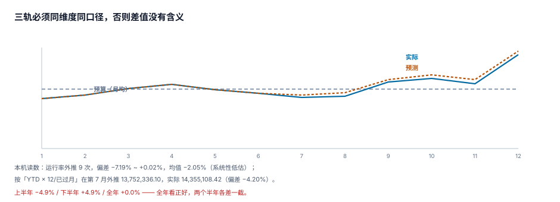

# 滚动预测：三轨并行与偏差方向

年度预算在 1 月就固定了，而经营环境每天都在变。中间这层「预测」的功能不是「更准地猜」，而是**提前看到偏差并改变动作**：现在还来得及做什么，才能让全年结果回到目标附近。

所以预测的第一条要求是**及时且可追溯**，第二条才是准。一个每月 5 号就出、方法透明、偏差方向稳定的预测，比一个季度出一次、每次都「重新拍」的预测有用得多。

::: tip 一句话理解
预测的价值不在误差大小，在**误差方向**。系统性低估 2% 意味着「永远差一点」，可以提前加预算；随机波动 ±7% 则说明方法本身不稳。
:::

## 一、三轨必须同维度同口径



| 轨 | 含义 | 更新频率 | 允许改历史吗 |
| --- | --- | --- | --- |
| 预算（budget） | 授权的额度 | 年度 + 调整 | 不改（冻结版只读） |
| 预测（forecast） | 将会发生多少 | 月度 | 不改（每次新版本） |
| 实际（actual） | 已经发生多少 | 关账后 | 只通过调整分录改 |

三轨的维度必须一致：版本 × 责任中心 × 科目 × 期间。少一个维度就没法比较，多一个维度就没法汇总。

预测与预算的**差**不是「超支」。这是最常见的误读：某部门全年预测 1,150 万、预算 1,000 万，报表标红「预计超支 150 万」，于是额度被冻结——但它其实只花了 800 万，剩下的是「按当前速度会花到 1,150 万」。

```sql
-- 三轨对比：预算 / 预测 / 实际 / 缺口
SELECT COALESCE(b.cc, f.cc) AS cc,
       SUM(b.amount) AS budget,
       SUM(f.amount) AS forecast,
       SUM(COALESCE(a.amount, 0)) AS actual,
       SUM(f.amount) - SUM(b.amount) AS forecast_gap,
       SUM(f.amount) - SUM(COALESCE(a.amount, 0)) AS remaining
  FROM forecast_line f
  LEFT JOIN budget_line b ON b.cc = f.cc AND b.acct = f.acct AND b.period = f.period
                         AND b.ver = 'V2'
  LEFT JOIN actual a ON a.cc = f.cc AND a.acct = f.acct AND a.period = f.period
 WHERE f.ver = '2026-07-F1'
 GROUP BY COALESCE(b.cc, f.cc);
```

四个数各有用途：`forecast_gap` 是「需要多少追加/削减」，`remaining` 是「从现在到年底还要花多少」——后者才是资金计划的输入。

## 二、三种预测方法，误差形态完全不同

| 方法 | 公式 | 优点 | 误差形态 |
| --- | --- | --- | --- |
| 运行率外推 | 已发生 + 最近月 × 剩余月 | 简单、可解释 | 对趋势敏感，转折点必错 |
| YTD 外推 | 已发生 × 12 ÷ 已过月 | 抗单月异常 | 有季节性时系统性偏 |
| 驱动因子 | 量 × 单价 × 剩余月 | 可解释、可干预 | 依赖驱动量预测的准确性 |

本机读数（12 个月、种子 20261102）：

| 方法 | 读数 |
| --- | --- |
| 运行率外推（第 3~11 月各预测一次，共 9 次） | 偏差 **−7.19% ~ +0.02%**，均值 **−2.05%**（系统性低估） |
| YTD 外推（第 7 月） | 13,752,336.10 vs 全年 14,355,108.42，偏差 **−4.20%** |
| MAPE | **2.06%** |
| 最大单次偏差 | **7.19%**（第 3 月，样本太短） |

三个结论：

1. **bias 比 MAPE 重要**。均值 −2.05% 说明这套方法在系统性地低估——每次预测都少报一点。这个偏差可以用一个系数校准，而随机误差不能。
2. **样本越短越不准**。第 3 月预测偏差最大（7.19%），因为只有 3 个月历史。所以「季度首月出的预测」只适合看方向，不适合做资金安排。
3. **两种方法都低估**，说明数据本身有加速上升的趋势（本例月均增长约 2.8%）。方法没错，是「用历史推未来」在增长期必然偏低。

## 三、全年平、半年不平

这是本专题最容易被忽略的一个读数：

| 口径 | 偏差 |
| --- | --- |
| 上半年累计 | **−4.9%** |
| 下半年累计 | **+4.9%** |
| 全年 | **+0.0%** |

全年执行率正好 100%，看起来完美。但上半年欠了 4.9%、下半年超了 4.9%——两件事的成因完全不同（上半年投放延迟、下半年追赶），而年度总结只会写「全年执行率 100%，预算管理良好」。

```sql
-- 期间结构：任一半年偏差超过 3% 即告警
SELECT CASE WHEN period <= '2026-06' THEN 'H1' ELSE 'H2' END AS half,
       SUM(actual) AS actual, SUM(budget) AS budget,
       ROUND((SUM(actual) - SUM(budget)) * 100.0 / SUM(budget), 2) AS dev_pct
  FROM period_summary
 GROUP BY half
HAVING ABS(dev_pct) > 3;
```

## 四、重预测的节律

预测的时效性由「关账 → 出数 → 重预测 → 评审」四步的节律决定。推荐节律：

| 步骤 | 时间 | 责任 |
| --- | --- | --- |
| 关账 | 月末 + 3 个工作日 | 财务 |
| 出实际数 | 关账后 1 天 | 系统 |
| 重预测 | 出数后 3 个工作日内 | 财务 BP + 业务 |
| 评审 | 每月固定日（如 10 日） | 管理层 |

节律一旦固定，就不再讨论「这个月要不要做」——不做的代价是下个月要补两个月的偏差。

## 五、预测版本：锁定不覆盖

预测是有历史价值的：**上一次预测有多偏**，是校准这次预测的唯一依据。所以每次预测都是新版本，旧版本锁定：

```sql
CREATE TABLE forecast_version(
  ver         TEXT PRIMARY KEY,        -- '2026-07-F1'
  fiscal_year INTEGER NOT NULL,
  period_from TEXT NOT NULL,
  method      TEXT NOT NULL CHECK (method IN ('run_rate','ytd_extrapolate','driver')),
  locked_at   TEXT,
  created_by  TEXT NOT NULL
);
CREATE UNIQUE INDEX uq_forecast_locked
    ON forecast_version(fiscal_year, period_from) WHERE locked_at IS NOT NULL;
```

`ver` 命名要把「期间」与「第几版」分开：`2026-07-F1` 表示「7 月做的第 1 版」。如果只写 `F1`，跨年后会撞车；如果只写 `2026-07`，同一个月的两次修订无法区分。

::: danger 覆盖旧预测的三种后果
1. **偏差序列断裂**：算不出「上次预测 vs 实际」，bias 无法校准。
2. **责任无法认定**：年底超支时，无法证明「7 月就预警过」。
3. **审计不可追溯**：预测虽不是会计记录，但它是「管理层是否及时行动」的证据。

正确做法：`locked_at` 一旦写入，该版本的 `forecast_line` 全部只读（同样的触发器套路，见第 4 章）。
:::

## 六、把预测准确度纳入编制质量

预测如果不考核，就会退化成「填个数交差」。三个指标足够：

| 指标 | 定义 | 目标 |
| --- | --- | --- |
| MAPE | 平均绝对百分比误差 | ≤ 5%（成熟业务）、≤ 10%（新业务） |
| bias | 平均有符号偏差 | 绝对值 ≤ 2% |
| 第 3 季度预测偏差 | Q3 做的全年预测 vs 实际 | ≤ 3% |

第三个指标最关键：**它衡量的是「有没有提前看到」**。Q3 的预测如果还差 15%，说明前三个季度的滚动预测都没有起作用。

## 判据

本页判据族 `BPF-A` ~ `BPF-H`，共 8 条，逐条可判定：

| 编号 | 判据 | 怎么判 |
| --- | --- | --- |
| `BPF-A` | 三轨同维度同口径，可比 | 三表维度列一致，join 无条件缺失 |
| `BPF-B` | 预测版本按月命名，含期间与版次 | `ver` 形如 `YYYY-MM-Fn` |
| `BPF-C` | 预测方法显式记录（运行率/YTD/驱动因子） | `forecast_version.method` 非空 |
| `BPF-D` | 有偏差历史序列（MAPE、bias） | 至少 3 期可算 |
| `BPF-E` | 预测与预算的差单独展示，不标「超支」 | 报表列名为 `forecast_gap` |
| `BPF-F` | 重预测节律固定（关账后 N 天） | 有排期表且按期执行 |
| `BPF-G` | 锁定版本不可覆盖 | 锁定后写入被拒 |
| `BPF-H` | 预测准确度纳入编制人考核 | 考核表含 MAPE/bias |

## 验证方式

先复现两种外推方法的偏差，再验证「全年平、半年不平」：

```shell
# 1) 本页判据 8 条
grep -o 'BPF-[A-H]' docs/Backend/Budgeting/Forecast/index.md | sort -u | wc -l

# 2) 运行率外推的年化偏差（与正文同一组种子数据）
python3 - <<'PY'
import random, statistics as st
random.seed(13)
base, real = 1_000_000.0, []
for _ in range(12):
    base *= random.uniform(0.97, 1.10)
    real.append(base)
Y = sum(real)
errs = [((sum(real[:c]) + real[c-1] * (12 - c)) - Y) / Y * 100 for c in range(3, 12)]
print("bias %+.2f%% / 最小 %+.2f%% / 最大 %+.2f%%" % (st.mean(errs), min(errs), max(errs)))
PY

# 3) 半年结构
python3 - <<'PY'
h1, h2, bud = 4_755_000, 5_245_000, 5_000_000
print("H1 %+.1f%% / H2 %+.1f%% / 全年 %+.1f%%" %
      ((h1-bud)/bud*100, (h2-bud)/bud*100, (h1+h2-2*bud)/(2*bud)*100))
PY
```

预期输出：第一条 `8`；第二条打印 `bias -2.05% / 最小 -7.19% / 最大 +0.02%`；第三条打印 `H1 -4.9% / H2 +4.9% / 全年 +0.0%`。若第三条的全年偏差是 0 而两个半年都是 0，说明你用的数据没有期间结构，测不出这个缺陷。

## 参考资料

- [差异归因与口径桥](../Variance/index.md)
- [度量与验收](../Metrics/index.md)
- IMA《Rolling Forecasts and Beyond Budgeting》：<https://www.imanet.org/>
- AICPA/CIMA《Global Management Accounting Principles》（预测与决策的相关性）：<https://www.aicpa-cima.com/>
- Hyndman & Athanasopoulos《Forecasting: Principles and Practice》第 5 章（预测精度指标与偏差方向）：<https://otexts.com/fpp3/>
