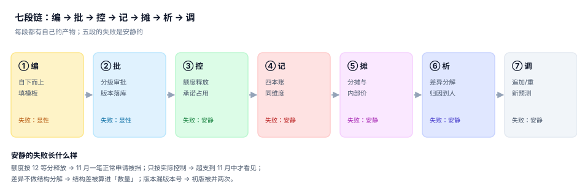

# 总览：七段链与三个「预算」

一家公司做预算，通常从一个 Excel 模板开始：几十个部门把表填回来，财务汇总、跟老板给的数对一下、改两轮、定稿，然后这张表就进了抽屉——直到年中有人问「市场部怎么花了这么多」。

之所以会进抽屉，是因为这张表**只被当成一份数字**。它其实是一份合同：公司授权某个责任中心在某个期间对某个科目最多花多少钱。合同一旦签了，就要有签署（版本）、有履约（承诺）、有对账（四本账）、有争议处理（差异）、有变更（追加）。这一整条链，就是本专题讲的七段。

::: tip 一句话理解
预算不是「一个数」，是「一条从授权到解释的链」。**链上每段都会安静地失败，除了第 ② 段——它只会告诉你「没批」，不会告诉你「批错了」。**
:::

## 一、七段链



| 段 | 输入 | 动作 | 产物 | 失败方式 |
| --- | --- | --- | --- | --- |
| ① 编 | 目标、历史、驱动因子 | 填模板、三轮收敛 | 草稿版本 + 编制说明 | 显性（表交不上来） |
| ② 批 | 草稿版本、审批矩阵 | 分级审批、落版本 | `budget_version` | 显性（没批就花不出去） |
| ③ 控 | 版本、释放曲线 | 申请与下单时占用 | `commitment` | 安静（额度被多占或没占） |
| ④ 记 | 收货、发票、分摊 | 四本账对齐 | `actual` | 安静（错一位数） |
| ⑤ 摊 | 费用池、动因 | 分到责任中心 | `allocation_run` | 安静（差额进「其他」） |
| ⑥ 析 | 四本账 + 分解口径 | 五支分解、归因到人 | `variance_snapshot` | 安静（结构算成数量） |
| ⑦ 调 | 差异结论、新预测 | 追加/调剂/重预测 | 新版本 | 安静（旧版被覆盖） |

七段里**五段安静**。一个反直觉的事实是：真正把预算体系做坏的不是编制不准（那是显性问题，老板会拍桌子），而是第 ③ 段——**额度在错误的时点被占用**。因为它在任何单点上都不违反约束：申请金额没超、订单金额没超、发票金额没超，只有「三者相加」才超。

## 二、三个「预算」必须分成三个字段

| 身份 | 回答什么 | 变化频率 | 谁签字 | 落库字段 |
| --- | --- | --- | --- | --- |
| 授权 | 最多能花多少 | 年度 + 调整 | 预算委员会 | `budget_line.amount` |
| 目标 | 应该花多少 | 年度 | 董事会 / 事业部 | `target_line.amount` |
| 预测 | 将会花多少 | 月度 | 财务 BP | `forecast_line.amount` |

三者共用一个字段的三种典型事故：

1. **把预测当授权**：某部门预测全年要花 1,200 万，授权只有 1,000 万，于是系统冻结了它的额度——但它连 800 万都还没花完。
2. **把目标当授权**：目标 1,000 万，实际做到 950 万，报表显示「还有 50 万」，采购继续下单，年度结果 1,080 万。
3. **把授权当预测**：授权 1,000 万，预测 1,150 万，但因为「预算只有 1,000 万」，资金计划按 1,000 万准备，月中出现支付缺口。

::: danger 这三个字段的分离必须在表结构里做
不要用「类型字段 + 一张表」偷懒：

1. 一张表加 `type` 字段（`budget`/`target`/`forecast`）→ 主键变成四维 + 类型，所有聚合 SQL 都要带类型条件，漏一次就把三个数加在一起；
2. 三个视图指向一张表 → 视图层面能过滤，但写入时没人拦得住「往 budget 里写 target」；
3. 正确做法是**三张表 + 三个主键**，字段名相同、约束相同，聚合时显式选表。本专题第 10 章的实战 DDL 就是分开建的。
:::

## 三、四本账的对齐规则

四本账的维度必须完全一致：**版本 × 责任中心 × 科目 × 期间**。少一个维度就无法对齐，多一个维度就无法汇总。

```sql
-- 四本账的唯一对齐口径
SELECT b.cc, b.acct, b.period,
       b.amount AS budget,
       COALESCE(c.committed, 0) AS committed,
       COALESCE(a.amount, 0)    AS actual,
       b.amount - COALESCE(c.committed, 0) - COALESCE(a.amount, 0) AS available
  FROM budget_line b
  JOIN budget_version v ON v.ver = b.ver AND v.state = 'current'
  LEFT JOIN (SELECT cc, acct, period, SUM(amount) AS committed
               FROM commitment WHERE received_at IS NULL
              GROUP BY cc, acct, period) c
         ON c.cc = b.cc AND c.acct = b.acct AND c.period = b.period
  LEFT JOIN actual a
         ON a.cc = b.cc AND a.acct = b.acct AND a.period = b.period
 WHERE b.period = '2026-07';
```

这段 SQL 有四个容易漏的点，每一个都会让结果「看起来正常」：

- `v.state = 'current'`：不带这个条件，冻结版会一起并进来（本机实测虚增 93.4%）。
- `received_at IS NULL`：承诺只算未收货的部分，收货后转实际，两边都算就重复。
- `LEFT JOIN` 而不是 `JOIN`：没有承诺或没有实际的科目必须出现，否则「没花」和「没有这个科目」分不清。
- `COALESCE(..., 0)`：缺值当 0，否则整行被 NULL 吞掉。

## 四、五段「安静失败」的代价

本机（12 个中心 / 5 个科目 / 12 个月 / 3,000 张订单，种子 20261102）把每段失败的代价各量了一次：

| 段 | 失败形态 | 本机读数 |
| --- | --- | --- |
| ③ 控 | 额度按 12 等分释放 | 11 月一笔 1,050,000 的申请被挡，差 50,000（5.0%） |
| ③ 控 | 只按实际控制 | 7 月 74.1% 的额度「已花但未记」 |
| ④ 记 | 汇总未去重（矩阵归属） | 23,200,000 → 34,900,000，虚增 50.4% |
| ⑤ 摊 | 比例先取整再加总 | 差 +1,200（比例和 1.0001） |
| ⑥ 析 | 只做价量两分解 | 残差 −1,200，占总额 43.5% |
| ⑦ 调 | 版本条件漏写 | 53,026,185.93 → 102,551,730.02，虚增 93.4% |

::: warning 代价的量级不重要，方向才重要
上表六个数字里有大有小（1,200 元与 4,950 万），但它们的**方向都是同一个**：让实际支出看起来比真实更少、或让可用额度看起来比真实更多。预算体系的所有安静失败，最终都会流向同一个结论——「还有钱」。这就是为什么控制点必须放在第 ③ 段，而不是第 ④ 段。
:::

## 五、责任的三种归属

差异出来了，归给谁？这决定了整套体系有没有人真的在乎。

| 归属方式 | 判据 | 后果 |
| --- | --- | --- |
| 归科目 | 差在「差旅费」 | 财务只能写「差旅超支」，业务无法行动 |
| 归中心 | 差在「华东销售部」 | 部门经理被问责，但可能是价格或结构原因 |
| 归决策点 | 差在「谁批准了这次提价/加人」 | 可行动：下个月调政策 |

本专题第 6 章要求每个差异至少有**一个可行动归属**：价格差归采购或定价、数量差归业务量、结构差归产品组合决策、汇率差归财务（并单独列示）、一次性项归立项人。归不到人的差异，等于没归因。

## 判据

本页判据族 `BPO-A` ~ `BPO-H`，共 8 条，逐条可判定：

| 编号 | 判据 | 怎么判 |
| --- | --- | --- |
| `BPO-A` | 七段各自的产物落成表，且能指名到列 | 每段在 DDL 里有对应表与主键 |
| `BPO-B` | 授权 / 目标 / 预测分三张表存 | `budget_line` / `target_line` / `forecast_line` 三表存在 |
| `BPO-C` | 四本账同维度（版本×中心×科目×期间），有单条对齐 SQL | 对齐 SQL 可执行且返回行数 = 预算行数 |
| `BPO-D` | 每段标注「失败是否安静」，安静的段有对账查询 | 五段各至少一条对账 SQL |
| `BPO-E` | 金额带币种与最小单位，跨币种行有汇率字段 | 行上有 `currency` 与 `fx_rate` |
| `BPO-F` | 责任中心编码稳定、不复用、不回收 | 编码表含 `retired_at`，无重复启用 |
| `BPO-G` | 期间颗粒度为月，与关账日一致 | `period` 形如 `YYYY-MM`，关账后才允许实际入账 |
| `BPO-H` | 全链共用同一财年定义（起止月、周口径） | 有 `fiscal_calendar` 表并被所有表引用 |

## 验证方式

先确认四本账能对齐，再验证「只按实际控制会高估可用额度」：

```shell
# 1) 本页判据 8 条
grep -o 'BPO-[A-H]' docs/Backend/Budgeting/Overview/index.md | sort -u | wc -l

# 2) 四本账对齐 SQL（在实战库上跑，期望返回 5 行、无负值）
python3 - <<'PY'
budget, committed, actual = 260_000, 90_000, 150_000
avail = budget - committed - actual
print("预算", budget, "承诺", committed, "实际", actual, "可用", avail)   # 期望可用 20000
print("只减实际会高估", committed)                                        # 期望 90000
PY

# 3) 全库判据不撞号
python3 utils/audit/judgeidcheck.py --root . | tail -1
```

预期输出：第一条 `8`；第二条打印 `可用 20000` 与 `只减实际会高估 90000`——**同一行预算，两种口径差 9 万**；第三条 `E=0`。若第二条的可用额为负，说明你的种子数据里承诺已经吃掉了全部额度，这是有意的负向样本。

## 参考资料

- [期间化、承诺与预算控制](../PeriodCommitment/index.md)
- [实战：七张表跑通一次额度控制](../Practice/index.md)
- IMA《Statement on Management Accounting — Budgeting: A Guide for Managers》：<https://www.imanet.org/>
- COSO《Internal Control — Integrated Framework》（授权与职责分离的控制要素）：<https://www.coso.org/>
- 《企业内部控制应用指引第 15 号——全面预算》：<https://www.mof.gov.cn/>
