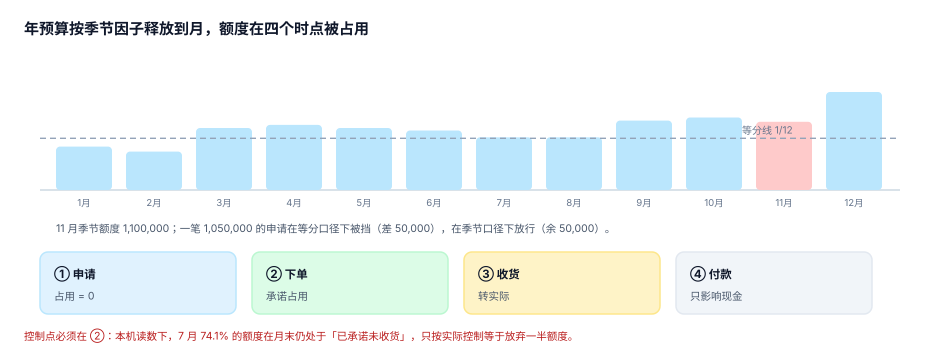

# 期间化、承诺与预算控制：额度在哪个时点被占用

预算批下来是一年的数，花钱是按月和按单发生的。中间那层「把年额度切成可用的月额度，并在正确的时点扣减」就是预算控制。它是整个体系里**唯一真正会拦人的地方**，也是唯一一个「做错了不会报错」的地方——因为拦住了只是「申请被拒」，没人会追问拒绝得对不对。

::: tip 一句话理解
控制的三个变量：**额度什么时候释放**、**什么时候被占用**、**谁有权力越过**。三个都能配，配错了全都不报错。
:::

## 一、年额度怎么释放到月



三种释放方式，适用场景完全不同：

| 方式 | 公式 | 适合 | 代价 |
| --- | --- | --- | --- |
| 12 等分 | 年额 ÷ 12 | 每月均匀发生的费用（房租、薪酬） | 季节业务被挡 |
| 季节因子 | 年额 × 月度因子 | 有明显的旺淡季（市场、零售） | 因子要有依据 |
| 里程碑 | 按项目节点释放 | 资本性支出、研发项目 | 节点延期即锁死 |

本机读数（年额 12,000,000、11 月因子 1.10）：

| 口径 | 11 月额度 | 一笔 1,050,000 的申请 |
| --- | --- | --- |
| 12 等分 | 1,000,000 | 超 50,000（5.0%）→ **被挡** |
| 季节因子 | 1,100,000 | 余 50,000（4.5%）→ 放行 |

同一笔申请、同一份年预算，两种口径给出相反结论。而这次「挡住」不会留下任何告警——申请人只会被告知「额度不足」，然后自己去拆单或者等 12 月。

### 月内累计：自然日还是工作日

额度在月内怎么「长出来」，也有两种口径。2026 年 2 月 28 天、20 个工作日（春节 2 月 17 日），截至 15 日：

| 月份 | 自然日口径 | 工作日口径 | 差 |
| --- | --- | --- | --- |
| 2026-02 | 53.57% | 50.00% | −3.57 点 |
| 2026-03 | 48.39% | 45.45% | −2.93 点 |

方向上工作日口径更慢（因为月中之前的工作日占比低于自然日占比）。差别不大，但**必须选一个并写进配置**：两种口径混用会出现「15 号按自然日批了，月底结算按工作日算超了」。

```sql
-- 释放曲线必须守恒：12 个月之和 = 年额
SELECT cc, acct, SUM(amount) AS year_total
  FROM budget_release
 WHERE fiscal_year = 2026
 GROUP BY cc, acct
HAVING SUM(amount) <> (SELECT SUM(amount) FROM budget_line b
                        WHERE b.cc = budget_release.cc AND b.acct = budget_release.acct
                          AND b.ver = 'V2');
-- 期望：0 行；差一分钱也算不守恒
```

## 二、承诺：钱在「下单」那一刻就花了

承诺（commitment）是会计上最容易被忽略的一种占用：合同签了、订单下了、货还没到，账上什么都没有，但**这笔钱已经不可能给别人了**。

本机读数（3,000 张订单、平均提前期 37.4 天）：

| 数 | 值 | 含义 |
| --- | --- | --- |
| 7 月承诺 | 2,756,517.38 | 当月下单金额 |
| 月末已收货 | 714,236.25 | 25.9% |
| **已花但未记** | **2,042,281.13** | **74.1%** |
| 在途占全年承诺 | 10.4% | 任一时刻的常态 |

如果控制只减实际，那么这个部门在 7 月 31 日看起来还有 74% 的额度没花，于是 8 月继续下单——而实际上 7 月的钱早花出去了，只是还没到货。**这就是「超支在 11 月中才被发现」的机制**：本机 CC07 的实际累计直到第 322 天才越过 300 万预算线。

```sql
-- 承诺表：必须与预算行同维度，且同一订单行只能承诺一次
CREATE TABLE commitment(
  id          INTEGER PRIMARY KEY,
  po_no       TEXT NOT NULL,
  line_no     INTEGER NOT NULL,
  cc          TEXT NOT NULL,
  acct        TEXT NOT NULL,
  period      TEXT NOT NULL,
  amount      NUMERIC NOT NULL CHECK (amount > 0),
  created_at  TEXT NOT NULL,
  received_at TEXT,                      -- 收货即转实际，IS NULL 表示仍在途
  UNIQUE (po_no, line_no)
);
CREATE INDEX idx_commit_open ON commitment(cc, acct, period) WHERE received_at IS NULL;
```

那个**部分索引**不是优化，是语义：所有「可用额度」查询都只看在途行，部分索引让这个语义在物理层可见。

## 三、三个控制档位，代价完全不同

| 档位 | 行为 | 阻塞 | 年末超支（本机） |
| --- | --- | --- | --- |
| 无控制 | 只记录，不拦 | 0 笔 | **5,435,463.48** |
| 软控制 | 超了告警，仍然放行 | 0 笔 | **5,435,463.48** |
| 硬控制 | 超了拒绝 | 153 笔（12.8%） | **0.00** |

软件控制的超支金额与无控制**完全一样**——它只多出 153 条告警。这不是说软控没用，而是说：**软控的价值取决于告警的转化率**。如果 153 条告警里没有一条导致额度调整，那它就等于没有控制，只是多了一张没人看的表。

::: danger 硬控制的三个反作用
1. **把正常业务挡在门外**：本机 12.8% 的阻塞率里，有一部分是季节口径错配造成的（见第一节），这类阻塞会逼着业务拆单，反而破坏数据质量。
2. **催生「预算外」通道**：被挡的钱会走「其他应付款」「员工垫付」等科目，最后以更不可控的方式回到费用里。
3. **让季度末变成橡皮筋**：只要额度可以跨月结转，12 月就会被集中使用，硬控在 12 月失去意义。

所以硬控必须配三个附件：**例外审批通道**（带审批人、理由、有效期）、**阻塞原因分类统计**（口径错配 vs 真实超支）、**跨月结转规则**（明确能不能结转、结转到几月、结转后是否重算释放曲线）。
:::

## 四、控制点只能有一个

一笔支出经过四个时点，每个时点都可以「控」，但只能选一个作为**主控制点**：

| 时点 | 此时占用什么 | 控制的后果 |
| --- | --- | --- |
| ① 申请 | 无（还没承诺） | 挡得最早，但申请常被改，误挡多 |
| ② 下单 | 承诺 | **推荐**：钱已经确定要花 |
| ③ 收货 | 实际 | 太晚，货已到，只能事后追责 |
| ④ 付款 | 现金 | 与预算无关（预算管权责，不管现金） |

本机把控制点放在 ② 的理由就是那张 74.1% 的表：放到 ③，等于放弃了四分之三的额度；放到 ①，会因为申请金额频繁变动而反复误挡。

## 五、可用额度的并发问题

「先查余额，再写入」在并发下必然超发。这不是预算特有的问题，但预算的金额大、笔数少，超发一次就是几十万：

```sql
-- 错误：先查后改
SELECT amount - COALESCE(SUM(c.amount), 0) FROM budget_line ... ;  -- 读到 100,000
-- 两个请求同时读到 100,000，各自批准 80,000
INSERT INTO commitment(...) VALUES(...);
```

```sql
-- 正确：条件更新，把判定和写入合成一步
UPDATE budget_available
   SET used = used + :amt
 WHERE cc = :cc AND acct = :acct AND period = :period
   AND used + :amt <= amount;
-- 影响行数 = 0 即为超额，直接拒绝；不需要再查一次
```

`budget_available` 是一张冗余表（`amount`、`used` 两列），由承诺与实际的变化维护。它存在的唯一理由是「让判定与写入落在同一行上」。

## 六、结转与清零

期末没花完的额度怎么处理，直接决定 12 月的行为：

| 政策 | 12 月行为 | 适合 |
| --- | --- | --- |
| 全部清零 | 突击花钱 | 费用类、每年重新编制的科目 |
| 按比例结转 | 留一部分，花一部分 | 项目类 |
| 全额结转 | 年中预算失去意义 | 资本性支出（按项目周期） |

无论哪种，都必须有一条可查的结转记录，而不是在汇总时「顺手加上」：

```sql
CREATE TABLE budget_carryover(
  from_period TEXT NOT NULL, to_period TEXT NOT NULL,
  cc TEXT NOT NULL, acct TEXT NOT NULL,
  amount NUMERIC NOT NULL CHECK (amount >= 0),
  policy TEXT NOT NULL,            -- 'none' / 'ratio:0.5' / 'full'
  approved_by TEXT NOT NULL,
  PRIMARY KEY (from_period, to_period, cc, acct)
);
```

## 判据

本页判据族 `BPP-A` ~ `BPP-H`，共 8 条，逐条可判定：

| 编号 | 判据 | 怎么判 |
| --- | --- | --- |
| `BPP-A` | 释放曲线有依据（季节因子/工时/里程碑），因子表可查 | `budget_release` 有来源字段 |
| `BPP-B` | 释放曲线守恒：12 月之和 = 年额 | 第一节 SQL 返回 0 行 |
| `BPP-C` | 月内累计口径唯一（自然日或工作日），写进配置 | 配置项有取值且被引用 |
| `BPP-D` | 承诺在下单时占用，收货转实际 | `received_at` 非空时不参与可用额度 |
| `BPP-E` | 控制档位可配（无/软/硬），按中心或科目分别配 | 配置表有 `control_mode` |
| `BPP-F` | 阻塞有记录：原因、申请人、金额、时间 | `blocked_log` 表存在且有分类 |
| `BPP-G` | 可用额度 = 预算 − 承诺 − 实际，且并发下不为负 | 条件更新影响行数可判 |
| `BPP-H` | 控制点唯一，写在文档里且代码只有一处判定 | 只有一张表/一个函数做判定 |

## 验证方式

先验证「同一笔申请在两种释放口径下结论相反」，再验证承诺占用会让可用额度显著变小：

```shell
# 1) 本页判据 8 条
grep -o 'BPP-[A-H]' docs/Backend/Budgeting/PeriodCommitment/index.md | sort -u | wc -l

# 2) 释放口径对比
python3 - <<'PY'
flat, season, req = 1_000_000, 1_100_000, 1_050_000
print("等分差额 %d（%.1f%%）→ %s" % (req - flat, (req - flat) / flat * 100,
      "被挡" if req > flat else "放行"))
print("季节余额 %d（%.1f%%）→ %s" % (season - req, (season - req) / season * 100,
      "被挡" if req > season else "放行"))
PY

# 3) 承诺占用对可用额度的影响
python3 - <<'PY'
budget, committed, actual = 2_756_517.38, 2_042_281.13, 714_236.25
print("只减实际可用 %.2f" % (budget - actual))
print("减承诺与实际可用 %.2f" % (budget - committed - actual))
print("差额 = %.2f（占额度 %.1f%%）" % (committed, committed / budget * 100))
PY
```

预期输出：第一条 `8`；第二条打印 `等分差额 50000（5.0%）→ 被挡` 与 `季节余额 50000（4.5%）→ 放行`；第三条打印两个可用额度，差额 2,042,281.13（占 74.1%）。若第三条两个数相等，说明你的承诺表里没算在途行。

## 参考资料

- [审批与版本](../ApprovalVersion/index.md)
- [差异归因与口径桥](../Variance/index.md)
- 《企业内部控制应用指引第 15 号——全面预算》第三章（预算执行的刚性与例外）：<https://www.mof.gov.cn/>
- COSO《Internal Control — Integrated Framework》原则 11（控制活动的选择与执行）：<https://www.coso.org/>
- IMA《Budgetary Control and Variance Analysis》：<https://www.imanet.org/>
