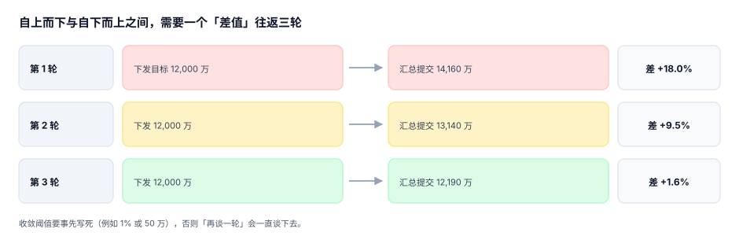

# 编制与基线：三轮收敛怎么收

预算编制最容易被误解成「填表」。真正的难点在两头：**上面给的目标和下面报的需求，第一次一定对不上**（本机第一轮差 18.0%），而组织没有无限的会议时间把这个差磨到零。所以编制的工程问题不是「怎么算准」，而是**「几轮之内收敛到可接受的差值，并且每一轮的差值都能被解释」**。

::: tip 一句话理解
编制不是一次填表，是**一条从目标到版本的收敛曲线**。收敛阈值要事先写死，收敛过程要留三轮的差值记录——否则「再谈一轮」会一直谈下去。
:::

## 一、三种编制方法，对应三种失败

| 方法 | 怎么编 | 适合 | 典型失败 |
| --- | --- | --- | --- |
| 增量法 | 去年基数 ×（1+涨幅） | 稳定业务、费用类 | 基数固化：从来没花过的钱继续留着 |
| 零基法 | 每项从 0 重算依据 | 支持部门、项目类 | 工作量爆炸，最后退化成「按去年的比例」 |
| 驱动因子法 | 量 × 单价（编制×薪酬、面积×单价） | 人工、场地、云资源 | 单价不更新，量准了钱还是错 |

本机读数（1,200 行、种子 20261102）：

- **增量法**按 3.5% 涨幅汇总 126,018,753.00；其中 **135 行（11.2%）连续三年零动支**，金额 13,537,309.93（11.1%）。零基重算把这些行剔掉后是 112,007,637.23，**差 14,011,115.78（11.12%）**——这 11% 就是「基数固化」的价格。
- **驱动因子法**总编制 2,913 人，用去年平均薪酬 18,500 复算得 646,686,000.00，实际按 20,100 算是 702,615,600.00，**差 8.65%**。量（人数）一个都没错，错的是单价没更新。

::: danger 增量法的三个必踩点
1. **零动支行不清理**：连续三年金额为 0 的行，第四年照样按比例涨——因为「删了明年要用怎么办」。正确做法是设「休眠规则」：连续 24 个月零动支的行转为休眠，保留编码但额度归零，重启需重新申请。
2. **涨幅一刀切**：全公司统一 3.5%，等于让增长 40% 的部门饿死、萎缩 20% 的部门躺赢。涨幅必须按科目与业务分别给，且写进假设表。
3. **基数含一次性项**：去年有一次 80 万的装修，今年按 1.035 变成 82.8 万——一次性项必须先剔除再算基数，否则它会永远留在预算里。
:::

## 二、三轮收敛：把「谈」变成「算」



| 轮次 | 下发目标 | 汇总提交 | 差值 | 这一轮在解决什么 |
| --- | --- | --- | --- | --- |
| 第 1 轮 | 12,000 万 | 14,160 万 | **+18.0%** | 暴露结构：钱花在哪些科目上、谁在要增量 |
| 第 2 轮 | 12,000 万 | 13,140 万 | **+9.5%** | 砍项目：按优先级排序，砍掉的项要写理由 |
| 第 3 轮 | 12,000 万 | 12,190 万 | **+1.6%** | 磨金额：同一批项目内调价、调时间 |

三条纪律：

1. **目标在下发后不改**。目标一改，前面三轮的差值就失去可比性，也无法判断「是需求降了还是目标松了」。
2. **每轮只允许一种动作**。第 1 轮谈结构、第 2 轮砍项目、第 3 轮磨金额。三轮都在做同一件事，说明流程没有分层。
3. **收敛阈值事先写死**。建议「差值 ≤ 1% 或 ≤ 50 万，取先到者」。本机第三轮 1.6% 仍未达标，按纪律要么进第 4 轮、要么由预算委员会强制裁定——**不能默认通过**。

## 三、假设表：所有「为什么是这个数」都放一处

编制的争议 90% 来自假设，而假设通常散落在各人的 Excel 批注里。把它们收进一张表：

```sql
CREATE TABLE planning_assumption(
  assumption_id TEXT PRIMARY KEY,       -- 'HC_GROWTH_2026'
  category      TEXT NOT NULL,          -- 'headcount' / 'price' / 'fx' / 'seasonality'
  scope         TEXT NOT NULL,          -- 'CC07' 或 'ALL'
  value         NUMERIC NOT NULL,
  unit          TEXT NOT NULL,          -- 'pct' / 'cny' / 'ratio'
  source        TEXT NOT NULL,          -- 依据：'HR 2026 编制计划 v3'
  effective_from TEXT NOT NULL,
  owner         TEXT NOT NULL,
  updated_at    TEXT NOT NULL
);
```

有了这张表，「人工预算为什么比去年高 8.65%」的答案就不再是「HR 说要加人」，而是一条可以复算的链：`编制 2,913 人 × 平均薪酬 20,100 × 12 = 702,615,600`，其中平均薪酬这一项来自 `PRICE_HC_2026 = 20100`，依据是「2026 薪酬调整方案」，签字人是 HRD。

## 四、驱动因子的可复算性

一条预算行如果写成「市场费用 120 万」，它无法被审计；写成「12 场活动 × 10 万」，它可以。驱动因子法的判据是**能被第三方用同样的输入复算出同一个数**：

```text
金额 = 驱动量 × 单价 × (1 + 税率调整) × 期间占比
例：6004 市场费用（CC07，2026-11）
    = 12 场 × 100,000 × 1.00 × 1.10（季节因子）
    = 1,320,000
```

复算不通过只有三种原因，且都能定位到具体格子：

| 原因 | 表现 | 定位方式 |
| --- | --- | --- |
| 驱动量缺失 | 金额有、量没有 | `driver_qty IS NULL AND amount > 0` |
| 单价过期 | 复算差 8.65% 这类系统性偏差 | 按科目对比「复算/填报」比值分布 |
| 期间占比错 | 全年对、单月错 | 12 个月之和 ≠ 年额 |

## 五、科目映射：编制口径必须等于报表口径

编制时用明细科目（人力、差旅、软件、市场、外包），出报表时用报表行（人力成本、管理费用、销售费用）。中间的映射表如果允许一对多，汇总就会重复计入：

本机读数：5 个明细科目映射到 6 个报表行，**其中 4 条是一对多**；按明细逐行展开再汇总，重复计入 97,854,316.60，**占总额 80.4%**。

::: danger 映射一对多的两种正确写法
1. **带权重的映射**：`account_map(detail_acct, report_line, weight)`，同一明细的多条映射权重之和必须为 1，由触发器或约束保证。汇总时按 `weight` 加权，而不是把明细行复制到多个报表行。
2. **只允许一对一的编制口径**：编制模板直接用报表行，明细科目只作为附注。代价是编制颗粒度变粗，收益是永远不可能重复计入。

两种都不能接受的写法是「一对多 + 直接 join」：它会让每个报表行的合计数看起来都合理，只有把 6 个报表行加起来才发现是总额的 1.8 倍。
:::

## 六、提交状态与责任人

编制是一场接力，缺任何一棒都会烂在最后一棒：

| 状态 | 谁能改 | 超期动作 |
| --- | --- | --- |
| `draft` | 编制人 | 提醒，不影响他人 |
| `submitted` | 只读，退回才能改 | 记录提交时间，用于考核 |
| `returned` | 编制人（带退回理由） | 计入返工轮次 |
| `locked` | 无人可改 | 进入审批 |

三个必留字段：`owner`（谁负责）、`submitted_at`（什么时候交的）、`rework_count`（被退回几次）。缺了它们，「编制质量」就只剩一句主观评价。

## 判据

本页判据族 `BPC-A` ~ `BPC-H`，共 8 条，逐条可判定：

| 编号 | 判据 | 怎么判 |
| --- | --- | --- |
| `BPC-A` | 每行显式声明编制方法（增量/零基/驱动因子） | 行上有 `method` 字段且非空 |
| `BPC-B` | 目标与提交分列，目标下发后不改 | `target_line` 与 `budget_line` 两表，目标版本无二次写入 |
| `BPC-C` | 驱动因子可被第三方复算（量×单价×占比） | 抽样 20 行，复算误差 = 0 |
| `BPC-D` | 假设集中存放并带来源与责任人 | `planning_assumption` 表存在且每条有 `source`/`owner` |
| `BPC-E` | 编制口径 = 报表口径（映射权重和为 1） | 按明细汇总 = 按报表行汇总 |
| `BPC-F` | 零金额行不落库（休眠行单独标记） | `amount = 0` 的行数为 0，或 `state='dormant'` |
| `BPC-G` | 每行有 `owner` 与 `submitted_at` | 两列非空率 100% |
| `BPC-H` | 收敛轮次与差值有记录，阈值事先写死 | `planning_round` 表含 3 轮差值 |

## 验证方式

先确认收敛曲线能被复算，再验证「增量法的 11% 藏在哪」：

```shell
# 1) 本页判据 8 条
grep -o 'BPC-[A-H]' docs/Backend/Budgeting/PlanningCycle/index.md | sort -u | wc -l

# 2) 三轮收敛差值
python3 - <<'PY'
target = 120_000_000
for rnd, sub in ((1, 141_600_000), (2, 131_400_000), (3, 121_900_000)):
    print("第 %d 轮 %+.1f%%" % (rnd, (sub - target) / target * 100))
PY

# 3) 增量法 vs 零基
python3 - <<'PY'
tot, dormant = 121_757_249.28, 13_537_309.93
inc = tot * 1.035
print("增量 %.2f / 剔除休眠后 %.2f / 差 %.2f（%.2f%%）" %
      (inc, inc - dormant * 1.035, dormant * 1.035, dormant * 1.035 / inc * 100))
PY
```

预期输出：第一条 `8`；第二条依次打印 `第 1 轮 +18.0%`、`第 2 轮 +9.5%`、`第 3 轮 +1.6%`；第三条打印 `增量 126018753.00 / 剔除休眠后 112007637.23 / 差 14011115.78（11.12%）`。若第二条的差值单调下降但没有一轮落到 1% 以内，说明你的收敛阈值没有写死。

## 与「组织与任职」专题的分工（第 238 天补充）

本页判**预算怎么编、驱动因子怎么复算**，组织与任职册判**编制这个因子本身准不准**。两者的接缝是「人数 × 单价」里的「人数」。

| 你关心的问题 | 该读哪一册 | 为什么不是本页 |
| --- | --- | --- |
| 预算额度怎么批、怎么占用 | 本页 | 判**授权与承诺** |
| 编制变了预算要不要跟着改 | 本页给复算规则 | 判**驱动因子联动** |
| 编制到底有几个、谁占着 | [岗位与编制：占编的四种口径](../../OrgPeople/Position/index.md) | 那册判**占编口径**，本页判**额度** |
| 年中扩编该按几个月算钱 | 本页给期间化规则 | 编制生效日由组织册提供 |

::: danger 本页特有的一处坑：用期末编制乘 12 个月
人工预算最常见的一行算式是「期末编制 × 平均薪酬 × 12」。编制年中从 10 人扩到 15 人时，这个算式给 180 人月，实际只有 10×2 + 15×10 = 170 人月，**多算 5.9%**；缩编时则相反，少算。

编制必须带生效日（`position.valid_from`），预算按月取该月的编制值再求和。本机 405 个组织里有 138 个超编、191 个缺口，编制在年内变动的组织占多数，按期末值算等于把全年都按 12 月的组织形态计价。
:::

## 参考资料

- [责任中心与矩阵归属](../ResponsibilityModel/index.md)
- [审批与版本](../ApprovalVersion/index.md)
- IMA《Budgeting: A Guide for Managers》（增量法与零基法的适用边界）：<https://www.imanet.org/>
- 《企业内部控制应用指引第 15 号——全面预算》第二章（预算编制的程序与方法）：<https://www.mof.gov.cn/>
- AICPA《Financial Forecasting and Budgeting》（驱动因子法的复算要求）：<https://www.aicpa-cima.com/>
