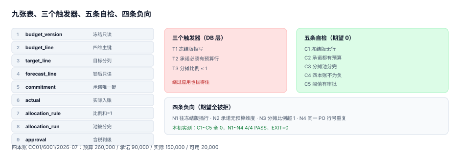

# 实战：九张表跑通一次额度控制

前面八章讲的是「应该怎样」，这一章把它落成可以照着敲的库：**九张表、三个触发器、五条自检、四条负向用例**。全部用 SQLite 标准语法写成，复制到 Python 里跑一遍就能验证——不需要容器、不需要外部服务。

::: tip 一句话理解
判据能不能落地，只看一件事：**把违反规则的写入丢进去，它会不会被拒绝**。所以这一章的重点不是建表，是那三条触发器和四条负向用例。
:::

## 一、目标与边界

| 项 | 内容 |
| --- | --- |
| 目标 | 一张预算行从「批准」到「被承诺占用」到「转实际」的全过程可查、可拦 |
| 边界 | 不含审批工作流引擎、不含报表渲染、不含多币种折算 |
| 运行环境 | Python 3.13 标准库 `sqlite3`（3.50.4），单文件内存库 |
| 通过标准 | C1~C5 全部为 0，N1~N4 全部被拒，退出码 0 |



## 二、九张表

```sql
PRAGMA foreign_keys = ON;

-- ① 版本：一次编制一个版本，冻结后只读
CREATE TABLE budget_version(
  ver        TEXT PRIMARY KEY,
  fiscal_year INTEGER NOT NULL,
  state      TEXT NOT NULL CHECK (state IN ('draft','current','frozen','void')),
  frozen_at  TEXT
);

-- ② 预算行：四维（版本 / 责任中心 / 科目 / 期间）
CREATE TABLE budget_line(
  ver     TEXT NOT NULL REFERENCES budget_version(ver),
  cc      TEXT NOT NULL,
  acct    TEXT NOT NULL,
  period  TEXT NOT NULL,
  amount  NUMERIC NOT NULL CHECK (amount >= 0),
  PRIMARY KEY (ver, cc, acct, period)
);

-- ③ 目标：与授权分列，编制期用，不参与控制
CREATE TABLE target_line(
  ver     TEXT NOT NULL REFERENCES budget_version(ver),
  cc      TEXT NOT NULL,
  acct    TEXT NOT NULL,
  period  TEXT NOT NULL,
  amount  NUMERIC NOT NULL CHECK (amount >= 0),
  PRIMARY KEY (ver, cc, acct, period)
);

-- ④ 预测：每次一个新版本，锁后只读
CREATE TABLE forecast_line(
  ver       TEXT NOT NULL,
  cc        TEXT NOT NULL,
  acct      TEXT NOT NULL,
  period    TEXT NOT NULL,
  amount    NUMERIC NOT NULL,
  locked_at TEXT,
  PRIMARY KEY (ver, cc, acct, period)
);

-- ⑤ 承诺：下单即占用，收货即转实际
CREATE TABLE commitment(
  id          INTEGER PRIMARY KEY,
  po_no       TEXT NOT NULL,
  line_no     INTEGER NOT NULL,
  cc          TEXT NOT NULL,
  acct        TEXT NOT NULL,
  period      TEXT NOT NULL,
  amount      NUMERIC NOT NULL CHECK (amount > 0),
  created_at  TEXT NOT NULL,
  received_at TEXT,
  UNIQUE (po_no, line_no)
);

-- ⑥ 实际：按期间与维度入账
CREATE TABLE actual(
  cc     TEXT NOT NULL,
  acct   TEXT NOT NULL,
  period TEXT NOT NULL,
  amount NUMERIC NOT NULL,
  PRIMARY KEY (cc, acct, period)
);

-- ⑦ 分摊规则：比例之和必须为 1（由触发器守）
CREATE TABLE allocation_rule(
  pool_acct TEXT NOT NULL,
  cc        TEXT NOT NULL,
  driver    TEXT NOT NULL CHECK (driver IN ('headcount','revenue','area')),
  share     NUMERIC NOT NULL CHECK (share > 0 AND share <= 1),
  PRIMARY KEY (pool_acct, cc)
);

-- ⑧ 分摊结果：池金额必须被分完
CREATE TABLE allocation_run(
  run_id      TEXT NOT NULL,
  period      TEXT NOT NULL,
  pool_acct   TEXT NOT NULL,
  pool_amount NUMERIC NOT NULL,
  cc          TEXT NOT NULL,
  amount      NUMERIC NOT NULL CHECK (amount >= 0),
  PRIMARY KEY (run_id, pool_acct, cc)
);

-- ⑨ 审批：阈值以上必须有记录，且按含税判级
CREATE TABLE approval(
  doc_id      TEXT PRIMARY KEY,
  cc          TEXT NOT NULL,
  amount_net  NUMERIC NOT NULL,
  tax_rate    NUMERIC NOT NULL DEFAULT 0.06,
  level       INTEGER NOT NULL CHECK (level BETWEEN 1 AND 3),
  approved_by TEXT
);
```

五处设计取舍值得单独说：

| 取舍 | 为什么 |
| --- | --- |
| `budget_line` 与 `target_line` 分表 | 目标不参与控制；同表加 `type` 会让所有聚合 SQL 都要带类型条件，漏一次就把三个数加在一起 |
| `commitment` 的 `UNIQUE(po_no, line_no)` | 同一订单行重投不会二次占用额度 |
| `received_at` 可空 | 空 = 在途（参与占用）；非空 = 已转实际（不参与占用） |
| `allocation_rule.share` 单列而非百分比 | 数值就是比例，避免「50 还是 0.5」的歧义 |
| `approval.tax_rate` 存在行上 | 含税判级需要它；放在配置里就无法复算历史单据 |

## 三、三个触发器

触发器是这一章的核心：**它们保证违反规则的写入在数据库层就被拒绝**，而不是靠应用层「记得检查」。

```sql
-- T1 冻结版本只读
CREATE TRIGGER trg_frozen_readonly
BEFORE INSERT ON budget_line
WHEN (SELECT state FROM budget_version WHERE ver = NEW.ver) = 'frozen'
BEGIN
  SELECT RAISE(ABORT, 'budget_version is frozen');
END;

-- T2 承诺必须落在当前版本的预算维度上
CREATE TRIGGER trg_commit_needs_budget
BEFORE INSERT ON commitment
WHEN NOT EXISTS (
  SELECT 1 FROM budget_line b JOIN budget_version v ON v.ver = b.ver
   WHERE v.state = 'current' AND b.cc = NEW.cc
     AND b.acct = NEW.acct AND b.period = NEW.period)
BEGIN
  SELECT RAISE(ABORT, 'no budget line for commitment');
END;

-- T3 分摊比例之和不得超过 1
CREATE TRIGGER trg_share_sum
BEFORE INSERT ON allocation_rule
WHEN (SELECT COALESCE(SUM(share), 0) FROM allocation_rule
       WHERE pool_acct = NEW.pool_acct) + NEW.share > 1 + 1e-9
BEGIN
  SELECT RAISE(ABORT, 'allocation share exceeds 1');
END;
```

::: danger 三个触发器的写法坑（都是本机踩过的）
1. **`WHEN` 子句里不能用聚合**：T3 写成 `WHEN SUM(share) + NEW.share > 1` 会直接语法错误，必须写成子查询。
2. **`RAISE(ABORT, ...)` 是语句级的**：它回滚当前语句，不回滚整个事务。批量导入时这意味着「坏的拒掉、好的留下」——如果想整批回滚，要在应用层包事务。
3. **T2 只挡 INSERT 不挡 UPDATE**：如果业务允许改承诺的 `cc`，必须再写一条 `BEFORE UPDATE OF cc, acct, period` 的触发器，否则可以先把承诺挂在有预算的科目上，再改成没有预算的科目。
:::

## 四、五条自检（期望全 0）

```sql
-- C1 冻结版本上不应有任何行
SELECT count(*) FROM budget_line WHERE ver = 'V1';

-- C2 每条承诺都必须有对应的预算行
SELECT count(*) FROM commitment c WHERE NOT EXISTS (
  SELECT 1 FROM budget_line b JOIN budget_version v ON v.ver = b.ver
   WHERE v.state = 'current' AND b.cc = c.cc AND b.acct = c.acct AND b.period = c.period);

-- C3 分摊池必须被分完（差额 ≤ 0.005）
SELECT count(*) FROM (
  SELECT pool_acct, pool_amount - SUM(amount) AS gap
    FROM allocation_run GROUP BY run_id, period, pool_acct, pool_amount
   HAVING abs(gap) > 0.005);

-- C4 四本账的可用额度不能为负
SELECT count(*) FROM (
  SELECT b.cc, b.acct, b.period,
         b.amount
         - COALESCE((SELECT SUM(amount) FROM commitment c
                      WHERE c.cc = b.cc AND c.acct = b.acct AND c.period = b.period
                        AND c.received_at IS NULL), 0)
         - COALESCE((SELECT amount FROM actual a
                      WHERE a.cc = b.cc AND a.acct = b.acct AND a.period = b.period), 0) AS avail
    FROM budget_line b JOIN budget_version v ON v.ver = b.ver
   WHERE v.state = 'current')
 WHERE avail < 0;

-- C5 含税超过 50 万的单据必须有二级及以上审批
SELECT count(*) FROM approval
 WHERE amount_net * (1 + tax_rate) > 500000 AND level < 2;
```

注意 C4 的写法：**先算出行级的 `avail`，再在外面过滤**。如果写成 `... WHERE b.amount - (子查询) < 0`，SQLite 会对外层每一行各跑一次子查询，行数一多就慢；而且 `NULL` 参与比较时结果既不是真也不是假，负额度会被静默跳过。

## 五、四条负向用例（期望全被拒）

```python
NEG = [
 ("N1 往冻结版本插行",
  "INSERT INTO budget_line VALUES('V1','CC09','6001','2026-07',1000)"),
 ("N2 承诺无预算维度",
  "INSERT INTO commitment(po_no,line_no,cc,acct,period,amount,created_at) "
  "VALUES('PO-999',1,'CC77','6009','2026-12',1000,'2026-07-30')"),
 ("N3 分摊比例超 1",
  "INSERT INTO allocation_rule VALUES('7001','CC04','headcount',0.20)"),
 ("N4 承诺重复行号",
  "INSERT INTO commitment(po_no,line_no,cc,acct,period,amount,created_at) "
  "VALUES('PO-001',1,'CC01','6001','2026-07',5000,'2026-07-09')"),
]
```

四条用例覆盖了四种不同的约束类型：**触发器（N1/N2/N3）** 与 **唯一键（N4）**。缺任何一条，就有一类违规可以悄悄写进去。

## 六、跑一遍的真实输出

种子数据：`V1` 冻结、`V2` 当前；`CC01/6001/2026-07` 预算 260,000、承诺 90,000（PO-001 未收货）、实际 150,000；分摊池 300,000 按 40/35/25 分到三个中心。

```text
四本账 CC01/6001/2026-07：预算 260000.00 承诺 90000.00 实际 150000.00 可用 20000.00
C1 冻结版本不可写: 0
C2 承诺都有预算行: 0
C3 分摊池被分完: 0
C4 四本账不为负: 0
C5 阈值以上有审批: 0
N1 往冻结版本插行: PASS（被拒：budget_version is frozen）
N2 承诺无预算维度: PASS（被拒：no budget line for commitment）
N3 分摊比例超 1: PASS（被拒：allocation share exceeds 1）
N4 承诺重复行号: PASS（被拒：UNIQUE constraint failed: commitment.po_no, commitment.line_no）
负向用例 4/4
EXIT=0
```

四本账那一行值得单独看：预算 260,000 − 承诺 90,000 − 实际 150,000 = **可用 20,000**。如果只减实际，可用是 110,000——**高估 5.5 倍**。这一个数字就是第 5 章讲的「承诺必须参与占用」的全部理由。

## 七、从这套表到真实系统

| 缺什么 | 真实系统怎么补 |
| --- | --- |
| 审批工作流 | 外部流程引擎；只把结果（`approval`）落库 |
| 并发控制 | `UPDATE ... WHERE used + :amt <= amount` 的条件更新，或行级锁 |
| 期间关账 | `period_close` 表 + 实际入账前的检查触发器 |
| 多币种 | 行上加 `currency` 与 `fx_rate`，落库前统一折成记账币种 |
| 分摊回溯 | `allocation_run` 加 `rule_ver`，规则表加 `valid_from` |
| 报表 | 视图 + 物化；不要把报表逻辑写进写入路径 |

## 判据

本页判据族 `BPX-A` ~ `BPX-H`，共 8 条，逐条可判定：

| 编号 | 判据 | 怎么判 |
| --- | --- | --- |
| `BPX-A` | 九张表可建，主键与约束齐备 | DDL 一次执行成功 |
| `BPX-B` | 冻结版本写入被拒 | N1 被拒 |
| `BPX-C` | 承诺必须有预算维度 | N2 被拒 |
| `BPX-D` | 分摊比例与分摊池双守 | N3 被拒 且 C3 = 0 |
| `BPX-E` | 同一订单行不会二次占用 | N4 被拒（唯一键） |
| `BPX-F` | 含税阈值以上必有审批 | C5 = 0 |
| `BPX-G` | 四本账可用额度不为负 | C4 = 0 |
| `BPX-H` | 五条自检全 0 且四条负向全拒，退出码 0 | 输出 `EXIT=0` |

## 验证方式

把第二节的 DDL、第三节的触发器、第四节的五条查询与第五节的四条用例拼成一个 `bp_practice.py`（纯标准库），然后：

```shell
# 1) 跑一遍（期望末行 EXIT=0）
python3 bp_practice.py | tail -3

# 2) 本页判据 8 条
grep -o 'BPX-[A-H]' docs/Backend/Budgeting/Practice/index.md | sort -u | wc -l

# 3) 全库判据不撞号 + 链接与图片可达
python3 utils/audit/judgeidcheck.py --root . | tail -1
python3 utils/audit/linkexistcheck.py --root docs/Backend/Budgeting | tail -1
```

预期输出：第一条打印 `负向用例 4/4` 与 `EXIT=0`；第二条 `8`；第三条 `E=0` 与 `E=0`。若负向用例只过了 3 条，检查 N3 是否因为 `allocation_rule` 的主键冲突而被拒——**被拒的原因不对，也算没过**（这说明你的 T3 没生效，是主键替你挡了）。

## 参考资料

- [总览：七段链与三个「预算」](../Overview/index.md)
- [期间化、承诺与预算控制](../PeriodCommitment/index.md)
- SQLite 官方文档《CREATE TRIGGER》（`WHEN` 子句与 `RAISE`）：<https://www.sqlite.org/lang_createtrigger.html>
- SQLite 官方文档《Partial Indexes》（部分索引用于「在途承诺」）：<https://www.sqlite.org/partialindex.html>
- 《企业内部控制应用指引第 15 号——全面预算》第四章（预算控制与考核）：<https://www.mof.gov.cn/>
