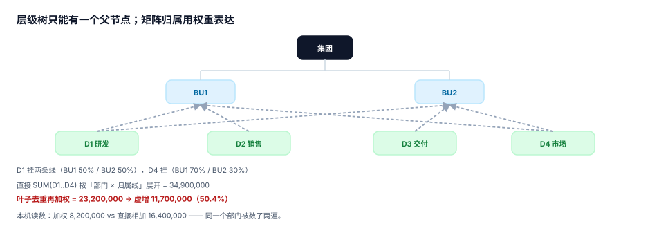

# 责任中心与矩阵归属：一个部门只能有一个父节点

预算要落到「谁负责」，就得先有责任中心的树。麻烦从第二天就开始了：公司同时跑着**法人架构**（谁签合同）、**管理架构**（谁被考核）、**成本归集架构**（钱记在谁头上）。三套架构大多一致，但总有几个部门不一致——新业务挂在创新事业部下面，考核却挂在销售条线；共享中心给三条业务线同时服务。

于是「汇总一下全公司在研发上花了多少」这句话，在不同人那里会得到三个不同的答案，而三个都「有据可查」。

::: tip 一句话理解
树只能有一个父节点，矩阵只能用权重表达。**允许一个部门挂两个父节点，汇总就一定会把它数两遍，而每一层的数看起来都对。**
:::

## 一、五种责任中心，五种考核指标

| 类型 | 负责什么 | 考核指标 | 典型失控 |
| --- | --- | --- | --- |
| 成本中心 | 单位成本 | 单位成本、产能利用率 | 为了降单位成本而牺牲质量 |
| 费用中心 | 费用总额 | 费用预算执行率 | 年底突击花钱 |
| 收入中心 | 收入规模 | 收入、回款 | 用折扣换收入 |
| 利润中心 | 收入 − 成本 | 毛利、营业利润 | 转移定价操纵利润 |
| 投资中心 | 占用的资本 | ROI、EVA | 少提折旧、压库存做高 ROI |

判据只有一条：**中心的类型必须与考核指标的类型一致**。给费用中心考核 ROI，它会把该花的钱省下来；给投资中心只考核费用率，它会拼命买设备。

## 二、树：唯一父节点 + 稳定编码



```sql
CREATE TABLE cost_center(
  cc          TEXT PRIMARY KEY,          -- 'CC07'
  name        TEXT NOT NULL,
  parent_cc   TEXT REFERENCES cost_center(cc),
  cc_type     TEXT NOT NULL CHECK (cc_type IN ('cost','expense','revenue','profit','invest')),
  is_leaf     INTEGER NOT NULL DEFAULT 1,
  valid_from  TEXT NOT NULL,
  retired_at  TEXT                       -- 停用时间，编码永不回收
);
-- 一个中心只能有一个父节点：靠单列 parent_cc 保证，
-- 不要用 cost_center_parent(cc, parent_cc) 这种多对多表
```

三条设计纪律：

1. **父节点是一列，不是一张关联表**。一旦建了关联表，就允许了两条父链，而「哪个是真的」只能靠应用层判断——应用层迟早会漏。
2. **编码不复用、不回收**。`CC07` 停用后永远空着，新部门用 `CC13`。复用会让历史数据的含义随时间改变，而历史数据不会报错。
3. **组织调整 = 新中心 + 迁移**，不是改 `parent_cc`。改父节点会让去年的报表按今年的架构重算，同比数据失去意义。

## 三、矩阵归属：用权重，不用重复行

当一个部门同时归属两条业务线时，只有两种表达方式：

| 表达方式 | 结构 | 汇总 | 风险 |
| --- | --- | --- | --- |
| 重复行 | 一个 cc 出现两条 `(cc, biz_line)` | `SUM(amount)` 直接加 | **必然重复计入** |
| 权重 | `(cc, biz_line, weight)`，`Σweight = 1` | `SUM(amount × weight)` | 权重和不为 1 时仍会偏 |

本机读数（4 个叶子中心、D1 与 D4 各挂两条线）：

- 叶子合计（去重）**23,200,000.00**
- 按「部门 × 归属线」直接 `SUM` **34,900,000.00**
- **虚增 11,700,000.00（50.4%）**

单个部门看更直观：D1 金额 8,200,000，挂在 BU1 与 BU2 各 50%。按权重算合计还是 8,200,000；按重复行直接加是 **16,400,000**——同一个部门被数了两遍，而两条线的报表都「对」。

```sql
-- 正确：先按叶子去重，再按权重摊到条线
WITH leaf AS (
  SELECT cc, SUM(amount) AS amount
    FROM budget_line b JOIN budget_version v ON v.ver = b.ver AND v.state = 'current'
   WHERE b.period BETWEEN '2026-01' AND '2026-12'
   GROUP BY cc
)
SELECT m.biz_line, SUM(l.amount * m.weight) AS amount
  FROM leaf l JOIN cc_biz_line m ON m.cc = l.cc
 GROUP BY m.biz_line;
-- 所有条线之和 = 叶子合计；若不想按条线拆，就别 join 这张表
```

::: danger 权重表的四个坑
1. **权重和不为 1**：`Σweight = 0.98`，于是分摊后总额少 2%——没人发现，因为每个条线的数都变小了一点点。加约束 `CHECK`，或用一个 `allocation_run` 校验总和。
2. **权重随时间变化**：7 月组织调整后权重变了，如果权重表没有 `valid_from/valid_to`，重算历史会得到新答案。
3. **只在汇总时按权重、明细却按重复行**：明细报表与汇总报表永远对不上，且两边都能自证。
4. **把权重当成本分摊比例**：矩阵归属的权重是「归属」，不产生内部结算；成本分摊是「转移」，要进对方的费用。两者混用会让同一笔钱既被归属又被转移。
:::

## 四、共享中心：双向归属必须能对账

共享中心（HR、财务、IT 运维）同时服务三条业务线，它的费用有两个方向：

| 方向 | 含义 | 对账口径 |
| --- | --- | --- |
| 归属（attribution） | 这条线「用了多少」 | 动因量（工单数、人头数） |
| 转移（chargeback） | 这条线「付了多少」 | 内部结算单，进对方费用 |

两个方向的数**本来就不相等**（归属按动因、转移按协议价），所以不能互相校验。能校验的是各自内部：

```sql
-- 归属侧：动因量之和 = 共享中心总动因量
SELECT SUM(qty) FROM shared_service_usage WHERE period = '2026-07';
-- 转移侧：结算单金额之和 = 共享中心开出的内部发票总额
SELECT SUM(amount) FROM internal_invoice WHERE period = '2026-07' AND from_cc = 'SSC01';
```

## 五、每笔预算行必须挂到叶子中心

这是最容易被放过的一条。允许预算行挂在非叶子中心（比如直接挂在「集团」），会带来两个后果：

1. **责任无法下沉**：这笔钱没人认领，年底超支时找不到负责人。
2. **汇总翻倍风险**：如果汇总 SQL 同时加了「集团本级」与「集团下级」，同一笔钱被算两次。

```sql
-- 判据：非叶子中心上不应有预算行
SELECT b.cc, COUNT(*)
  FROM budget_line b JOIN cost_center c ON c.cc = b.cc
 WHERE c.is_leaf = 0 GROUP BY b.cc;
-- 期望：0 行
```

例外只有一种：**集团层面的不可分摊费用**（审计费、上市费），这类费用要单独建一个 `is_leaf = 1` 的虚拟中心（如 `CC99 集团本级`），而不是挂在根节点上。

## 六、组织调整的三种做法

| 做法 | 历史数据 | 同比可比 | 评价 |
| --- | --- | --- | --- |
| 改 `parent_cc` | 被重算 | 不可比 | 禁止 |
| 新建中心 + 迁移 | 保留 | 需要映射表才可比 | 推荐 |
| 双写（新旧各一套） | 两套都在 | 需人工对账 | 只用于过渡期，必须设截止日 |

推荐的迁移表长这样：

```sql
CREATE TABLE cc_restructure(
  old_cc TEXT NOT NULL, new_cc TEXT NOT NULL,
  effective_from TEXT NOT NULL, ratio NUMERIC NOT NULL CHECK (ratio > 0 AND ratio <= 1),
  reason TEXT NOT NULL,
  PRIMARY KEY (old_cc, new_cc, effective_from)
);
```

`ratio` 是拆分比例：`CC07` 拆成 `CC13`（70%）与 `CC14`（30%）时，历史上 `CC07` 的数按 7:3 摊到两个新中心，同比才有意义。

## 判据

本页判据族 `BPR-A` ~ `BPR-H`，共 8 条，逐条可判定：

| 编号 | 判据 | 怎么判 |
| --- | --- | --- |
| `BPR-A` | 中心类型与考核指标类型一致 | 类型表与指标字典对照 |
| `BPR-B` | 树是单父结构（父节点为一列） | 无 `cc_parent` 多对多表 |
| `BPR-C` | 矩阵归属用权重且 `Σweight = 1` | 按 cc 分组求和 = 1 |
| `BPR-D` | 汇总 SQL 去重口径固定，条线之和 = 叶子合计 | 两条 SQL 结果相等 |
| `BPR-E` | 编码不复用、不回收 | `retired_at` 非空的编码无再次启用 |
| `BPR-F` | 组织调整走「新中心 + 迁移比例」 | `cc_restructure` 有记录，历史未被改写 |
| `BPR-G` | 共享中心双向归属各自内部对账 | 动因合计、结算合计两条 SQL 各自相等 |
| `BPR-H` | 预算行只挂在叶子中心 | 非叶子中心预算行数 = 0 |

## 验证方式

先验证「重复行会把一个部门数两遍」，再验证权重口径下条线之和等于叶子合计：

```shell
# 1) 本页判据 8 条
grep -o 'BPR-[A-H]' docs/Backend/Budgeting/ResponsibilityModel/index.md | sort -u | wc -l

# 2) 重复行 vs 权重
python3 - <<'PY'
leaf = {"D1": 8_200_000, "D2": 4_600_000, "D3": 6_900_000, "D4": 3_500_000}
owner = {"D1": 2, "D2": 1, "D3": 1, "D4": 2}
naive = sum(leaf[d] * owner[d] for d in leaf)
true = sum(leaf.values())
print("去重 %.2f / 直接加 %.2f / 虚增 %.2f（%.1f%%）" %
      (true, naive, naive - true, (naive - true) / true * 100))
PY

# 3) 全库判据不撞号
python3 utils/audit/judgeidcheck.py --root . | tail -1
```

预期输出：第一条 `8`；第二条打印 `去重 23200000.00 / 直接加 34900000.00 / 虚增 11700000.00（50.4%）`；第三条 `E=0`。若第二条的虚增比例是 0，检查你的测试数据里是否所有部门都只挂了一条线——那样的数据测不出这个缺陷。

## 参考资料

- [编制与基线](../PlanningCycle/index.md)
- [分摊与内部转移定价](../Allocation/index.md)
- Horngren《Cost Accounting: A Managerial Emphasis》第 6 章（责任中心与可控性原则）
- 《企业内部控制应用指引第 15 号——全面预算》第三章（预算执行与责任落实）：<https://www.mof.gov.cn/>
- IMA《Responsibility Accounting and Transfer Pricing》：<https://www.imanet.org/>
