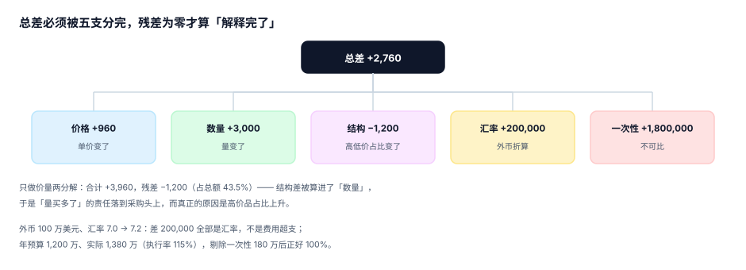

# 差异归因与口径桥：把总差分成五支

「这个月超了 276 万」——这句话在经营会上没有任何用。因为它没有回答三个问题：**超在哪个因素上**、**这个因素谁负责**、**有多少是一次性不可比**。

差异归因就是把一个总差拆成若干个**互斥且穷尽**的分支，并且让分支的合计严格等于总差。做不到「严格等于」，说明分解口径本身有漏项，后面所有的责任认定都不可信。

::: tip 一句话理解
归因的第一条判据不是「准」，是**「平」**：五支加起来必须正好等于总差。加不平的分解，一定有某一支把别的支的差异吸收了。
:::

## 一、五支分解：价格、数量、结构、汇率、一次性



设定：两个产品 A/B，预算量 1,000（各 50%）、预算价 10/20；实际量 1,200（60%/40%）、实际价 11/20.5。

```text
预算 = 1000 × (0.5×10 + 0.5×20) = 15,000.00
实际 = 1200 × (0.6×11 + 0.4×20.5) = 17,760.00
总差 = +2,760.00
```

| 分支 | 公式 | 金额 | 谁负责 |
| --- | --- | --- | --- |
| 价格差 | Σ 实际量 × 实际结构 × (实际价 − 预算价) | **+960.00** | 采购 / 定价 |
| 数量差 | (实际总量 − 预算总量) × 预算加权均价 | **+3,000.00** | 业务量 / 销售 |
| 结构差 | 实际总量 × Σ(实际结构 − 预算结构) × 预算价 | **−1,200.00** | 产品组合决策 |
| 汇率差 | 外币金额 × (实际汇率 − 预算汇率) | 见第二节 | 财务 |
| 一次性项 | 白名单内的不可比支出 | 见第三节 | 立项人 |
| **合计** | | **+2,760.00** | 残差 0 |

验算：`960 + 3,000 − 1,200 = 2,760`。残差为 0，说明这三分支已经穷尽了这个例子的总差。

::: danger 只做「价量两分解」会得出相反的责任结论
本机读数：只做价量两分解，合计 `+3,960`，残差 **−1,200（占总额 43.5%）**。

这 1,200 的缺口会被计算方式「自动」并进数量差里——于是结论变成「量买多了，销售/采购负责」。而真实原因是**高价品占比从 50% 升到 60%**，属于产品组合决策。两个结论的责任人完全不同，而报表上的数字只差一个「结构差」列。

必须补结构差的三类场景：多产品组合、多渠道/多地区混合、多客户等级混合。单一产品单价的场景可以省，但只要有两个以上的价，就必须拆。
:::

## 二、汇率差不能混进费用差

外币支出 100 万美元、预算汇率 7.0、实际汇率 7.2：

| 项 | 金额 |
| --- | --- |
| 预算（7.0） | 7,000,000.00 |
| 实际（7.2） | 7,200,000.00 |
| 总差 | 200,000.00 |
| 其中汇率差 | **200,000.00（2.9%）** |
| 折成执行率 | 102.9% |

如果把这 20 万混进「费用超支」，会出现两个后果：业务部门被要求解释一笔它根本无法控制的支出；财务的汇率对冲效果永远算不清。

汇率差单独列示之后，剩下的「量 × 价」才是业务能解释的部分。三条规则：

1. **折算汇率必须来自冻结的快照**，不能按关账当天的牌价重算（否则同一期报表每次跑都不同）。
2. **汇率差单列一个科目**（`6604 汇兑损益` 或管理口径的「汇率影响」行），不混入业务科目。
3. **预算汇率与实际汇率的来源都要落库**（`fx_budget_rate`、`fx_actual_rate`），否则差异无法复算。

## 三、一次性项：白名单 + 凭证

年预算 1,200 万，实际 1,380 万，执行率 115%。其中一次性项 180 万（15.0%），剔除后执行率正好 100%。

同比更能说明问题：

| 口径 | 金额 | 同比 |
| --- | --- | --- |
| 本年实际（含一次性） | 13,800,000 | **+20.0%** |
| 剔除一次性 | 12,000,000 | **+4.3%** |
| 上年实际 | 11,500,000 | — |

同一个数，「增长 20%」和「增长 4.3%」是两个完全不同的经营判断。所以一次性项必须有白名单，而不是每次开会临时讨论：

```sql
CREATE TABLE one_off_item(
  id          TEXT PRIMARY KEY,
  period      TEXT NOT NULL,
  cc          TEXT NOT NULL,
  acct        TEXT NOT NULL,
  amount      NUMERIC NOT NULL,
  category    TEXT NOT NULL,      -- 'restructuring' / 'litigation' / 'impairment' / 'mna'
  evidence    TEXT NOT NULL,      -- 董事会决议号、判决书号、评估报告号
  approved_by TEXT NOT NULL
);
```

判据：**每一条一次性项都能指名到一份凭证**。指不到凭证的，就不是一次性项，是超支。

## 四、管理口径与法定口径的桥

经营分析用管理口径（剔除一次性、剔除股权激励、按固定汇率），对外报表用法定口径。两个数必须能桥接，且桥的两端严格相等：

| 步骤 | 金额 | 说明 |
| --- | --- | --- |
| 法定口径营业利润 | 8,600,000 | 报表数 |
| + 一次性重组费用 | 1,800,000 | `one_off_item` 白名单 |
| + 股权激励摊销 | 900,000 | 非现金 |
| − 资本化开发支出转回 | −600,000 | 管理口径当期费用化 |
| ± 汇率影响（按预算汇率重算） | +200,000 | 固定汇率口径 |
| **管理口径营业利润** | **10,900,000** | 必须能被上面五行加出来 |

注意最后一行是**加出来的结果**，不是另一个系统里的数。如果两个系统各算一遍，桥就永远差几万块，然后有人手工调平——手工调平的那一刻，这套体系就失去了审计价值。

```sql
-- 桥表：每一行都要能追到明细
CREATE TABLE pnl_bridge(
  fiscal_year TEXT NOT NULL, period TEXT NOT NULL,
  step_no     INTEGER NOT NULL,
  label       TEXT NOT NULL,
  amount      NUMERIC NOT NULL,
  source_ref  TEXT NOT NULL,          -- 指向 one_off_item / 科目余额 / 汇率表
  PRIMARY KEY (fiscal_year, period, step_no)
);
```

## 五、归因到人：差异必须落到一个可行动的点

| 差异类型 | 可行动归属 | 不可行动归属（禁止） |
| --- | --- | --- |
| 价格差 | 采购经理 / 定价委员会 | 「市场价格上涨」 |
| 数量差 | 销售负责人 / 产能计划 | 「需求好」 |
| 结构差 | 产品组合决策人 | 「客户偏好变了」 |
| 汇率差 | 财务（对冲比例） | 「汇率波动」 |
| 一次性 | 立项人 | 「特殊情况」 |

判据很简单：**这个归属人下个月能做一个不同的决定**。做不到，就说明还没归到位。

## 六、差异的分级上报

不是所有差异都值得开会。用「金额 + 比例」双阈值分级：

| 级别 | 触发条件 | 动作 |
| --- | --- | --- |
| L1 关注 | 绝对额 > 5 万 且 比例 > 5% | 进部门周报 |
| L2 解释 | 绝对额 > 50 万 或 比例 > 15% | 进月度经营会，需书面归因 |
| L3 干预 | 绝对额 > 200 万 或 影响全年 > 3% | 进预算委员会，需调整方案 |

双阈值是必须的：只看比例，100 万预算的部门差 10% 只有 10 万，不值得开会；只看金额，10 亿预算的部门差 200 万只有 0.2%，也不值得。

## 判据

本页判据族 `BPV-A` ~ `BPV-H`，共 8 条，逐条可判定：

| 编号 | 判据 | 怎么判 |
| --- | --- | --- |
| `BPV-A` | 分解恒等式闭合：五支之和 = 总差（残差 = 0） | 分解 SQL 的残差列全 0 |
| `BPV-B` | 结构差单列，不并入数量差 | 分解结果含 `mix_effect` 列 |
| `BPV-C` | 汇率差单列，用冻结快照汇率 | 分解结果含 `fx_effect` 且汇率有来源 |
| `BPV-D` | 一次性项有白名单与凭证号 | 每条 `one_off_item` 有 `evidence` |
| `BPV-E` | 管理口径与法定口径桥两端相等 | 桥表首末行差额 = 0 |
| `BPV-F` | 每类差异有可行动归属人 | 差异表有 `owner` 且非「市场原因」类描述 |
| `BPV-G` | 分级阈值（金额 + 比例）明确，L2/L3 有书面归因 | 阈值配置 + 归因记录 |
| `BPV-H` | 归因结论回写下一轮编制或预测 | 预测/编制表引用 `variance_snapshot.id` |

## 验证方式

先验证三分支能闭合，再验证「只做价量分解会算错责任人」：

```shell
# 1) 本页判据 8 条
grep -o 'BPV-[A-H]' docs/Backend/Budgeting/Variance/index.md | sort -u | wc -l

# 2) 四分解闭合检验
python3 - <<'PY'
B = dict(q=1000, mix=(0.5, 0.5), price=(10.0, 20.0))
A = dict(q=1200, mix=(0.6, 0.4), price=(11.0, 20.5))
ba = sum(B["q"] * m * p for m, p in zip(B["mix"], B["price"]))
aa = sum(A["q"] * m * p for m, p in zip(A["mix"], A["price"]))
tot = aa - ba
pe = sum(A["q"] * A["mix"][i] * (A["price"][i] - B["price"][i]) for i in range(2))
qe = (A["q"] - B["q"]) * sum(B["mix"][i] * B["price"][i] for i in range(2))
me = A["q"] * sum((A["mix"][i] - B["mix"][i]) * B["price"][i] for i in range(2))
print("总差 %.2f / 价格 %+.2f / 数量 %+.2f / 结构 %+.2f / 残差 %.2f" %
      (tot, pe, qe, me, tot - (pe + qe + me)))
print("只做价量：合计 %+.2f / 残差 %+.2f" % (pe + qe, tot - (pe + qe)))
PY

# 3) 一次性项对同比的影响
python3 - <<'PY'
cur, one_off, prior = 13_800_000, 1_800_000, 11_500_000
print("含一次性同比 %+.1f%% / 剔除后 %+.1f%%" %
      ((cur - prior) / prior * 100, (cur - one_off - prior) / prior * 100))
PY
```

预期输出：第一条 `8`；第二条打印 `总差 2760.00 / 价格 +960.00 / 数量 +3000.00 / 结构 -1200.00 / 残差 0.00`，以及 `只做价量：合计 +3960.00 / 残差 -1200.00`；第三条打印 `含一次性同比 +20.0% / 剔除后 +4.3%`。若第二条残差不为 0，说明你的结构差公式里漏了「实际总量」这个乘数。

## 参考资料

- [滚动预测](../Forecast/index.md)
- [度量与验收](../Metrics/index.md)
- Horngren《Cost Accounting: A Managerial Emphasis》第 7 章（差异分析的分解结构）
- IMA《Variance Analysis and Management Reporting》：<https://www.imanet.org/>
- IFRS Foundation《IAS 21 — The Effects of Changes in Foreign Exchange Rates》（汇率影响的列示）：<https://www.ifrs.org/issued-standards/list-of-standards/ias-21-the-effects-of-changes-in-foreign-exchange-rates/>
