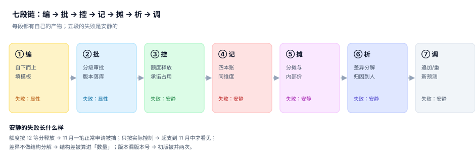
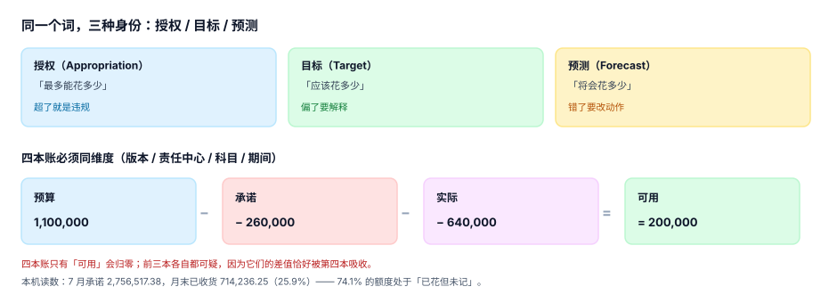

# 全面预算与经营分析

<p style="text-align:center;"></p>

每家公司都有一份「预算」。绝大多数公司的预算只有三个用途：年初开会时贴在 PPT 上、年中超支时找出来看一眼、年末做总结时证明「我们基本按计划走」。

这三件事都不需要预算真的准。**预算真正的作用是一份授权**：它规定「谁在什么期间、对什么科目、能花到多少」。授权一旦落进系统，就变成一条条可以拦截、可以追溯、可以对账的记录。而绝大多数预算失败都不是「编制不准」，而是**授权、占用、实际、预测这四本账从来没有真正对齐过**。

::: tip 一句话理解
预算不是一个数，是一条承诺。**授权、目标、预测是三种身份，混着用的时候谁都不会报错——只有月末对账会。**
:::

## 一、这个专题讲什么

从「各部门交一张 Excel」到「每个月能解释每一次偏差」，要走七段。本专题按这七段组织，每段都标出产物与失败方式：

| 段 | 这一段在做什么 | 产物 | 失败是否安静 |
| --- | --- | --- | --- |
| ① 编 | 自下而上填模板、自上而下给目标，往返收敛 | `budget_line`（草稿版） | 显性（不交就没有数） |
| ② 批 | 按金额与科目分级审批，落成版本 | `budget_version` | 显性（不批就不能花） |
| ③ 控 | 年预算释放到月，申请与下单时占用额度 | `commitment` | **安静**（额度悄悄被多占） |
| ④ 记 | 预算 / 承诺 / 实际 / 预测四本账同维度对齐 | `actual` / `forecast` | **安静**（错一位数没人发现） |
| ⑤ 摊 | 共享费用按动因分到责任中心，内部交易定价 | `allocation_run` | **安静**（差额被"其他"吸收） |
| ⑥ 析 | 差异按价格/数量/结构/汇率/一次性分解并归因到人 | `variance_snapshot` | **安静**（结构差被算成数量差） |
| ⑦ 调 | 追加、调剂、重预测，形成新版本 | `budget_version`（新） | **安静**（旧版被覆盖） |



七段里**五段的失败是安静的**。它们共同的形态是：预算表看起来完整、合计数看起来正常、系统没有报任何错，只有某一次月末关账、某一次审计、某一次「为什么这个部门花了这么多」的追问，才会把问题翻出来。而那时已经过去三个月了。

## 二、三个「预算」，只有一个是授权

同一个词在三种场合指三件事，而报表里通常只有一个数字：

| 说法 | 回答的问题 | 谁在用 | 说错了的后果 |
| --- | --- | --- | --- |
| 授权（appropriation） | 最多能花多少 | 财务控制、审计 | 超支变成违规，或者该花的钱被挡住 |
| 目标（target） | 应该花多少 | 业务负责人、董事会 | 偏差无法解释，考核失去意义 |
| 预测（forecast） | 将会花多少 | 财务 BP、资金 | 现金准备不足或多备 |

这三个数在健康的体系里是**三个字段**，年初可以相等，年中一定不相等。如果它们共用一个字段，就必然出现两种事故：把「预测超了」当成「已经超支」去冻结额度；或者把「目标没花完」当成「还有钱」去批准新支出。

本专题判的是第一种：**授权要能拦住、目标要能解释、预测要能改动作**，三者各自有版本、有口径、有责任人。

## 三、四本账

授权落到系统里就变成四本账，它们的差值恰好被第四本吸收，所以前三本错在哪一本，从合计数看不出来：

| 账 | 含义 | 什么时候变 | 本机 7 月读数 |
| --- | --- | --- | --- |
| 预算 | 本期授权额度 | 版本批准 / 调整 / 追加 | 2,756,517.38（承诺侧） |
| 承诺 | 已下单未收货 | 采购订单审批通过 | 2,042,281.13（占 74.1%） |
| 实际 | 已入账费用 | 收货 / 发票 / 分摊 | 714,236.25 |
| 可用 | 还能花多少 | 上面三本联动 | 预算 − 承诺 − 实际 |



::: warning 为什么「可用」不能只减实际
本机 7 月的数据：当月承诺 2,756,517.38，月末真正到货入账的只有 714,236.25（25.9%）。如果可用额度只减实际，那么这个部门在 7 月 31 日看起来还有 74% 的额度没花，采购会继续下单——而实际上这些钱已经花出去了，只是还没到货。
:::

## 四、与其它专题的分工

库里跟「钱」有关的册子已经有五本，问的问题各不相同。先看这张表再决定读哪一册：

| 你关心的问题 | 该读哪一册 | 为什么不是本册 |
| --- | --- | --- |
| 「这笔业务怎么拆成借贷两腿、横平不平」 | [复式记账与分录](../Ledger/DoubleEntry/index.md) | 那册判**记账规则**，本册判**花钱的授权** |
| 「产品成本怎么算出来、月末怎么结」 | [成本核算与月末结账](../CostAccounting/Overview/index.md) | 那册判**金额守恒**（材料+人工+费用=转入成本），本册判**额度是否被授权** |
| 「这个月现金够不够、13 周后会不会缺」 | [资金管理与现金流预测](../Treasury/Overview/index.md) | 那册判**余额的时间**，本册判**费用的授权** |
| 「集团合并时内部交易怎么抵销」 | [合并报表与内部交易抵销](../Consolidation/Overview/index.md) | 那册判**跨主体只数一次**，本册只判**同一主体内的额度** |
| 「收入什么时候能确认」 | [收入确认与递延收入](../RevenueRecognition/Overview/index.md) | 那册判**义务有没有消**，本册不碰收入确认 |
| 「资产怎么折旧、账实对不对」 | [资产台账与折旧摊销](../FixedAsset/Overview/index.md) | 那册判**账实相符**，本册只管**资本化支出的额度** |
| 「采购订单到发票怎么三单匹配」 | [采购到付款](../ProcureToPay/Overview/index.md) | 那册判**三份文件是否一致**，本册判**这笔钱有没有预算** |
| 「部门与人的编制、薪酬怎么算」 | [薪酬核算与个税社保](../Payroll/Overview/index.md) | 那册判**三本账各自竖直**，本册只把人工成本当预算行 |

::: info 为什么不并入「成本核算与月末结账」
两册都会出现「差异」这个词，但差的东西不同：成本核算的差异是**实际成本与标准成本之差**（对象是产品，判据是守恒式）；本册的差异是**实际支出与授权额度之差**（对象是责任中心，判据是能被解释、能被归因到人）。

一组最直观的反例：一家公司的产品成本核算完全准确（材料、人工、费用分毫不差），同时销售部门的差旅预算超了 40% 且无人知晓——两件事互不影响，前者全绿，后者全错。
:::

## 五、本机读数（种子 20261102）

12 个责任中心、5 个科目、12 个月、3,000 张采购订单，跑完七段得到七个数字，后面每一页都会用到：

| 环节 | 读数 | 说明 |
| --- | --- | --- |
| 期间化 | 11 月一笔 1,050,000 的申请 | 等分口径差 50,000 被挡，季节口径余 50,000 放行 |
| 承诺 | 7 月 74.1% 的额度「已花但未记」 | 只按实际控制等于放弃一半额度 |
| 控制 | 硬控阻塞 153 笔（12.8%） | 无控制时年末超支 5,435,463.48 |
| 差异 | 只做价量分解残差 −1,200（43.5%） | 结构差被算进「数量」 |
| 汇总 | 矩阵归属直接 SUM 虚增 50.4% | 23,200,000 → 34,900,000 |
| 分摊 | 比例保留 4 位再加总差 +1,200 | 逐行四舍五入只差 0.01 |
| 版本 | 漏版本条件虚增 93.4% | 53,026,185.93 → 102,551,730.02 |
| 预测 | 运行率外推均值 −2.05% | 系统性低估，方向比大小重要 |

::: warning 这七个数字之间的关系
它们不是七个独立指标，是**同一条链上七次「安静失败」的度量**。被挡的那笔申请、被放弃的那 74% 额度、被算错的那 1,200 块结构差、被数了两遍的那 1,170 万，没有一个会让接口返回 500，也没有一个会出现在「预算执行率」这一个数字里。这正是本专题要建立判据的理由。
:::

## 六、章节索引

| 章 | 章节 | 判据族 | 条数 |
| --- | --- | --- | --- |
| 1 | [总览：七段链与三个「预算」](Overview/index.md) | `BPO-A` ~ `BPO-H` | 8 |
| 2 | [编制与基线：三轮收敛怎么收](PlanningCycle/index.md) | `BPC-A` ~ `BPC-H` | 8 |
| 3 | [责任中心与矩阵归属：一个部门只能有一个父节点](ResponsibilityModel/index.md) | `BPR-A` ~ `BPR-H` | 8 |
| 4 | [审批与版本：版本是单向的，冻结是物理的](ApprovalVersion/index.md) | `BPA-A` ~ `BPA-H` | 8 |
| 5 | [期间化、承诺与预算控制：额度在哪个时点被占用](PeriodCommitment/index.md) | `BPP-A` ~ `BPP-H` | 8 |
| 6 | [差异归因与口径桥：把总差分成五支](Variance/index.md) | `BPV-A` ~ `BPV-H` | 8 |
| 7 | [滚动预测：三轨并行与偏差方向](Forecast/index.md) | `BPF-A` ~ `BPF-H` | 8 |
| 8 | [分摊与内部转移定价：只改归属，不改合计](Allocation/index.md) | `BPL-A` ~ `BPL-H` | 8 |
| 9 | [度量与验收：执行率的分母是什么](Metrics/index.md) | `BPM-A` ~ `BPM-H` | 8 |
| 10 | [实战：七张表跑通一次额度控制](Practice/index.md) | `BPX-A` ~ `BPX-H` | 8 |

## 七、验证方式

先确认目录结构与判据编号，再复现「全年执行率正好 100%、上下半年各差一截」这个论断：

```shell
# 1) 目录页 + 10 章齐备
ls -d docs/Backend/Budgeting/*/ | grep -v assets | wc -l

# 2) 本专题判据族 10 个、每个 8 条
grep -rho 'BP[A-Z]-[A-H]' docs/Backend/Budgeting | sort -u | wc -l

# 3) 全库判据不撞号
python3 utils/audit/judgeidcheck.py --root . | tail -1

# 4) 复现「全年平、半年不平」
python3 - <<'PY'
h1, h2 = 5_000_000 * 0.951, 5_000_000 * 1.049
print("上半年 %+.1f%% / 下半年 %+.1f%% / 全年 %+.1f%%" %
      ((h1 - 5_000_000) / 5_000_000 * 100, (h2 - 5_000_000) / 5_000_000 * 100,
       (h1 + h2 - 10_000_000) / 10_000_000 * 100))
PY
```

预期输出：第一条 `10`；第二条 `80`；第三条 `E=0`；第四条打印 `上半年 -4.9% / 下半年 +4.9% / 全年 +0.0%`——**三个数同时成立**，就是本专题要防的那件事：一个「执行率 100%」的年度结论，掩盖了两个各差 5% 的半年。

## 参考资料

- [总览：七段链与三个「预算」](Overview/index.md)
- [期间化、承诺与预算控制](PeriodCommitment/index.md)
- [差异归因与口径桥](Variance/index.md)
- IMA《Statement on Management Accounting: Budgeting》（预算的授权与目标两种身份）：<https://www.imanet.org/>
- 《企业内部控制应用指引第 15 号——全面预算》（预算编制、执行、考核的控制要求）：<https://www.mof.gov.cn/>
- IFRS Foundation《Conceptual Framework for Financial Reporting》（管理口径与法定口径的桥接基础）：<https://www.ifrs.org/issued-standards/list-of-standards/conceptual-framework/>
