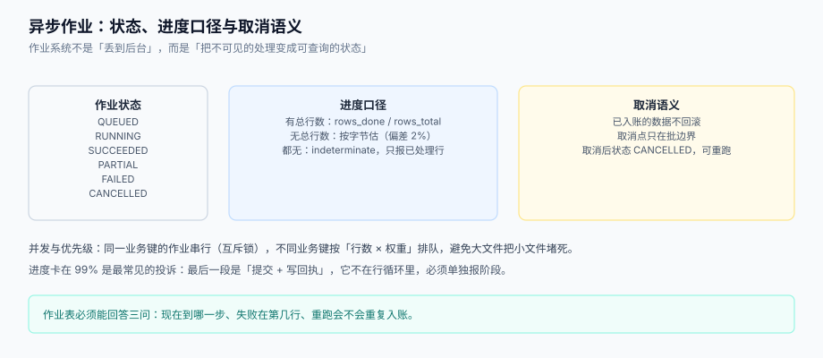

# 异步作业：进度、取消与并发

一次导入 10 万行要跑几十秒到几分钟，HTTP 请求撑不住；一次导出百万行要几十秒，用户也不会盯着转圈。于是所有批量操作最终都要变成**异步作业**：提交返回一个 `job_id`，前端轮询或用 SSE 看进度。

作业系统看起来只是「丢到后台线程」，真正的难点是三个问题：**进度怎么报才不骗人、取消之后数据在哪、多个作业抢资源时谁先跑**。这一页逐个回答。



本页判据族 `BDJ-A` ~ `BDJ-H`，共 8 条。定义表在第七节。

## 一、作业模型：一个作业，一次状态迁移，一条终态

```sql [db/import_job.sql]
CREATE TABLE batch_job (
  job_id        BIGSERIAL    PRIMARY KEY,
  job_type      VARCHAR(16)  NOT NULL,        -- IMPORT | EXPORT
  biz_key       VARCHAR(128) NOT NULL,        -- 例：batch_no 或 export_id
  status        VARCHAR(16)  NOT NULL,        -- QUEUED/RUNNING/SUCCEEDED/PARTIAL/FAILED/CANCELLED
  phase         VARCHAR(24),                  -- PARSING/VALIDATING/COMMITTING/RECEIPT
  rows_total    BIGINT,                       -- 未知时为 NULL，不要写 0
  rows_done     BIGINT       NOT NULL DEFAULT 0,
  bytes_total   BIGINT,                       -- 无行数时用它估算
  bytes_done    BIGINT       NOT NULL DEFAULT 0,
  progress      SMALLINT,                     -- 0~100，NULL 表示 indeterminate
  error_code    VARCHAR(32),
  error_message TEXT,
  requested_by  VARCHAR(64)  NOT NULL,
  created_at    TIMESTAMPTZ  NOT NULL DEFAULT now(),
  started_at    TIMESTAMPTZ,
  finished_at   TIMESTAMPTZ
);

CREATE INDEX ix_job_status_created ON batch_job (status, created_at);
CREATE UNIQUE INDEX ux_job_bizkey_type ON batch_job (job_type, biz_key);
```

最后一行的唯一索引很关键：**同一个业务对象只允许一个作业**。这样「用户点两次导出」不会产生两个百万行导出任务，第二个请求直接返回已有 `job_id`。

## 二、进度：三种口径，别混着用

| 情况 | 口径 | 表达式 | 前端展示 |
| --- | --- | --- | --- |
| 已知总行数 | 按行 | `rows_done / rows_total` | `已处理 62,000 / 100,000（62%）` |
| 只有字节数（流式读文件） | 按字节估 | `bytes_done / bytes_total` | 同上，但注明「估算」 |
| 都不知道（SSE / 管道） | 不确定 | `progress = NULL` | 只显示「已处理 N 行」+ 转圈 |

**按字节估行数是有偏差的**：本机造了一份「大部分行等长、少量行超长」的 CSV（20,000 行），字节走到 50% 时，实际行数只有 **50.98%**。偏差不大，但如果行长分布极端（比如有几百条超长备注），偏差会到两位数。所以口径里要写明「按字节估算」。

### 为什么进度会卡在 99%

因为**最后 1% 不是行循环**。一个导入作业的实际阶段是：

```text
PARSING（读文件） → VALIDATING（校验） → COMMITTING（写库） → RECEIPT（写回执 + 对账）
```

行循环只覆盖前两段。如果 `progress` 只按行算，走到 100% 时写库与回执还没开始，而写库往往是最慢的一段（尤其有唯一索引时）。正确做法是**给每个阶段分配权重**：

| 阶段 | 权重（经验值） | 依据 |
| --- | --- | --- |
| PARSING | 25% | 解析是纯 CPU，10 万行约几秒 |
| VALIDATING | 25% | 含引用查询，可能比解析慢 |
| COMMITTING | 45% | 写库 + 索引维护，最慢 |
| RECEIPT | 5% | 生成文件 + 对账 SQL |

权重不是拍脑袋，而是**用一次真实运行的分段耗时算出来的**；算完写进配置，作业跑的时候按阶段报进度。

## 三、取消：只在批边界生效

| 取消方式 | 行为 | 风险 |
| --- | --- | --- |
| 直接 `kill` 线程 | 数据库连接被强断，事务回滚（或更糟：连接池里留下脏状态） | 高 |
| 设置 `cancel_requested` 标志，循环里检查 | 在当前批结束后停止，已提交的批保留 | 低（推荐） |
| 数据库层 `pg_cancel_backend` | 立即中断当前语句 | 中：语句级中断，事务仍需回滚 |

推荐的写法：

```python [app/job/cancel.py]
class Cancelled(Exception):
    pass

def run_batch(job_id: int, rows, repo, chunk: int = 500):
    for i in range(0, len(rows), chunk):
        if repo.is_cancel_requested(job_id):      # 每次批前查一次
            raise Cancelled()
        repo.commit_chunk(rows[i:i + chunk])
```

三条纪律：

1. **取消只在批边界检查**，不要在行循环里每行查一次数据库——那会把取消检查变成性能瓶颈。
2. **取消不回滚已提交的批**。语义写死：「已入账 N 行，剩余 M 行未处理」，并在回执里给出这个数字。想「一点痕迹不留」的实现需要长事务，会把目标表锁住，代价远大于收益。
3. **取消后状态是 `CANCELLED`，不是 `FAILED`**。两者对用户的意义完全不同：前者是「我不想要了」，后者是「系统出错了」，重试策略也不同。

## 四、并发与优先级：别让一个大文件堵住所有人

批量队列最常见的抱怨是「我传了一个 3 行的文件，等了 20 分钟」。原因是队列按 FIFO，前面有个 50 万行的任务在跑。

| 调度策略 | 规则 | 效果 |
| --- | --- | --- |
| FIFO | 先到先跑 | 大文件阻塞小文件 |
| **按预估工作量加权**（推荐） | 优先级 = `weight / 预估行数`，小文件优先 | 小文件秒回，大文件后台跑 |
| 分池 | 小文件池（≤1 万行）与大文件池分开，各自并发度不同 | 隔离性好，实现稍复杂 |
| 抢占 | 大文件跑一半让位 | 实现复杂，状态难收敛，不建议 |

还要限制**同一业务键的并发**：同一个 `namespace` 下的两个导入作业并行，很可能写同一批业务键，最后谁生效取决于提交顺序。用「业务键维度串行 + 全局并发上限」两条规则就够了。

```yaml [config/batch.yaml]
batch:
  worker_concurrency: 4          # 全局并发
  small_file_rows: 10000         # 小文件阈值
  chunk_size: 500
  job_timeout_seconds: 1800
  per_namespace_serial: true     # 同 namespace 串行
  stages:
    PARSING: 25
    VALIDATING: 25
    COMMITTING: 45
    RECEIPT: 5
```

## 五、超时与重试：作业级的幂等

作业超时（`job_timeout_seconds`）到点必须能停下来，否则一个卡死的作业会永久占用 worker。而重试的前提是**作业本身幂等**：

| 层 | 幂等键 | 重试时 |
| --- | --- | --- |
| 作业 | `(job_type, biz_key)` 唯一索引 | 返回已有作业，不新建 |
| 批次 | `batch_no`（内容哈希） | 命中已有批次，从断点续跑 |
| 行 | 业务唯一键 + upsert | 覆盖写，不产生新行 |

三者串起来，才能做到「重试任意多次，结果一致」。缺任何一层，重试都会留下痕迹：缺作业层 → 队列里堆满重复作业；缺批次层 → 跑两遍、回执两份；缺行层 → 数据翻倍。

## 六、可观测：作业系统要能回答四个问题

| 问题 | 指标 | 采集方式 |
| --- | --- | --- |
| 队列堵不堵 | `queue_wait_seconds`（P50/P95） | 作业开始时间 − 创建时间 |
| 处理快不快 | `rows_per_second`（按阶段） | `rows_done` 差分 |
| 失败多不多 | `job_failed_total{phase}` | 终态计数 |
| 卡在哪 | `job_running_seconds`（长尾） | 运行中作业的时长分布 |

前三个是趋势，第四个是**止血依据**：当 `job_running_seconds` 的长尾突然变长，通常是数据库写变慢（索引膨胀、锁等待），而不是作业系统本身的问题。

## 七、本页判据

| 编号 | 看什么现象 | 判成什么 | 不满足时改哪里 |
| --- | --- | --- | --- |
| `BDJ-A` | 作业是否有独立表与唯一键 `(job_type, biz_key)` | 无唯一键即失败：重复作业 | 建 `batch_job` 与唯一索引 |
| `BDJ-B` | 进度是否有明确口径（按行/按字节/不确定），且未知时置 `NULL` 而非 0 | 一律写 0 即失败 | 三列并存，缺失置 `NULL` |
| `BDJ-C` | 进度是否按阶段加权，而不是只按行循环 | 只按行算即失败：卡 99% | 配置阶段权重，按阶段累加 |
| `BDJ-D` | 取消是否只在批边界生效，且已提交数据不回滚 | 任意 `kill` 即失败 | `cancel_requested` 标志 + 批边界检查 |
| `BDJ-E` | 取消与失败的终态是否区分 | 都记 `FAILED` 即失败 | 增加 `CANCELLED` |
| `BDJ-F` | 是否有全局并发上限与同 `namespace` 串行 | 无限制即失败：互相覆盖 | 配置 `worker_concurrency` + 串行规则 |
| `BDJ-G` | 是否有作业超时，且超时后能释放 worker | 无超时即失败 | `job_timeout_seconds` + 看门狗 |
| `BDJ-H` | 是否有队列等待、处理速率、失败数、长尾时长四个指标 | 缺任一即失败 | 按第六节埋点 |

## 参考资料

- [幂等重跑、批次状态机与断点](../IdempotentRerun/index.md)（作业层幂等与批次层幂等的关系）
- [行级校验与错误回执](../RowValidation/index.md)（`PARTIAL` 状态从哪来）
- [分布式调度工程](../../DistributedScheduling/index.md)（作业触发与分布式锁）
- PostgreSQL 18 文档《Monitoring Database Activity》（`pg_stat_activity`、`pg_cancel_backend`）：<https://www.postgresql.org/docs/18/monitoring.html>
- Google SRE Book《Handling Overload》（队列、公平性与拒绝策略）：<https://sre.google/sre-book/handling-overload/>
