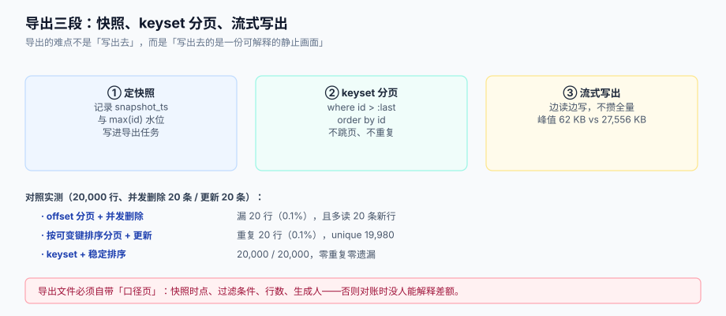

# 导出：快照一致性、分页与流式下载

导入的错会有人投诉，导出的错**往往过一个月才被发现**：财务拿你导出的对账单去核账，差额几分钱，翻遍系统都对不上，最后发现「导出那一刻，有 20 条数据正在被改」。导出没有回执，也没有守恒式，它唯一的验收标准是——**这份文件是某一瞬间的完整画面，且能证明自己是什么时候、按什么条件拍的**。

这一页讲三件事：怎么拿到一份静止的数据（快照）、怎么翻页不重不漏（keyset）、怎么写出去不炸内存（流式 + 分片）。



本页判据族 `BDX-A` ~ `BDX-H`，共 8 条。定义表在第八节。

## 一、为什么「边查边写」一定会错

大多数导出的第一版长这样：

```python
page = 0
while True:
    rows = db.query("select * from orders order by id limit 500 offset ?", page * 500)
    if not rows:
        break
    writer.writerows(rows)
    page += 1
```

它有三个独立的缺陷，每一个都会造成「数据不对」：

| 缺陷 | 机制 | 本机读数（20,000 行） |
| --- | --- | --- |
| **offset 漂移** | 导出期间有人删除了游标之前的数据，后面的页整体前移，跳过的行永远不会被读到 | 删 20 条 → **漏 20 行（0.1%）**，同时多读 20 条新插入的行 |
| **可变排序键** | 按 `updated_at` 排序，导出期间某行被更新，它会「跑到后面再出现一次」 | 更新 20 行 → **重复 20 行**，去重后仅 19,980 |
| **无快照** | 每次查询都是「当前已提交」的数据，页与页之间不是同一时刻 | 6 次 `count(*)` 得到 50,000 / 50,001 / … / 50,005 |

三条叠加起来，就是那句经典的「我导出的表和系统里对不上，差十几条」。

## 二、快照的三种做法

| 做法 | 实现 | 一致性 | 代价 | 适合 |
| --- | --- | --- | --- | --- |
| **单事务可重复读** | 整个导出跑在一个 `REPEATABLE READ` 事务里，所有分页查询共享同一快照 | 强：同一时刻的完整画面 | 长事务持有快照，可能阻碍 vacuum（PostgreSQL）/ 撑大 undo（MySQL） | 中小数据量（十万级）、秒级完成 |
| **水位法** | 导出开始时记录 `snapshot_ts = now()` 与 `max(id)`，所有查询加 `where updated_at <= snapshot_ts and id <= max_id` | 强（前提：`updated_at` 单调且不回填） | 需要业务表有可靠的 `updated_at`；软删除要额外处理 | 大数据量、跨库导出 |
| **物化快照** | 先把结果写进临时表/文件（`create table as select`），再从快照表分页读 | 最强：与源表彻底解耦 | 写放大（一份数据写两次）、需要清理 | 百万级以上、需要多次下载同一份 |

推荐组合：**十万级以内用单事务可重复读；百万级用物化快照**。水位法看起来最优雅，但它对「`updated_at` 是否可靠」的依赖太强——只要有一处代码 `update` 时忘了改 `updated_at`，导出的就是旧值，而且**没有任何报错**。

::: danger 注意
1. **不要用 `now()` 当水位却不写进文件**。`snapshot_ts` 必须落到导出记录里，否则事后无法解释「为什么这份文件里没有昨天新增的那条」。
2. **不要在长事务里做慢操作**。单事务快照期间如果还要调外部接口、生成 Excel、上传对象存储，事务可能挂几分钟——PostgreSQL 上这会拖住 autovacuum，MySQL 上会撑大 undo log。做法是：**事务只负责「读进临时文件」，出事务后再做格式转换与上传**。
3. **不要依赖「导出期间没人写」**。批量导出往往在业务高峰被触发（月结、审计），恰恰是写入最频繁的时候。
:::

## 三、keyset 分页：把 offset 换成「上一页的最后一个键」

```sql
-- ❌ offset 分页：越翻越慢，且会漂移
SELECT id, order_no, amount FROM orders ORDER BY id LIMIT 500 OFFSET 15000;

-- ✅ keyset 分页：定位精确，翻页恒定速度
SELECT id, order_no, amount FROM orders
WHERE (id) > (:last_id)
ORDER BY id
LIMIT 500;
```

三个要点：

1. **排序键必须唯一且不可变**。`id` 主键最好；用 `(created_at, id)` 也可以，但**必须带 `id` 做 tiebreaker**，否则同一毫秒的多行在不同页里顺序不定，会重会漏。
2. **多列 keyset 用行值比较**，不要写成 `a > x and b > y`（那是错的）：
   ```sql
   WHERE (created_at, id) > (:last_created_at, :last_id)
   ORDER BY created_at, id
   ```
3. **`last_id` 从结果里取，不要自己算**。`last_id = page * 500` 只在「ID 连续且无删除」时成立，而这两条都不成立。

```python [app/export/keyset.py]
def iter_keyset(conn, sql_tpl: str, page: int = 500):
    last = None
    while True:
        if last is None:
            cur = conn.execute(sql_tpl + " ORDER BY id LIMIT %s", (page,))
        else:
            cur = conn.execute(sql_tpl + " AND id > %s ORDER BY id LIMIT %s", (last, page))
        rows = cur.fetchall()
        if not rows:
            break
        yield from rows
        last = rows[-1]["id"]
```

## 四、流式写：不要把结果攒在内存里

导出的内存曲线和导入是同一个问题，只是方向相反：

| 做法 | 峰值内存（10 万行） | 说明 |
| --- | --- | --- |
| `rows = query.fetchall()` 再写 | 与行数线性相关，10 万行约 27 MB 起 | 100 万行直接 OOM |
| 逐批 `fetchmany(1000)` 边读边写 | 恒定（约 62 KB 量级） | 推荐 |

```python [app/export/writer.py]
import csv

def export_csv(conn, sql: str, out_path: str, page: int = 1000):
    with open(out_path, "w", encoding="utf-8-sig", newline="") as f:
        w = csv.writer(f, quoting=csv.QUOTE_MINIMAL)
        w.writerow(["订单号", "金额", "状态", "创建时间"])
        for row in iter_keyset(conn, sql, page):
            w.writerow([row["order_no"], row["amount"], row["status"], row["created_at"]])
```

注意 `encoding="utf-8-sig"`：**导出的 CSV 给 Excel 打开时必须带 BOM**，否则中文全是乱码。这与「导入时要剥 BOM」正好相反——一个是写，一个是读，方向不同结论就不同。

如果导出的是 xlsx，用各语言的**流式写模式**（Apache POI 的 `SXSSFWorkbook`、openpyxl 的 `write_only=True`），它们只在内存里保留固定行数的窗口，其余刷到临时文件：

```python [app/export/xlsx.py]
from openpyxl import Workbook

def export_xlsx(conn, sql: str, out_path: str, page: int = 1000):
    wb = Workbook(write_only=True)          # 关键：流式模式
    ws = wb.create_sheet("订单")
    ws.append(["订单号", "金额", "状态", "创建时间"])
    for row in iter_keyset(conn, sql, page):
        ws.append([row["order_no"], row["amount"], row["status"], row["created_at"]])
    wb.save(out_path)
```

## 五、Excel 的硬上限：1,048,576 行

Microsoft 官方规格：工作表 **1,048,576 行 × 16,384 列**，单元格最多 **32,767 字符**，单元格内最多 **253 个换行**。

超过行数上限时，Excel **不会报错**——它只是打不开、或者（用某些工具生成时）静默截断。所以「导全量给业务看」这件事必须自己分片：

| 数据量 | 方案 |
| --- | --- |
| ≤ 100 万行 | 单个 xlsx，但**接近上限时要留余量**（表头占 1 行，格式行也可能占位） |
| 100 万 ~ 500 万行 | 按主键区间分片，每片一个文件，文件名带 `part-01`，并在包内放一个 `README` 说明分片规则 |
| > 500 万行 | **不要给 Excel**，改为 CSV + 说明，或提供「按条件筛选后再导」 |

分片必须是**按稳定键切**（如 `id` 区间），不能按「行数」切——因为按行数切要求你先知道总行数，而总行数在并发写入下会变。

还有一个更隐蔽的上限：**单元格 32,767 字符、253 个换行**。备注类列超长时，Excel 会截断或报错，而 CSV 不会。所以「导出 CSV 正常、导出 Excel 少字」是同一份数据在不同容器里的正常差异，必须在口径页里写明。

## 六、下载凭证：文件不能靠 URL 猜

导出文件通常落到对象存储，再用一个 URL 给用户下载。三种做法：

| 做法 | 安全性 | 实现 |
| --- | --- | --- |
| 公开 URL（不可猜的路径） | 低：一旦泄露永久有效 | 不要用 |
| 预签名 URL（有 TTL） | 中：TTL 内任何人可下 | 主流做法，TTL 建议 15~60 分钟 |
| 预签名 + 登录态校验（后端代理） | 高：每次下载都验身份与权限 | 敏感数据（含 PII、财务）必须这样 |

预签名 URL 的两个纪律：

1. **TTL 要短，且一次性最好**。导出文件里往往是全量数据，一个 7 天有效的链接等于把数据放在公网上。
2. **下载行为要进审计**：谁、什么时候、下了哪个导出任务、多少行。没有审计的导出，等于无法回答「这份数据是怎么流出去的」。

## 七、口径页：让文件能解释自己

导出文件的第一屏（或包内第一个文件）必须回答六个问题：

```text [export/README.txt]
导出名称：2026-10 订单对账单
快照时点：2026-10-25T10:02:11+08:00（此后的变更不包含在本文件内）
过滤条件：status in ('PAID','SHIPPED') and created_at >= '2026-10-01'
数据行数：48,213
分片：part-01（id 1 ~ 24000）/ part-02（id 24001 ~ 48213）
生成人：zhangsan@example.com（导出任务 #EXP-20261025-0031）
金额口径：人民币元，两位小数；不含运费与退款
```

这七行字的价值，等于一次对账会议。没有它，任何人（包括三个月后的你）都无法判断「文件里为什么少一条」。

## 八、本页判据

| 编号 | 看什么现象 | 判成什么 | 不满足时改哪里 |
| --- | --- | --- | --- |
| `BDX-A` | 导出是否记录 `snapshot_ts` 并写入导出记录与口径页 | 无快照时点即失败 | 导出任务表加 `snapshot_ts`，写进口径页 |
| `BDX-B` | 分页是否用 keyset（`where key > last`）而非 offset | 用 offset 即失败 | 改 keyset，排序键带唯一 tiebreaker |
| `BDX-C` | 排序键是否唯一且不可变 | 按 `updated_at` 等可变列排序即失败 | 加 `id` 做 tiebreaker，或改按主键 |
| `BDX-D` | 是否逐批流式写出（`fetchmany` / `write_only`） | `fetchall()` 全量载入即失败 | 改流式迭代 |
| `BDX-E` | 超过 Excel 行数上限时是否分片，且分片按稳定键 | 单文件硬塞即失败 | 按 `id` 区间分片，命名 `part-NN` |
| `BDX-F` | 下载是否用带 TTL 的预签名 URL，敏感数据是否走代理 | 公开 URL 即失败 | 换预签名 + 权限校验 |
| `BDX-G` | 包内是否有口径页（快照、过滤、行数、生成人） | 缺任一即失败 | 生成 `README.txt` 或首个 sheet |
| `BDX-H` | 导出行为是否可审计（谁、何时、多少行、哪个任务） | 无审计即失败 | 导出任务表 + 下载日志 |

## 参考资料

- Microsoft《Excel specifications and limits》（1,048,576 行、16,384 列、32,767 字符、253 个换行）：<https://support.microsoft.com/en-us/office/excel-specifications-and-limits-1672b34d-7043-467e-8e27-269d656771c3>
- PostgreSQL 18 文档《Transaction Isolation》（`REPEATABLE READ` 快照语义）：<https://www.postgresql.org/docs/18/transaction-iso.html>
- PostgreSQL 18 文档《Routine Vacuuming》（长事务对 vacuum 的影响）：<https://www.postgresql.org/docs/18/routine-vacuuming.html>
- openpyxl 文档《Write-only mode》（`Workbook(write_only=True)`）：<https://openpyxl.readthedocs.io/en/stable/optimized.html>
- Apache POI 文档《SXSSF》（流式 xlsx 写、滑动窗口）：<https://poi.apache.org/components/spreadsheet/how-to.html#sxssf>
- [对象存储工程](../../ObjectStorage/index.md)（预签名 URL 与生命周期策略）
- [解析与编码：编码嗅探、引号与注入面](../ParsingAndEncoding/index.md)（导出时的 BOM 与公式前缀处理）
