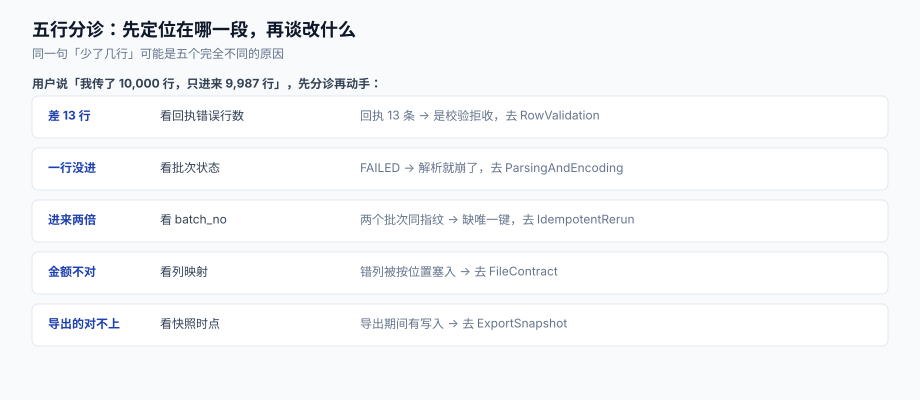

# 常见问题与分诊

批量数据交换的工单有一个共同特征：**报障的人只说结论，不说现场**。「我传了 10,000 行，只进来 9,987 行」这句话里没有任何定位信息——它可能是校验拒收、可能是解析错列、可能是重跑翻倍、也可能是用户在数自己的 Excel 时多数了两行。

这一页先把「一句话报障」分诊到具体的段，再给十二条高频问题的直接答案，最后是线上出问题时的止血顺序。

本页判据族 `BDQ-A` ~ `BDQ-H`，共 8 条。定义表在第六节。

## 一、先分诊，再动手

| 用户的原话 | 第一眼看什么 | 大概率落点 |
| --- | --- | --- |
| 「少了 13 行」 | 回执的 `error_rows` | 有 13 条错误 → [行级校验](../RowValidation/index.md)；回执 0 条 → 往下看 |
| 「一行都没进」 | `import_batch.status` | `FAILED` → [解析与编码](../ParsingAndEncoding/index.md)（编码/表头）；`RECEIVED` → 作业没跑，看[异步作业](../AsyncJob/index.md) |
| 「进来了两倍」 | `select batch_no, count(*) ... group by 1` | 两个批次 → 缺内容哈希幂等，[幂等重跑](../IdempotentRerun/index.md) |
| 「金额不对/列错位」 | 目标表里某一行的值是否像是隔壁列 | 列错位 → [文件契约](../FileContract/index.md)（按位置读取） |
| 「导出的和系统里对不上」 | 导出文件的 `snapshot_ts` 与差异行 | 导出期间有写入 → [导出快照](../ExportSnapshot/index.md) |
| 「作业卡住了」 | `batch_job.status` 与 `phase` | 卡在 `COMMITTING` → 锁等待；卡在 `PARSING` → 文件异常大 |

分诊的关键是**先拿到一个数字**：回执里的 `success_rows` / `error_rows`。没有回执的批量导入，等于没有仪表盘的飞机——这也是为什么回执不是「附加功能」，而是链路的一部分。

## 二、十二条高频问题

**Q1：用户传的文件是 Excel（`.xlsx`），能直接当 CSV 读吗？**
不能。`.xlsx` 是 ZIP 包（魔数 `PK\x03\x04`），`csv.reader` 读出来是二进制垃圾，且**不一定报错**。要么用 `openpyxl` 读，要么让用户「另存为 CSV」。判断类型看魔数，不看扩展名。

**Q2：为什么中文全是乱码，日志里却没有任何错误？**
用户很可能用 GBK 保存（Windows Excel 默认），而代码按 UTF-8 读。诡异之处在于：若代码用了 `errors="replace"`，乱码会变成 `????` 静默入库。做法：严格解码 + 失败给出「第几行第几列」，并支持显式声明编码。

**Q3：`UnicodeDecodeError` 报的 `position 25` 是什么位置？**
字节偏移，不是字符位置。转成行列号再报给用户：读前 25 个字节、按编码切分、数出第几行第几个字符。

**Q4：表头明明叫 `sku`，代码却取不到值？**
九成是 BOM。带 BOM 的 UTF-8 文件，第一个表头是 `'\ufeffsku'`。`print` 出来看不出差别，`repr()` 才能看到。用 `utf-8-sig` 或 `lstrip("\ufeff")`。

**Q5：用户说「我只改了 13 行，为什么其他行被覆盖了？」**
重跑语义没写清。覆盖（upsert）会把文件里出现的行更新，未出现的行不动；但如果代码先 `delete` 再 `insert`，未出现的行就被删了。语义必须三处一致：契约、页面提示、`import_batch.mode`。

**Q6：为什么同一份文件导两次，库里有 20,000 行？**
没有业务唯一键。自增主键每次都不同，唯一约束不触发，所以第二次是纯追加。本机实测：无唯一键 20,000 行；有 `on conflict(biz_no)` 则恒为 10,000 行。

**Q7：加了唯一索引之后，导入变慢了 3 倍，正常吗？**
正常。唯一索引要在写入时维护 B 树，批量写入的代价明显上升。缓解办法：批大小控制在 500~1,000（本机 5 万行：批 100 → 289 ms，批 1,000 → 89 ms）、导入前 `ANALYZE`、必要时用 `COPY` 到临时表再 `INSERT ... SELECT`。

**Q8：用户取消之后，数据还在写，怎么办？**
取消只在**批边界**生效，已提交的批不回滚。要在取消后立刻停止，需要 `cancel_requested` 标志 + 每批检查一次；`kill` 线程会让连接池留下脏状态。

**Q9：导出的 CSV 用 Excel 打开，长数字变成科学计数法 / 身份证号后三位变 0。**
CSV 没有类型，Excel 会自作主张。解决办法：① 导出 xlsx 时把该列设为文本格式；② 或在值前加 `\t`（Excel 会当文本）；③ 或接受现状并在口径页提示「请用文本方式导入」。**这属于容器限制，不是数据错误**，必须在口径页写清。

**Q10：导出百万行 Excel 打不开，是不是程序错了？**
不是。Excel 上限 1,048,576 行 × 16,384 列，超了它不开也不报错。按主键区间分片，文件名 `part-01`，包内放 `README` 说明分片规则。

**Q11：上传一个 20 MB 的 zip 把服务打挂了，怎么防？**
压缩比。本机实测：20 MB 全零文件压成 20,504 字节（**1,023:1**），解压后 20 GB。必须在**解压前**读 ZIP 目录，校验「解压后总字节」与「单文件压缩比」，两者同时设上限。

**Q12：回执里同一行出现三次，是不是重复入账了？**
不是。一行可以有多个错误（`E_REF` + `E_RANGE`），回执按「一错一行」展开，所以 `line_no` 重复。统计失败行数要 `count(distinct line_no)`，不要 `count(*)`。

## 三、止血五步（线上已经出问题时）

| 步 | 动作 | 目的 |
| --- | --- | --- |
| ① | **冻结入口**：把导入接口置为维护或加白名单 | 防止更多脏数据进来；不要急着改代码 |
| ② | **留证**：把批次记录、回执、原始文件都归档（原始文件别删） | 事后复盘与重跑都靠它 |
| ③ | **量化影响**：`select count(*) ... where import_batch_no = ?`，与回执对比 | 确定「多了多少 / 少了多少 / 错在哪几行」 |
| ④ | **定型修复**：优先用「差异重跑」修数据，不要手写 `update` | 手写 SQL 无法回放，也无法解释 |
| ⑤ | **恢复入口**，并补一条验收（P2/P3/P4/P7 里缺的那条） | 同一个坑不踩第二次 |

顺序不能反。最常见的错误是**第 ① 步没做就先去改代码**，改的过程中又有几批脏数据进来，最后连「哪批是错的」都分不清。

## 四、四个容易误判的现象

| 现象 | 看起来像 | 实际是 |
| --- | --- | --- |
| 库里行数比文件行数多 2 | 重复导入 | 文件末尾有空行，被当成两条空记录（`\r\n\r\n`）。解析时跳过「全字段为空」的行，并计入 `skipped_blank` |
| 回执成功数 = 文件行数，但库里少 13 行 | 回执在说谎 | 目标表有唯一键，13 行是**更新**而非新增；`success_rows` 含更新行，`count(*)` 不含。要在回执里区分 `inserted` / `updated` |
| 导出文件比系统少 20 行 | 导出有 bug | 导出期间并发删除；或导出条件带了 `deleted_at is null` 而系统页没带。看 `snapshot_ts` 与过滤条件 |
| 同一份文件两次导入，第二次耗时是第一次的一半 | 第二次没跑 | 幂等返回（命中已有 `batch_no`）。这是**正确行为**，看回执的 `finished_at` 是否与第一次相同 |

最后一条尤其值得记住：**幂等返回和「什么都没做」在表面上完全一样**。所以批次记录必须能被查到，接口要显式返回「这是已有批次」的标志（如 `idempotent_replay: true`）。

## 五、术语表

| 术语 | 含义 | 容易混淆的对象 |
| --- | --- | --- |
| 物理行号（`line_no`） | 文件里的第几行，含表头与注释 | 记录序号（只数数据行） |
| 逻辑记录 | 一条完整数据，可能跨多个物理行 | 文本行（按 `\n` 切出来的） |
| 批次（batch） | 一次上传对应的一条记录 | 作业（job）：执行批次的那次运行 |
| 幂等键 | 让「重复执行」等价于「执行一次」的键 | 唯一键：约束数据的键（通常同一个） |
| 部分成功（partial） | 合法行入账、非法行进回执 | 全成或全败（atomic） |
| 快照（snapshot） | 导出开始那一刻的完整数据视图 | 备份（backup）：用于恢复，不是用于读取 |
| 待修正区（staging） | 存非法行、供用户在线改的表 | 目标表（正式数据） |
| 解压炸弹 | 压缩比极高、解压后极大的文件 | 大文件（本身很大但压缩比正常） |

## 六、本页判据

| 编号 | 看什么现象 | 判成什么 | 不满足时改哪里 |
| --- | --- | --- | --- |
| `BDQ-A` | 是否有回执（含 `success_rows` / `error_rows`）可查 | 只有日志即失败 | 落地回执文件 + 批次汇总字段 |
| `BDQ-B` | 分诊是否能落到「段」而不是「大概是数据问题」 | 无分诊表即失败 | 按第一节建 Runbook |
| `BDQ-C` | 空行是否被显式跳过并计数 | 空行当记录即失败 | 解析时判断「全字段为空」，计 `skipped_blank` |
| `BDQ-D` | 回执是否区分 `inserted` 与 `updated` | 只报 `success_rows` 即失败 | 增加两列计数 |
| `BDQ-E` | 幂等返回是否有显式标志 | 静默返回成功即失败 | 返回 `idempotent_replay: true` |
| `BDQ-F` | 止血顺序是否「先冻结入口、再改代码」 | 先改代码即失败 | 写进 Runbook 并演练 |
| `BDQ-G` | 原始上传文件是否保留且可追溯（TTL 内） | 处理完即删即失败 | 对象存储保留 30~90 天，路径带 `batch_no` |
| `BDQ-H` | 每个已发生的线上问题是否补了一条可执行验收 | 只写「已修复」即失败 | 补进 P1~P8 清单并落 CI |

## 参考资料

- [总览：七段交换链与三个成功定义](../Overview/index.md)（分诊表的理论依据）
- [行级校验与错误回执](../RowValidation/index.md)（`error_rows` 从哪来）
- [导出：快照一致性、分页与流式下载](../ExportSnapshot/index.md)（「导出对不上」的全部原因）
- [实战：一个能跑起来的最小交换链路](../Practice/index.md)（P1~P8 验收清单）
- Microsoft《Excel specifications and limits》：<https://support.microsoft.com/en-us/office/excel-specifications-and-limits-1672b34d-7043-467e-8e27-269d656771c3>
- OWASP《CSV Injection》：<https://owasp.org/www-community/attacks/CSV_Injection>
- Google SRE Book《Managing Incidents》（止血优先于定位）：<https://sre.google/sre-book/managing-incidents/>
