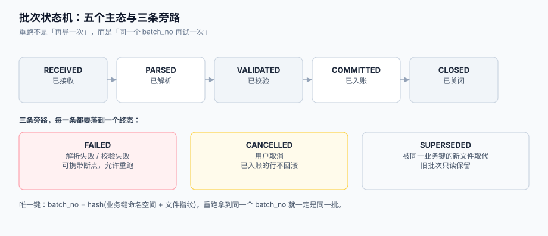

# 幂等重跑、批次状态机与断点

批量导入一定会重跑：网络断了要重传、跑一半服务重启、用户点了两次「导入」、定时任务重叠触发。**「重跑」本身不是问题，问题是重跑之后数据翻倍、或者把已经修正的行又改回旧值**。

幂等要分三层做，缺一层都不成立：请求层（同一个上传不要建两个批次）、批次层（同一批不要跑两遍）、行层（同一行业务键只应该有一份最新值）。这一页把三层拆开讲，并给出批次状态机与断点的落地写法。



本页判据族 `BDI-A` ~ `BDI-H`，共 8 条。定义表在第八节。

## 一、三层幂等，三种键

| 层 | 幂等键 | 防的是 | 键从哪来 |
| --- | --- | --- | --- |
| **请求层** | `Idempotency-Key`（客户端生成）或 `(uploader, file_sha256)` | 用户连点两次「上传」建出两个批次 | 客户端 UUID / 文件内容哈希 |
| **批次层** | `batch_no = sha256(namespace + file_sha256 + contract_version)` | 同一份文件被不同请求再跑一遍 | 由内容推出，不由时间推出 |
| **行层** | 业务唯一键（`sku` / `(sku, effective_date)`） | 同一行被写两次 → 两行数据 | 契约里声明的唯一键组合 |

三层的关系是「**层层收窄**」：请求层拦住重复提交，批次层拦住重复执行，行层拦住重复入账。只做前两层，仍然会出现「两个不同文件包含同一个 SKU」造成的重复；只做第三层，则会出现「同一批次被跑两遍、回执写了两次、错误行翻倍」。

::: danger 注意
1. **不要用时间戳做幂等键**。`batch_no = 20261025100211` 只能保证「不重名」，不能保证「不重复处理」——重传一次就是一个新批次号。
2. **不要用文件名做幂等键**。`商品价目表.xlsx` 每天都叫这个名字，内容却每天不同。
3. **不要用「查询是否已存在」代替唯一约束**。先查再插（check-then-act）在并发下必失：两个请求同时查到「不存在」，然后都插入。
:::

## 二、`batch_no`：由内容推出，不由环境推出

```python [app/batch/identity.py]
import hashlib

def file_sha256(path: str) -> str:
    h = hashlib.sha256()
    with open(path, "rb") as f:
        for chunk in iter(lambda: f.read(1024 * 1024), b""):
            h.update(chunk)
    return h.hexdigest()

def make_batch_no(namespace: str, file_hash: str, contract_version: int) -> str:
    """同一份内容 + 同一版契约 => 同一个批次号；与上传时间、上传人无关。"""
    raw = f"{namespace}|{file_hash}|{contract_version}".encode()
    return "B-" + hashlib.sha256(raw).hexdigest()[:20]
```

三个设计后果，都要接受：

1. **同一份文件重传，拿到同一个 `batch_no`** → 数据库唯一约束直接挡住第二次执行，接口返回上一次的结果（幂等返回）。
2. **内容改一个字节，就是新批次** → 用户改了 13 行再传，是一个新批次，这正是期望的语义。
3. **同一份内容在不同业务域（`namespace`）下是不同批次** → 商品价目表与库存表用同一个模板也不会互相干扰。

本机实测的对照（10,000 行，导入两次）：

| 做法 | 库内行数 | 结论 |
| --- | --- | --- |
| 无唯一键、纯 `insert` | **20,000** | 翻倍 |
| 有 `unique(biz_no)` + `on conflict do update` | **10,000** | 幂等 |
| 有 `unique(batch_no)`，第二次直接拒跑 | 10,000（且不重复处理） | 幂等且省 CPU |

## 三、批次状态机：五个主态 + 三条旁路

```text
RECEIVED ──► PARSED ──► VALIDATED ──► COMMITTED ──► CLOSED
    │           │            │             │
    └───────────┴────────────┴─────────────┴──► FAILED
                                             └──► CANCELLED
                                             └──► SUPERSEDED
```

| 状态 | 进入条件 | 允许的动作 | 不允许 |
| --- | --- | --- | --- |
| `RECEIVED` | 文件落盘、批次记录已建 | 解析、取消 | 入账 |
| `PARSED` | 表头与编码通过 | 校验、取消 | 重复解析（会产生第二份行映射） |
| `VALIDATED` | 全部行校验完成 | 入账、取消 | 修改校验结果 |
| `COMMITTED` | 合法行全部入账 | 写回执 | **再次入账**（幂等约束在这里生效） |
| `CLOSED` | 回执已生成、对账通过 | 只读 | 任何写操作 |
| `FAILED` | 任一段抛不可恢复错误 | 从断点重跑 | 跳过失败段直接入账 |
| `CANCELLED` | 用户取消 | 重跑（新批次或续跑） | 回滚已入账数据 |
| `SUPERSEDED` | 同一业务键出现更新的文件 | 只读查阅 | 回执覆盖 |

**`CANCELLED` 的语义必须写死：已入账的数据不回滚。** 想「取消后一点痕迹都不留」的实现，本质上要求一个跨表的长事务，代价是锁住目标表直到取消完成——批量导入最不该做的事就是长时间锁表。正确的做法是：取消只停止后续批次，已写入的由下一次「差异重跑」或显式清理处理，并在回执里写明「已入账 N 行未回滚」。

## 四、断点：记录「做到哪一行」，而不是「做了几行」

断点有两种写法，只有一种是安全的：

| 写法 | 字段 | 重跑时 | 风险 |
| --- | --- | --- | --- |
| **计数式** | `processed_count = 5000` | 跳过前 5,000 行 | 文件被重新编辑过（哪怕只改了错别字），行号全错位 |
| **指纹式** | `cursor = {file_hash, line_no, batch_no}` | 校验哈希一致后才跳过 | 哈希变了就整批重来（正确行为） |

```sql [db/import_batch.sql]
CREATE TABLE import_batch (
  batch_no        VARCHAR(24) PRIMARY KEY,
  namespace       VARCHAR(64)  NOT NULL,
  file_name       VARCHAR(255) NOT NULL,
  file_sha256     CHAR(64)     NOT NULL,
  template_version INT         NOT NULL,
  mode            VARCHAR(16)  NOT NULL,      -- atomic | partial | staging
  status          VARCHAR(16)  NOT NULL,      -- RECEIVED..CLOSED
  total_rows      INT          NOT NULL DEFAULT 0,
  success_rows    INT          NOT NULL DEFAULT 0,
  error_rows      INT          NOT NULL DEFAULT 0,
  cursor_line_no  INT          NOT NULL DEFAULT 0,
  chunk_size      INT          NOT NULL DEFAULT 500,
  started_at      TIMESTAMPTZ,
  finished_at     TIMESTAMPTZ,
  created_at      TIMESTAMPTZ  NOT NULL DEFAULT now()
);

CREATE UNIQUE INDEX ux_batch_no ON import_batch (batch_no);
CREATE INDEX ix_batch_ns_created ON import_batch (namespace, created_at DESC);
```

续跑的条件写成一个判断，不要散落在各处：

```python [app/batch/resume.py]
def can_resume(batch, current_hash: str) -> bool:
    return (
        batch.status in ("FAILED", "CANCELLED")
        and batch.file_sha256 == current_hash      # 文件没变
        and batch.cursor_line_no > 0               # 确实做过一部分
    )
```

**文件变了就不能续跑**——这一点必须坚持。`cursor_line_no` 是「在第 N 个物理行之后继续」，而文件被人重新编辑后，第 N 行可能是另一条记录。宁可整批重来（有幂等，重来无害），也不要错位续跑（错位后数据看着都合法）。

## 五、并发导入：锁在哪一层

| 场景 | 需要的锁 | 实现 |
| --- | --- | --- |
| 同一 `batch_no` 被两个 worker 同时抢到 | 批次行级锁 | `SELECT ... FOR UPDATE` 或 `UPDATE ... WHERE status='RECEIVED'` 条件更新 |
| 同一业务键的两个**不同**文件同时导入 | 业务键维度的串行 | 分布式锁（`namespace + biz_key`），或让行层 upsert 自然收敛 |
| 导入与在线写入冲突 | 行锁 + 短事务 | 批大小 500、单批事务、避免长事务 |

用条件更新抢批次的写法（不需要额外组件）：

```sql
UPDATE import_batch
   SET status = 'PARSED', started_at = now()
 WHERE batch_no = $1
   AND status   = 'RECEIVED'
RETURNING batch_no;
```

影响行数为 0 就说明**别人已经抢到了**，当前 worker 直接退出——这比「先查再改」可靠，因为它把判断和修改放在了同一条语句里。

## 六、重跑的三种语义，选一个并写进文档

| 语义 | 实现 | 适合 | 用户预期 |
| --- | --- | --- | --- |
| **覆盖**（upsert） | `on conflict (biz_key) do update set ...` | 价目表、主数据 | 「我传的就是最新版」 |
| **追加**（append） | 纯 `insert`，靠批次号去重 | 流水、日志 | 「每次都是一笔新记录」 |
| **差异**（diff） | 只写「有变化」的行，未出现的行不动 | 大批量主数据 | 「只改我传的这几行」 |

最容易出事的是**覆盖与差异混用**：用户以为「这次只传了 13 行修正，其他不动」，系统却按覆盖语义把未出现的行删了或没动（取决于实现），两边理解不同，一个月后才发现一半数据是旧的。

所以语义要写在**三个地方**：契约文档、导入页面的提示文案、批次记录字段（`mode`）。

## 七、一段可验证的幂等实现

```python [app/import/commit.py]
def commit_rows(conn, batch_no: str, rows: list[dict], chunk: int = 500) -> int:
    """按业务键 upsert；返回实际写入(含更新)的行数。"""
    written = 0
    with conn.transaction():
        for i in range(0, len(rows), chunk):
            part = rows[i:i + chunk]
            conn.executemany(
                """
                INSERT INTO product_price (sku, price, currency, effective_date, import_batch_no)
                VALUES (%(sku)s, %(price)s, %(currency)s, %(effective_date)s, %(batch_no)s)
                ON CONFLICT (sku, effective_date)
                DO UPDATE SET price = EXCLUDED.price,
                              currency = EXCLUDED.currency,
                              import_batch_no = EXCLUDED.import_batch_no,
                              updated_at = now()
                """,
                [{**r, "batch_no": batch_no} for r in part],
            )
            written += len(part)
    return written
```

**验收要点**：连续调用两次，`written` 都是 10,000，但库里 `count(*)` 恒为 10,000；同时 `updated_at` 会变——这说明第二次确实执行了，只是收敛到了同一份数据。

## 八、本页判据

| 编号 | 看什么现象 | 判成什么 | 不满足时改哪里 |
| --- | --- | --- | --- |
| `BDI-A` | `batch_no` 是否由内容哈希推出（而非时间戳/文件名） | 用时间或文件名即失败 | 改 `make_batch_no(namespace, sha256, version)` |
| `BDI-B` | 行层是否有业务唯一索引 + upsert | 仅靠「先查再插」即失败 | 建唯一索引，改 `on conflict` |
| `BDI-C` | 批次状态迁移是否只允许状态机里的边 | 任意状态可跳转即失败 | 状态迁移集中在一次 `UPDATE ... WHERE status=` |
| `BDI-D` | 抢批次是否用条件更新（影响行数判定） | 先 `select` 再 `update` 即失败 | 改 `UPDATE ... WHERE status='RECEIVED' RETURNING` |
| `BDI-E` | 断点是否带文件哈希校验 | 只记行数即失败 | `cursor` 里加 `file_sha256`，变了就整批重来 |
| `BDI-F` | 取消语义是否明确「已入账不回滚」 | 取消时回滚已入账数据即失败 | 停止后续批，回执写明未回滚行数 |
| `BDI-G` | 重跑语义（覆盖/追加/差异）是否写进契约、页面提示与批次字段 | 三处不一致即失败 | 统一 `mode` 字段并在页面展示 |
| `BDI-H` | 同一批次并发执行时是否只有一个 worker 生效 | 两个 worker 都入账即失败 | 条件更新抢锁 + 行层唯一约束双保险 |

## 参考资料

- [幂等与状态机工程 · 幂等键](../../IdempotencyStateMachine/IdempotencyKey/index.md)（单次请求的幂等键设计，与本文的批次/行两级互补）
- [行级校验与错误回执](../RowValidation/index.md)（失败率阈值与「部分成功」的策略）
- [异步作业：进度、取消与并发](../AsyncJob/index.md)（状态机在作业系统里的另一种表达）
- PostgreSQL 18 文档《INSERT ... ON CONFLICT》：<https://www.postgresql.org/docs/18/sql-insert.html>
- PostgreSQL 18 文档《Transaction Isolation》（`FOR UPDATE` 与并发写）：<https://www.postgresql.org/docs/18/transaction-iso.html>
- MySQL 8.4 文档《INSERT ... ON DUPLICATE KEY UPDATE》：<https://dev.mysql.com/doc/refman/8.4/en/insert-on-duplicate.html>
