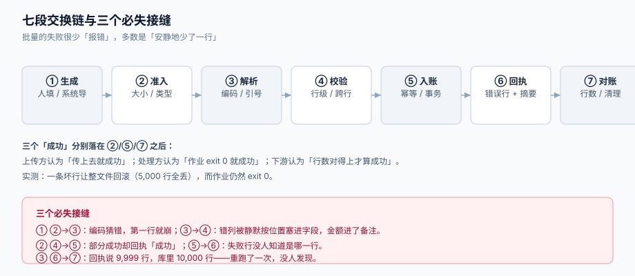

# 总览：七段交换链与三个成功定义

批量数据交换的难点不在「怎么把文件读成数组」，而在于**同一个文件有三个人，各自用不同的标准宣布「成功了」**：上传的人看到进度条走完，处理的人看到作业 `exit 0`，下游的人打开报表只发现少了 13 行。整条链路的设计目标，就是把这三种「成功」**接成同一个判据**。

这一页给整条链的全局图，并回答三个所有批量事故都会回到的问题：**失败发生在哪一段、那一段的失败为什么安静、以及哪一段应该由谁负责**。



本页判据族 `BDO-A` ~ `BDO-H`，共 8 条。定义表在第六节。

## 一、七段链

| # | 段 | 输入 | 输出 | 谁的错算谁的 | 失败是否安静 |
| --- | --- | --- | --- | --- | --- |
| ① | 生成 | 业务规则 + 人 | 一个文件（CSV / XLSX / 分片） | 出货方（可能是你，也可能是客户） | **是**：列顺序错了也能打开 |
| ② | 准入 | 文件字节 | 通过校验的字节流 + 元数据 | 接入层 | 否：能明确拒绝 |
| ③ | 解析 | 字节流 | `(行号, 字段列表)` 的流 | 解析层 | **是**：错列不报错 |
| ④ | 校验 | 行 + 列定义 + 外部引用 | 合法行 + 错误行 | 业务规则 | 半安静：日志有、回执没有 |
| ⑤ | 入账 | 合法行 + 幂等键 | 库里的新行 / 更新行 | 数据层 | **是**：写进去就算对 |
| ⑥ | 回执 | 错误行 + 汇总 | 回执文件 + 批次状态 | 交换平台 | 否：**必须**对用户可见 |
| ⑦ | 对账 | 文件行数 + 库行数 | 守恒结论 + 差集 | 交换平台 | **是**：没人算就没人知道 |

这张表里「失败是否安静」这一列是整页的核心。**安静的四段（①③⑤⑦）加起来，正好覆盖了绝大多数「数据不对」的工单**：生成段列错了、解析段错列了、入账段重了、对账段没人算。

::: danger 注意
1. **不要在第 ⑤ 段「顺手补一下」**。发现某行金额为空就写 0、发现 SKU 不存在就跳过——这类「容错」会让回执永远报 0 条失败，而库里多了一批金额为 0 的脏数据。容错必须显式：要么进「待修正区」，要么进回执。
2. **不要把 ⑥ 做成「只有成功才写回执」**。失败才是回执的主要内容；成功时那份回执的价值在于「用户能拿它去对账」。
3. **不要用 ⑤ 的返回值当作 ⑦ 的结论**。`executemany` 返回 10,000 不代表库里多了 10,000 行——它可能是 10,000 次 upsert 覆盖了同一批行。守恒式必须用**入库后重新 count** 来验，见[实战](../Practice/index.md)。
:::

## 二、三个「成功」，三种读者

同一个批次，三个角色眼里的「成功」完全不同：

| 口径 | 判据 | 谁在看 | 这个判据漏掉什么 |
| --- | --- | --- | --- |
| **传输成功** | HTTP 200 / 文件落到对象存储 | 上传者、前端 | 文件内容可能是空的、可能是旧模板 |
| **处理成功** | 作业状态 `SUCCEEDED` / `exit 0` | 运维、调度 | 处理了 0 行也是 `SUCCEEDED` |
| **数据成功** | `入库行数 = 文件行数 − 失败行数`，且失败行有回执 | 业务、财务、下游系统 | ——（只有这一条是闭环的） |

三者之间只有一种合法关系：

```text
数据成功 = 传输成功 ∧ 处理成功 ∧ 行数守恒 ∧ 失败行可追溯
```

少了任何一项，「成功」就退化成一句口头承诺。而工程上最常见的写法恰恰是**只实现了前两项**：接口返回 `{code: 0}`、作业日志打一行 `import finished`，第三项从来没有人算。

::: tip 一条口径纪律
**批次的最终状态只能由行数守恒推出，不能由异常是否抛出来推出**。没有异常只说明「代码跑完了」，不说明「数据进去了」——本机实测里，一条坏行让整批回滚（入账 0 行）时，异常被 `try/except` 吃掉，作业状态依然是成功。
:::

## 三、七个必失点，各自的读数

这七条都在专题首页列过，这里给出**每一处为什么会发生、以及在本机复现出来的量级**：

1. **按逗号切分**。RFC 4180 允许字段用双引号包裹、内部含逗号与换行。本机造 5,000 行（其中 75% 的备注列含逗号/引号/换行）：按 `split(',')` 切分 **3,724 行错列（74.5%）**，`csv.reader` 错 **0** 行；同一份文件的**物理行数 6,233、逻辑行数 5,001**——差出来的 1,232 行全是字段内换行。
2. **编码猜错**。GBK 文件按 UTF-8 读，本机在**第 25 个字节**就抛错（首个中文字符）；而带 BOM 的文件不会抛错，表头会静默变成 `'\ufeffid'`，`row['id']` 直接 `KeyError`——如果代码用的是下标 `row[0]`，则连 `KeyError` 都没有，脏值一路写进库。
3. **事务粒度选错**。5,000 行里第 4,999 行非法：整批一个事务 → 入账 **0 行**；批 500 → **9,500 行**；批 100 → **9,900 行**。事务粒度决定了「一个坏行毁掉多少好数据」。
4. **没有业务唯一键**。同一份 10,000 行导两次：无唯一键 → **20,000 行**；`on conflict(biz_no) do update` → **10,000 行**。
5. **导出分页漂移**。20,000 行导出期间并发删 20 条 → offset 分页**漏 20 行（0.1%）**、并多读 20 条新行；按可变键 `updated_at` 排序 + 20 次更新 → 反过来**重复 20 行**（unique 19,980）。
6. **全量载入 + 无上限**。4.29 MB 的 10 万行 CSV：全量载入峰值 **27,556 KB**，流式 **62 KB**（约 444 倍）；20 MB 全零文件压成 **20,504 字节**（1,023:1），说明「按压缩后大小限制上传」拦不住解压炸弹。
7. **导出不做公式前缀处理**。20,000 个字段里 **522 个（2.61%）**以 `= + - @` 开头；加单引号后归零，但代价是 `+86 13800138000` 和 `-5% 折扣` 被改坏。

## 四、一次导入的完整时间线

以「运营上传 10,000 行商品价目表」为主线，把七段链放进时间里看：

| 时刻 | 动作 | 读了什么 | 写了什么 | 关键风险 |
| --- | --- | --- | --- | --- |
| T0 | 上传 | 文件字节 + 模板声明 | `import_batch`（`RECEIVED`） | 文件指纹没算，重传就是新批次 |
| T1 | 准入 | 魔数、大小、行数、压缩比 | 批次元数据 | 只查扩展名 → 解压炸弹 |
| T2 | 解析 | 编码、表头、列定义 | 逐行 `(line_no, fields)` | BOM 未剥离 → 全列取空 |
| T3 | 校验 | 类型、枚举、引用、唯一 | `import_error` | 一行多错只报第一个 → 用户改 3 轮 |
| T4 | 入账 | 合法行 + 业务键 | 目标表（upsert） | 无唯一键 → 重跑翻倍 |
| T5 | 回执 | 错误行 + 行数 | 回执文件 + `PARTIAL`/`SUCCEEDED` | 回执与库不同源 → 数字对不上 |
| T6 | 对账 | `文件行数` 与 `count(*)` 差值 | 守恒结论 | 差集没人算 → 下个月才发现 |

T4 那一行值得单独说：**入账的幂等键必须落在业务键上（如 `sku`），而不是落在自增主键上**。落在主键上时，同一份文件第二次导入会得到一批新 ID，唯一约束不会触发，数据翻倍；落在业务键上时，第二次导入只是一次覆盖写——**这正是「重跑」应该有的语义**。

## 五、四问决策

在写第一行导入代码前，先回答这四个问题，答案会决定后面所有设计：

| 问题 | 选项 | 选错的代价 |
| --- | --- | --- |
| **一个坏行怎么办？** | 全批回滚 / 部分成功 + 回执 / 进待修正区 | 全批回滚：一个错字让 10,000 行白干；部分成功：用户以为全进了 |
| **重跑的语义是什么？** | 覆盖（upsert）/ 追加 / 丢弃重来 | 追加：数据翻倍；丢弃重来：已修正的行被旧文件覆盖回去 |
| **导出要「实时」还是「快照」？** | 实时分页 / 快照 + keyset | 实时分页：0.1% 的漏行与重复，且无法复现 |
| **上限是多少？** | 行数上限 / 字节上限 / 解压后上限 | 只限压缩包大小：1,023:1 的压缩比让 20 MB 变成 20 GB |

::: tip 一条判断标准
如果一个问题**在需求评审时没有答案**，它最后一定变成代码里某个 `if` 的默认分支——而这个默认分支没人测过、没人记得。批量交换里绝大多数事故都出自这种「没答案就默认」：默认跳过坏行、默认追加、默认实时分页。
:::

## 六、本页判据

| 编号 | 看什么现象 | 判成什么 | 不满足时改哪里 |
| --- | --- | --- | --- |
| `BDO-A` | 是否同时存在「传输成功 / 处理成功 / 数据成功」三个可观测信号 | 缺「数据成功」即失败：事故不可发现 | 补行数守恒检查，写入批次汇总 |
| `BDO-B` | 批次最终状态是否由行数守恒推出 | 由「无异常」推出即失败 | 状态机改为按 `成功 + 失败 = 总数` 判定 |
| `BDO-C` | 解析是否使用符合 RFC 4180 的解析器（而非字符串切分） | 用 `split` 即失败：错列静默 | 换 `csv` / `OpenCSV` / `encoding/csv` 等 |
| `BDO-D` | 入账幂等键是否落在业务键上 | 落在自增主键即失败：重跑翻倍 | 建业务键唯一索引 + upsert |
| `BDO-E` | 事务粒度是否显式声明（整批 / 分批 / 逐行） | 未声明即失败：回滚范围不可预期 | 在批次表记录 `chunk_size`，并按批提交 |
| `BDO-F` | 导出是否记录快照时点与稳定排序键 | 缺一即失败：结果不可复现 | 记录 `snapshot_ts`，按不可变键 keyset 分页 |
| `BDO-G` | 上传限制是否包含解压后大小与行数 | 只限字节数即失败：解压炸弹 | 加「解压后字节上限 + 行数上限 + 压缩比上限」 |
| `BDO-H` | 失败行是否能指回「文件的第几行」 | 只能给「第 N 条记录」即失败 | 解析器保留物理行号，错误表存 `line_no` |

## 参考资料

- [文件契约：模板、列定义与版本](../FileContract/index.md)（第 ① 段的约定）
- [解析与编码：编码嗅探、引号与注入面](../ParsingAndEncoding/index.md)（第 ③ 段的全部坑）
- [行级校验与错误回执](../RowValidation/index.md)（第 ④⑥ 段）
- [幂等重跑、批次状态机与断点](../IdempotentRerun/index.md)（第 ⑤ 段）
- [导出：快照一致性、分页与流式下载](../ExportSnapshot/index.md)（反方向的第 ③⑦ 段）
- RFC 4180（CSV 格式的事实标准）：<https://www.rfc-editor.org/rfc/rfc4180>
- Microsoft《Excel specifications and limits》：<https://support.microsoft.com/en-us/office/excel-specifications-and-limits-1672b34d-7043-467e-8e27-269d656771c3>
- Fowler, *Patterns of Enterprise Application Architecture*（Unit of Work / Identity Map：事务粒度与身份判定的经典讨论）
