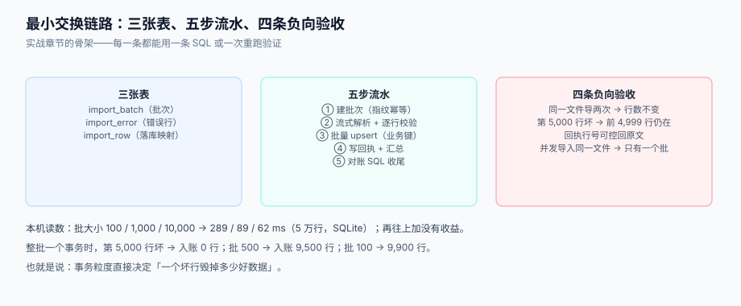

# 实战：一个能跑起来的最小交换链路

前面八页讲的是「每一段为什么这么设计」，这一页把它们串成一条能跑、能验收、能被别人照着重做的最小链路：**接收一个商品价目表 CSV，校验、入账、出回执、导出对账文件**。

它刻意做小：三张表、五个步骤、八条验收。凡是这一页没写的（鉴权、页面、通知），都是「接上去就行」的部分，不影响链路的正确性。



本页判据族 `BDE-A` ~ `BDE-H`，共 8 条。定义表在第八节。

::: info 版本与环境
- Python **3.13**（标准库 `csv` / `hashlib` / `zipfile`），数据库 **PostgreSQL 18**（示例 DDL 用 `timestamptz`；换成 MySQL 8.4 时把 `on conflict` 改为 `on duplicate key update`）。
- 本页所有读数在 macOS + Python 3.13.12 + SQLite 3（内存库）上跑出，**不是生产压测**；SQLite 与 PostgreSQL 的绝对耗时不可直接比较，比例关系可参考。
- 完整实现约 **600~800 行**（含校验器与回执生成），本节给出结构与关键片段。
:::

## 一、S1 表结构：三张表 + 一张目标表

```sql [db/schema.sql]
-- 批次：一次上传一行，batch_no 由内容哈希推出
CREATE TABLE import_batch (
  batch_no         VARCHAR(24) PRIMARY KEY,
  namespace        VARCHAR(64)  NOT NULL,
  file_name        VARCHAR(255) NOT NULL,
  file_sha256      CHAR(64)     NOT NULL,
  template_version INT          NOT NULL,
  mode             VARCHAR(16)  NOT NULL DEFAULT 'partial',
  status           VARCHAR(16)  NOT NULL,
  total_rows       INT          NOT NULL DEFAULT 0,
  success_rows     INT          NOT NULL DEFAULT 0,
  error_rows       INT          NOT NULL DEFAULT 0,
  cursor_line_no   INT          NOT NULL DEFAULT 0,
  created_at       TIMESTAMPTZ  NOT NULL DEFAULT now()
);

-- 错误行：一行多错就多行，line_no 是文件物理行号
CREATE TABLE import_error (
  id        BIGSERIAL PRIMARY KEY,
  batch_no  VARCHAR(24) NOT NULL REFERENCES import_batch(batch_no),
  line_no   INT         NOT NULL,
  column_nm VARCHAR(64) NOT NULL,
  code      VARCHAR(32) NOT NULL,
  value     TEXT,
  hint      TEXT
);
CREATE INDEX ix_import_error_batch ON import_error (batch_no, line_no);

-- 目标表：业务唯一键 (sku, effective_date)
CREATE TABLE product_price (
  id              BIGSERIAL PRIMARY KEY,
  sku             VARCHAR(32)  NOT NULL,
  price           NUMERIC(12,2) NOT NULL CHECK (price >= 0),
  currency        CHAR(3)      NOT NULL,
  effective_date  DATE         NOT NULL,
  import_batch_no VARCHAR(24)  NOT NULL,
  updated_at      TIMESTAMPTZ  NOT NULL DEFAULT now(),
  CONSTRAINT ux_price_sku_date UNIQUE (sku, effective_date)
);
```

三个设计选择值得说明：

1. **`import_batch` 不带自增主键**，直接用 `batch_no`（内容哈希）做主键——它天然唯一，且「同一份文件重传」会自动撞主键，幂等在数据库层就成立。
2. **`import_error.line_no` 不加唯一约束**——一行可以有多个错误，这正是回执要的表达能力。
3. **目标表的唯一键是业务组合键**，不是 `(sku)`。价目表允许多个生效日期，历史价格要保留；`(sku, effective_date)` 才是真正的业务身份。

## 二、S2 契约：一份最小可用的列定义

```yaml [contracts/product_price.v3.yaml]
version: 3
header_row: 1
columns:
  - { name: sku,            label: 商品编码, type: string,        required: true,  unique_in_file: true, normalize: [trim, upper] }
  - { name: name,           label: 商品名称, type: string,        required: true,  max_length: 120 }
  - { name: price,          label: 单价,     type: decimal(12,2), required: true,  min: 0, unit: CNY }
  - { name: currency,       label: 币种,     type: string,        required: true,  enum: [CNY, USD, HKD] }
  - { name: effective_date, label: 生效日期, type: date,          required: true,  format: "%Y-%m-%d" }
  - { name: on_sale,        label: 是否在售, type: boolean,       required: false, default: true }
```

列定义的细节见[文件契约](../FileContract/index.md)；这里只强调一句：**`unique_in_file` 与 `UNIQUE (sku, effective_date)` 是两个不同的判据**——前者查「文件里有没有重复行」，后者查「库里有没有冲突」。

## 三、S3 导入五步

```python [app/import/run.py]
def run_import(path: str, namespace: str, contract, db) -> str:
    # ① 建批次（内容哈希 => 天然幂等）
    h = file_sha256(path)
    batch_no = make_batch_no(namespace, h, contract.version)
    if db.batch_exists(batch_no):
        return batch_no                       # 幂等返回：已存在就不重跑
    db.create_batch(batch_no, path, h, contract)

    # ② 解析 + 逐行校验（流式，不整份载入）
    meta, reader = open_table(path)
    valid, errors, seen = [], [], {}
    line_no = meta.line_no
    for row in reader:
        start = line_no + 1
        line_no = reader.line_num
        rec = dict(zip([c.name for c in contract.columns], row))
        errs = validate_row(start, rec, contract)
        if not errs:
            errs = check_dup_in_file(start, rec, seen, contract)   # L4：批内重复
        if errs:
            errors.extend(errs)
        else:
            valid.append({**rec, "_line_no": start})

    # ③ 引用校验（批量化：一次 IN 查询）
    ref_errs = check_refs(valid, db)          # 返回 {line_no: [RowError]}
    for ln, es in ref_errs.items():
        errors.extend(es)
    valid = [r for r in valid if r["_line_no"] not in ref_errs]

    # ④ 入账（分批事务 + 业务键 upsert）
    written = commit_rows(db.conn, batch_no, valid, chunk=500)

    # ⑤ 回执 + 对账（守恒式）
    db.save_errors(batch_no, errors)
    total = len(valid) + len({e.line_no for e in errors})
    db.finish_batch(batch_no, total=total, success=len(valid), error=len({e.line_no for e in errors}))
    write_receipt(batch_no, path, total, len(valid), errors)
    return batch_no
```

四个容易被写错的地方：

| 位置 | 常见写法 | 为什么错 | 正确做法 |
| --- | --- | --- | --- |
| ② 行号 | `enumerate(reader, 1)` | 字段内换行时，行号与 Excel 错位 | `reader.line_num`（物理行号） |
| ③ 引用 | 每行 `select` 一次 | 1 万行 = 1 万次查询 | 收集键 → 分批 `IN` |
| ④ 事务 | 整个文件一个事务 | 一条坏行回滚全部（实测入账 0 行） | 每 500 行提交一次 |
| ⑤ 计数 | `len(errors)` 当失败行数 | 一行多错会被重复计数 | 用 `len({e.line_no})` |

## 四、S4 回执：两张 CSV + 一条守恒式

```python [app/import/receipt.py]
import csv

def write_receipt(batch_no, file_name, total, success, errors):
    err_rows = len({e.line_no for e in errors})
    with open(f"/data/receipts/{batch_no}.csv", "w", encoding="utf-8-sig", newline="") as f:
        w = csv.writer(f)
        w.writerow(["batch_no", "file_name", "total_rows", "success_rows", "error_rows", "error_rate"])
        w.writerow([batch_no, file_name, total, success, err_rows, f"{err_rows/total:.2%}"])
        w.writerow([])
        w.writerow(["line_no", "column", "code", "value", "hint"])
        for e in sorted(errors, key=lambda x: (x.line_no, x.column)):
            w.writerow([e.line_no, e.column, e.code, e.value, e.hint])
```

回执同样是「导出」，所以同样要防公式注入：`hint` 里可能出现用户填的内容，以 `=` 开头时加单引号——见[解析与编码](../ParsingAndEncoding/index.md)第五节。

## 五、S5 导出一份可解释的对账文件

```python [app/export/recon.py]
def export_recon(conn, batch_no: str, out_path: str):
    snapshot_ts = conn.query_one("select now() as ts")["ts"]
    with open(out_path, "w", encoding="utf-8-sig", newline="") as f:
        w = csv.writer(f)
        w.writerow(["# snapshot_ts", snapshot_ts.isoformat()])
        w.writerow(["# batch_no", batch_no])
        w.writerow(["sku", "price", "currency", "effective_date", "updated_at"])
        last = ""
        while True:
            rows = conn.query(
                """select sku, price, currency, effective_date, updated_at
                     from product_price where sku > %s order by sku limit 1000""", (last,))
            if not rows:
                break
            for r in rows:
                w.writerow([r["sku"], r["price"], r["currency"], r["effective_date"], r["updated_at"]])
            last = rows[-1]["sku"]
```

按 `sku` 做 keyset（业务键唯一），不用 offset。文件头两行就是「口径页」的最小版本——**没有这两行，这个文件三个月后没人能解释**。

## 六、P1~P8 验收清单

每一条都是「一条 SQL / 一次重跑 / 一次 diff」，不需要看日志：

| # | 验收项 | 操作 | 预期 |
| --- | --- | --- | --- |
| P1 | 正常导入 | 导 10,000 行合法文件 | 回执 `success_rows=10000`、`error_rows=0`；`select count(*) from product_price` = 10,000 |
| P2 | **重跑幂等** | 同一文件再导一次 | 返回**同一个** `batch_no`；库内仍 10,000 行；`import_batch` 只有 1 行 |
| P3 | **部分成功** | 第 4,999 行金额写 `-3` | 入账 9,999 行；回执 1 条 `E_RANGE`，`line_no` 指向该行 |
| P4 | **坏行不毁好行** | 同上，但事务粒度设 100 | 入账 9,900 行（对比整批事务：0 行） |
| P5 | 编码 | 用 GBK 保存的中文文件 | 解析成功，`encoding=gb18030`；中文不乱码 |
| P6 | BOM | 用带 BOM 的 UTF-8 文件 | 表头首列是 `sku`（不是 `\ufeffsku`），无 `E_HEADER_MISSING` |
| P7 | 导出静止 | 导出期间并发插入 100 行 | 导出文件行数 = 开始时的行数；`snapshot_ts` 早于插入时间 |
| P8 | 守恒 | 任意批次 | `total_rows = success_rows + error_rows` 恒成立；且 `success_rows` = 库内该批次行数 |

P3 与 P4 是核心：**正常路径永远测不到「事务粒度选错」**。P7 同理，只有在导出时并发写才能暴露。

## 七、性能读数：批大小怎么定

本机（SQLite 内存库，5 万行 4 列）：

| 批大小 | 耗时 | 相对 |
| --- | --- | --- |
| 100 | 289 ms | 1.00× |
| 1,000 | 89 ms | **3.25×** 快 |
| 10,000 | 62 ms | 4.66× 快 |

结论：**1,000 是拐点**。从 100 加到 1,000 提速 3.25 倍，从 1,000 加到 10,000 只再快 1.4 倍，但一个坏行毁掉的行数从 1,000 变成 10,000。所以默认 `chunk_size=500~1000`，而不是越大越好。

另外两组参考读数：

- 20,000 行表上 `count(*)` 约 **0.03 ms**，全表扫描取全部列约 **13.5 ms** —— 「对账 SQL」很便宜，不要为了省它而省略验收。
- 4.29 MB / 10 万行 CSV，全量载入峰值 **27,556 KB**，流式 **62 KB** —— 差距 444 倍，这一条决定了你能否支撑并发上传。

## 八、本页判据

| 编号 | 看什么现象 | 判成什么 | 不满足时改哪里 |
| --- | --- | --- | --- |
| `BDE-A` | 是否有批次表且 `batch_no` 为主键（内容哈希） | 自增主键 + 时间戳编号即失败 | 改 `batch_no` 为主键，由哈希生成 |
| `BDE-B` | 目标表是否有业务唯一键 + upsert | 仅自增主键即失败 | 加 `UNIQUE (sku, effective_date)`，改 `on conflict` |
| `BDE-C` | 事务粒度是否可配置且默认 ≤1,000 | 整批一个事务即失败 | `chunk_size` 配置，按批提交 |
| `BDE-D` | 回执行号是否用物理行号，且一错一行 | 用记录序号即失败 | `reader.line_num`，错误表按 `(line_no, column)` 展开 |
| `BDE-E` | 失败行数是否按去重行号统计 | `len(errors)` 直接计数即失败 | `len({e.line_no})` |
| `BDE-F` | 导出是否带 `snapshot_ts` 与 keyset 分页 | 无快照 / 用 offset 即失败 | 见第五节 |
| `BDE-G` | 是否有 P2/P3/P4/P7 四条负向验收 | 只测正常路径即失败 | 把四条写进 CI 或验收清单 |
| `BDE-H` | 守恒式 `total = success + error` 是否可作为 SQL 断言 | 只能人工核对即失败 | 批次汇总字段 + 一条 `select ... as balanced` |

## 参考资料

- [文件契约：模板、列定义与版本](../FileContract/index.md)
- [解析与编码：编码嗅探、引号与注入面](../ParsingAndEncoding/index.md)
- [行级校验与错误回执](../RowValidation/index.md)
- [幂等重跑、批次状态机与断点](../IdempotentRerun/index.md)
- [导出：快照一致性、分页与流式下载](../ExportSnapshot/index.md)
- PostgreSQL 18 文档《COPY》：<https://www.postgresql.org/docs/18/sql-copy.html>
- Python 文档《csv》：<https://docs.python.org/3/library/csv.html>
- 项目侧的同类实践：[事件驱动订单与履约中心 · 批量化主写路径](../../../../project/Complete/EventOrderHub/BatchWrite/index.md)
